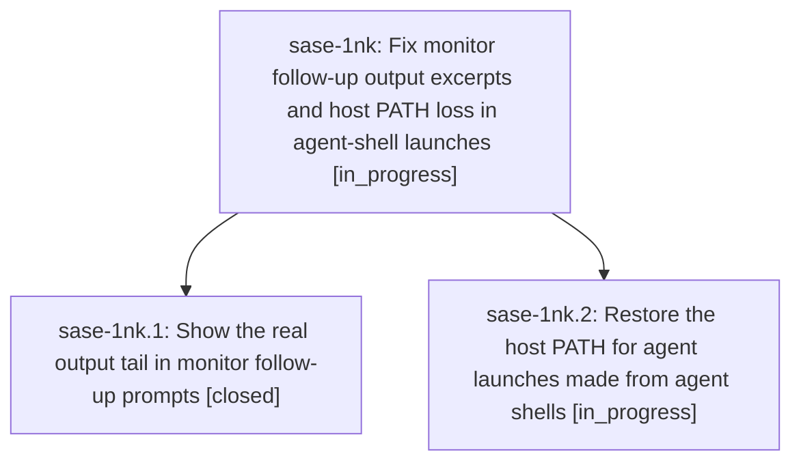

# Bead: sase-1nk — Fix monitor follow-up output excerpts and host PATH loss in agent-shell launches

[Bead Pages](../README.md) / sase-1nk

**Status:** ◐ in_progress · **Type:** ▸ plan · **Tier:** epic
**Owner:** `bryanbugyi34@gmail.com` · **Created by:** [bbugyi200.athena.133](https://github.com/sase-org/sase--agents/blob/main/sessions/bbugyi200.athena.133.md) · **Assignee:** `sase-1nk.land`
**Created:** 2026-10-23 09:29:10 EDT
**Plan:** [202610/monitor\_followup\_output\_and\_host\_path.md](https://github.com/sase-org/sase--plans/blob/main/202610/monitor_followup_output_and_host_path.md)

## Description

Monitor follow-up prompts show the real tail of the monitored command's output, and agents launched from inside an agent's harness shell (monitor follow-ups, handoffs, nested launches) resolve provider CLIs with the same PATH a host launch would have.

## Phases

| Bead | Title | Status | Size | Created | Agents | Commits |
|---|---|---|---|---|---:|---:|
| [sase-1nk.1](sase-1nk.1.md) | Show the real output tail in monitor follow-up prompts | ✓ closed | small | 2026-10-23 | 1 | 1 |
| [sase-1nk.2](sase-1nk.2.md) | Restore the host PATH for agent launches made from agent shells | ◐ in_progress | medium | 2026-10-23 | 1 | 0 |

## Lineage

## Agents

| Agent | Bead | Commits |
|---|---|---:|
| [bbugyi200.athena.sase-1nk.1](https://github.com/sase-org/sase--agents/blob/main/agents/bbugyi200.athena.sase-1nk.1/README.md) | [sase-1nk.1](sase-1nk.1.md) | 1 |
| [bbugyi200.athena.sase-1nk.2](https://github.com/sase-org/sase--agents/blob/main/agents/bbugyi200.athena.sase-1nk.2/README.md) | [sase-1nk.2](sase-1nk.2.md) | 0 |
| [bbugyi200.athena.sase-1nk.land](https://github.com/sase-org/sase--agents/blob/main/agents/bbugyi200.athena.sase-1nk.land/README.md) | [sase-1nk](README.md) | 0 |

## Commits

| Repo | Commit | Subject | Bead | Committed |
|---|---|---|---|---|
| sase | [`def4c66`](https://github.com/sase-org/sase/commit/def4c66ce37b1999e656331cd415d21675a51f04) | fix(monitor): show retained output tail in follow-ups | [sase-1nk.1](sase-1nk.1.md) | 2026-10-23 10:02:19 EDT |
