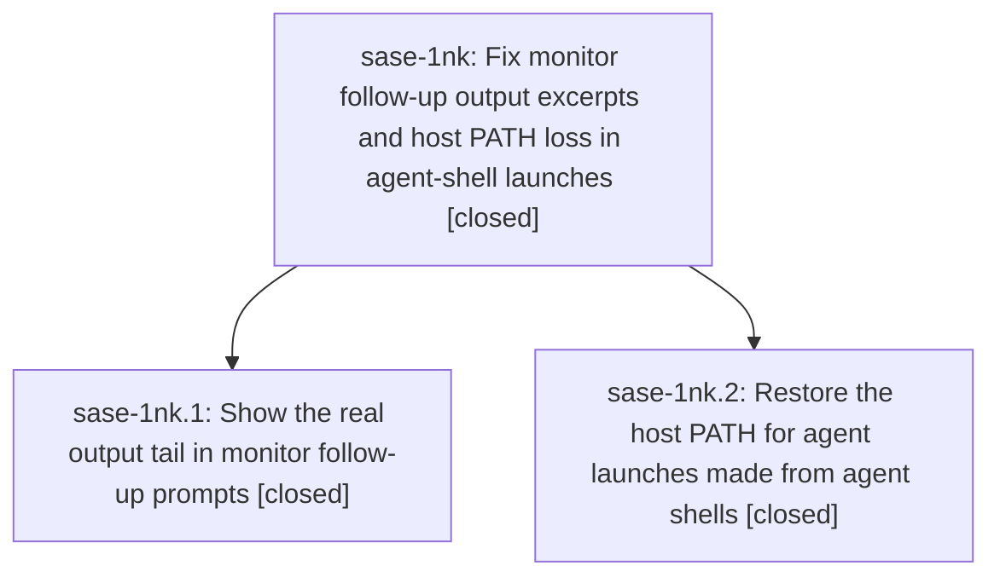

# Bead: sase-1nk — Fix monitor follow-up output excerpts and host PATH loss in agent-shell launches

[Bead Pages](../README.md) / sase-1nk

**Status:** ✓ closed · **Resolution:** done · **Type:** ▸ plan · **Tier:** epic
**Owner:** `bryanbugyi34@gmail.com` · **Created by:** [bbugyi200.athena.133](https://github.com/sase-org/sase--agents/blob/main/sessions/bbugyi200.athena.133.md) · **Assignee:** `sase-1nk.land`
**Created:** 2026-10-23 09:29:10 EDT · **Closed:** 2026-10-23 10:48:36 EDT
**Plan:** [202610/monitor\_followup\_output\_and\_host\_path.md](https://github.com/sase-org/sase--plans/blob/main/202610/monitor_followup_output_and_host_path.md)

<!-- sase:links:start -->

## Links

| Relation | Artifact | Why |
| --- | --- | --- |
| implemented-by | [plan:202610/monitor_followup_output_and_host_path.md][1] | derived from the plan's `bead_id:` frontmatter field |

[1]: https://github.com/sase-org/sase--plans/blob/main/202610/monitor_followup_output_and_host_path.md

<!-- sase:links:end -->

## Description

Monitor follow-up prompts show the real tail of the monitored command's output, and agents launched from inside an agent's harness shell (monitor follow-ups, handoffs, nested launches) resolve provider CLIs with the same PATH a host launch would have.

## Notes

[2026-10-23T14:18:42Z · sase-1nk.land] LANDING AUDIT / FOLLOW-UP TRIAGE: Read the epic, both children, every child note, approved plan plan:202610/monitor_followup_output_and_host_path.md, and commits def4c66ce3 (sase-1nk.1) and ed321c5434 (sase-1nk.2). Host-first deduplicated PATH restoration is after hygiene and before explicit extra_env; runner main stamps the snapshot; proc supervisor PATH is unchanged. Active/rotated fallback ranges, legacy null-range reads, and reverse tail selection are present. Refreshed origin/master: since epic creation and since first epic commit there are only these two epic commits, so no integration drift. No epic-symbol entries; no parent_bead link. Remaining scope: phase monitor-output-tail explicitly required an end-to-end proc-backed settlement-to-composed-prompt regression, but current settlement tests replace launch_followup_agent and the new tail test calls frozen_output_text directly. Plan a small tale to add this coverage, fix any epic-owned defect it exposes, verify, and finish this epic closeout in the coder turn. Focused pytest audit could not collect because this workspace venv lacks sase_core_rs; no new passing test claim. PROPOSED FOLLOW-UP outcomes: sase-1nk.1 note #1 and sase-1nk.2 note #1 are one import-budget issue, corroborated on existing ready task sase-1ic via /sase_new_task. Declined two new tasks because they duplicate that existing node/remediation; reviewed recent CI tasks and active epics, with no credible causal active-epic link. Phase reports independently show clean-base 3529 vs 3527, unrelated to this epic. The transient failures mentioned in completion notes passed focused reruns per those notes; they add no distinct proposal.

[2026-10-23T14:48:36Z · sase-1nk.land] Landing complete for sase-1nk.

Implementation commits reviewed: def4c66ce3 (sase-1nk.1: proc-backed retained-log ranges, legacy null-range reads, tail excerpts) and ed321c5434 (sase-1nk.2: SASE_HOST_PATH_SNAPSHOT plus host-first restore on nested launches). Preserved reviewer decisions path_merge_order=host_first and monitored_command_path=no; monitored commands keep the spawning shell PATH.

Added tests/monitor/test_monitor_proc_settlement_followup_prompt.py: real settle_monitor_artifacts freeze/persist, then launch_followup_agent/compose_followup_prompt, capturing the prompt at spawn. Oversized failed log with early sentinel and final fail summary; live log poisoned after freeze so capture fallback cannot pass. Result: the Last-N section contains FAIL_SUMMARY/# fail 5, omits the early sentinel and CAPTURE_FALLBACK_SENTINEL, and has no retained-output gap. Focused pytest: 50 passed (new regression, diagnostics/tail, launch-env, env-hygiene, runner-bootstrap).

Drift: refreshed origin/master still ed321c5434; no intervening commits since the epic pair. Epic-symbols: none.

sase tool run check 4eb9f3fa96e95278ccf0f473f4be70e1: lint/SASE validation passed; scoped tests escalated to full suite; 57192 passed, 17 skipped, 1 failed. The failure is KNOWN TUI import budget 3529 vs 3527 cap (test_tui_app_import_stays_under_startup_budget), verdict no_new_failures. That is the same independently established issue as sase-1nk.1 note #1 and sase-1nk.2 note #1; both were corroborated onto ready task sase-1ic and no new task was created because they duplicate that node. Cap not raised here.

No parent_bead. Both children remain closed/done.

## Phases

| Bead | Title | Status | Size | Created | Agents | Commits |
|---|---|---|---|---|---:|---:|
| [sase-1nk.1](sase-1nk.1.md) | Show the real output tail in monitor follow-up prompts | ✓ closed | small | 2026-10-23 | 1 | 1 |
| [sase-1nk.2](sase-1nk.2.md) | Restore the host PATH for agent launches made from agent shells | ✓ closed | medium | 2026-10-23 | 1 | 1 |

## Lineage

## Agents

| Agent | Bead | Commits |
|---|---|---:|
| [bbugyi200.athena.sase-1nk.1](https://github.com/sase-org/sase--agents/blob/main/agents/bbugyi200.athena.sase-1nk.1/README.md) | [sase-1nk.1](sase-1nk.1.md) | 1 |
| [bbugyi200.athena.sase-1nk.2](https://github.com/sase-org/sase--agents/blob/main/agents/bbugyi200.athena.sase-1nk.2/README.md) | [sase-1nk.2](sase-1nk.2.md) | 1 |
| [bbugyi200.athena.sase-1nk.land](https://github.com/sase-org/sase--agents/blob/main/sessions/bbugyi200.athena.sase-1nk.land.md) | [sase-1nk](README.md) | 1 |

## Commits

| Repo | Commit | Subject | Bead | Committed |
|---|---|---|---|---|
| sase | [`def4c66`](https://github.com/sase-org/sase/commit/def4c66ce37b1999e656331cd415d21675a51f04) | fix(monitor): show retained output tail in follow-ups | [sase-1nk.1](sase-1nk.1.md) | 2026-10-23 10:02:19 EDT |
| sase | [`ed321c5`](https://github.com/sase-org/sase/commit/ed321c5434bba31c7636bdc8dadc80afba040a7f) | fix(agent-launch): restore host PATH for nested launches | [sase-1nk.2](sase-1nk.2.md) | 2026-10-23 10:05:29 EDT |
| sase | [`7552ebe`](https://github.com/sase-org/sase/commit/7552ebe590c07d4f9bf5fd62bf583a30d79c31b3) | test(monitor): prove proc-backed follow-up prompts show the output tail | [sase-1nk](README.md) | 2026-10-23 10:50:56 EDT |
