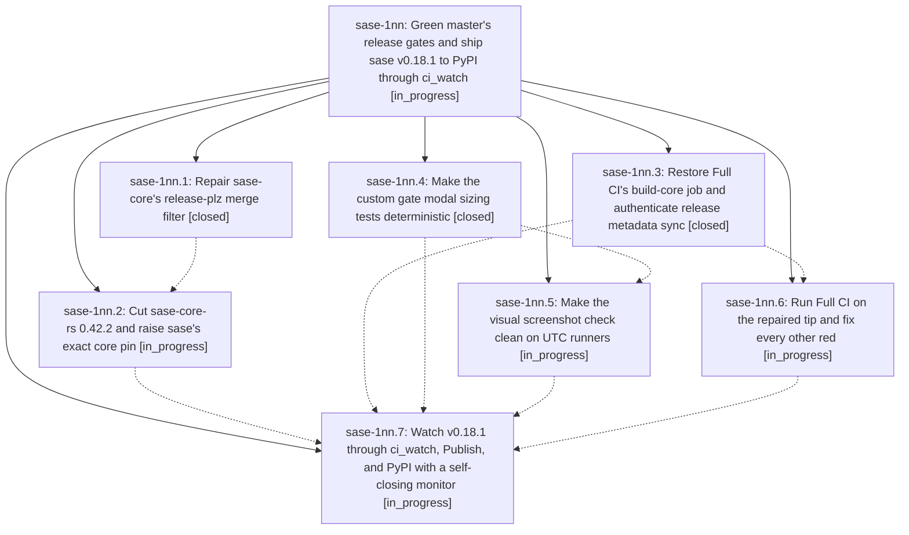

# Bead: sase-1nn — Green master's release gates and ship sase v0.18.1 to PyPI through ci\_watch

[Bead Pages](../README.md) / sase-1nn

**Status:** ◐ in_progress · **Type:** ▸ plan · **Tier:** epic
**Owner:** `bryanbugyi34@gmail.com` · **Created by:** [bbugyi200.athena.137](https://github.com/sase-org/sase--agents/blob/main/sessions/bbugyi200.athena.137.md) · **Assignee:** `sase-1nn.land`
**Created:** 2026-10-23 11:30:05 EDT
**Plan:** [202610/v0\_18\_1\_release.md](https://github.com/sase-org/sase--plans/blob/main/202610/v0_18_1_release.md)

<!-- sase:links:start -->

## Links

| Relation | Artifact | Why |
| --- | --- | --- |
| implemented-by | [plan:202610/v0_18_1_release.md][1] | derived from the plan's `bead_id:` frontmatter field |

_Plus 2 automatic references — see [Referenced By](#referenced-by)._

[1]: https://github.com/sase-org/sase--plans/blob/main/202610/v0_18_1_release.md

<!-- sase:links:end -->

## Description

Master Gate is green at master HEAD, a fresh Full CI run on master is green, ci_watch merges the release-please PR for 0.18.1, Publish uploads sase 0.18.1 to PyPI, a clean install of it works, and the final lander records that evidence as an artifact.

## Phases

| Bead | Title | Status | Size | Created | Agents | Commits |
|---|---|---|---|---|---:|---:|
| [sase-1nn.1](sase-1nn.1.md) | Repair sase-core's release-plz merge filter | ✓ closed | small | 2026-10-23 | 1 | 1 |
| [sase-1nn.2](sase-1nn.2.md) | Cut sase-core-rs 0.42.2 and raise sase's exact core pin | ◐ in_progress | medium | 2026-10-23 | 1 | 0 |
| [sase-1nn.3](sase-1nn.3.md) | Restore Full CI's build-core job and authenticate release metadata sync | ✓ closed | small | 2026-10-23 | 1 | 1 |
| [sase-1nn.4](sase-1nn.4.md) | Make the custom gate modal sizing tests deterministic | ✓ closed | small | 2026-10-23 | 1 | 1 |
| [sase-1nn.5](sase-1nn.5.md) | Make the visual screenshot check clean on UTC runners | ◐ in_progress | medium | 2026-10-23 | 1 | 0 |
| [sase-1nn.6](sase-1nn.6.md) | Run Full CI on the repaired tip and fix every other red | ◐ in_progress | medium | 2026-10-23 | 1 | 0 |
| [sase-1nn.7](sase-1nn.7.md) | Watch v0.18.1 through ci\_watch, Publish, and PyPI with a self-closing monitor | ◐ in_progress | small | 2026-10-23 | 1 | 0 |

## Lineage

## Agents

| Agent | Bead | Commits |
|---|---|---:|
| [bbugyi200.athena.sase-1nn.1](https://github.com/sase-org/sase--agents/blob/main/agents/bbugyi200.athena.sase-1nn.1/README.md) | [sase-1nn.1](sase-1nn.1.md) | 1 |
| [bbugyi200.athena.sase-1nn.2](https://github.com/sase-org/sase--agents/blob/main/sessions/bbugyi200.athena.sase-1nn.2.md) | [sase-1nn.2](sase-1nn.2.md) | 0 |
| [bbugyi200.athena.sase-1nn.3](https://github.com/sase-org/sase--agents/blob/main/sessions/bbugyi200.athena.sase-1nn.3.md) | [sase-1nn.3](sase-1nn.3.md) | 1 |
| [bbugyi200.athena.sase-1nn.4](https://github.com/sase-org/sase--agents/blob/main/agents/bbugyi200.athena.sase-1nn.4/README.md) | [sase-1nn.4](sase-1nn.4.md) | 1 |
| [bbugyi200.athena.sase-1nn.5](https://github.com/sase-org/sase--agents/blob/main/agents/bbugyi200.athena.sase-1nn.5/README.md) | [sase-1nn.5](sase-1nn.5.md) | 0 |
| [bbugyi200.athena.sase-1nn.6](https://github.com/sase-org/sase--agents/blob/main/agents/bbugyi200.athena.sase-1nn.6/README.md) | [sase-1nn.6](sase-1nn.6.md) | 0 |
| [bbugyi200.athena.sase-1nn.7](https://github.com/sase-org/sase--agents/blob/main/agents/bbugyi200.athena.sase-1nn.7/README.md) | [sase-1nn.7](sase-1nn.7.md) | 0 |
| [bbugyi200.athena.sase-1nn.land](https://github.com/sase-org/sase--agents/blob/main/agents/bbugyi200.athena.sase-1nn.land/README.md) | [sase-1nn](README.md) | 0 |

## Commits

| Repo | Commit | Subject | Bead | Committed |
|---|---|---|---|---|
| sase-core | [`sase-core@db2ce63`](https://github.com/sase-org/sase-core/commit/db2ce6375a7bb92c7218d6190f2a6346952e6ad5) | fix(release): make release-plz PR filter jq-safe | [sase-1nn.1](sase-1nn.1.md) | 2026-10-23 11:55:15 EDT |
| sase | [`b2a4c38`](https://github.com/sase-org/sase/commit/b2a4c380cf464ee2bda5c49d24c08812081e2900) | fix(ci): restore Full CI build-core job and authenticate release metadata sync | [sase-1nn.3](sase-1nn.3.md) | 2026-10-23 12:25:45 EDT |
| sase | [`1a3a702`](https://github.com/sase-org/sase/commit/1a3a7022d1878b395a36f67a2837546dca2684ea) | fix(ace): wait for settled custom-gate modal geometry after resize | [sase-1nn.4](sase-1nn.4.md) | 2026-10-23 12:29:01 EDT |

<!-- sase:referenced-by:start -->

## Referenced By

| Relation | Artifact | Why | Uses |
| --- | --- | --- | ---: |
| read-by | [agent:research.2a.gem][1] | Check sase-1nn status and what has been done | 1 |
| read-by | [agent:research.2a.grk][2] | Need current 0.18.1 release-gate epic status because it races E2 cutover | 1 |

[1]: https://github.com/sase-org/sase--agents/blob/main/agents/bbugyi200.athena.research.2a.gem/README.md
[2]: https://github.com/sase-org/sase--agents/blob/main/agents/bbugyi200.athena.research.2a.grk/README.md

<!-- sase:referenced-by:end -->
