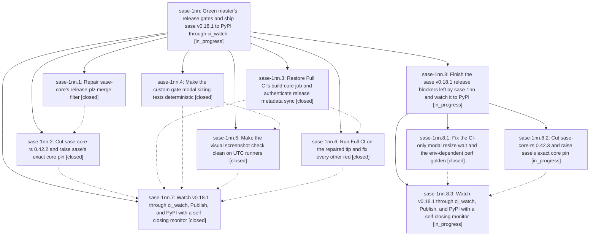

# Bead: sase-1nn — Green master's release gates and ship sase v0.18.1 to PyPI through ci\_watch

[Bead Pages](../README.md) / sase-1nn

**Status:** ◐ in_progress · **Type:** ▸ plan · **Tier:** epic
**Owner:** `bryanbugyi34@gmail.com` · **Created by:** [bbugyi200.athena.137](https://github.com/sase-org/sase--agents/blob/main/sessions/bbugyi200.athena.137.md) · **Assignee:** `sase-1nn.land`
**Created:** 2026-10-23 11:30:05 EDT
**Plan:** [202610/v0\_18\_1\_release.md](https://github.com/sase-org/sase--plans/blob/main/202610/v0_18_1_release.md)

<!-- sase:links:start -->

## Links

| Relation | Artifact | Why |
| --- | --- | --- |
| implemented-by | [plan:202610/v0_18_1_release.md][1] | derived from the plan's `bead_id:` frontmatter field |

_Plus 5 automatic references — see [Referenced By](#referenced-by)._

[1]: https://github.com/sase-org/sase--plans/blob/main/202610/v0_18_1_release.md

<!-- sase:links:end -->

## Description

Master Gate is green at master HEAD, a fresh Full CI run on master is green, ci_watch merges the release-please PR for 0.18.1, Publish uploads sase 0.18.1 to PyPI, a clean install of it works, and the final lander records that evidence as an artifact.

## Notes

[2026-10-23T22:20:16Z · sase-1n6.5.1.5.2.1.land] DISCOVERED ISSUE: qualification land triage of sase-1n6.5.1.5.2.1.2 note 7 independently confirms the incomplete sase-1nn.4 modal-sizing repair. At bdec291c77b0de1aab4c00abecef7430761db736 (contains 1a3a7022d1), green run 40000653149 Python 3.13/3.14 and source Full CI 40000661173 all three versions fail test_custom_gate_modal_sizing.py::test_compact_scroll_refits_after_resize after 5s. Same failure already in sase-1nn.6 note 1; this is owned repair work here, not a new task. Retained mapping file:explicit:88fe402c602e56f995848006 and raw evidence file:explicit:d1d05f2daface15a4c425e9f. Our fresh qualification proof needs a landed fix or honest bounded once-only test retry. Note 9 visual drift is historical evidence before your 62c5934eb6 visual repair; no new post-fix visual regression is claimed. Source 3.12 also reproduces closed flake sase-1a7, corroborated separately.

[2026-10-23T22:28:27Z · sase-1nn.land] LANDING (sase-1nn.land, 2026-10-23): 0.18.1 is NOT on PyPI (404). I'm handing off to a nested child epic (parent_bead sase-1nn, plan sase_plan_v0_18_1_release_landing).

Verified: phases .1-.6 closed done, and their commits are on origin/master: core-merge (sase-core db2ce637), b2a4c380cf, 1a3a7022d1, b97e6c4b91, bdec291c77, 62c5934eb6. CI confirms build-core, the Publish GH_TOKEN (Publish run 40023322266 green), the 0.42.2 pin, and the PYTEST_ADDOPTS -p fix. The DECISIONS publish_dispatch=yes and gate_rerun=yes were honored. Epic-symbols for sase-1nn are empty.

Remaining blockers:
(1) test_compact_scroll_refits_after_resize is still red in every Master Gate shard 8 and Full CI test lane after 1a3a7022d1. Root cause: CI resolves textual 8.2.8 from unlocked .[dev]. Textual 8.2 debounces App Resize behind a 1/120s timer and derives Screen.size from App.size, so _wait_for_terminal is vacuous. The fix (wait on screen.outer_size) was verified 20/20 serial on 8.0.1 and 8.2.8, and 3/3 at -n 8. It ships in the child ci-reds phase, because a plan handoff does not commit the lander's tree.
(2) sase-1nn.5's golden config_center_statistics_perf_degraded_120x40 was captured under the agent's ambient SASE_TUI_PERF=1. Full CI 40024191990 visual-test reports updated=1, and reproduction locally needs env -u. Fix: scrub the env in tests/conftest.py and regenerate (child ci-reds).
(3) Post-epic drift: 5d982d2bb9 moved sase-core-revision.txt to 58aca5fe (stranded_work_reduce). Release PR #321 floor smoke is red: 0.42.2 is missing 1 of 876 bindings. sase-core PR #334 (v0.42.3) contains 58aca5fe (child core-cut).
(4) sase-1nn.7's wrapper used 'timeout 10h30m'. GNU timeout rejected it (exit 125), so the watcher never ran (monitor 1hn3r3rdbyxr). The child watch phase uses 630m and preflights the duration.

Integration: non-epic commits since the start are 35e593bcc0, fc0b41479f (sudo), 5d982d2bb9 (beads stranded work: the binding gap, see 3), and 2d1e7fd486 (E2 release.yml qualification). None duplicates or conflicts with this epic's work beyond (3). E2's sase-1n6.9 cutover is guarded in the child watch prerequisites.

Follow-up triage:
- sase-1nn.2#1, .3#1, .4#1, .6#3 (the 4 KNOWN TUI failures): three are caused by ambient SASE_TUI_PERF/SASE_TUI_GC_CENSUS. Created sase-1np (bug, small); the child ci-reds phase fixes it. test_app_import_budget still fails with the env unset (3529 vs 3527), so I +1'd sase-1ic.
- sase-1nn.6#1 (modal node still red in CI): epic-caused, owned by the child ci-reds phase. Declined as a task.
- sase-1nn.6#2 (visual-test red): epic work. The remaining drift is (2), owned by the child ci-reds phase. Declined as a task.
- sase-1nn.6#4 (test_owner_cleanup_stops_monitor_child_and_suppresses_followup failed once at -n 8): created sase-1ns (flake, large).
- Lander-found: Master Gate 39998578927 shard 7 test_existing_typeahead_seeds_finder_query NoMatches, +1 on sase-1mu. Textual 8.2.8 vs 8.0.1 install drift (the root cause of 1), +1 on sase-1cs, which stays open.

## Phases

| Bead | Title | Status | Size | Created | Agents | Commits |
|---|---|---|---|---|---:|---:|
| [sase-1nn.1](sase-1nn.1.md) | Repair sase-core's release-plz merge filter | ✓ closed | small | 2026-10-23 | 1 | 1 |
| [sase-1nn.2](sase-1nn.2.md) | Cut sase-core-rs 0.42.2 and raise sase's exact core pin | ✓ closed | medium | 2026-10-23 | 1 | 1 |
| [sase-1nn.3](sase-1nn.3.md) | Restore Full CI's build-core job and authenticate release metadata sync | ✓ closed | small | 2026-10-23 | 1 | 1 |
| [sase-1nn.4](sase-1nn.4.md) | Make the custom gate modal sizing tests deterministic | ✓ closed | small | 2026-10-23 | 1 | 1 |
| [sase-1nn.5](sase-1nn.5.md) | Make the visual screenshot check clean on UTC runners | ✓ closed | medium | 2026-10-23 | 1 | 1 |
| [sase-1nn.6](sase-1nn.6.md) | Run Full CI on the repaired tip and fix every other red | ✓ closed | medium | 2026-10-23 | 1 | 1 |
| [sase-1nn.7](sase-1nn.7.md) | Watch v0.18.1 through ci\_watch, Publish, and PyPI with a self-closing monitor | ✓ closed | small | 2026-10-23 | 1 | 0 |

## Lineage

## Agents

| Agent | Bead | Commits |
|---|---|---:|
| [bbugyi200.athena.sase-1nn.1](https://github.com/sase-org/sase--agents/blob/main/agents/bbugyi200.athena.sase-1nn.1/README.md) | [sase-1nn.1](sase-1nn.1.md) | 1 |
| [bbugyi200.athena.sase-1nn.2](https://github.com/sase-org/sase--agents/blob/main/sessions/bbugyi200.athena.sase-1nn.2.md) | [sase-1nn.2](sase-1nn.2.md) | 1 |
| [bbugyi200.athena.sase-1nn.3](https://github.com/sase-org/sase--agents/blob/main/sessions/bbugyi200.athena.sase-1nn.3.md) | [sase-1nn.3](sase-1nn.3.md) | 1 |
| [bbugyi200.athena.sase-1nn.4](https://github.com/sase-org/sase--agents/blob/main/agents/bbugyi200.athena.sase-1nn.4/README.md) | [sase-1nn.4](sase-1nn.4.md) | 1 |
| [bbugyi200.athena.sase-1nn.5](https://github.com/sase-org/sase--agents/blob/main/sessions/bbugyi200.athena.sase-1nn.5.md) | [sase-1nn.5](sase-1nn.5.md) | 1 |
| [bbugyi200.athena.sase-1nn.6](https://github.com/sase-org/sase--agents/blob/main/agents/bbugyi200.athena.sase-1nn.6/README.md) | [sase-1nn.6](sase-1nn.6.md) | 1 |
| [bbugyi200.athena.sase-1nn.7](https://github.com/sase-org/sase--agents/blob/main/sessions/bbugyi200.athena.sase-1nn.7.md) | [sase-1nn.7](sase-1nn.7.md) | 0 |
| [bbugyi200.athena.sase-1nn.8.1](https://github.com/sase-org/sase--agents/blob/main/agents/bbugyi200.athena.sase-1nn.8.1/README.md) | [sase-1nn.8.1](sase-1nn.8.1.md) | 1 |
| [bbugyi200.athena.sase-1nn.8.2](https://github.com/sase-org/sase--agents/blob/main/sessions/bbugyi200.athena.sase-1nn.8.2.md) | [sase-1nn.8.2](sase-1nn.8.2.md) | 0 |
| [bbugyi200.athena.sase-1nn.8.3](https://github.com/sase-org/sase--agents/blob/main/agents/bbugyi200.athena.sase-1nn.8.3/README.md) | [sase-1nn.8.3](sase-1nn.8.3.md) | 0 |
| [bbugyi200.athena.sase-1nn.8.land](https://github.com/sase-org/sase--agents/blob/main/agents/bbugyi200.athena.sase-1nn.8.land/README.md) | [sase-1nn.8](sase-1nn.8.md) | 0 |
| [bbugyi200.athena.sase-1nn.land](https://github.com/sase-org/sase--agents/blob/main/sessions/bbugyi200.athena.sase-1nn.land.md) | [sase-1nn](README.md) | 0 |

## Commits

| Repo | Commit | Subject | Bead | Committed |
|---|---|---|---|---|
| sase-core | [`sase-core@db2ce63`](https://github.com/sase-org/sase-core/commit/db2ce6375a7bb92c7218d6190f2a6346952e6ad5) | fix(release): make release-plz PR filter jq-safe | [sase-1nn.1](sase-1nn.1.md) | 2026-10-23 11:55:15 EDT |
| sase | [`b2a4c38`](https://github.com/sase-org/sase/commit/b2a4c380cf464ee2bda5c49d24c08812081e2900) | fix(ci): restore Full CI build-core job and authenticate release metadata sync | [sase-1nn.3](sase-1nn.3.md) | 2026-10-23 12:25:45 EDT |
| sase | [`1a3a702`](https://github.com/sase-org/sase/commit/1a3a7022d1878b395a36f67a2837546dca2684ea) | fix(ace): wait for settled custom-gate modal geometry after resize | [sase-1nn.4](sase-1nn.4.md) | 2026-10-23 12:29:01 EDT |
| sase | [`b97e6c4`](https://github.com/sase-org/sase/commit/b97e6c4b91da1382db9a0f8f0f43b5d37e8cc307) | chore(core): raise sase-core-rs pin 0.42.0 to 0.42.2 | [sase-1nn.2](sase-1nn.2.md) | 2026-10-23 13:51:54 EDT |
| sase | [`bdec291`](https://github.com/sase-org/sase/commit/bdec291c77b0de1aab4c00abecef7430761db736) | fix(ci): treat PYTEST\_ADDOPTS -p values as plugins, not selectors | [sase-1nn.6](sase-1nn.6.md) | 2026-10-23 13:59:55 EDT |
| sase | [`62c5934`](https://github.com/sase-org/sase/commit/62c5934eb6ba1c30f32805cc30d52ae084d4de5c) | test(tui): stabilize visual snapshot lane | [sase-1nn.5](sase-1nn.5.md) | 2026-10-23 16:40:38 EDT |
| sase | [`43314db`](https://github.com/sase-org/sase/commit/43314db7ad3b9e90ac8234b38ef5bb20009fef33) | fix(tui): prove screen reflow in resize waits and scrub ambient TUI profiling env | [sase-1nn.8.1](sase-1nn.8.1.md) | 2026-10-23 19:39:34 EDT |

<!-- sase:referenced-by:start -->

## Referenced By

| Relation | Artifact | Why | Uses |
| --- | --- | --- | ---: |
| read-by | [agent:research.2a.cld][1] | E3 readiness: sase-1nn status | 1 |
| read-by | [agent:research.2a.final][2] | Check current state of 0.18.1 firefight epic overlapping E3 surfaces | 1 |
| read-by | [agent:research.2a.gem][3] | Check sase-1nn status and what has been done | 1 |
| read-by | [agent:research.2a.grk][4] | Need current 0.18.1 release-gate epic status because it races E2 cutover | 1 |
| read-by | [agent:sase-1nn.6][5] | Need sibling phase close notes and epic status before Full CI triage | 1 |

[1]: https://github.com/sase-org/sase--agents/blob/main/agents/bbugyi200.athena.research.2a.cld/README.md
[2]: https://github.com/sase-org/sase--agents/blob/main/agents/bbugyi200.athena.research.2a.final/README.md
[3]: https://github.com/sase-org/sase--agents/blob/main/agents/bbugyi200.athena.research.2a.gem/README.md
[4]: https://github.com/sase-org/sase--agents/blob/main/agents/bbugyi200.athena.research.2a.grk/README.md
[5]: https://github.com/sase-org/sase--agents/blob/main/agents/bbugyi200.athena.sase-1nn.6/README.md

<!-- sase:referenced-by:end -->
