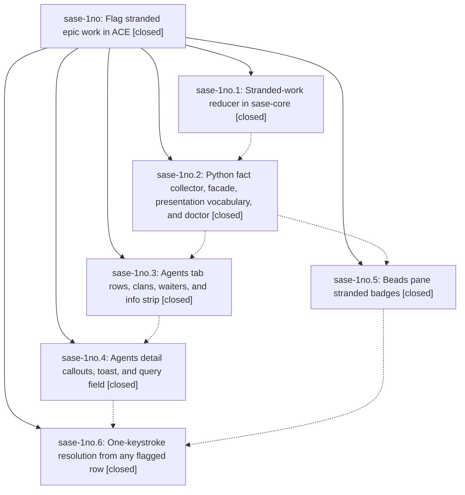

# Bead: sase-1no — Flag stranded epic work in ACE

[Bead Pages](../README.md) / sase-1no

**Status:** ✓ closed · **Resolution:** done · **Type:** ▸ plan · **Tier:** epic
**Owner:** `bryanbugyi34@gmail.com` · **Created by:** [bbugyi200.athena.13e](https://github.com/sase-org/sase--agents/blob/main/sessions/bbugyi200.athena.13e.md) · **Assignee:** `sase-1no.land`
**Created:** 2026-10-23 14:22:48 EDT · **Closed:** 2026-10-24 10:46:02 EDT
**Plan:** [202610/stranded\_epic\_work.md](https://github.com/sase-org/sase--plans/blob/main/202610/stranded_epic_work.md)

<!-- sase:links:start -->

## Links

| Relation | Artifact | Why |
| --- | --- | --- |
| implemented-by | [plan:202610/stranded_epic_work.md][1] | derived from the plan's `bead_id:` frontmatter field |
| related | [bead:sase-1nz][2] | Reuses sase-1no's load_stranded_report classifier and stranded_presentation vocabulary; the toast diff in _stranded_toasts.py is the in-memory precedent |
| related | [bead:sase-1o0][3] | Prevention-side companion to sase-1no's stranded detection; both come from the sase-1n6 E2 stall report |

_Plus 1 automatic references — see [Referenced By](#referenced-by)._

[1]: https://github.com/sase-org/sase--plans/blob/main/202610/stranded_epic_work.md
[2]: https://github.com/sase-org/sase--beads/blob/main/pages/sase-1nz/README.md
[3]: https://github.com/sase-org/sase--beads/blob/main/pages/sase-1o0/README.md

<!-- sase:links:end -->

## Description

An in_progress phase or epic bead that nothing will ever resume can no longer sit unnoticed. sase-core classifies it once. ACE flags it with a single amber ⚐ vocabulary on the stuck row, on everything waiting on it, on its epic clans, and in the Beads pane, and any flagged row resolves it with one keystroke.

## Notes

[2026-10-23T22:20:33Z · sase-1n6.5.1.5.2.1.land] DISCOVERED ISSUE: integration audit by sase-1n6.5.1.5.2.1.land at 2d1e7fd486. Your collect commit 5d982d2bb9 moves sase-core-revision.txt to 58aca5fe69158286092e3a33685687a52f8d2b8f and adds required stranded_work_reduce, while pyproject/uv.lock still pin published 0.42.2. Isolated published preflight: uv run --no-project --isolated --with sase-core-rs==0.42.2 python tools/check_sase_core_rs_bindings exits 1, missing 1 of 876: stranded_work_reduce. Opened core checkout has no tag containing 58aca5fe; v0.42.2 contains the earlier proof pin 246e2874 only. This newly landed feature prevents a green published qualification at current master. The qualification remaining-work plan will wait for the authorized daily core cut and integrate a complete containing exact published pin before reproof; do not duplicate that pin work. No binding bypass or source fallback is permitted.

[2026-10-24T06:39:39Z · sase-1nn.8.land] DISCOVERED ISSUE from sase-1nn.8.1 note 1, independently verified by sase-1nn.8.land: bb81495765 (sase-1no.3) adds three Help legend rows without updating agents_archive_help_120x40.png. Full CI 40063272183, job 120783473777 at 102c6ee847 reports exactly 52757/1520532 changed pixels; prior Full CI 40054807788 reports the same delta. This blocks the 0.18.1 release. The remaining-work child plan under sase-1nn.8 will repair this golden using deterministic local capture and inspect Archive visibility; do not duplicate that repair. The published-core gap in note 1 is resolved: dd0c6d8d19 pins complete PyPI 0.42.3, tag f726ca1e contains 58aca5fe, and an isolated binding probe passes all 876 bindings.

[2026-10-24T12:55:30Z · sase-1nn.8.4.land] RESOLVED DISCOVERED ISSUE note 2: release integration commit dc2cc11324 (sase-1nn.8.4.1) regenerates agents_archive_help_120x40.png for the three stranded-work Help rows. Phase records 52757/1520532 pixels, local dual-zone exact checks and full clean visual check. Independent land review viewed the committed image and confirmed Archive (read-only) heading and restore footer; both visibility assertions remain. Full CI 40085700689 visual job 120851129789 passes check/clean with 1123 unchanged. Later Beads-pane commit c793bff54b changes Artifacts Help only and its own goldens, with no conflicting Agents Help edit. No duplicate repair needed; this epic remains open. Evidence file:explicit:c12008cebe29a875c6afb8fe.

[2026-10-24T13:23:41Z · sase-1no.land] LAND TRIAGE (sase-1no.land) of every PROPOSED FOLLOW-UP and the plan's non-goals: (1) sase-1no.6 note 1, the test_sdd_git_streaming interruption flake: created sase-1ny (flake, small, ready; probable 50 ms timeout vs grandchild pid-file startup race). (2) The import-budget overage in sase-1no.2 note 1, sase-1no.4 note 1, and sase-1no.5 note 2: +1 on sase-1ic with tui_import_closure evidence (clean base 62c5934eb6 measures 3529 against the 3527 cap; master measures 3536, including 5 epic modules). 0a1a8aba2f raised the cap to 3537 with an inaccurate 'no sase.* growth' comment, and the remaining-work tale corrects it. (3) The env-leak gc_policy/statistics_perf failures in sase-1no.2 note 1, sase-1no.3 note 2, and sase-1no.5 note 1: declined as resolved. sase-1np is closed via 43314db7ad (autouse conftest scrub), and test_gc_policy, test_statistics_perf, and test_app_import_budget pass (38 passed) at 0a1a8aba2f. (4) Publish sase-core-rs with stranded_work_reduce (sase-1no.3 note 1, sase-1no.4 note 1): declined as resolved. dd0c6d8d19 pins 0.42.3, and core tag f726ca1e contains 58aca5fe. (5) The sase_13 conflict markers (sase-1no.5 note 3): declined. That was transient state in another ephemeral workspace, not a repo defect, and the phase later landed cleanly as c793bff54b. (6) Plan non-goal, inbox/Telegram/mobile notifications: created sase-1nz (feature, large, ready). (7) Plan non-goal, the report's second recommendation (dirty monitor handoff waiting on master): created sase-1o0 (feature, large, ready). (8) Plan non-goal, a sase bead CLI listing: declined, because sase doctor already prints the stranded WARNING with both remedies through the shared classifier. (9) Plan non-goal, automatic relaunch: declined as a separate policy decision the plan excluded; the resolve modal is the remedy.

[2026-10-24T13:26:02Z · sase-1no.land] LAND AUDIT (sase-1no.land): the epic is not yet complete, and a remaining-work tale is proposed. It covers: (1) clan ⚐N is counted from loaded member rows, always in breadcrumb style, so ancestor epic clans in nested chains show no ⚐; it must be bead-anchored via the epic verdict's blocked_by, with leaf style when a leaf is a direct phase. (2) Wave pips fold only stranded members, not blocked ones, to ▲. (3) _agent_wait_section.py [beads] lane: else blocked_sentence pairs with 'if report is not None', so blocked entries show an age instead of 'blocked by stranded <leaf>'. (4) The blocked header callout renders 'blocked 1h blocked by stranded …', which shows in the agents_stranded_blocked_detail golden. (5) WAITING bead tokens were never swapped ◐→⚐ or given a ⚐N count, and agent-session targets are ignored. (6) The Waiting Badges and Clan Waves help rows are missing. (7) agent-statuses.md lacks the STRANDED overlay. (8) The agents_stranded_nested_chain_120x40 golden is missing. (9) The test_app_import_budget cap comment from 0a1a8aba2f misstates the epic's +5 first-paint modules. The tale's final step closes this epic.

[2026-10-24T14:46:02Z · sase-1no.land--1] LAND CLOSE (sase-1no.land). Remaining-work tale plan:202610/stranded_epic_work_landing.md is complete.

Land-audit steps 1–2. All six phases match plan:202610/stranded_epic_work.md and DECISIONS flag_tasks=yes / doctor_report=yes: core (sase-core 58aca5fe / stranded_work_reduce), collect (facade, ⚐ vocabulary, doctor WARNING), agents-rows, agents-detail, beads-pane, resolve. Integration checked with a2a38005df (declaration_manifest split, two first-paint modules named in the import-budget comment), 1a5e01adba (doctor bead-check test split), 43314db7ad (autouse TUI env scrub; gc_policy/statistics_perf env-leak declined as resolved in LAND TRIAGE), dd0c6d8d19 (sase-core-rs 0.42.3 pin; core tag f726ca1e contains 58aca5fe), and dc2cc11324 (Archive-help golden repair from sase-1nn.8.4.1). Phase commits: 5d982d2bb9, bb81495765, a7996c3b77, c793bff54b, 0a1a8aba2f.

Tale fixes (nine) plus the new golden:
1. Clan ⚐N is bead-anchored from the epic verdict's blocked_by (plus member union); leaf style when a leaf is a direct phase or the epic itself, breadcrumb otherwise. Ancestor clans in nested chains now show ⚐1.
2. Wave pips fold stranded or blocked members to ▲.
3. [beads] wait lane: stranded is ⚐ stranded <age>; blocked is ⚐ blocked_sentence with no age.
4. Blocked header callout is ⚐ blocked <age> by stranded <leaf> (+N more) · ⏎ resolve; blocked_sentence tail stripped of leading "blocked" so it cannot stutter. Zero-age fixtures omit the age token.
5. WAITING bead tokens swap ◐→⚐ (or append ⚐N); agent-session targets with no bead token get a breadcrumb ⚐.
6. Help: Waiting Badges ⚐ / ⚐N, Clan Waves ▲, Agent Row Glyphs ⚐N reworded (bold when direct leaf / epic, dim otherwise).
7. Docs: STRANDED overlay in agent-statuses.md (linked from FINALIZING and bead-lifecycles); agent-row-glyphs.md and agents-main-deck.md updated.
8. New PNG golden agents_stranded_nested_chain_120x40: ancestor clan breadcrumb ⚐1, leaf clan ⚐1+▲, leaf STRANDED, land ⚐; ancestor collapsed, leaf expanded. Regenerated goldens: agents_stranded_rows_and_clan_120x40 (leaf-style ⚐1, waiter token swap), agents_stranded_blocked_detail_120x40 (no stutter), agents_archive_help_120x40 (still Archive (read-only) + restore footer). Visual update applied created=1 updated=3 unchanged=2 skipped=0 unstable=0. Dual just fix-tui-screenshots --check (default TZ and TZ=UTC) both check clean, 6 unchanged, unstable_count=0.
9. Import-budget comment names the five epic first-paint modules plus a2a38005df's two; cap stays 3537. No new first-paint modules in this tale.

just check: sase tool run b0c0f4bcddfa3c04ebed88e4a2267397 succeeded, exit 0, TRIAGE KIND none / VERDICT pass / REASON exited_zero. Lint (including just symvision) and scoped tests (29m 43s) passed. No KNOWN items.

sase bead epic-symbols sase-1no: no --epic-symbol entries. just symvision: all public/private classes/functions used properly.

Follow-up outcomes remain as recorded in the existing LAND TRIAGE note (sase-1no note 4): flake sase-1ny created; +1 on sase-1ic; features sase-1nz and sase-1o0 created; remaining proposals declined. Not re-triaged.

## Phases

| Bead | Title | Status | Size | Created | Agents | Commits |
|---|---|---|---|---|---:|---:|
| [sase-1no.1](sase-1no.1.md) | Stranded-work reducer in sase-core | ✓ closed | medium | 2026-10-23 | 1 | 1 |
| [sase-1no.2](sase-1no.2.md) | Python fact collector, facade, presentation vocabulary, and doctor | ✓ closed | medium | 2026-10-23 | 1 | 1 |
| [sase-1no.3](sase-1no.3.md) | Agents tab rows, clans, waiters, and info strip | ✓ closed | medium | 2026-10-23 | 1 | 1 |
| [sase-1no.4](sase-1no.4.md) | Agents detail callouts, toast, and query field | ✓ closed | small | 2026-10-23 | 1 | 1 |
| [sase-1no.5](sase-1no.5.md) | Beads pane stranded badges | ✓ closed | small | 2026-10-23 | 1 | 1 |
| [sase-1no.6](sase-1no.6.md) | One-keystroke resolution from any flagged row | ✓ closed | medium | 2026-10-23 | 1 | 1 |

## Lineage

## Agents

| Agent | Bead | Commits |
|---|---|---:|
| [bbugyi200.athena.sase-1no.1](https://github.com/sase-org/sase--agents/blob/main/agents/bbugyi200.athena.sase-1no.1/README.md) | [sase-1no.1](sase-1no.1.md) | 1 |
| [bbugyi200.athena.sase-1no.2](https://github.com/sase-org/sase--agents/blob/main/sessions/bbugyi200.athena.sase-1no.2.md) | [sase-1no.2](sase-1no.2.md) | 1 |
| [bbugyi200.athena.sase-1no.3](https://github.com/sase-org/sase--agents/blob/main/agents/bbugyi200.athena.sase-1no.3/README.md) | [sase-1no.3](sase-1no.3.md) | 1 |
| [bbugyi200.athena.sase-1no.4](https://github.com/sase-org/sase--agents/blob/main/sessions/bbugyi200.athena.sase-1no.4.md) | [sase-1no.4](sase-1no.4.md) | 1 |
| [bbugyi200.athena.sase-1no.5](https://github.com/sase-org/sase--agents/blob/main/sessions/bbugyi200.athena.sase-1no.5.md) | [sase-1no.5](sase-1no.5.md) | 1 |
| [bbugyi200.athena.sase-1no.6](https://github.com/sase-org/sase--agents/blob/main/sessions/bbugyi200.athena.sase-1no.6.md) | [sase-1no.6](sase-1no.6.md) | 1 |
| [bbugyi200.athena.sase-1no.land](https://github.com/sase-org/sase--agents/blob/main/sessions/bbugyi200.athena.sase-1no.land.md) | [sase-1no](README.md) | 2 |

## Commits

| Repo | Commit | Subject | Bead | Committed |
|---|---|---|---|---|
| sase-core | [`sase-core@58aca5f`](https://github.com/sase-org/sase-core/commit/58aca5fe69158286092e3a33685687a52f8d2b8f) | feat(stranded-work): add pure facts-to-verdicts reducer with PyO3 binding | [sase-1no.1](sase-1no.1.md) | 2026-10-23 15:03:40 EDT |
| sase | [`5d982d2`](https://github.com/sase-org/sase/commit/5d982d2bb9241a5b4e3db8baf38d0cae7ebeb53f) | feat(beads): collect stranded-work facts and doctor WARNING | [sase-1no.2](sase-1no.2.md) | 2026-10-23 17:21:03 EDT |
| sase | [`bb81495`](https://github.com/sase-org/sase/commit/bb81495765e9afe676552b285c8e487b1a144814) | feat(agents): show stranded bead work in agent rows | [sase-1no.3](sase-1no.3.md) | 2026-10-23 18:22:50 EDT |
| sase | [`a7996c3`](https://github.com/sase-org/sase/commit/a7996c3b77d155a9b3449d97b5e79b46b0ddd7f3) | feat(ace): show stranded work in agent details | [sase-1no.4](sase-1no.4.md) | 2026-10-23 20:06:53 EDT |
| sase | [`c793bff`](https://github.com/sase-org/sase/commit/c793bff54b0382194527c3c422b0416b11d87a1f) | feat(tui): flag stranded work in the Beads pane | [sase-1no.5](sase-1no.5.md) | 2026-10-24 06:53:28 EDT |
| sase | [`0a1a8ab`](https://github.com/sase-org/sase/commit/0a1a8aba2fa75e3ab72df3d3ec703086d515ecd9) | feat(ace): add stranded Enter resolve modal and PNG goldens (sase-1no.6) | [sase-1no.6](sase-1no.6.md) | 2026-10-24 09:02:38 EDT |
| sase | [`206bda9`](https://github.com/sase-org/sase/commit/206bda93be1e2f303370bf0d2fcb567b099e8f3d) | feat(ace): finish bead-anchored stranded flags and land sase-1no | [sase-1no](README.md) | 2026-10-24 10:48:02 EDT |
| sase--plans | [`sase--plans@69e2ff7`](https://github.com/sase-org/sase--plans/commit/69e2ff7d87f24460b0efe50bb118d9084b3ecfea) | docs(plans): mark stranded\_epic\_work as done | [sase-1no](README.md) | 2026-10-24 10:50:39 EDT |

<!-- sase:referenced-by:start -->

## Referenced By

| Relation | Artifact | Why | Uses |
| --- | --- | --- | ---: |
| read-by | [agent:sase-1no.2--5][1] | Need parent epic DECISIONS and phase list to confirm collect-phase completeness | 1 |

[1]: https://github.com/sase-org/sase--agents/blob/main/sessions/bbugyi200.athena.sase-1no.2.md

<!-- sase:referenced-by:end -->
