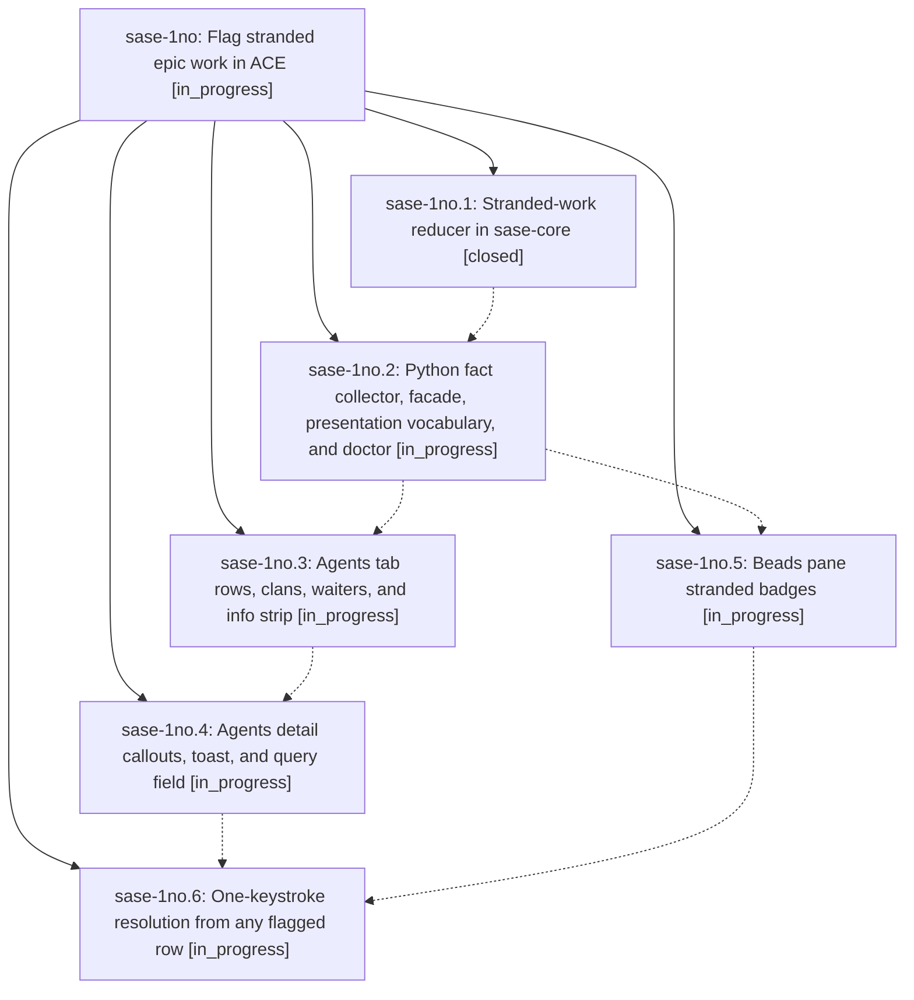

# Bead: sase-1no — Flag stranded epic work in ACE

[Bead Pages](../README.md) / sase-1no

**Status:** ◐ in_progress · **Type:** ▸ plan · **Tier:** epic
**Owner:** `bryanbugyi34@gmail.com` · **Created by:** [bbugyi200.athena.13e](https://github.com/sase-org/sase--agents/blob/main/sessions/bbugyi200.athena.13e.md) · **Assignee:** `sase-1no.land`
**Created:** 2026-10-23 14:22:48 EDT
**Plan:** [202610/stranded\_epic\_work.md](https://github.com/sase-org/sase--plans/blob/main/202610/stranded_epic_work.md)

## Description

An in_progress phase or epic bead that nothing will ever resume can no longer sit unnoticed. sase-core classifies it once. ACE flags it with a single amber ⚐ vocabulary on the stuck row, on everything waiting on it, on its epic clans, and in the Beads pane, and any flagged row resolves it with one keystroke.

## Phases

| Bead | Title | Status | Size | Created | Agents | Commits |
|---|---|---|---|---|---:|---:|
| [sase-1no.1](sase-1no.1.md) | Stranded-work reducer in sase-core | ✓ closed | medium | 2026-10-23 | 1 | 1 |
| [sase-1no.2](sase-1no.2.md) | Python fact collector, facade, presentation vocabulary, and doctor | ◐ in_progress | medium | 2026-10-23 | 1 | 0 |
| [sase-1no.3](sase-1no.3.md) | Agents tab rows, clans, waiters, and info strip | ◐ in_progress | medium | 2026-10-23 | 1 | 0 |
| [sase-1no.4](sase-1no.4.md) | Agents detail callouts, toast, and query field | ◐ in_progress | small | 2026-10-23 | 1 | 0 |
| [sase-1no.5](sase-1no.5.md) | Beads pane stranded badges | ◐ in_progress | small | 2026-10-23 | 1 | 0 |
| [sase-1no.6](sase-1no.6.md) | One-keystroke resolution from any flagged row | ◐ in_progress | medium | 2026-10-23 | 1 | 0 |

## Lineage

## Agents

| Agent | Bead | Commits |
|---|---|---:|
| [bbugyi200.athena.sase-1no.1](https://github.com/sase-org/sase--agents/blob/main/agents/bbugyi200.athena.sase-1no.1/README.md) | [sase-1no.1](sase-1no.1.md) | 1 |
| [bbugyi200.athena.sase-1no.2](https://github.com/sase-org/sase--agents/blob/main/agents/bbugyi200.athena.sase-1no.2/README.md) | [sase-1no.2](sase-1no.2.md) | 0 |
| [bbugyi200.athena.sase-1no.3](https://github.com/sase-org/sase--agents/blob/main/agents/bbugyi200.athena.sase-1no.3/README.md) | [sase-1no.3](sase-1no.3.md) | 0 |
| [bbugyi200.athena.sase-1no.4](https://github.com/sase-org/sase--agents/blob/main/agents/bbugyi200.athena.sase-1no.4/README.md) | [sase-1no.4](sase-1no.4.md) | 0 |
| [bbugyi200.athena.sase-1no.5](https://github.com/sase-org/sase--agents/blob/main/agents/bbugyi200.athena.sase-1no.5/README.md) | [sase-1no.5](sase-1no.5.md) | 0 |
| [bbugyi200.athena.sase-1no.6](https://github.com/sase-org/sase--agents/blob/main/agents/bbugyi200.athena.sase-1no.6/README.md) | [sase-1no.6](sase-1no.6.md) | 0 |
| [bbugyi200.athena.sase-1no.land](https://github.com/sase-org/sase--agents/blob/main/agents/bbugyi200.athena.sase-1no.land/README.md) | [sase-1no](README.md) | 0 |

## Commits

| Repo | Commit | Subject | Bead | Committed |
|---|---|---|---|---|
| sase-core | [`sase-core@58aca5f`](https://github.com/sase-org/sase-core/commit/58aca5fe69158286092e3a33685687a52f8d2b8f) | feat(stranded-work): add pure facts-to-verdicts reducer with PyO3 binding | [sase-1no.1](sase-1no.1.md) | 2026-10-23 15:03:40 EDT |
