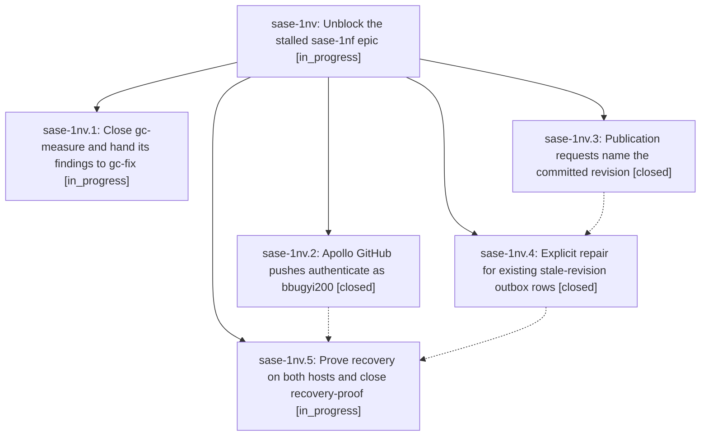

# Bead: sase-1nv — Unblock the stalled sase-1nf epic

[Bead Pages](../README.md) / sase-1nv

**Status:** ◐ in_progress · **Type:** ▸ plan · **Tier:** epic
**Owner:** `bryanbugyi34@gmail.com` · **Created by:** [bbugyi200.athena.13m](https://github.com/sase-org/sase--agents/blob/main/sessions/bbugyi200.athena.13m.md) · **Assignee:** `sase-1nv.land`
**Created:** 2026-10-24 07:01:32 EDT
**Plan:** [202610/unblock\_sase\_1nf.md](https://github.com/sase-org/sase--plans/blob/main/202610/unblock_sase_1nf.md)

<!-- sase:links:start -->

## Links

| Relation | Artifact | Why |
| --- | --- | --- |
| implemented-by | [plan:202610/unblock_sase_1nf.md][1] | derived from the plan's `bead_id:` frontmatter field |

[1]: https://github.com/sase-org/sase--plans/blob/main/202610/unblock_sase_1nf.md

<!-- sase:links:end -->

## Description

Both stalled sase-1nf tracks move again without anyone waiting on a question. gc-measure closes, so the waiting gc-fix agent starts. Agent-run Apollo pushes authenticate as bbugyi200. Publication requests name the commit their agent actually created, and existing stale-revision rows are repaired explicitly. recovery-proof (sase-1nf.10.1.9) closes with evidence, so the waiting sase-1nf.10.1 land agent and then pub-recover (sase-1nf.11) resume on a backlog that can drain.

## Phases

| Bead | Title | Status | Size | Created | Agents | Commits |
|---|---|---|---|---|---:|---:|
| [sase-1nv.1](sase-1nv.1.md) | Close gc-measure and hand its findings to gc-fix | ◐ in_progress | medium | 2026-10-24 | 1 | 0 |
| [sase-1nv.2](sase-1nv.2.md) | Apollo GitHub pushes authenticate as bbugyi200 | ✓ closed | small | 2026-10-24 | 1 | 0 |
| [sase-1nv.3](sase-1nv.3.md) | Publication requests name the committed revision | ✓ closed | medium | 2026-10-24 | 1 | 2 |
| [sase-1nv.4](sase-1nv.4.md) | Explicit repair for existing stale-revision outbox rows | ✓ closed | medium | 2026-10-24 | 1 | 2 |
| [sase-1nv.5](sase-1nv.5.md) | Prove recovery on both hosts and close recovery-proof | ◐ in_progress | medium | 2026-10-24 | 1 | 0 |

## Lineage

## Agents

| Agent | Bead | Commits |
|---|---|---:|
| [bbugyi200.athena.sase-1nv.1](https://github.com/sase-org/sase--agents/blob/main/agents/bbugyi200.athena.sase-1nv.1/README.md) | [sase-1nv.1](sase-1nv.1.md) | 0 |
| [bbugyi200.athena.sase-1nv.2](https://github.com/sase-org/sase--agents/blob/main/agents/bbugyi200.athena.sase-1nv.2/README.md) | [sase-1nv.2](sase-1nv.2.md) | 0 |
| [bbugyi200.athena.sase-1nv.3](https://github.com/sase-org/sase--agents/blob/main/sessions/bbugyi200.athena.sase-1nv.3.md) | [sase-1nv.3](sase-1nv.3.md) | 2 |
| [bbugyi200.athena.sase-1nv.4](https://github.com/sase-org/sase--agents/blob/main/sessions/bbugyi200.athena.sase-1nv.4.md) | [sase-1nv.4](sase-1nv.4.md) | 2 |
| [bbugyi200.athena.sase-1nv.5](https://github.com/sase-org/sase--agents/blob/main/agents/bbugyi200.athena.sase-1nv.5/README.md) | [sase-1nv.5](sase-1nv.5.md) | 0 |
| [bbugyi200.athena.sase-1nv.land](https://github.com/sase-org/sase--agents/blob/main/agents/bbugyi200.athena.sase-1nv.land/README.md) | [sase-1nv](README.md) | 0 |

## Commits

| Repo | Commit | Subject | Bead | Committed |
|---|---|---|---|---|
| sase-core | [`sase-core@e80f08d`](https://github.com/sase-org/sase-core/commit/e80f08dae98224ccc192a569d97fc13177a6d76f) | feat(publication): fulfill linked-scope rows when the page exists | [sase-1nv.3](sase-1nv.3.md) | 2026-10-24 09:22:13 EDT |
| sase | [`02cd3b3`](https://github.com/sase-org/sase/commit/02cd3b39b64358f37b2fa097f0ebfa1db2960e53) | feat(agents-sync): name publications with the post-commit SHA | [sase-1nv.3](sase-1nv.3.md) | 2026-10-24 09:25:19 EDT |
| sase-core | [`sase-core@7ec12d2`](https://github.com/sase-org/sase-core/commit/7ec12d2d7ad8e670abe26aa396259a512f330391) | feat(core): classify stale publication requests for revision repair (sase-1nv.4) | [sase-1nv.4](sase-1nv.4.md) | 2026-10-24 11:45:47 EDT |
| sase | [`7b1b437`](https://github.com/sase-org/sase/commit/7b1b43755821fb4b6fe9ab8f51d09fcff0e46879) | feat(agents-sync): add report-first repair for stale publication revision rows (sase-1nv.4) | [sase-1nv.4](sase-1nv.4.md) | 2026-10-24 11:48:49 EDT |
