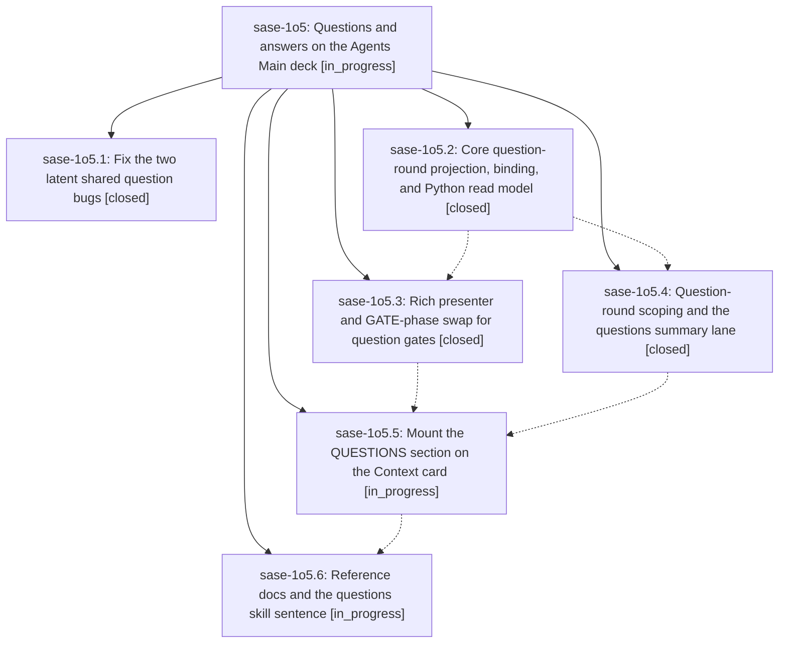

# Bead: sase-1o5 — Questions and answers on the Agents Main deck

[Bead Pages](../README.md) / sase-1o5

**Status:** ◐ in_progress · **Type:** ▸ plan · **Tier:** epic
**Owner:** `bryanbugyi34@gmail.com` · **Created by:** [bbugyi200.athena.research.58.linker.w0](https://github.com/sase-org/sase--agents/blob/main/sessions/bbugyi200.athena.research.58.linker.w0.md) · **Assignee:** `sase-1o5.land`
**Created:** 2026-10-24 19:29:30 EDT
**Plan:** [202610/questions\_main\_deck.md](https://github.com/sase-org/sase--plans/blob/main/202610/questions_main_deck.md)

<!-- sase:links:start -->

## Links

| Relation | Artifact | Why |
| --- | --- | --- |
| implemented-by | [plan:202610/questions_main_deck.md][1] | derived from the plan's `bead_id:` frontmatter field |

_Plus 2 automatic references — see [Referenced By](#referenced-by)._

[1]: https://github.com/sase-org/sase--plans/blob/main/202610/questions_main_deck.md

<!-- sase:links:end -->

## Description

Selecting an agent session, the turn that asked, or a question gate turn on the Agents tab shows that session's /sase_questions rounds in a QUESTIONS section on the Main deck's Context card: each question, its recommended (first-listed) option, the actual answer when one exists, and how the round was answered (human via TUI, Telegram, mobile, or CLI; automatic policy; agent; unknown). Data is projected from the existing question gate bundles, nothing new is written at settlement, and it works for every past gate-turn round with no backfill.

## Notes

[2026-10-25T02:14:54Z · sase-1nn.8.4.3.land] DISCOVERED ISSUE: Phase .2 commit 5497b59c5d adds --epic-symbol sase-1o5.3(project_question_round), but src/sase/question_gate_turn/projection.py:315 already consumes it. Master Gate 40149338072 attempt 2 lint job 121044124879 rejects the unnecessary exemption. The same commit advances source pin to 3156d11f, after published v0.42.5, renewing CORE_LAG. Release lander plans removal of the stale entry and a guarded containing core cut/metadata refresh; it will re-inventory before editing to avoid duplicating .3 cleanup. Other still-needed .3 exemptions remain until their actual consumers land. Evidence file:explicit:eca15519850917b7992759fe.

## Phases

| Bead | Title | Status | Size | Created | Agents | Commits |
|---|---|---|---|---|---:|---:|
| [sase-1o5.1](sase-1o5.1.md) | Fix the two latent shared question bugs | ✓ closed | small | 2026-10-24 | 1 | 1 |
| [sase-1o5.2](sase-1o5.2.md) | Core question-round projection, binding, and Python read model | ✓ closed | medium | 2026-10-24 | 1 | 2 |
| [sase-1o5.3](sase-1o5.3.md) | Rich presenter and GATE-phase swap for question gates | ✓ closed | medium | 2026-10-24 | 1 | 1 |
| [sase-1o5.4](sase-1o5.4.md) | Question-round scoping and the questions summary lane | ✓ closed | medium | 2026-10-24 | 1 | 1 |
| [sase-1o5.5](sase-1o5.5.md) | Mount the QUESTIONS section on the Context card | ◐ in_progress | medium | 2026-10-24 | 1 | 0 |
| [sase-1o5.6](sase-1o5.6.md) | Reference docs and the questions skill sentence | ◐ in_progress | small | 2026-10-24 | 1 | 0 |

## Lineage

## Agents

| Agent | Bead | Commits |
|---|---|---:|
| [bbugyi200.athena.sase-1o5.1](https://github.com/sase-org/sase--agents/blob/main/agents/bbugyi200.athena.sase-1o5.1/README.md) | [sase-1o5.1](sase-1o5.1.md) | 1 |
| [bbugyi200.athena.sase-1o5.2](https://github.com/sase-org/sase--agents/blob/main/sessions/bbugyi200.athena.sase-1o5.2.md) | [sase-1o5.2](sase-1o5.2.md) | 2 |
| [bbugyi200.athena.sase-1o5.3](https://github.com/sase-org/sase--agents/blob/main/agents/bbugyi200.athena.sase-1o5.3/README.md) | [sase-1o5.3](sase-1o5.3.md) | 1 |
| [bbugyi200.athena.sase-1o5.4](https://github.com/sase-org/sase--agents/blob/main/sessions/bbugyi200.athena.sase-1o5.4.md) | [sase-1o5.4](sase-1o5.4.md) | 1 |
| [bbugyi200.athena.sase-1o5.5](https://github.com/sase-org/sase--agents/blob/main/agents/bbugyi200.athena.sase-1o5.5/README.md) | [sase-1o5.5](sase-1o5.5.md) | 0 |
| [bbugyi200.athena.sase-1o5.6](https://github.com/sase-org/sase--agents/blob/main/agents/bbugyi200.athena.sase-1o5.6/README.md) | [sase-1o5.6](sase-1o5.6.md) | 0 |
| [bbugyi200.athena.sase-1o5.land](https://github.com/sase-org/sase--agents/blob/main/agents/bbugyi200.athena.sase-1o5.land/README.md) | [sase-1o5](README.md) | 0 |

## Commits

| Repo | Commit | Subject | Bead | Committed |
|---|---|---|---|---|
| sase | [`b76183e`](https://github.com/sase-org/sase/commit/b76183e9382941b325c46be867f71089b7bc8127) | fix(gates): render free-text answers and park option-less auto rounds as manual gates | [sase-1o5.1](sase-1o5.1.md) | 2026-10-24 20:14:43 EDT |
| sase-core | [`sase-core@3156d11`](https://github.com/sase-org/sase-core/commit/3156d11f33d5a5277ff806a78b92a9490f78d6be) | feat(question-round): add pure question\_round projection and project binding | [sase-1o5.2](sase-1o5.2.md) | 2026-10-24 21:03:41 EDT |
| sase | [`5497b59`](https://github.com/sase-org/sase/commit/5497b59c5ddac82c20cf92bd0f63394a1f5e2d82) | feat(questions): add question-round facade, projection loader, and core binding validation | [sase-1o5.2](sase-1o5.2.md) | 2026-10-24 21:06:42 EDT |
| sase | [`393430d`](https://github.com/sase-org/sase/commit/393430da551e6a981ebb0e3cf0f821eb2bf8cc60) | feat(ace): rich text presenter for question gates with GATE-phase swap | [sase-1o5.3](sase-1o5.3.md) | 2026-10-24 22:14:40 EDT |
| sase | [`518717c`](https://github.com/sase-org/sase/commit/518717cdaca4b05ed19427ceab4371987c60d16f) | feat(questions): add question-round scoping and questions summary lane | [sase-1o5.4](sase-1o5.4.md) | 2026-10-24 22:42:58 EDT |

<!-- sase:referenced-by:start -->

## Referenced By

| Relation | Artifact | Why | Uses |
| --- | --- | --- | ---: |
| read-by | [agent:sase-1o5.1][1] | epic context for phase | 1 |
| read-by | [agent:sase-1o5.3][2] | Need phase scope, epic notes, and prior work | 1 |

[1]: https://github.com/sase-org/sase--agents/blob/main/agents/bbugyi200.athena.sase-1o5.1/README.md
[2]: https://github.com/sase-org/sase--agents/blob/main/agents/bbugyi200.athena.sase-1o5.3/README.md

<!-- sase:referenced-by:end -->
