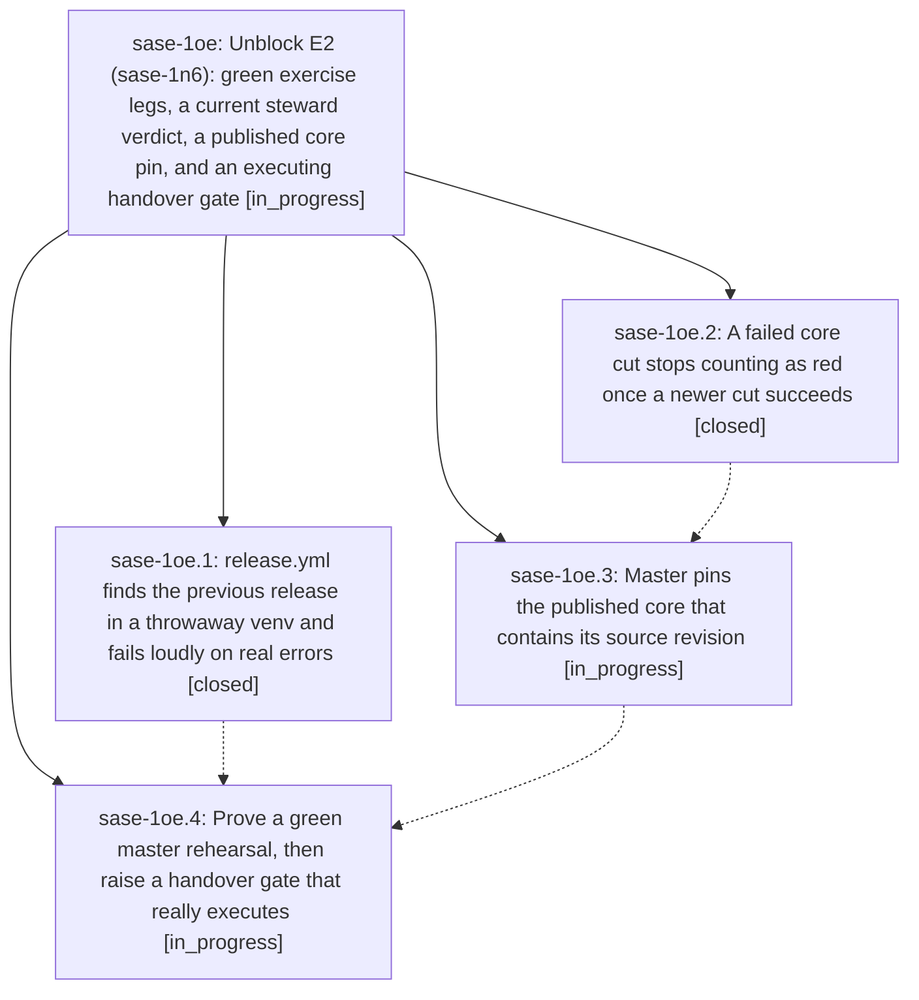

# Bead: sase-1oe — Unblock E2 (sase-1n6): green exercise legs, a current steward verdict, a published core pin, and an executing handover gate

[Bead Pages](../README.md) / sase-1oe

**Status:** ◐ in_progress · **Type:** ▸ plan · **Tier:** epic
**Owner:** `bryanbugyi34@gmail.com` · **Created by:** [bbugyi200.athena.14h](https://github.com/sase-org/sase--agents/blob/main/sessions/bbugyi200.athena.14h.md) · **Assignee:** `sase-1oe.land`
**Created:** 2026-10-26 08:35:12 EDT
**Plan:** [202610/unblock\_e2\_release\_cutover.md](https://github.com/sase-org/sase--plans/blob/main/202610/unblock_e2_release_cutover.md)

<!-- sase:links:start -->

## Links

| Relation | Artifact | Why |
| --- | --- | --- |
| implemented-by | [plan:202610/unblock_e2_release_cutover.md][1] | derived from the plan's `bead_id:` frontmatter field |

_Plus 2 automatic references — see [Referenced By](#referenced-by)._

[1]: https://github.com/sase-org/sase--plans/blob/main/202610/unblock_e2_release_cutover.md

<!-- sase:links:end -->

## Description

sase-1n6.10 can watch and prove the first steward release. A master rehearsal of release.yml is green end to end, including both wheel exercise legs. Master pins a complete published sase-core-rs whose tag contains its source revision. A failed core cut that a newer green cut superseded no longer stops the steward. One human approval turns on merge authority, leaves the pypi environment tag-only, and relaunches sase-1n6.10 with corrected instructions.

## Phases

| Bead | Title | Status | Size | Created | Agents | Commits |
|---|---|---|---|---|---:|---:|
| [sase-1oe.1](sase-1oe.1.md) | release.yml finds the previous release in a throwaway venv and fails loudly on real errors | ✓ closed | medium | 2026-10-26 | 1 | 1 |
| [sase-1oe.2](sase-1oe.2.md) | A failed core cut stops counting as red once a newer cut succeeds | ✓ closed | small | 2026-10-26 | 1 | 2 |
| [sase-1oe.3](sase-1oe.3.md) | Master pins the published core that contains its source revision | ◐ in_progress | small | 2026-10-26 | 1 | 0 |
| [sase-1oe.4](sase-1oe.4.md) | Prove a green master rehearsal, then raise a handover gate that really executes | ◐ in_progress | medium | 2026-10-26 | 1 | 0 |

## Lineage

## Agents

| Agent | Bead | Commits |
|---|---|---:|
| [bbugyi200.athena.sase-1oe.1](https://github.com/sase-org/sase--agents/blob/main/agents/bbugyi200.athena.sase-1oe.1/README.md) | [sase-1oe.1](sase-1oe.1.md) | 1 |
| [bbugyi200.athena.sase-1oe.2](https://github.com/sase-org/sase--agents/blob/main/agents/bbugyi200.athena.sase-1oe.2/README.md) | [sase-1oe.2](sase-1oe.2.md) | 2 |
| [bbugyi200.athena.sase-1oe.3](https://github.com/sase-org/sase--agents/blob/main/agents/bbugyi200.athena.sase-1oe.3/README.md) | [sase-1oe.3](sase-1oe.3.md) | 0 |
| [bbugyi200.athena.sase-1oe.4](https://github.com/sase-org/sase--agents/blob/main/agents/bbugyi200.athena.sase-1oe.4/README.md) | [sase-1oe.4](sase-1oe.4.md) | 0 |
| [bbugyi200.athena.sase-1oe.land](https://github.com/sase-org/sase--agents/blob/main/agents/bbugyi200.athena.sase-1oe.land/README.md) | [sase-1oe](README.md) | 0 |

## Commits

| Repo | Commit | Subject | Bead | Committed |
|---|---|---|---|---|
| sase | [`72a1e3a`](https://github.com/sase-org/sase/commit/72a1e3a18eabfaca84c45a03feac447caaadb842) | feat(release): resolve previous release in a throwaway uv venv | [sase-1oe.1](sase-1oe.1.md) | 2026-10-26 09:41:46 EDT |
| sase-core | [`sase-core@f956906`](https://github.com/sase-org/sase-core/commit/f95690648dadfbe9a1f02e3282f1840f81ed6589) | fix(release-steward): treat only the newest decisive core cut as red | [sase-1oe.2](sase-1oe.2.md) | 2026-10-26 09:53:57 EDT |
| sase | [`6083264`](https://github.com/sase-org/sase/commit/60832648be4292fc5f49565a34b44402c40cba1b) | docs(release-train): core\_cut\_red is the newest completed core cut | [sase-1oe.2](sase-1oe.2.md) | 2026-10-26 09:56:50 EDT |

<!-- sase:referenced-by:start -->

## Referenced By

| Relation | Artifact | Why | Uses |
| --- | --- | --- | ---: |
| read-by | [agent:sase-1oe.1][1] | parent epic scope and DECISIONS for phase work | 1 |
| read-by | [agent:sase-1oe.2][2] | Need parent epic scope, notes, and remaining phases | 1 |

[1]: https://github.com/sase-org/sase--agents/blob/main/agents/bbugyi200.athena.sase-1oe.1/README.md
[2]: https://github.com/sase-org/sase--agents/blob/main/agents/bbugyi200.athena.sase-1oe.2/README.md

<!-- sase:referenced-by:end -->
