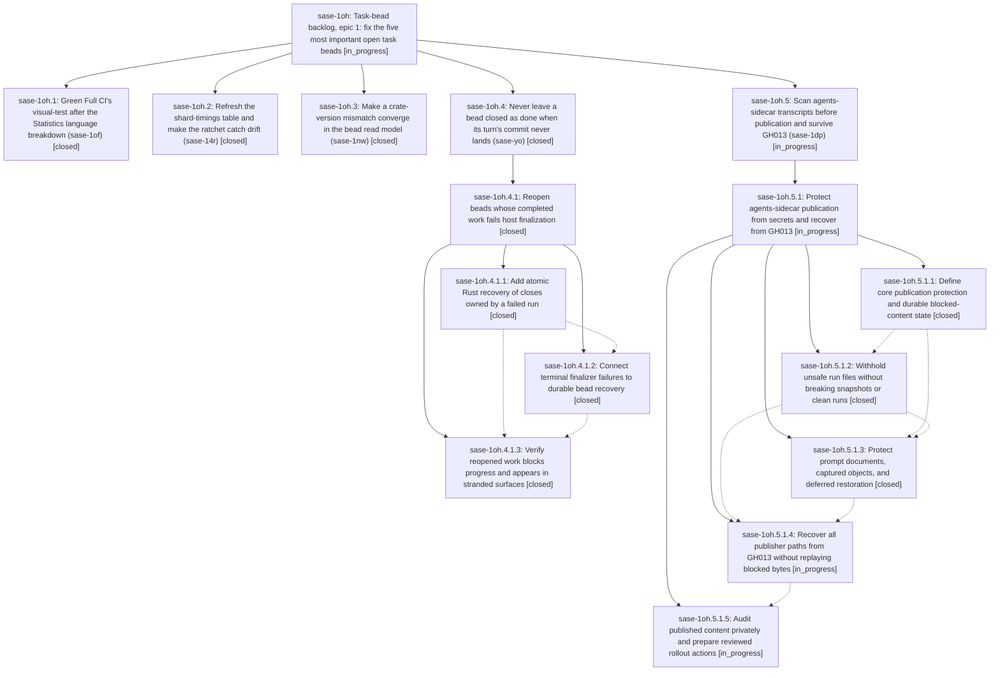

# Bead: sase-1oh — Task-bead backlog, epic 1: fix the five most important open task beads

[Bead Pages](../README.md) / sase-1oh

**Status:** ◐ in_progress · **Type:** ▸ plan · **Tier:** epic
**Owner:** `bryanbugyi34@gmail.com` · **Created by:** [bbugyi200.athena.14m](https://github.com/sase-org/sase--agents/blob/main/sessions/bbugyi200.athena.14m.md) · **Assignee:** `sase-1oh.land`
**Created:** 2026-10-26 14:14:58 EDT
**Plan:** [202610/backlog\_epic\_top\_five\_task\_beads.md](https://github.com/sase-org/sase--plans/blob/main/202610/backlog_epic_top_five_task_beads.md)

<!-- sase:links:start -->

## Links

| Relation | Artifact | Why |
| --- | --- | --- |
| implemented-by | [plan:202610/backlog_epic_top_five_task_beads.md][1] | derived from the plan's `bead_id:` frontmatter field |

_Plus 1 automatic references — see [Referenced By](#referenced-by)._

[1]: https://github.com/sase-org/sase--plans/blob/main/202610/backlog_epic_top_five_task_beads.md

<!-- sase:links:end -->

## Description

The five most important open task beads in the sase project are resolved on master and closed with recorded evidence: sase-1of (Full CI visual-test red), sase-14r (the shard-timings table is about to turn Master Gate red), sase-1nw (the stuck bead read model burns CPU and disk on athena), sase-yo (closed-as-done beads strand unlanded work), and sase-1dp (agent transcripts reach the public sidecar unscanned). The land agent then starts the next backlog epic, five beads at a time, until no workable task bead remains.

## Phases

| Bead | Title | Status | Size | Created | Agents | Commits |
|---|---|---|---|---|---:|---:|
| [sase-1oh.1](sase-1oh.1.md) | Green Full CI's visual-test after the Statistics language breakdown (sase-1of) | ✓ closed | small | 2026-10-26 | 1 | 1 |
| [sase-1oh.2](sase-1oh.2.md) | Refresh the shard-timings table and make the ratchet catch drift (sase-14r) | ✓ closed | medium | 2026-10-26 | 1 | 1 |
| [sase-1oh.3](sase-1oh.3.md) | Make a crate-version mismatch converge in the bead read model (sase-1nw) | ✓ closed | large | 2026-10-26 | 1 | 1 |
| [sase-1oh.4](sase-1oh.4.md) | Never leave a bead closed as done when its turn's commit never lands (sase-yo) | ✓ closed | large | 2026-10-26 | 1 | 0 |
| [sase-1oh.5](sase-1oh.5.md) | Scan agents-sidecar transcripts before publication and survive GH013 (sase-1dp) | ◐ in_progress | large | 2026-10-26 | 1 | 0 |

## Lineage

## Agents

| Agent | Bead | Commits |
|---|---|---:|
| [bbugyi200.athena.sase-1oh.1](https://github.com/sase-org/sase--agents/blob/main/agents/bbugyi200.athena.sase-1oh.1/README.md) | [sase-1oh.1](sase-1oh.1.md) | 1 |
| [bbugyi200.athena.sase-1oh.2](https://github.com/sase-org/sase--agents/blob/main/agents/bbugyi200.athena.sase-1oh.2/README.md) | [sase-1oh.2](sase-1oh.2.md) | 1 |
| [bbugyi200.athena.sase-1oh.3](https://github.com/sase-org/sase--agents/blob/main/sessions/bbugyi200.athena.sase-1oh.3.md) | [sase-1oh.3](sase-1oh.3.md) | 1 |
| [bbugyi200.athena.sase-1oh.4](https://github.com/sase-org/sase--agents/blob/main/sessions/bbugyi200.athena.sase-1oh.4.md) | [sase-1oh.4](sase-1oh.4.md) | 0 |
| [bbugyi200.athena.sase-1oh.4.1.1](https://github.com/sase-org/sase--agents/blob/main/agents/bbugyi200.athena.sase-1oh.4.1.1/README.md) | [sase-1oh.4.1.1](sase-1oh.4.1.1.md) | 1 |
| [bbugyi200.athena.sase-1oh.4.1.2](https://github.com/sase-org/sase--agents/blob/main/agents/bbugyi200.athena.sase-1oh.4.1.2/README.md) | [sase-1oh.4.1.2](sase-1oh.4.1.2.md) | 1 |
| [bbugyi200.athena.sase-1oh.4.1.3](https://github.com/sase-org/sase--agents/blob/main/agents/bbugyi200.athena.sase-1oh.4.1.3/README.md) | [sase-1oh.4.1.3](sase-1oh.4.1.3.md) | 1 |
| [bbugyi200.athena.sase-1oh.4.1.land](https://github.com/sase-org/sase--agents/blob/main/sessions/bbugyi200.athena.sase-1oh.4.1.land.md) | [sase-1oh.4.1](sase-1oh.4.1.md) | 2 |
| [bbugyi200.athena.sase-1oh.5](https://github.com/sase-org/sase--agents/blob/main/sessions/bbugyi200.athena.sase-1oh.5.md) | [sase-1oh.5](sase-1oh.5.md) | 0 |
| [bbugyi200.athena.sase-1oh.5.1.1](https://github.com/sase-org/sase--agents/blob/main/agents/bbugyi200.athena.sase-1oh.5.1.1/README.md) | [sase-1oh.5.1.1](sase-1oh.5.1.1.md) | 2 |
| [bbugyi200.athena.sase-1oh.5.1.2](https://github.com/sase-org/sase--agents/blob/main/agents/bbugyi200.athena.sase-1oh.5.1.2/README.md) | [sase-1oh.5.1.2](sase-1oh.5.1.2.md) | 1 |
| [bbugyi200.athena.sase-1oh.5.1.3](https://github.com/sase-org/sase--agents/blob/main/agents/bbugyi200.athena.sase-1oh.5.1.3/README.md) | [sase-1oh.5.1.3](sase-1oh.5.1.3.md) | 1 |
| [bbugyi200.athena.sase-1oh.5.1.4](https://github.com/sase-org/sase--agents/blob/main/sessions/bbugyi200.athena.sase-1oh.5.1.4.md) | [sase-1oh.5.1.4](sase-1oh.5.1.4.md) | 0 |
| [bbugyi200.athena.sase-1oh.5.1.5](https://github.com/sase-org/sase--agents/blob/main/agents/bbugyi200.athena.sase-1oh.5.1.5/README.md) | [sase-1oh.5.1.5](sase-1oh.5.1.5.md) | 0 |
| [bbugyi200.athena.sase-1oh.5.1.land](https://github.com/sase-org/sase--agents/blob/main/agents/bbugyi200.athena.sase-1oh.5.1.land/README.md) | [sase-1oh.5.1](sase-1oh.5.1.md) | 0 |
| [bbugyi200.athena.sase-1oh.land](https://github.com/sase-org/sase--agents/blob/main/agents/bbugyi200.athena.sase-1oh.land/README.md) | [sase-1oh](README.md) | 0 |

## Commits

| Repo | Commit | Subject | Bead | Committed |
|---|---|---|---|---|
| sase | [`7c9bfa8`](https://github.com/sase-org/sase/commit/7c9bfa89f78f79df699327904d578dea02034e4f) | fix(ci): catch shard timing drift before gate breaks | [sase-1oh.2](sase-1oh.2.md) | 2026-10-26 15:11:20 EDT |
| sase-core | [`sase-core@4f17b72`](https://github.com/sase-org/sase-core/commit/4f17b727bdbff69515a5cebc5db099ca549edf98) | feat(beads): recover failed-run closes atomically | [sase-1oh.4.1.1](sase-1oh.4.1.1.md) | 2026-10-26 15:40:41 EDT |
| sase | [`dd12f98`](https://github.com/sase-org/sase/commit/dd12f981ae3256d135114dc46aaa2eb4ecb73ddf) | test(ace): refresh statistics language snapshots | [sase-1oh.1](sase-1oh.1.md) | 2026-10-26 15:41:28 EDT |
| sase-core | [`sase-core@7b88b98`](https://github.com/sase-org/sase-core/commit/7b88b98d40162590c4226192fa27993f08d024a5) | fix(bead-read-model): converge crate-version mismatch recovery | [sase-1oh.3](sase-1oh.3.md) | 2026-10-26 16:14:28 EDT |
| sase-core | [`sase-core@416db28`](https://github.com/sase-org/sase-core/commit/416db28904d080f5fc1ed884dfc256a4d0427fa6) | feat(core): add publication protection policy | [sase-1oh.5.1.1](sase-1oh.5.1.1.md) | 2026-10-26 17:06:52 EDT |
| sase | [`f4591e9`](https://github.com/sase-org/sase/commit/f4591e9106830fb5e558d71f506b4a2d9fe9791b) | feat(agents-sync): add publication protection state | [sase-1oh.5.1.1](sase-1oh.5.1.1.md) | 2026-10-26 17:10:06 EDT |
| sase | [`67edb96`](https://github.com/sase-org/sase/commit/67edb9677d23a2cdc93b71d944c551336f6416e3) | feat(agents-sync): withhold unsafe transcript bytes without breaking clean publication | [sase-1oh.5.1.2](sase-1oh.5.1.2.md) | 2026-10-26 20:17:10 EDT |
| sase | [`eb365af`](https://github.com/sase-org/sase/commit/eb365afe30ba8a1b8c5c291f6e0e1be26c999a12) | fix(finalizers): resolve symvision items for failed-close recovery | [sase-1oh.4.1.2](sase-1oh.4.1.2.md) | 2026-10-26 20:18:19 EDT |
| sase | [`13abbfb`](https://github.com/sase-org/sase/commit/13abbfb01ed4df28e9330ce07b70c2c3d03ecae0) | feat(beads): surface recovered open work as stranded | [sase-1oh.4.1.3](sase-1oh.4.1.3.md) | 2026-10-26 22:59:23 EDT |
| sase | [`0f76e05`](https://github.com/sase-org/sase/commit/0f76e05de4dfcef4655a2eae0f9ca74e44f68211) | feat(agents-sync): withhold unsafe prompt-archive text without breaking clean publication | [sase-1oh.5.1.3](sase-1oh.5.1.3.md) | 2026-10-27 00:54:32 EDT |
| sase-core | [`sase-core@800caef`](https://github.com/sase-org/sase-core/commit/800caef4c70039ccf299a0ecca379142f80234c2) | fix(beads): recover every eligible failed-run close in one mutation | [sase-1oh.4.1](sase-1oh.4.1.md) | 2026-10-27 01:14:00 EDT |
| sase | [`3f00441`](https://github.com/sase-org/sase/commit/3f0044196d5e385912b09efbd5477d6c58cee2c7) | fix(finalizers): require current landing proof and retry recovery commits | [sase-1oh.4.1](sase-1oh.4.1.md) | 2026-10-27 02:21:17 EDT |

<!-- sase:referenced-by:start -->

## Referenced By

| Relation | Artifact | Why | Uses |
| --- | --- | --- | ---: |
| read-by | [agent:sase-1oh.4.1.1][1] | Need source task and parent-plan context for the recovery phase | 1 |

[1]: https://github.com/sase-org/sase--agents/blob/main/agents/bbugyi200.athena.sase-1oh.4.1.1/README.md

<!-- sase:referenced-by:end -->
