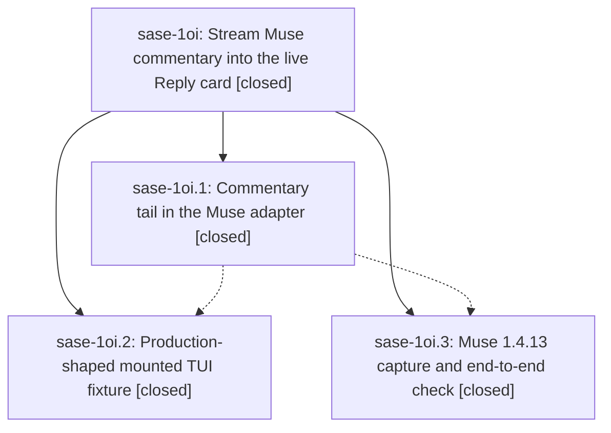

# Bead: sase-1oi — Stream Muse commentary into the live Reply card

[Bead Pages](../README.md) / sase-1oi

**Status:** ✓ closed · **Resolution:** done · **Type:** ▸ plan · **Tier:** epic
**Owner:** `bryanbugyi34@gmail.com` · **Created by:** `bbugyi200.apollo.research.2i.linker.w0` · **Assignee:** `sase-1oi.land`
**Created:** 2026-10-26 15:05:46 EDT · **Closed:** 2026-10-27 00:47:08 EDT
**Plan:** [202610/muse\_commentary\_live\_reply.md](https://github.com/sase-org/sase--plans/blob/main/202610/muse_commentary_live_reply.md)

<!-- sase:links:start -->

## Links

| Relation | Artifact | Why |
| --- | --- | --- |
| implemented-by | [plan:202610/muse_commentary_live_reply.md][1] | derived from the plan's `bead_id:` frontmatter field |

_Plus 2 automatic references — see [Referenced By](#referenced-by)._

[1]: https://github.com/sase-org/sase--plans/blob/main/202610/muse_commentary_live_reply.md

<!-- sase:links:end -->

## Description

While a Muse agent runs, each commentary message Muse commits to its session log appears in live_reply.md, and so in the main deck's Reply card, within about a second. The returned reply, token usage, final-answer streaming, and host finalizers are unchanged, and tests exercise the real Muse 1.4.13 stream shape so this gap cannot hide again.

## Notes

[2026-10-27T04:39:09Z · sase-1oi.land] FOLLOW-UP TRIAGE: Reviewed every note on sase-1oi.1/.2/.3 and grouped duplicate proposals. (1) Auto-skipped decision record (.1 #1, .2 #2, .3 #2): filed small memory task sase-1oq for decisions/private-logs-display-only.md under sase_memory_write/sase_new_task; decision_record=no honored, no memory edits. (2) PROPOSED FOLLOW-UP: retire the private commentary tail when muse exec --json exposes assistant message phase (.1 #2, .2 #1, .3 #3). Declined a runnable task now: committed R6996.1 capture still requires the tail, the upstream event is a prerequisite, and the feature task type refuses agent creation. Preserve the concrete migration here: parse that event in _process_muse_json_line, deduplicate by message_id during overlap, then remove the tail and its on_tick call site. (3) Capacity scan failure (.1 #3) plus blocked-waiter/parity failures (.2 #3, .3 #4): already repaired by sase-1oj.4 commits e7d9f7a479/f83711219c; all three relevant test files pass in this landing. Added disposition evidence to causal epic sase-1oj; declined duplicate tasks because no remaining reproduction. (4) AGY timeout/rate-limit flake (.1 #4): corroborated existing ready flake task sase-19m with phase ToolRun 307a0c857ef60b738f085e57c3c933cd and current passing AGY file; no duplicate. Searched all task statuses, swept the last week, and reviewed active-epic ownership before dispositions.

[2026-10-27T04:47:08Z · sase-1oi.land] Verified the approved plan and every note on all three closed phases against commits cf9b9dbf39, 027125d57b, and 260b9caa3f and the actual source/tests/docs. Commentary is incrementally tailed, session-filtered, deduplicated, bounded, fail-soft, and display-only; metadata appears at launch, final deltas/fallback remain authoritative, and returned content, usage, wait guard, and host finalizers are preserved. All four production-shaped mounted cases and sanitized R6996.1 replay pass; reviewed phase .3 real Muse E2E timing evidence. decision_record=no honored, no memory edits. The research reference is unavailable in the local sidecar; the approved plan, committed captures, and phase evidence independently support the audit. Integration: fetched origin/master equals 260b9caa3f; reviewed all commits since the first epic commit plus creation-to-first-commit drift. Capacity report/adoption, failed-close refactor, Codex home changes, and publication changes require no Muse integration edits or duplicated implementation removal. 161 focused tests passed, including shared stream UTF-8 and TUI import-budget tests. sase tool run check 21d18726cc56afddc5f2bf7999697c81 passed (exit 0); no check-full. epic-symbols empty. Follow-ups: .1#1/.2#2/.3#2 consolidated into ready small memory task sase-1oq; .1#2/.2#1/.3#3 tail-retirement proposal retained in epic triage note, no runnable task because upstream message-phase export is absent and feature tasks refuse agent creation; .1#3/.2#3/.3#4 capacity failures fixed by sase-1oj.4 commits e7d9f7a479/f83711219c and passing now, evidence noted on causal epic sase-1oj, no duplicate tasks; .1#4 AGY timeout/rate-limit flake corroborated on existing sase-19m with phase ToolRun evidence and current passing rerun. No unresolved epic work.

[2026-10-27T04:48:31Z · sase-1oi.land] POST-CLOSE: just symvision exited 0 (All public/private classes/functions are used properly). Marked plan:202610/muse_commentary_live_reply.md status: done. Re-read epic after close: no parent_bead, so no ancestor closeout is required.

## Phases

| Bead | Title | Status | Size | Created | Agents | Commits |
|---|---|---|---|---|---:|---:|
| [sase-1oi.1](sase-1oi.1.md) | Commentary tail in the Muse adapter | ✓ closed | medium | 2026-10-26 | 1 | 1 |
| [sase-1oi.2](sase-1oi.2.md) | Production-shaped mounted TUI fixture | ✓ closed | medium | 2026-10-26 | 1 | 1 |
| [sase-1oi.3](sase-1oi.3.md) | Muse 1.4.13 capture and end-to-end check | ✓ closed | medium | 2026-10-26 | 1 | 1 |

## Lineage

## Agents

| Agent | Bead | Commits |
|---|---|---:|
| [bbugyi200.athena.sase-1oi.1](https://github.com/sase-org/sase--agents/blob/main/agents/bbugyi200.athena.sase-1oi.1/README.md) | [sase-1oi.1](sase-1oi.1.md) | 1 |
| [bbugyi200.athena.sase-1oi.2](https://github.com/sase-org/sase--agents/blob/main/agents/bbugyi200.athena.sase-1oi.2/README.md) | [sase-1oi.2](sase-1oi.2.md) | 1 |
| [bbugyi200.athena.sase-1oi.3](https://github.com/sase-org/sase--agents/blob/main/sessions/bbugyi200.athena.sase-1oi.3.md) | [sase-1oi.3](sase-1oi.3.md) | 1 |
| [bbugyi200.athena.sase-1oi.land](https://github.com/sase-org/sase--agents/blob/main/agents/bbugyi200.athena.sase-1oi.land/README.md) | [sase-1oi](README.md) | 1 |

## Commits

| Repo | Commit | Subject | Bead | Committed |
|---|---|---|---|---|
| sase | [`cf9b9db`](https://github.com/sase-org/sase/commit/cf9b9dbf39737dfc7bf924bd9979b9f3273985b3) | feat(llm-provider): tail Muse session-log commentary into live\_reply.md | [sase-1oi.1](sase-1oi.1.md) | 2026-10-26 23:09:56 EDT |
| sase | [`027125d`](https://github.com/sase-org/sase/commit/027125d57b651d99cdd31d6f294476395bef7e85) | test(tui): mount production-shaped Muse commentary fixture in live-reply follow tests | [sase-1oi.2](sase-1oi.2.md) | 2026-10-27 00:23:57 EDT |
| sase | [`260b9ca`](https://github.com/sase-org/sase/commit/260b9caa3fccf9e9be33fb04bdb7c48d9bfc2473) | feat(muse-provider): add 1.4.13 live-capture fixtures and replay test | [sase-1oi.3](sase-1oi.3.md) | 2026-10-27 00:26:26 EDT |
| sase--plans | [`sase--plans@1a27ece`](https://github.com/sase-org/sase--plans/commit/1a27ece54b108ad02c74f4cea7f39281b0c0ec58) | docs(plans): complete sase-1oi Muse commentary epic | [sase-1oi](README.md) | 2026-10-27 00:49:06 EDT |

<!-- sase:referenced-by:start -->

## Referenced By

| Relation | Artifact | Why | Uses |
| --- | --- | --- | ---: |
| read-by | [agent:sase-1oi.1][1] | Need epic scope and remaining phases | 1 |
| read-by | [agent:sase-1oi.3--1][2] | Check epic DECISIONS and scope for phase close | 1 |

[1]: https://github.com/sase-org/sase--agents/blob/main/agents/bbugyi200.athena.sase-1oi.1/README.md
[2]: https://github.com/sase-org/sase--agents/blob/main/sessions/bbugyi200.athena.sase-1oi.3.md

<!-- sase:referenced-by:end -->
