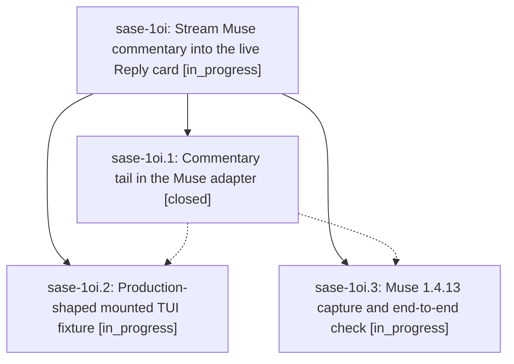

# Bead: sase-1oi — Stream Muse commentary into the live Reply card

[Bead Pages](../README.md) / sase-1oi

**Status:** ◐ in_progress · **Type:** ▸ plan · **Tier:** epic
**Owner:** `bryanbugyi34@gmail.com` · **Created by:** `bbugyi200.apollo.research.2i.linker.w0` · **Assignee:** `sase-1oi.land`
**Created:** 2026-10-26 15:05:46 EDT
**Plan:** [202610/muse\_commentary\_live\_reply.md](https://github.com/sase-org/sase--plans/blob/main/202610/muse_commentary_live_reply.md)

<!-- sase:links:start -->

## Links

| Relation | Artifact | Why |
| --- | --- | --- |
| implemented-by | [plan:202610/muse_commentary_live_reply.md][1] | derived from the plan's `bead_id:` frontmatter field |

[1]: https://github.com/sase-org/sase--plans/blob/main/202610/muse_commentary_live_reply.md

<!-- sase:links:end -->

## Description

While a Muse agent runs, each commentary message Muse commits to its session log appears in live_reply.md, and so in the main deck's Reply card, within about a second. The returned reply, token usage, final-answer streaming, and host finalizers are unchanged, and tests exercise the real Muse 1.4.13 stream shape so this gap cannot hide again.

## Phases

| Bead | Title | Status | Size | Created | Agents | Commits |
|---|---|---|---|---|---:|---:|
| [sase-1oi.1](sase-1oi.1.md) | Commentary tail in the Muse adapter | ✓ closed | medium | 2026-10-26 | 1 | 1 |
| [sase-1oi.2](sase-1oi.2.md) | Production-shaped mounted TUI fixture | ◐ in_progress | medium | 2026-10-26 | 1 | 0 |
| [sase-1oi.3](sase-1oi.3.md) | Muse 1.4.13 capture and end-to-end check | ◐ in_progress | medium | 2026-10-26 | 1 | 0 |

## Lineage

## Agents

| Agent | Bead | Commits |
|---|---|---:|
| [bbugyi200.athena.sase-1oi.1](https://github.com/sase-org/sase--agents/blob/main/agents/bbugyi200.athena.sase-1oi.1/README.md) | [sase-1oi.1](sase-1oi.1.md) | 1 |
| [bbugyi200.athena.sase-1oi.2](https://github.com/sase-org/sase--agents/blob/main/agents/bbugyi200.athena.sase-1oi.2/README.md) | [sase-1oi.2](sase-1oi.2.md) | 0 |
| [bbugyi200.athena.sase-1oi.3](https://github.com/sase-org/sase--agents/blob/main/agents/bbugyi200.athena.sase-1oi.3/README.md) | [sase-1oi.3](sase-1oi.3.md) | 0 |
| [bbugyi200.athena.sase-1oi.land](https://github.com/sase-org/sase--agents/blob/main/agents/bbugyi200.athena.sase-1oi.land/README.md) | [sase-1oi](README.md) | 0 |

## Commits

| Repo | Commit | Subject | Bead | Committed |
|---|---|---|---|---|
| sase | [`cf9b9db`](https://github.com/sase-org/sase/commit/cf9b9dbf39737dfc7bf924bd9979b9f3273985b3) | feat(llm-provider): tail Muse session-log commentary into live\_reply.md | [sase-1oi.1](sase-1oi.1.md) | 2026-10-26 23:09:56 EDT |
