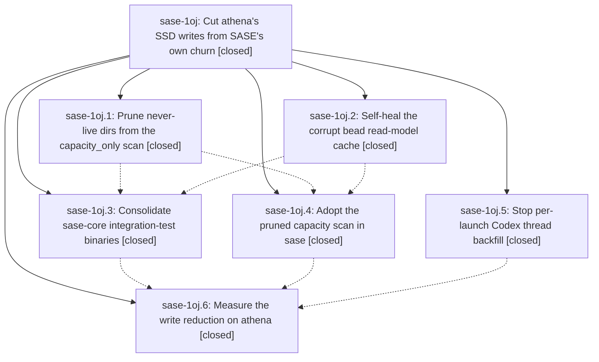

# Bead: sase-1oj — Cut athena's SSD writes from SASE's own churn

[Bead Pages](../README.md) / sase-1oj

**Status:** ✓ closed · **Resolution:** done · **Type:** ▸ plan · **Tier:** epic
**Owner:** `bryanbugyi34@gmail.com` · **Created by:** [bbugyi200.apollo.ae](https://github.com/sase-org/sase--agents/blob/main/sessions/bbugyi200.apollo.ae.md) · **Assignee:** `sase-1oj.land`
**Created:** 2026-10-26 16:07:27 EDT · **Closed:** 2026-10-27 15:19:04 EDT
**Plan:** [202610/athena\_disk\_write\_diet.md](https://github.com/sase-org/sase--plans/blob/main/202610/athena_disk_write_diet.md)

<!-- sase:links:start -->

## Links

| Relation | Artifact | Why |
| --- | --- | --- |
| implemented-by | [plan:202610/athena_disk_write_diet.md][1] | derived from the plan's `bead_id:` frontmatter field |
| related | [bead:sase-1p0][2] | Epic that cut the four targeted write sources; its verify phase sase-1oj.6 measured the remaining writers this task covers |

_Plus 5 automatic references — see [Referenced By](#referenced-by)._

[1]: https://github.com/sase-org/sase--plans/blob/main/202610/athena_disk_write_diet.md
[2]: https://github.com/sase-org/sase--beads/blob/main/pages/sase-1p0/README.md

<!-- sase:links:end -->

## Description

SASE stops rewriting large derived state on athena's root NVMe. The runner-slot capacity cache shrinks from ~104 MB to under ~1 MB. Codex launches stop rebuilding a 347 MB thread index (and start ~3 minutes sooner). The corrupt bead read-model cache heals itself instead of rebuilding and rolling back on every read. sase-core test builds link ~2.9 GB less per cycle. No admission decision, Codex transcript, or bead read result changes.

## Notes

[2026-10-27T02:05:05Z · sase-1ok.land] DISCOVERED ISSUE: Landing triage of sase-1ok.1#1, sase-1ok.2#1, and sase-1ok.3#2 finds the same three capacity fixtures failing after sase-1oj.1 dead-PID pruning: test_capacity_only_skips_done_dirs_and_keeps_active_ones, test_capacity_blocked_waiter_does_not_park_the_queue_behind_it, test_capacity_blocked_head_then_high_budget_launch_uses_real_scan. The phases independently reproduced failures on clean base 98cb07ebb8 / witness 0eefa7f1c9ee0383c9c47942325079fe; fixture PID 11111 is not a liveness guarantee. sase-1oj.4#2 reports correcting these fixtures and passing ToolRun ad01b1a3661b647ee62905f865c53150, but those adoption files are not in fetched origin/master cef4bb1199 at this audit. Please include that reported fix in this epic landing. Causally owned here; no new task bead.

[2026-10-27T02:11:04Z · sase-1ok.land] FOLLOW-UP TO LANDING EVIDENCE: e7d9f7a479 (sase-1oj.4 adoption) landed during the audit and was fast-forwarded locally. Focused verification of tests/test_core_agent_scan_options.py, test_run_agent_runner_slot_poll.py, test_run_agent_runner_slot_scan_capacity.py, and test_capacity_only_scan_parity.py now gives 36 passed, 1 failed. Remaining exact node: test_capacity_blocked_waiter_does_not_park_the_queue_behind_it, tests/test_run_agent_runner_slot_scan_capacity.py:90, drained is unexpected instead of None. This function still supplies fake PIDs 100, 101, 102; e7d9f7a479 changed only the other real-scan test to os.getpid(). That leftover fixture remains part of the dead-PID-pruning adoption. Other two previously proposed failures now pass. Clean tracked tree, no sase-1ok changes authored.

[2026-10-27T03:01:40Z · sase-1ok.land] INDEPENDENT REPRODUCTION: sase-1ok tale coder ToolRun 27aed0c963ecf9fe21d2881b3d2d3fcf (sase tool run check) still fails tests/test_run_agent_runner_slot_scan_capacity.py::test_capacity_blocked_waiter_does_not_park_the_queue_behind_it. Assertion is drained == 'unexpected' instead of None at the claim that must park; the fixture still uses fake PIDs 100/101/102. Same remaining node recorded on this epic after e7d9f7a479. Unrelated to stranded-wait reconciliation. No new task.

[2026-10-27T03:15:28Z · sase-1oh.4.1.land] DISCOVERED ISSUE: Landing triage of sase-1oh.4.1.3 note #1 independently reproduces the remaining dead-PID fixture after e7d9f7a479 on sase c74a32c5c4. Focused run of test_agent_group_revival_e2e.py, test_axe_chop_bead_claim_checks.py, test_axe_chop_bead_claim_checks_leases.py, test_run_agent_runner_slot_scan_capacity.py, and test_core_agent_scan_options.py: 47 passed, only test_capacity_blocked_waiter_does_not_park_the_queue_behind_it failed at line 90 (drained unexpected, expected None). Fixture still uses PIDs 100/101/102. Other proposed capacity nodes now pass. This corroborates this epic notes #2/#3 and belongs to dead-PID pruning adoption, not failed-close recovery. No new task.

[2026-10-27T04:38:20Z · sase-1oi.land] FOLLOW-UP DISPOSITION from sase-1oi landing: proposals sase-1oi.1 #3 (capacity_only active-dir scan), sase-1oi.2 #3 and sase-1oi.3 #4 (blocked waiter and capacity parity) belong to this dead-PID-pruning adoption. Inspected e7d9f7a479 and f83711219c, including os.getpid() fixtures and admission-view parity. At current master 260b9caa3f, tests/test_core_agent_scan_options.py, tests/test_capacity_only_scan_parity.py, and tests/test_run_agent_runner_slot_scan_capacity.py all pass within a 147-test focused audit. No remaining reproduction and no duplicate task created; the prior failure reports are addressed by your committed adoption fixes.

[2026-10-27T11:26:52Z · sase-1oh.land] DISCOVERED ISSUE (sase-1oh.land, sase master 887175c3e5): tests/test_run_agent_runner_slot_lineage.py::test_capacity_only_dropped_predecessor_does_not_break_persisted_lineage fails on all three Python legs of Full CI run 40470130984 (7a860ff33e) with assert '20260910150001' in set(), and passes on athena. Root cause: same dead-PID fixture class as notes #1-#4. The test builds holder/grandchild with fake PIDs 101/102 and patches only Python is_process_alive. The real scan_agent_artifacts(_RUNNER_SLOT_SCAN_OPTIONS) now prunes never-live dirs in Rust (sase-1oj.1 / adoption e7d9f7a479). On athena PID 101 exists (kworker/13:0H, cpuhp/14 at 102), so the record survives; on GitHub runners it is pruned and the scanned set is empty. Fix: use os.getpid() for live fixtures, as f83711219c did for the sibling tests. Routed here via /sase_new_task; no task created.

[2026-10-27T11:27:11Z · sase-1oh.land] DISCOVERED ISSUE (sase-1oh.land, athena, 2026-10-27 ~07:15 EDT): the primary beads clone's bead read model (bead-read-model-e3b0c44298fc1c14.sqlite) is no longer stuck. sase-1nw's 0.40.0 meta is gone and crate_version now updates. But the cache ping-pongs between the crate versions loaded in live processes, and the churn now dominates athena's SASE writes.

Evidence. A read-only meta sample every 35 s over 140 s cycled crate_version 0.42.7 -> 0.42.4 -> 0.42.4 -> 0.42.1 -> 0.42.7 with the frontier fixed at 2026-10-27T11:03:47Z (no store change). Over those 140 s, generation went 30758 -> 30820, outcome_rebuild went 11214 -> 11237 (+23), and the -wal reached 36 MB.

Per-process cost. 23 processes map the deleted pre-update sase_core_rs.abi3.so: 16 parked run_agent_runner.py runners started Oct 19-26, the sase service host, sase_gateway, sase_federation_worker, two supervisor_bootstrap procs, and the user's `sase tui`. 22 processes map the current 800caef4 build. /proc/<pid>/io write_bytes over 60 s:
- old-extension processes: 1175 MB total, about 70 MB/min per parked runner (the original sase-1nw symptom), and the TUI at 313 MB/min;
- current-extension processes: 548 MB total, for example the axe waits routine at 267 MB/min and agent_ at 174 MB/min. They keep cold-rebuilding because older processes keep re-stamping crate_version.

Cause. A single shared cache file is validated by an exact crate_version match, and every process rewrites it on mismatch. This predates sase-1oh.3 (7b88b98d) and sase-1oj.2 (651d1933). Those fixes made rebuilds commit again, so mixed-version fleets now flip-flop instead of rolling back. Every sase-core update that leaves long-lived processes running will reproduce this until they restart.

Why it belongs here. This epic's goal (cut athena's SSD writes; the read model stops rebuilding on every read) and its measurement phase sase-1oj.6 cannot pass while this persists.

Suggested remedy:
- immediate: restart the stale-extension processes. sase-1oh.land raises a restart gate as its last action; agents cannot restart the user's services, runners or TUI unilaterally.
- durable: key the cache path or validity on schema_version+reducer_version, or per crate version, so different loaded versions never rewrite one file. The wrong answer is crate_version-blind serving without a reducer contract.

Routed here via /sase_new_task as the causally related active epic; no task created.

[2026-10-27T12:37:42Z · ak--code] sase-1oj.6 and sase-1oj.land were parked forever on agent-session name sase-1oj.4. Cause: sase-1oj.4--plan attempt 1 left a failed finalizer_result.json in the root artifacts dir; snapshot_attempt did not archive it, so the later shell-handoff:monitored wrote done.json outcome=failed from that stale verdict. Session wait then treated the failed --plan as live, while the newest failed --mon was skipped as a terminal blocker because its follow-up launched. Fix (plan:202610/unstick_session_wait_after_handoff_retry.md): (A) drop a failed agent turn from the effective generation when its own launched monitor/gate follow-up is present; (B) snapshot_attempt archives finalizer_result.json and finalizers/progress.jsonl into attempts/<N>/. Live read-only replay of _resolve_marker_release: sase-1oj.6 releasable=True; sase-1oj.land blocked_on=('sase-1oj.6',). wait_checks should write ready.json for sase-1oj.6 without restarting the parked runners.

[2026-10-27T12:57:57Z · sase-1oh.land--1] Restart gate custom-4e3c8758-4bea-4d33-b179-edcbca6b292b (stale pre-update sase_core_rs processes) was answered via tui, 2026-10-27T12:54Z. Selected branch: all three commands (restart the SASE service host, restart stale parked WAITING/QUEUED agents, verify the read-model cache settles).
- restart_service: exit 0, sase.service restarted through the native manager.
- restart_waiting: 19 agents restarted, 0 failed. 2 parked monitors were skipped by design (sase-1oe.4--mon, sase-1n6.10--mon).
- verify: status=converged. installed_core 0.42.7. crate_versions_seen [0.42.7]. Over 105 s: generation_delta 0, rebuild_delta 0, frontier_changes 0. 37 current processes write 723.7 MB/min in total; 7 stale processes write 15.7 MB/min.
Residual: at 12:57Z, 5 processes still map a sase_core_rs .so marked "(deleted)". They are the two skipped monitor supervisors (pid 1347500 = sase-1oe.4--mon ratchet_core_pin loop; pid 4026430 = sase-1n6.10--mon cutover poll), sase_federation_worker (pid 195776, started Oct 25 and not cycled by the service restart), and two bob-cli land runners (pid 3265419 = bob-cli-d2.land, started 11:44Z; pid 3435543 = bob-cli-an.6.6.6.5.6.5.5.6.6.6.6.6.6.6.6.6.land, started 11:54Z by this gate). The runners started after the 0.42.7 install, so their deleted mapping is most likely a later same-version rebuild of the dev .so. That matches crate_versions_seen=[0.42.7] and zero rebuilds: the crate_version flip-flop is gone. Nothing was killed or restarted by the follow-up agent.

For sase-1oj.6: the measurement baseline should use post-restart numbers (converged, no rebuild churn). The durable per-version cache isolation in DISCOVERED ISSUE #7 is still open.

[2026-10-27T16:51:03Z · sase-1oj.6] VERIFY-ATHENA (sase-1oj.6, 2026-10-27 12:27–12:44 EDT): host already ran the landed code (editable uv sase @ 691ef46153 with e7d9f7a479/d6d8b2b942; sase-core 6d11122e / pin 800caef4 / crate 0.43.0). No reinstall gate. Post-restart numbers (gate #9 at

… and 4794 more characters

## Phases

| Bead | Title | Status | Size | Created | Agents | Commits |
|---|---|---|---|---|---:|---:|
| [sase-1oj.1](sase-1oj.1.md) | Prune never-live dirs from the capacity\_only scan | ✓ closed | medium | 2026-10-26 | 1 | 1 |
| [sase-1oj.2](sase-1oj.2.md) | Self-heal the corrupt bead read-model cache | ✓ closed | medium | 2026-10-26 | 1 | 1 |
| [sase-1oj.3](sase-1oj.3.md) | Consolidate sase-core integration-test binaries | ✓ closed | medium | 2026-10-26 | 1 | 2 |
| [sase-1oj.4](sase-1oj.4.md) | Adopt the pruned capacity scan in sase | ✓ closed | small | 2026-10-26 | 1 | 2 |
| [sase-1oj.5](sase-1oj.5.md) | Stop per-launch Codex thread backfill | ✓ closed | medium | 2026-10-26 | 1 | 1 |
| [sase-1oj.6](sase-1oj.6.md) | Measure the write reduction on athena | ✓ closed | small | 2026-10-26 | 1 | 0 |

## Lineage

## Agents

| Agent | Bead | Commits |
|---|---|---:|
| [bbugyi200.apollo.sase-1oj.1](https://github.com/sase-org/sase--agents/blob/main/agents/bbugyi200.apollo.sase-1oj.1/README.md) | [sase-1oj.1](sase-1oj.1.md) | 1 |
| [bbugyi200.apollo.sase-1oj.2](https://github.com/sase-org/sase--agents/blob/main/agents/bbugyi200.apollo.sase-1oj.2/README.md) | [sase-1oj.2](sase-1oj.2.md) | 1 |
| [bbugyi200.apollo.sase-1oj.3](https://github.com/sase-org/sase--agents/blob/main/agents/bbugyi200.apollo.sase-1oj.3/README.md) | [sase-1oj.3](sase-1oj.3.md) | 2 |
| [bbugyi200.apollo.sase-1oj.4](https://github.com/sase-org/sase--agents/blob/main/sessions/bbugyi200.apollo.sase-1oj.4.md) | [sase-1oj.4](sase-1oj.4.md) | 2 |
| [bbugyi200.apollo.sase-1oj.5](https://github.com/sase-org/sase--agents/blob/main/sessions/bbugyi200.apollo.sase-1oj.5.md) | [sase-1oj.5](sase-1oj.5.md) | 1 |
| [bbugyi200.apollo.sase-1oj.6](https://github.com/sase-org/sase--agents/blob/main/agents/bbugyi200.apollo.sase-1oj.6/README.md) | [sase-1oj.6](sase-1oj.6.md) | 0 |
| [bbugyi200.apollo.sase-1oj.land](https://github.com/sase-org/sase--agents/blob/main/agents/bbugyi200.apollo.sase-1oj.land/README.md) | [sase-1oj](README.md) | 1 |

## Commits

| Repo | Commit | Subject | Bead | Committed |
|---|---|---|---|---|
| sase-core | [`sase-core@d14a32c`](https://github.com/sase-org/sase-core/commit/d14a32c8242aea936f39711a8452ef0ba08b121d) | feat(agent-scan): prune never-live capacity records | [sase-1oj.1](sase-1oj.1.md) | 2026-10-26 17:21:29 EDT |
| sase-core | [`sase-core@651d193`](https://github.com/sase-org/sase-core/commit/651d19330651f911ffdf20c8768d7b3a3d5e2634) | fix(bead-read-model): repair corrupt caches in place | [sase-1oj.2](sase-1oj.2.md) | 2026-10-26 18:05:21 EDT |
| sase-core | [`sase-core@b12e581`](https://github.com/sase-org/sase-core/commit/b12e5815289b1a83c244ab2bc7d620fa3eb662be) | test(core): merge integration tests into one binary per crate | [sase-1oj.3](sase-1oj.3.md) | 2026-10-26 18:52:13 EDT |
| sase | [`60498dc`](https://github.com/sase-org/sase/commit/60498dcb5ec08bd945a8e89055c74e182065fbab) | docs(rust-backend): point test paths at consolidated integration targets | [sase-1oj.3](sase-1oj.3.md) | 2026-10-26 18:56:43 EDT |
| sase | [`d6d8b2b`](https://github.com/sase-org/sase/commit/d6d8b2b9425ae2c4e88aa689ad8a89c03852732b) | feat(codex): isolate shadow-home sessions to today and tomorrow | [sase-1oj.5](sase-1oj.5.md) | 2026-10-26 19:48:02 EDT |
| sase | [`e7d9f7a`](https://github.com/sase-org/sase/commit/e7d9f7a479664f412422ce40c0e679d29e5db41c) | feat(runner-slots): adopt pruned capacity scan | [sase-1oj.4](sase-1oj.4.md) | 2026-10-26 22:05:57 EDT |
| sase | [`f837112`](https://github.com/sase-org/sase/commit/f83711219c0c5cb137d5b94a25a8923cd7357adf) | test(runner-slots): pin live pids in capacity-scan adoption tests | [sase-1oj.4](sase-1oj.4.md) | 2026-10-26 23:45:36 EDT |
| sase | [`c328233`](https://github.com/sase-org/sase/commit/c328233430e4699d92a8abcc4a38ed7e009d1e9c) | test(runner-slots): pin live pids in the persisted-lineage capacity scan test | [sase-1oj](README.md) | 2026-10-27 15:22:53 EDT |

<!-- sase:referenced-by:start -->

## Referenced By

| Relation | Artifact | Why | Uses |
| --- | --- | --- | ---: |
| read-by | [agent:sase-1oi.land][1] | Need causal capacity pruning epic and current ownership before follow-up disposition | 1 |
| read-by | [agent:sase-1oj.2][2] | Need epic plan, phase notes, constraints and design details for assigned phase | 1 |
| read-by | [agent:sase-1oj.4][3] | Need parent epic status and remaining phases | 1 |
| read-by | [agent:sase-1om.3][4] | See if pruned-scan epic tracked the capacity_blocked_waiter failure | 1 |
| read-by | [agent:sase-1ou.1][5] | classify exceedance owner bead status | 1 |

[1]: https://github.com/sase-org/sase--agents/blob/main/agents/bbugyi200.apollo.sase-1oi.land/README.md
[2]: https://github.com/sase-org/sase--agents/blob/main/agents/bbugyi200.apollo.sase-1oj.2/README.md
[3]: https://github.com/sase-org/sase--agents/blob/main/sessions/bbugyi200.apollo.sase-1oj.4.md
[4]: https://github.com/sase-org/sase--agents/blob/main/agents/bbugyi200.apollo.sase-1om.3/README.md
[5]: https://github.com/sase-org/sase--agents/blob/main/agents/bbugyi200.apollo.sase-1ou.1/README.md

<!-- sase:referenced-by:end -->
