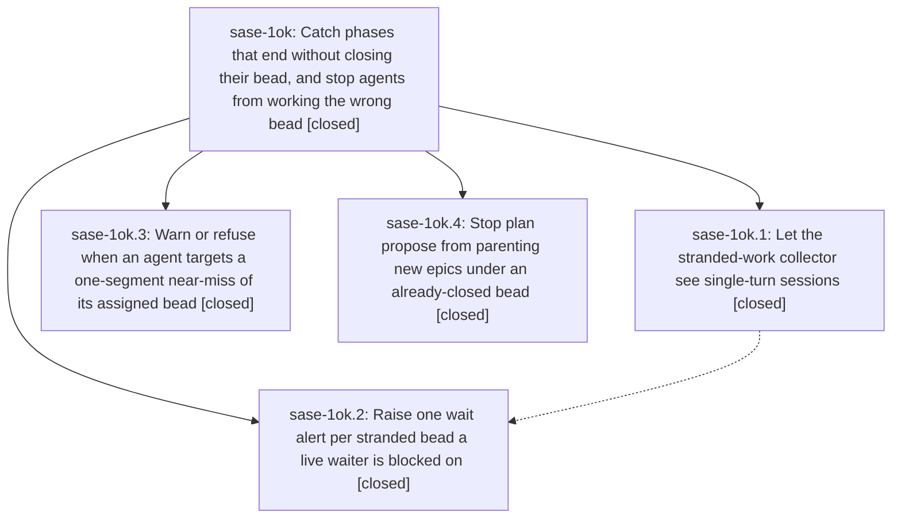

# Bead: sase-1ok — Catch phases that end without closing their bead, and stop agents from working the wrong bead

[Bead Pages](../README.md) / sase-1ok

**Status:** ✓ closed · **Resolution:** done · **Type:** ▸ plan · **Tier:** epic
**Owner:** `bryanbugyi34@gmail.com` · **Created by:** [bbugyi200.athena.14p](https://github.com/sase-org/sase--agents/blob/main/sessions/bbugyi200.athena.14p.md) · **Assignee:** `sase-1ok.land`
**Created:** 2026-10-26 18:10:49 EDT · **Closed:** 2026-10-26 23:02:18 EDT
**Plan:** [202610/stranded\_phase\_detection\_and\_wrong\_bead\_guard.md](https://github.com/sase-org/sase--plans/blob/main/202610/stranded_phase_detection_and_wrong_bead_guard.md)

<!-- sase:links:start -->

## Links

| Relation | Artifact | Why |
| --- | --- | --- |
| implemented-by | [plan:202610/stranded_phase_detection_and_wrong_bead_guard.md][1] | derived from the plan's `bead_id:` frontmatter field |

_Plus 2 automatic references — see [Referenced By](#referenced-by)._

[1]: https://github.com/sase-org/sase--plans/blob/main/202610/stranded_phase_detection_and_wrong_bead_guard.md

<!-- sase:links:end -->

## Description

A phase agent that misreads its own bead ID is warned or refused at the CLI. A single-turn phase that ends with its bead still open is classified stranded and raises one wait alert. A follow-on epic proposed after its bead closed no longer nests under it.

## Notes

[2026-10-27T02:05:31Z · sase-1ok.land] LANDING FOLLOW-UP TRIAGE: Reviewed all child notes. The three capacity-fixture proposals (sase-1ok.1#1, sase-1ok.2#1, sase-1ok.3#2) are one defect caused by active epic sase-1oj dead-PID pruning; recorded DISCOVERED ISSUE on sase-1oj, including sase-1oj.4 report of an already-tested fix not yet present in fetched cef4bb1199. Declined a separate task as causally owned there. The gateway IPC flake from sase-1ok.1#2 duplicates exact-node task sase-1gz; relayed the independent phase evidence as +1 (now +9). The Machines-pane flake from sase-1ok.3#1 duplicates sase-1ax; relayed it as +1 (now +1). No distinct untracked proposal remains and no new task was warranted. These are external to sase-1ok; the reproduced alert-reconciliation defect is remaining epic work and will be handled by a lander-authored tale.

[2026-10-27T02:10:00Z · sase-1ok.land] LANDING AUDIT: All four phase notes and commits reviewed: 538736f0f2, 98cb07ebb8, 9cb35859c9, fabfff06e0, and linked core 03dce1f2; source pin includes AgentName. DECISIONS near_miss_mutation=refuse is implemented on close/open, including fast-path open. Reviewed non-epic drift through cef4bb1199 (Codex shadow sessions; publication retry/protection; failed-close recovery; core wheel pin; monitor-capacity projections). Seven focused test files passed 89 tests. No epic-symbol exemptions; parent_id is null. Remaining epic defect reproduced in isolated state: after a stranded-bead alert exists, close the bead and release its waiter outside wait_checks (ready.json already exists, or waiting.json removed); alert count stays 1 after both ticks. The tick has no pending waiter to seed reconciliation. Required remaining-work tale will seed targets from outstanding alerts, retain bounded cached queries and failure behavior, add regressions, and finish this epic closeout in the coder turn.

[2026-10-27T02:10:18Z · sase-1ok.land] LIVE COLLECTOR ACCEPTANCE: Compared old session-only query with current any(agent_session,agent_name) on the same live project scopes using this checkout binding. gh_bobs-org__bob-cli unknown/no_records fell 8 -> 4; gh_sase-org__sase fell 149 -> 18. Current bob counts: unclosed 2, kept 2, blocked 1, waiting 2, queued 1, unknown 4. Current sase counts: unclosed 63, lost 15, kept 16, waiting 49, queued 3, running 8, monitor 6, blocked 39, delegated 12, unknown 18. All residual unknowns have records_available=true and zero members. Independently enumerated local ace-run artifact dirs via canonical path API: 3,030 bob and 17,699 sase dirs; inspected name and agent_session in agent_meta.json and done.json, with zero unreadable JSON files and zero matches for any residual assignee. Thus remaining unknowns genuinely have no local artifact record, not the single-turn filter miss. Residual bob bead IDs: bob-cli-3j, bob-cli-5w, bob-cli-8b, bob-cli-bj. Residual sase IDs: sase-12o, sase-12y.4, sase-12y.4.1, sase-158.6, sase-158.6.3, sase-169, sase-1e3, sase-1hi.10.7.6, sase-1oj, sase-1oj.6, sase-n4.5.4, sase-n4.5.4.1, sase-n4.5.4.2, sase-so.5, sase-so.5.1, sase-so.5.2, sase-w3, sase-yz. Counts are a live audit snapshot, not the older incident numbers in the plan.

[2026-10-27T02:11:50Z · sase-1ok.land] FINAL PRE-PROPOSAL INTEGRATION UPDATE: Fetched and fast-forwarded e7d9f7a479, the late sase-1oj.4 adoption. It preserves this epic AgentName literal and core revision pin. Its four focused capacity test files give 36 passed and one still-failing fake-PID fixture (test_capacity_blocked_waiter_does_not_park_the_queue_behind_it); appended exact fresh evidence to sase-1oj. Two of the three earlier proposals now pass. No new task; remaining capacity failure stays causally owned by sase-1oj. All proposals have durable dispositions. The medium tale finish_stranded_wait_reconciliation has completed explain/edit/revalidate with zero warnings; it contains only the reproduced reconciliation repair and this epic closeout. Original epic stays in_progress, and its plan stays unfinished until the tale coder verifies the fix and performs normal close, post-close symvision, and plan status: done. No parent exists.

[2026-10-27T03:02:18Z · sase-1ok.land] Landing complete for all four phases plus the remaining wait-alert reconciliation hole.

Phases: (1) stranded-root-members — sase-core AgentName filter 03dce1f2, sase pin includes it, 98cb07ebb8 any(session,name) collector; single-turn completed in_progress phases classify stranded/unclosed after settle grace. (2) stranded-bead-wait-alert — fabfff06e0 one wait_checks alert per stranded bead with live waiters; this tale seeds reconciliation from outstanding undismissed wait_checks:stranded-bead:<project>:<bead_id> keys union pending waits, queries bead_statuses_for_project/statuses_for_ids for closed IDs even when absent from reducer candidates, and dismisses only on positively established closed/owned/delegated/settling. Collection or status failure leaves that project's rows intact. New alerts still require blocked live waiters; reconciliation does not park/release runners. (3) assigned-bead-near-miss — 9cb35859c9; DECISION near_miss_mutation=refuse is implemented on close/open with no override flag; read/note/update/epic-symbols warn. (4) closed-parent-stamp — 538736f0f2 skips parent_bead when the active bead is already closed.

Release-path regressions added for already-ready ready.json, removed waiting.json, and a dead waiter; notification-only owned/delegated/settling; closed beads absent from reducer candidates; retention after status/collection failure; no extra collection when there are neither pending waits nor active alerts; TTL cache preserved; collection targets only pending+outstanding IDs across projects.

Verification: seven focused files 101 passed (tests/test_axe_chop_wait_checks_stranded_beads.py 24, plus test_stranded_single_turn, test_stranded_collector, test_stranded_collector_statuses, test_bead/test_assigned_near_miss, test_bead/test_cli_assigned_near_miss, test_plan_command_handler_associations). just fix clean. sase tool run check 27aed0c963ecf9fe21d2881b3d2d3fcf: every lint stage including symvision passed; test-scoped escalated to the full suite (core-identity-changed) with 57895 passed / 17 skipped. Two failures are pre-existing sase-1oj capacity fixtures, not this epic: NEW test_capacity_blocked_waiter_does_not_park_the_queue_behind_it (fake PIDs 100/101/102, drained is 'unexpected' instead of None) and KNOWN test_capacity_only_scan_parity (witness 0eefa7f1c9ee0383c9c47942325079fe). No commits landed after e7d9f7a479.

Live collector evidence (landing-audit snapshot, not a fresh sample): gh_bobs-org__bob-cli unknown/no_records 8->4; gh_sase-org__sase 149->18. Independent enumeration of 3,030 bob-cli and 17,699 sase local artifact dirs found no records for residual assignees and no unreadable JSON; remaining unknowns are genuinely missing local records (IDs on epic note #3).

Follow-ups already triaged: capacity proposals sase-1ok.1#1/.2#1/.3#2 are DISCOVERED ISSUE on active epic sase-1oj (e7d9f7a479 fixed two of three; remaining blocked-waiter fixture corroborated again this turn, no duplicate task). Gateway sase-1ok.1#2 corroborated on sase-1gz. Machines-pane sase-1ok.3#1 on sase-1ax. No epic-symbol exemptions. parent_id is null.

## Phases

| Bead | Title | Status | Size | Created | Agents | Commits |
|---|---|---|---|---|---:|---:|
| [sase-1ok.1](sase-1ok.1.md) | Let the stranded-work collector see single-turn sessions | ✓ closed | medium | 2026-10-26 | 1 | 2 |
| [sase-1ok.2](sase-1ok.2.md) | Raise one wait alert per stranded bead a live waiter is blocked on | ✓ closed | medium | 2026-10-26 | 1 | 1 |
| [sase-1ok.3](sase-1ok.3.md) | Warn or refuse when an agent targets a one-segment near-miss of its assigned bead | ✓ closed | medium | 2026-10-26 | 1 | 1 |
| [sase-1ok.4](sase-1ok.4.md) | Stop plan propose from parenting new epics under an already-closed bead | ✓ closed | small | 2026-10-26 | 1 | 1 |

## Lineage

## Agents

| Agent | Bead | Commits |
|---|---|---:|
| [bbugyi200.athena.sase-1ok.1](https://github.com/sase-org/sase--agents/blob/main/agents/bbugyi200.athena.sase-1ok.1/README.md) | [sase-1ok.1](sase-1ok.1.md) | 2 |
| [bbugyi200.athena.sase-1ok.2](https://github.com/sase-org/sase--agents/blob/main/agents/bbugyi200.athena.sase-1ok.2/README.md) | [sase-1ok.2](sase-1ok.2.md) | 1 |
| [bbugyi200.athena.sase-1ok.3](https://github.com/sase-org/sase--agents/blob/main/agents/bbugyi200.athena.sase-1ok.3/README.md) | [sase-1ok.3](sase-1ok.3.md) | 1 |
| [bbugyi200.athena.sase-1ok.4](https://github.com/sase-org/sase--agents/blob/main/agents/bbugyi200.athena.sase-1ok.4/README.md) | [sase-1ok.4](sase-1ok.4.md) | 1 |
| [bbugyi200.athena.sase-1ok.land](https://github.com/sase-org/sase--agents/blob/main/sessions/bbugyi200.athena.sase-1ok.land.md) | [sase-1ok](README.md) | 2 |

## Commits

| Repo | Commit | Subject | Bead | Committed |
|---|---|---|---|---|
| sase | [`538736f`](https://github.com/sase-org/sase/commit/538736f0f276dd860e59332fb90e222331a76910) | fix(plan): skip closed active bead parents | [sase-1ok.4](sase-1ok.4.md) | 2026-10-26 19:30:13 EDT |
| sase-core | [`sase-core@03dce1f`](https://github.com/sase-org/sase-core/commit/03dce1f20be40ad7d127dba3ec52c387d5352b5c) | feat(agent-scan): add AgentName candidate-filter variant | [sase-1ok.1](sase-1ok.1.md) | 2026-10-26 20:09:43 EDT |
| sase | [`98cb07e`](https://github.com/sase-org/sase/commit/98cb07ebb8f56aedc9d5f9c044687c8ee342d93a) | fix(stranded): find single-turn root members via any(session, name) query | [sase-1ok.1](sase-1ok.1.md) | 2026-10-26 20:36:55 EDT |
| sase | [`9cb3585`](https://github.com/sase-org/sase/commit/9cb35859c9454b01d0d130e4cd74cb6d38f55251) | feat(beads): warn or refuse assigned-bead one-segment near-misses | [sase-1ok.3](sase-1ok.3.md) | 2026-10-26 21:28:07 EDT |
| sase | [`fabfff0`](https://github.com/sase-org/sase/commit/fabfff06e0e2a2c358c210b1a6b91f4c616840b8) | feat(wait-checks): alert on stranded blocking beads | [sase-1ok.2](sase-1ok.2.md) | 2026-10-26 21:48:59 EDT |
| sase | [`c74a32c`](https://github.com/sase-org/sase/commit/c74a32c5c46afb1687751df2d0e0068dc6353596) | fix(wait-checks): dismiss stranded-bead alerts after external waiter release | [sase-1ok](README.md) | 2026-10-26 23:05:05 EDT |
| sase--plans | [`sase--plans@1813139`](https://github.com/sase-org/sase--plans/commit/181313957e9d8e806ae56130eee62780b8abe1e5) | docs(plans): mark stranded-wait epic and reconciliation tale done | [sase-1ok](README.md) | 2026-10-26 23:07:15 EDT |

<!-- sase:referenced-by:start -->

## Referenced By

| Relation | Artifact | Why | Uses |
| --- | --- | --- | ---: |
| read-by | [agent:sase-1ok.1][1] | epic scope and decisions | 1 |
| read-by | [agent:sase-1ok.3][2] | Need parent epic DECISIONS and phase graph | 1 |

[1]: https://github.com/sase-org/sase--agents/blob/main/agents/bbugyi200.athena.sase-1ok.1/README.md
[2]: https://github.com/sase-org/sase--agents/blob/main/agents/bbugyi200.athena.sase-1ok.3/README.md

<!-- sase:referenced-by:end -->
