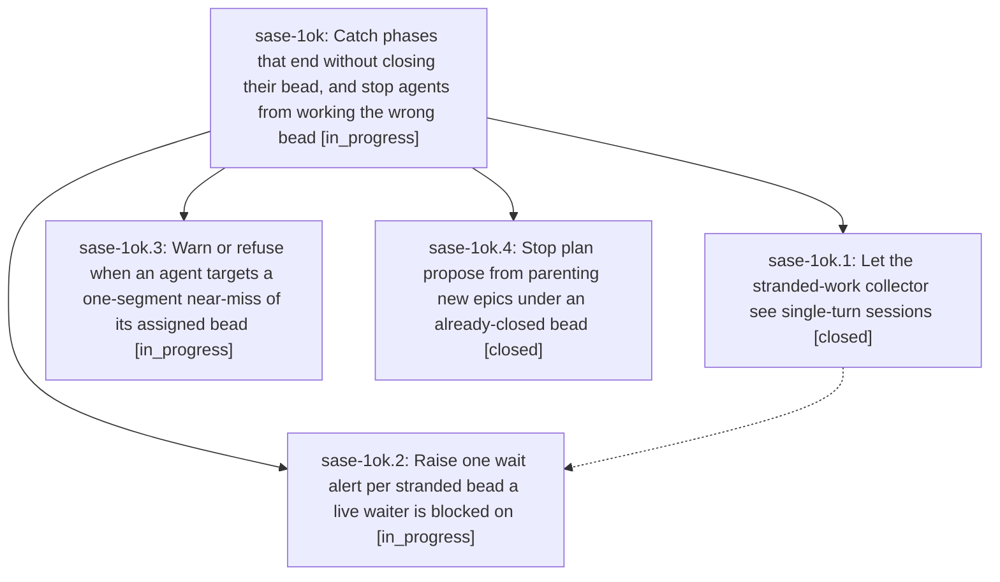

# Bead: sase-1ok — Catch phases that end without closing their bead, and stop agents from working the wrong bead

[Bead Pages](../README.md) / sase-1ok

**Status:** ◐ in_progress · **Type:** ▸ plan · **Tier:** epic
**Owner:** `bryanbugyi34@gmail.com` · **Created by:** [bbugyi200.athena.14p](https://github.com/sase-org/sase--agents/blob/main/sessions/bbugyi200.athena.14p.md) · **Assignee:** `sase-1ok.land`
**Created:** 2026-10-26 18:10:49 EDT
**Plan:** [202610/stranded\_phase\_detection\_and\_wrong\_bead\_guard.md](https://github.com/sase-org/sase--plans/blob/main/202610/stranded_phase_detection_and_wrong_bead_guard.md)

<!-- sase:links:start -->

## Links

| Relation | Artifact | Why |
| --- | --- | --- |
| implemented-by | [plan:202610/stranded_phase_detection_and_wrong_bead_guard.md][1] | derived from the plan's `bead_id:` frontmatter field |

[1]: https://github.com/sase-org/sase--plans/blob/main/202610/stranded_phase_detection_and_wrong_bead_guard.md

<!-- sase:links:end -->

## Description

A phase agent that misreads its own bead ID is warned or refused at the CLI. A single-turn phase that ends with its bead still open is classified stranded and raises one wait alert. A follow-on epic proposed after its bead closed no longer nests under it.

## Phases

| Bead | Title | Status | Size | Created | Agents | Commits |
|---|---|---|---|---|---:|---:|
| [sase-1ok.1](sase-1ok.1.md) | Let the stranded-work collector see single-turn sessions | ✓ closed | medium | 2026-10-26 | 1 | 1 |
| [sase-1ok.2](sase-1ok.2.md) | Raise one wait alert per stranded bead a live waiter is blocked on | ◐ in_progress | medium | 2026-10-26 | 1 | 0 |
| [sase-1ok.3](sase-1ok.3.md) | Warn or refuse when an agent targets a one-segment near-miss of its assigned bead | ◐ in_progress | medium | 2026-10-26 | 1 | 0 |
| [sase-1ok.4](sase-1ok.4.md) | Stop plan propose from parenting new epics under an already-closed bead | ✓ closed | small | 2026-10-26 | 1 | 0 |

## Lineage

## Agents

| Agent | Bead | Commits |
|---|---|---:|
| [bbugyi200.athena.sase-1ok.1](https://github.com/sase-org/sase--agents/blob/main/agents/bbugyi200.athena.sase-1ok.1/README.md) | [sase-1ok.1](sase-1ok.1.md) | 1 |
| [bbugyi200.athena.sase-1ok.2](https://github.com/sase-org/sase--agents/blob/main/agents/bbugyi200.athena.sase-1ok.2/README.md) | [sase-1ok.2](sase-1ok.2.md) | 0 |
| [bbugyi200.athena.sase-1ok.3](https://github.com/sase-org/sase--agents/blob/main/agents/bbugyi200.athena.sase-1ok.3/README.md) | [sase-1ok.3](sase-1ok.3.md) | 0 |
| [bbugyi200.athena.sase-1ok.4](https://github.com/sase-org/sase--agents/blob/main/agents/bbugyi200.athena.sase-1ok.4/README.md) | [sase-1ok.4](sase-1ok.4.md) | 0 |
| [bbugyi200.athena.sase-1ok.land](https://github.com/sase-org/sase--agents/blob/main/agents/bbugyi200.athena.sase-1ok.land/README.md) | [sase-1ok](README.md) | 0 |

## Commits

| Repo | Commit | Subject | Bead | Committed |
|---|---|---|---|---|
| sase-core | [`sase-core@03dce1f`](https://github.com/sase-org/sase-core/commit/03dce1f20be40ad7d127dba3ec52c387d5352b5c) | feat(agent-scan): add AgentName candidate-filter variant | [sase-1ok.1](sase-1ok.1.md) | 2026-10-26 20:09:43 EDT |
