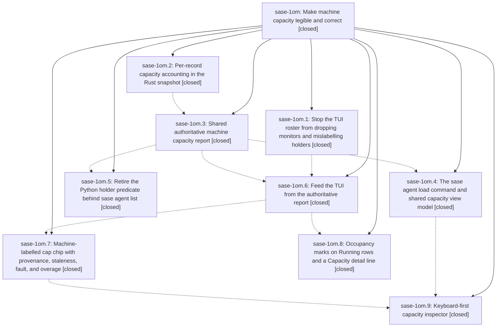

# Bead: sase-1om — Make machine capacity legible and correct

[Bead Pages](../README.md) / sase-1om

**Status:** ✓ closed · **Resolution:** done · **Type:** ▸ plan · **Tier:** epic
**Owner:** `bryanbugyi34@gmail.com` · **Created by:** [bbugyi200.athena.research.5e.linker.w0](https://github.com/sase-org/sase--agents/blob/main/sessions/bbugyi200.athena.research.5e.linker.w0.md) · **Assignee:** `sase-1om.land`
**Created:** 2026-10-26 20:19:43 EDT · **Closed:** 2026-11-01 15:29:46 EST
**Plan:** [202610/machine\_capacity\_transparency.md](https://github.com/sase-org/sase--plans/blob/main/202610/machine_capacity_transparency.md)

<!-- sase:links:start -->

## Links

| Relation | Artifact | Why |
| --- | --- | --- |
| implemented-by | [plan:202610/machine_capacity_transparency.md][1] | derived from the plan's `bead_id:` frontmatter field |
| related | [bead:sase-1qp][2] | Discovered and routed during epic sase-1om; list-holder-parity (sase-1om.5) already sources holders from Rust accounting |
| related | [bead:sase-1qr][3] | Proposed by sase-1om.1; roster-fixes kept monitor PID-reuse exclusion through supervisor_identity only |

_Plus 6 automatic references — see [Referenced By](#referenced-by)._

[1]: https://github.com/sase-org/sase--plans/blob/main/202610/machine_capacity_transparency.md
[2]: https://github.com/sase-org/sase--beads/blob/main/pages/sase-1qp/README.md
[3]: https://github.com/sase-org/sase--beads/blob/main/pages/sase-1qr/README.md

<!-- sase:links:end -->

## Description

The header capacity chip always matches what runner admission sees on this machine, and every unit (or zero) can be traced to a named agent and a stated reason: on the chip, on every Running-bucket row, in a keyboard-reachable inspector, and from `sase agent load`. The athena screenshot case (6 running, 5.0 occupied) reads `5/8`, not `3/8`.

## Notes

[2026-10-27T11:25:29Z · sase-1oh.land] DISCOVERED ISSUE (sase-1oh.land, sase master 887175c3e5): Full CI is red on three nodes traced to sase-1om.4 (78f60cd602, sase agent load). (1) tests/completion/test_snapshot.py::test_checked_in_snapshot_has_no_drift and ::test_current_structural_view_matches_checked_in_snapshot fail on every Python leg of Full CI run 40470130984 (7a860ff33e) and reproduce locally at 887175c3e5. The only drift is the new 'agent load' subtree (-j/--json, -r/--rescan) missing from tests/completion/snapshots/cli_spec.json; fix with just sync-completion-spec. (2) tests/test_agent_load_cli.py::test_cli_json_flag_emits_exact_report and ::test_json_shape_carries_report_provenance_and_metadata fail on CI only with assert 'runnervmtai0g' == 'athena': the expected report host is hard-coded to the local hostname rather than derived or patched. Neither is caused by sase-1oh. Routed here via /sase_new_task as the causally owning active epic; no task created.

[2026-10-27T15:43:42Z · 14t] DISCOVERED ISSUE: (1) sase agent list omits a live, slot-queued monitor follow-up turn. Repro 2026-10-27 11:35 EDT on athena: sase-1ox.1--1 (artifacts ace-run/202610/27/20261027112244, pid 2979464 alive, waiting.json slot_requested_at=2026-10-27T15:25:41Z, agent_session_role=root, parent_timestamp=20261027105002, launched by monitor te34f57zb1av as monitor_followup_agent) is waiter #1 of 3 in the authoritative capacity report and the TUI inspector, yet is absent from 'sase agent list -j'. Cause: src/sase/agent/_running_listing_running.py is_visible_runner_slot_child gates its queued branch on is_runner_slot_user_agent_record (src/sase/core/runner_slots/_admission_predicates.py), which returns False for any non-parallel child with parent_timestamp and whose docstring still claims monitor follow-ups ride the session slot and never wait. The Rust report disagrees (it queues the follow-up after the monitor released the slot). Visibility of queued rows should follow the Rust report's waiters, as sase-1om.5 did for holders. (2) Related regression from sase-1om.6 (f843bd8100): _run_agents_capacity_refresh_from_roster computes on shallow copy(agent) rows whose wait_display_source/runtime_children still point at live rows, and _apply_agents_capacity_row_updates writes the derived status back, demoting QUEUED agent-session roots and their clans to WAITING within 10 s of every full load. A separate tale plan is fixing (2) now.

[2026-10-27T21:50:50Z · sase-1ou.2.1.land] DISCOVERED ISSUE corroboration from sase-1ou.2.1.2 note 5: initial broad check fbab9f2df86cb680af2e7df5bb7142e2 and clean d16b79f3 with old core reproduce both tests/completion/test_snapshot.py drift failures byte-identically. Existing agent-load CLI snapshot ownership confirmed by this epic note 1; no duplicate task. Historical evidence file:explicit:c0f4bd59f97240f4bbc90b82 and report file:explicit:b0d1fd4be5d7f8c6c632927d. New footprint catalog commit a5207375e7 also refreshed cli_spec.json; this note preserves the historical witness and does not claim current drift.

[2026-10-30T08:54:58Z · sase-1ou.6.land--3] DISCOVERED ISSUE from sase-1ou.6 landing: scheduled Full CI 40976564464 and 41011050293 both produce the identical archive-help candidate (SHA256 e94637a91a073a44ad174c116dfe035f0bee11ecb1c60f18c60dd455a3d4d064), drifting 50,082 pixels / 50,035 material pixels against agents_archive_help_120x40.png. Viewed both images: the candidate is one text row higher in scroll position, exposing done above user-stopped and moving the instructions/Archive blocks down one row. Both still show the Archive title. The help source and this golden were last changed by phase .7 commit ff516a42b9. The fixture stops ctrl+d scrolling when the title first appears, which does not establish an exact anchor. Route this integrated help/golden acceptance finding to the still-claimed owning epic for diagnosis; the precise root cause is not proven, and this note does not claim a cap-chip hostname difference. No golden changed and no duplicate task created. Evidence file:explicit:f6dcad4959daf9ca825677a8. Existing note 1 already owns the machine-label failures represented by task sase-1ov, so the new backlog proposal explicitly excludes that task to avoid duplicate ownership.

[2026-11-01T20:29:46Z · sase-1om.land] LANDED (sase-1om.land, master a19243cdf6). Verified all 9 phases against plan, decisions, source, and commits cef4bb1199 4a64ff9a28 dd9e740aec e2b04a88e2 78f60cd602 f843bd8100 ff516a42b9 212a476786 7d1584c47e.

Decisions honored: glyph occupancy marks (▰/▱ in _queue_weight_badge.py, documented in agent-row-glyphs.md); no published snapshot file (no runner_slots.snapshot.json writer); no capacity decisions strand. Leader ,l capacity_inspector is wired in default_config.yml, mode_keymaps.py, _leader_mode.py, _LEADER_LABELS, and the leader listings. sase-1ol (holder labels) closed.

Tests: 188 epic and capacity tests pass on master, including the formerly KNOWN capacity-scan fixtures (sase-1om.1 #3, sase-1om.3 #2) and test_capacity_only_scan_preserves_admission_and_candidate_decisions (sase-1om.3 #3, epic-caused, now fixed). Completion-snapshot drift passes too. Targeted test-visual is clean for the archive-help and capacity-inspector goldens (6 unchanged).

Live acceptance (plan Verification): sase screenshot of a live TUI on busy athena showed cap ~8/8 (estimate) at first paint, then cap 8/8* (authoritative, override marker). This matched sase agent load -j: occupied 8.0, limit 8, 8 lanes, accounting_valid, scan_current.

Epic notes: #1 resolved (completion spec synced; hostname test fixed under sase-1ov, closed). #2(2) QUEUED demotion fixed by 8d41b72218. #2(1) queued monitor follow-up hidden from sase agent list predates the epic (9c167a595b9) -> new task sase-1qp. #3 corroboration only. #4 archive-help golden regenerated by sase-1q2.4 (e28334c45a); targeted --check clean today.

Integration: reviewed the 240 non-epic commits since cef4bb1199. Follow-up epics sase-1ox (inspector redesign / tiered CLI), sase-1q5.7 (calmer feed), sase-1q5.5, and sase-1q2.3 build on MachineCapacityReport and the shared view model; no duplicate or conflicting occupancy logic found. Fixed two stale docstrings from the cap-chip rename (top_bar_group.py, agent_runner_slots.py). Existing related tasks: sase-1q9 (index-backed report), sase-1ow (-w 0 Running bucket, an epic non-goal), sase-1qb (inspector PNG instability).

PROPOSED FOLLOW-UP outcomes:
- sase-1om.1 #1 Rust scans drop process_identity: still true at sase-core 16a3ed0 -> new task sase-1qr.
- sase-1om.1 #3 and sase-1om.3 #2 capacity fixtures: declined, fixed (flake baseline fixed-at entries; tests pass).
- sase-1om.2 #1 sase-core parallel-gate flake: declined, already owned by open sase-1gz.
- sase-1om.3 #3 capacity_only parity: epic-caused, now passes; nothing to file.
- sase-1om.5 #1 unweighted Rust helpers (test-only callers): new task sase-1qq.
- sase-1om.6 #1 17 clean-base failures: declined; 16 fixed under sase-1ll (closed) and the stats render-context test passes now.
- sase-1om.7 #1 dispatch.md names the load: gauge: memory task sase-1qs (epic forbade memory edits).
- sase-1om.9 #1 xdist import deadlock: same node and signature as open flake sase-1qb; added as a diagnostic note there, not a new task.
- sase-1om.9 #2 pre-existing scoped-check failures: declined; that clean-base rendering set was fixed under sase-1ll and the sampled nodes pass.

epic-symbols: none.

## Phases

| Bead | Title | Status | Size | Created | Agents | Commits |
|---|---|---|---|---|---:|---:|
| [sase-1om.1](sase-1om.1.md) | Stop the TUI roster from dropping monitors and mislabelling holders | ✓ closed | medium | 2026-10-26 | 1 | 1 |
| [sase-1om.2](sase-1om.2.md) | Per-record capacity accounting in the Rust snapshot | ✓ closed | medium | 2026-10-26 | 1 | 2 |
| [sase-1om.3](sase-1om.3.md) | Shared authoritative machine capacity report | ✓ closed | medium | 2026-10-26 | 1 | 1 |
| [sase-1om.4](sase-1om.4.md) | The sase agent load command and shared capacity view model | ✓ closed | medium | 2026-10-26 | 1 | 1 |
| [sase-1om.5](sase-1om.5.md) | Retire the Python holder predicate behind sase agent list | ✓ closed | small | 2026-10-26 | 1 | 1 |
| [sase-1om.6](sase-1om.6.md) | Feed the TUI from the authoritative report | ✓ closed | medium | 2026-10-26 | 1 | 1 |
| [sase-1om.7](sase-1om.7.md) | Machine-labelled cap chip with provenance, staleness, fault, and overage | ✓ closed | medium | 2026-10-26 | 1 | 1 |
| [sase-1om.8](sase-1om.8.md) | Occupancy marks on Running rows and a Capacity detail line | ✓ closed | medium | 2026-10-26 | 1 | 1 |
| [sase-1om.9](sase-1om.9.md) | Keyboard-first capacity inspector | ✓ closed | medium | 2026-10-26 | 1 | 1 |

## Lineage

## Agents

| Agent | Bead | Commits |
|---|---|---:|
| [bbugyi200.athena.sase-1om.1](https://github.com/sase-org/sase--agents/blob/main/sessions/bbugyi200.athena.sase-1om.1.md) | [sase-1om.1](sase-1om.1.md) | 1 |
| [bbugyi200.athena.sase-1om.2](https://github.com/sase-org/sase--agents/blob/main/sessions/bbugyi200.athena.sase-1om.2.md) | [sase-1om.2](sase-1om.2.md) | 2 |
| [bbugyi200.athena.sase-1om.3](https://github.com/sase-org/sase--agents/blob/main/agents/bbugyi200.athena.sase-1om.3/README.md) | [sase-1om.3](sase-1om.3.md) | 1 |
| [bbugyi200.athena.sase-1om.4](https://github.com/sase-org/sase--agents/blob/main/agents/bbugyi200.athena.sase-1om.4/README.md) | [sase-1om.4](sase-1om.4.md) | 1 |
| [bbugyi200.athena.sase-1om.5](https://github.com/sase-org/sase--agents/blob/main/agents/bbugyi200.athena.sase-1om.5/README.md) | [sase-1om.5](sase-1om.5.md) | 1 |
| [bbugyi200.athena.sase-1om.6](https://github.com/sase-org/sase--agents/blob/main/sessions/bbugyi200.athena.sase-1om.6.md) | [sase-1om.6](sase-1om.6.md) | 1 |
| [bbugyi200.athena.sase-1om.7](https://github.com/sase-org/sase--agents/blob/main/sessions/bbugyi200.athena.sase-1om.7.md) | [sase-1om.7](sase-1om.7.md) | 1 |
| [bbugyi200.athena.sase-1om.8](https://github.com/sase-org/sase--agents/blob/main/sessions/bbugyi200.athena.sase-1om.8.md) | [sase-1om.8](sase-1om.8.md) | 1 |
| [bbugyi200.athena.sase-1om.9](https://github.com/sase-org/sase--agents/blob/main/sessions/bbugyi200.athena.sase-1om.9.md) | [sase-1om.9](sase-1om.9.md) | 1 |
| [bbugyi200.athena.sase-1om.land](https://github.com/sase-org/sase--agents/blob/main/sessions/bbugyi200.athena.sase-1om.land.md) | [sase-1om](README.md) | 1 |

## Commits

| Repo | Commit | Subject | Bead | Committed |
|---|---|---|---|---|
| sase-core | [`sase-core@f1ea08f`](https://github.com/sase-org/sase-core/commit/f1ea08fbdeb7fe40271b369892c91750a0b5c947) | feat!: per-record capacity accounting in Rust snapshot | [sase-1om.2](sase-1om.2.md) | 2026-10-26 21:44:10 EDT |
| sase | [`cef4bb1`](https://github.com/sase-org/sase/commit/cef4bb119942ee627f18ad82e153124620dbbdd0) | fix(tui): preserve monitor capacity in roster projections | [sase-1om.1](sase-1om.1.md) | 2026-10-26 21:50:26 EDT |
| sase | [`4a64ff9`](https://github.com/sase-org/sase/commit/4a64ff9a28e859e92badc9eb6206a78555ccccfd) | feat: adapt record builders for core capacity accounting | [sase-1om.2](sase-1om.2.md) | 2026-10-26 22:34:33 EDT |
| sase | [`dd9e740`](https://github.com/sase-org/sase/commit/dd9e740aec9bfb6efaf3ed26d59d8116d444760a) | feat(runner-slots): add read-only machine capacity report | [sase-1om.3](sase-1om.3.md) | 2026-10-27 00:18:41 EDT |
| sase | [`e2b04a8`](https://github.com/sase-org/sase/commit/e2b04a88e2a3653e2ce02c08ff30387cb4e083a5) | feat(agents): source list occupancy from Rust accounting | [sase-1om.5](sase-1om.5.md) | 2026-10-27 00:49:41 EDT |
| sase | [`78f60cd`](https://github.com/sase-org/sase/commit/78f60cd602e7d416bce656952dddd7fec72b87a3) | feat(agent): add sase agent load capacity view command | [sase-1om.4](sase-1om.4.md) | 2026-10-27 01:36:26 EDT |
| sase | [`f843bd8`](https://github.com/sase-org/sase/commit/f843bd810031b35431803b02dc315bdcf345d84f) | feat(ace): feed capacity header from machine report | [sase-1om.6](sase-1om.6.md) | 2026-10-27 02:49:50 EDT |
| sase | [`ff516a4`](https://github.com/sase-org/sase/commit/ff516a42b9ed32e26de10cea74760437de33f086) | feat(tui): restyle Agents header load gauge as a cap chip | [sase-1om.7](sase-1om.7.md) | 2026-10-27 04:42:49 EDT |
| sase | [`212a476`](https://github.com/sase-org/sase/commit/212a4767861c1a796aa1ba46bdfa6888f3edf808) | feat(ace): add agent capacity accounting and occupancy marks | [sase-1om.8](sase-1om.8.md) | 2026-10-27 05:40:30 EDT |
| sase | [`7d1584c`](https://github.com/sase-org/sase/commit/7d1584c47efb1b1c1350b44ab94a67bbeb0f5196) | feat(ace): add keyboard-first capacity inspector | [sase-1om.9](sase-1om.9.md) | 2026-10-27 06:05:37 EDT |
| sase | [`a5bc298`](https://github.com/sase-org/sase/commit/a5bc2987cc0e30b1ddec3997a645bb0897a8100e) | docs(tui): name the cap chip in stale load-gauge docstrings | [sase-1om](README.md) | 2026-11-01 15:51:01 EST |

<!-- sase:referenced-by:start -->

## Referenced By

| Relation | Artifact | Why | Uses |
| --- | --- | --- | ---: |
| read-by | [agent:sase-1om.3][1] | Need parent epic context and remaining phases | 1 |
| read-by | [agent:sase-1om.4][2] | epic decisions and plan scope | 1 |
| read-by | [agent:sase-1ou.1][3] | classify exceedance owner bead status | 1 |
| read-by | [agent:sase-1ou.6.land--3][4] | Check whether the archive-help golden regression belongs to an active capacity-header epic | 1 |
| read-by | [agent:sase-1p1.2][5] | Check whether the completion snapshot drift is already tracked by this open epic | 1 |
| read-by | [agent:sase-1pt.9.1][6] | Check whether the clean-base completion snapshot and value-slot failures already have an active owner | 1 |

[1]: https://github.com/sase-org/sase--agents/blob/main/agents/bbugyi200.athena.sase-1om.3/README.md
[2]: https://github.com/sase-org/sase--agents/blob/main/agents/bbugyi200.athena.sase-1om.4/README.md
[3]: https://github.com/sase-org/sase--agents/blob/main/agents/bbugyi200.athena.sase-1ou.1/README.md
[4]: https://github.com/sase-org/sase--agents/blob/main/sessions/bbugyi200.athena.sase-1ou.6.land.md
[5]: https://github.com/sase-org/sase--agents/blob/main/agents/bbugyi200.athena.sase-1p1.2/README.md
[6]: https://github.com/sase-org/sase--agents/blob/main/agents/bbugyi200.athena.sase-1pt.9.1/README.md

<!-- sase:referenced-by:end -->
