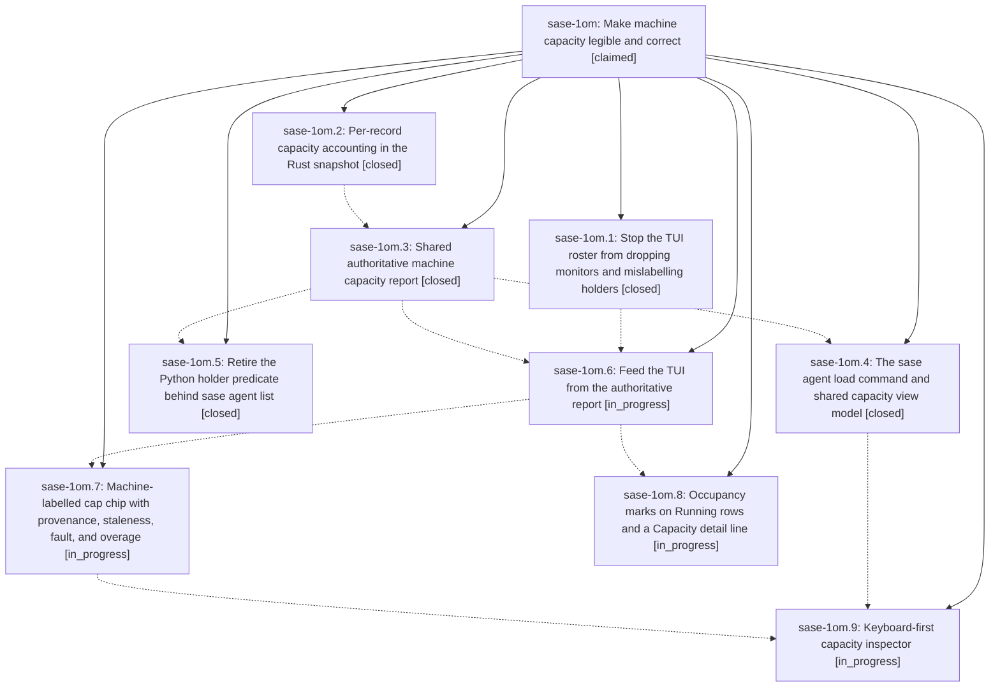

# Bead: sase-1om — Make machine capacity legible and correct

[Bead Pages](../README.md) / sase-1om

**Status:** ◎ claimed · **Type:** ▸ plan · **Tier:** epic
**Owner:** `bryanbugyi34@gmail.com` · **Created by:** [bbugyi200.athena.research.5e.linker.w0](https://github.com/sase-org/sase--agents/blob/main/sessions/bbugyi200.athena.research.5e.linker.w0.md) · **Assignee:** `sase-1om.land`
**Created:** 2026-10-26 20:19:43 EDT
**Plan:** [202610/machine\_capacity\_transparency.md](https://github.com/sase-org/sase--plans/blob/main/202610/machine_capacity_transparency.md)

<!-- sase:links:start -->

## Links

| Relation | Artifact | Why |
| --- | --- | --- |
| implemented-by | [plan:202610/machine_capacity_transparency.md][1] | derived from the plan's `bead_id:` frontmatter field |

_Plus 1 automatic references — see [Referenced By](#referenced-by)._

[1]: https://github.com/sase-org/sase--plans/blob/main/202610/machine_capacity_transparency.md

<!-- sase:links:end -->

## Description

The header capacity chip always matches what runner admission sees on this machine, and every unit (or zero) can be traced to a named agent and a stated reason: on the chip, on every Running-bucket row, in a keyboard-reachable inspector, and from `sase agent load`. The athena screenshot case (6 running, 5.0 occupied) reads `5/8`, not `3/8`.

## Phases

| Bead | Title | Status | Size | Created | Agents | Commits |
|---|---|---|---|---|---:|---:|
| [sase-1om.1](sase-1om.1.md) | Stop the TUI roster from dropping monitors and mislabelling holders | ✓ closed | medium | 2026-10-26 | 1 | 1 |
| [sase-1om.2](sase-1om.2.md) | Per-record capacity accounting in the Rust snapshot | ✓ closed | medium | 2026-10-26 | 1 | 2 |
| [sase-1om.3](sase-1om.3.md) | Shared authoritative machine capacity report | ✓ closed | medium | 2026-10-26 | 1 | 1 |
| [sase-1om.4](sase-1om.4.md) | The sase agent load command and shared capacity view model | ✓ closed | medium | 2026-10-26 | 1 | 1 |
| [sase-1om.5](sase-1om.5.md) | Retire the Python holder predicate behind sase agent list | ✓ closed | small | 2026-10-26 | 1 | 1 |
| [sase-1om.6](sase-1om.6.md) | Feed the TUI from the authoritative report | ◐ in_progress | medium | 2026-10-26 | 1 | 0 |
| [sase-1om.7](sase-1om.7.md) | Machine-labelled cap chip with provenance, staleness, fault, and overage | ◐ in_progress | medium | 2026-10-26 | 1 | 0 |
| [sase-1om.8](sase-1om.8.md) | Occupancy marks on Running rows and a Capacity detail line | ◐ in_progress | medium | 2026-10-26 | 1 | 0 |
| [sase-1om.9](sase-1om.9.md) | Keyboard-first capacity inspector | ◐ in_progress | medium | 2026-10-26 | 1 | 0 |

## Lineage

## Agents

| Agent | Bead | Commits |
|---|---|---:|
| [bbugyi200.athena.sase-1om.1](https://github.com/sase-org/sase--agents/blob/main/sessions/bbugyi200.athena.sase-1om.1.md) | [sase-1om.1](sase-1om.1.md) | 1 |
| [bbugyi200.athena.sase-1om.2](https://github.com/sase-org/sase--agents/blob/main/sessions/bbugyi200.athena.sase-1om.2.md) | [sase-1om.2](sase-1om.2.md) | 2 |
| [bbugyi200.athena.sase-1om.3](https://github.com/sase-org/sase--agents/blob/main/agents/bbugyi200.athena.sase-1om.3/README.md) | [sase-1om.3](sase-1om.3.md) | 1 |
| [bbugyi200.athena.sase-1om.4](https://github.com/sase-org/sase--agents/blob/main/agents/bbugyi200.athena.sase-1om.4/README.md) | [sase-1om.4](sase-1om.4.md) | 1 |
| [bbugyi200.athena.sase-1om.5](https://github.com/sase-org/sase--agents/blob/main/agents/bbugyi200.athena.sase-1om.5/README.md) | [sase-1om.5](sase-1om.5.md) | 1 |
| [bbugyi200.athena.sase-1om.6](https://github.com/sase-org/sase--agents/blob/main/sessions/bbugyi200.athena.sase-1om.6.md) | [sase-1om.6](sase-1om.6.md) | 0 |
| [bbugyi200.athena.sase-1om.7](https://github.com/sase-org/sase--agents/blob/main/agents/bbugyi200.athena.sase-1om.7/README.md) | [sase-1om.7](sase-1om.7.md) | 0 |
| [bbugyi200.athena.sase-1om.8](https://github.com/sase-org/sase--agents/blob/main/agents/bbugyi200.athena.sase-1om.8/README.md) | [sase-1om.8](sase-1om.8.md) | 0 |
| [bbugyi200.athena.sase-1om.9](https://github.com/sase-org/sase--agents/blob/main/agents/bbugyi200.athena.sase-1om.9/README.md) | [sase-1om.9](sase-1om.9.md) | 0 |
| [bbugyi200.athena.sase-1om.land](https://github.com/sase-org/sase--agents/blob/main/agents/bbugyi200.athena.sase-1om.land/README.md) | [sase-1om](README.md) | 0 |

## Commits

| Repo | Commit | Subject | Bead | Committed |
|---|---|---|---|---|
| sase-core | [`sase-core@f1ea08f`](https://github.com/sase-org/sase-core/commit/f1ea08fbdeb7fe40271b369892c91750a0b5c947) | feat!: per-record capacity accounting in Rust snapshot | [sase-1om.2](sase-1om.2.md) | 2026-10-26 21:44:10 EDT |
| sase | [`cef4bb1`](https://github.com/sase-org/sase/commit/cef4bb119942ee627f18ad82e153124620dbbdd0) | fix(tui): preserve monitor capacity in roster projections | [sase-1om.1](sase-1om.1.md) | 2026-10-26 21:50:26 EDT |
| sase | [`4a64ff9`](https://github.com/sase-org/sase/commit/4a64ff9a28e859e92badc9eb6206a78555ccccfd) | feat: adapt record builders for core capacity accounting | [sase-1om.2](sase-1om.2.md) | 2026-10-26 22:34:33 EDT |
| sase | [`dd9e740`](https://github.com/sase-org/sase/commit/dd9e740aec9bfb6efaf3ed26d59d8116d444760a) | feat(runner-slots): add read-only machine capacity report | [sase-1om.3](sase-1om.3.md) | 2026-10-27 00:18:41 EDT |
| sase | [`e2b04a8`](https://github.com/sase-org/sase/commit/e2b04a88e2a3653e2ce02c08ff30387cb4e083a5) | feat(agents): source list occupancy from Rust accounting | [sase-1om.5](sase-1om.5.md) | 2026-10-27 00:49:41 EDT |
| sase | [`78f60cd`](https://github.com/sase-org/sase/commit/78f60cd602e7d416bce656952dddd7fec72b87a3) | feat(agent): add sase agent load capacity view command | [sase-1om.4](sase-1om.4.md) | 2026-10-27 01:36:26 EDT |

<!-- sase:referenced-by:start -->

## Referenced By

| Relation | Artifact | Why | Uses |
| --- | --- | --- | ---: |
| read-by | [agent:sase-1om.3][1] | Need parent epic context and remaining phases | 1 |

[1]: https://github.com/sase-org/sase--agents/blob/main/agents/bbugyi200.athena.sase-1om.3/README.md

<!-- sase:referenced-by:end -->
