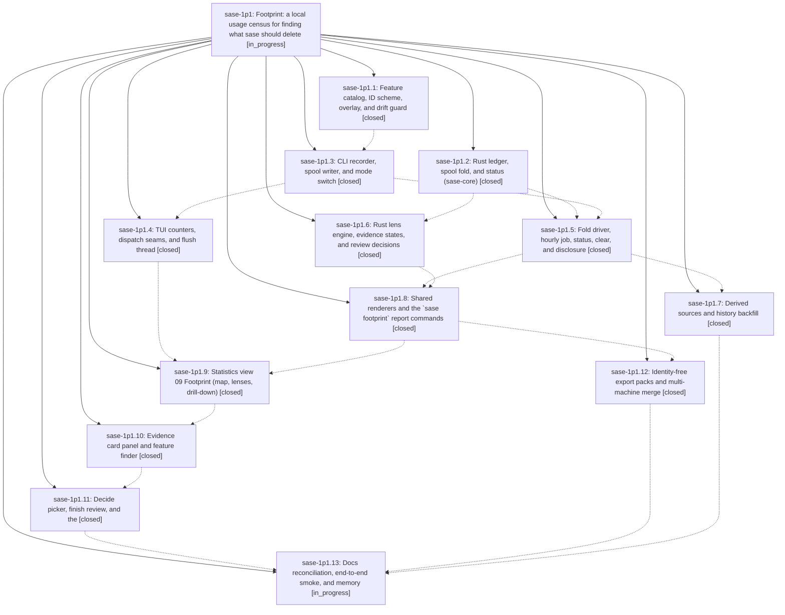

# Bead: sase-1p1 — Footprint: a local usage census for finding what sase should delete

[Bead Pages](../README.md) / sase-1p1

**Status:** ◐ in_progress · **Type:** ▸ plan · **Tier:** epic
**Owner:** `bryanbugyi34@gmail.com` · **Created by:** [bbugyi200.athena.14w](https://github.com/sase-org/sase--agents/blob/main/sessions/bbugyi200.athena.14w.md) · **Assignee:** `sase-1p1.land`
**Created:** 2026-10-27 15:21:48 EDT
**Plan:** [202610/footprint\_usage\_census.md](https://github.com/sase-org/sase--plans/blob/main/202610/footprint_usage_census.md)

<!-- sase:links:start -->

## Links

| Relation | Artifact | Why |
| --- | --- | --- |
| implemented-by | [plan:202610/footprint_usage_census.md][1] | derived from the plan's `bead_id:` frontmatter field |
| related | file:explicit:e8362613147409c299a8d713 | attached via sase artifact create --bead |

_Plus 7 automatic references — see [Referenced By](#referenced-by)._

[1]: https://github.com/sase-org/sase--plans/blob/main/202610/footprint_usage_census.md

<!-- sase:links:end -->

## Description

sase keeps an always-on, privacy-by-construction census of which of its surfaces (CLI commands and options, TUI actions and keys, views and modals, macros, skills, config leaves, automation) are used, by whom, and how. The census costs at most one appended line per CLI process and one in-memory counter bump per TUI action. A Statistics → Footprint view and a `sase footprint` command turn it into a review workflow that ends in keep reasons and deletion task beads. The local data contains only allowlisted IDs and enum values, so it can later be exported, and export packs carry no identity.

## Notes

[2026-10-27T22:09:19Z · sase-1ou.2.1.land--1] DISCOVERED ISSUE: Post-close validation during unrelated ToolRun landing sase-1ou.2.1 on 2026-10-27, clean primary HEAD/origin/master 57d5f411e41e543ffa10d9a91ab45fd66f62ebb6: `just --set sase_core_dir <opened-linked-core> symvision` exits 1 with `Error: --epic-symbol 'sase-1p1.2(other_id)': bead 'sase-1p1.2' is closed. Remove this stale --epic-symbol entry and clean up the symbol.` No tracked primary files were modified by this landing. Justfile line 483 was introduced by footprint catalog commit a5207375e7 (phase sase-1p1.1), and still keys other_id to phase sase-1p1.2, which closed done at 2026-10-27T21:31:40Z. Its note says its facade rows were re-keyed to parent sase-1p1, but this separate ids.py helper exemption remains on the closed phase. `other_id` remains a public def at src/sase/footprint/ids.py:134; within src/sase/footprint the only other reference is its export list. Footprint epic sase-1p1 is still in progress, so its remaining phases/lander own resolving the helper or re-keying it only to a still-open bead that genuinely needs it. This is independent evidence for the existing sase-o7 close-time whitelist lifecycle defect and a concrete issue for active epic sase-1p1; no new task or ToolRun code change is warranted. ToolRun epic and parent-phase epic-symbol audits are both empty. The failed Symvision command is retained as failed; the ToolRun test result remains 272/272 passing.

[2026-10-27T23:26:21Z · toobig-8o.panel_spread.0] DISCOVERED ISSUE: Independent reproduction during the panel_spread split on 2026-10-27. `sase tool run check` ToolRun a59d91b3418eefff7abffa92a8e88bae failed at lint (symvision) with five stale --epic-symbol entries for the now-closed phases sase-1p1.2 (other_id) and sase-1p1.3 (custom_id, spool_dir, mode_path, effective_mode). Justfile was unchanged by the split. This extends the earlier post-close other_id report with the four remaining closed-phase entries; the Justfile snapshot is attached as file:explicit:e8362613147409c299a8d713. The active epic still owns resolving or correctly re-keying these symbols.

[2026-10-27T23:29:23Z · toobig-8o.panel_spread.0] Supplemental verification detail: a project-wide Symvision scan using the recipe environment and only still-open epic exemptions reported no findings in the panel_spread facade or its private Files-scroll helper. It reported exactly custom_id and other_id in src/sase/footprint/ids.py, plus effective_mode, mode_path, and spool_dir in src/sase/footprint/paths.py. Those five helpers explain why the stale whitelist removal needs footprint-owned symbol cleanup or re-keying.

[2026-10-28T03:52:18Z · bob-cli-df.4.1.land] DISCOVERED ISSUE from bob-cli-df.4.1.land, consolidating proposals bob-cli-df.4.1.1 #2, .2 #1, .3 #1, and .4 #1: recovery phases repeatedly failed just check on your Footprint Symvision exemptions (KNOWN witnesses d7760f1346444dcb440fd30f5f921aac and c65495a42177023e3c2c7bb989a06055). At current SASE dcb7d2a6e7, Justfile still exempts sase-1p1(other_id/custom_id), but both have production callers in footprint/_tui.py and _tui_seams.py. Resolve the redundant exemptions in this causal epic. The separate closed-phase Overlay/load_overlay report is already addressed: current rows use still-open sase-1p1.8, confirmed by audited read. No recovery source edits or new task for this issue.

## Phases

| Bead | Title | Status | Size | Created | Agents | Commits |
|---|---|---|---|---|---:|---:|
| [sase-1p1.1](sase-1p1.1.md) | Feature catalog, ID scheme, overlay, and drift guard | ✓ closed | medium | 2026-10-27 | 1 | 1 |
| [sase-1p1.10](sase-1p1.10.md) | Evidence card panel and feature finder | ✓ closed | medium | 2026-10-27 | 1 | 1 |
| [sase-1p1.11](sase-1p1.11.md) | Decide picker, finish review, and the | ✓ closed | medium | 2026-10-27 | 1 | 1 |
| [sase-1p1.12](sase-1p1.12.md) | Identity-free export packs and multi-machine merge | ✓ closed | medium | 2026-10-27 | 1 | 2 |
| [sase-1p1.13](sase-1p1.13.md) | Docs reconciliation, end-to-end smoke, and memory | ◐ in_progress | small | 2026-10-27 | 1 | 0 |
| [sase-1p1.2](sase-1p1.2.md) | Rust ledger, spool fold, and status (sase-core) | ✓ closed | medium | 2026-10-27 | 1 | 2 |
| [sase-1p1.3](sase-1p1.3.md) | CLI recorder, spool writer, and mode switch | ✓ closed | medium | 2026-10-27 | 1 | 1 |
| [sase-1p1.4](sase-1p1.4.md) | TUI counters, dispatch seams, and flush thread | ✓ closed | medium | 2026-10-27 | 1 | 1 |
| [sase-1p1.5](sase-1p1.5.md) | Fold driver, hourly job, status, clear, and disclosure | ✓ closed | medium | 2026-10-27 | 1 | 1 |
| [sase-1p1.6](sase-1p1.6.md) | Rust lens engine, evidence states, and review decisions | ✓ closed | medium | 2026-10-27 | 1 | 2 |
| [sase-1p1.7](sase-1p1.7.md) | Derived sources and history backfill | ✓ closed | medium | 2026-10-27 | 1 | 2 |
| [sase-1p1.8](sase-1p1.8.md) | Shared renderers and the \`sase footprint\` report commands | ✓ closed | medium | 2026-10-27 | 1 | 1 |
| [sase-1p1.9](sase-1p1.9.md) | Statistics view 09 Footprint (map, lenses, drill-down) | ✓ closed | medium | 2026-10-27 | 1 | 1 |

## Lineage

## Agents

| Agent | Bead | Commits |
|---|---|---:|
| [bbugyi200.athena.sase-1p1.1](https://github.com/sase-org/sase--agents/blob/main/sessions/bbugyi200.athena.sase-1p1.1.md) | [sase-1p1.1](sase-1p1.1.md) | 1 |
| [bbugyi200.athena.sase-1p1.10](https://github.com/sase-org/sase--agents/blob/main/agents/bbugyi200.athena.sase-1p1.10/README.md) | [sase-1p1.10](sase-1p1.10.md) | 1 |
| [bbugyi200.athena.sase-1p1.11](https://github.com/sase-org/sase--agents/blob/main/agents/bbugyi200.athena.sase-1p1.11/README.md) | [sase-1p1.11](sase-1p1.11.md) | 1 |
| [bbugyi200.athena.sase-1p1.12](https://github.com/sase-org/sase--agents/blob/main/sessions/bbugyi200.athena.sase-1p1.12.md) | [sase-1p1.12](sase-1p1.12.md) | 2 |
| [bbugyi200.athena.sase-1p1.13](https://github.com/sase-org/sase--agents/blob/main/agents/bbugyi200.athena.sase-1p1.13/README.md) | [sase-1p1.13](sase-1p1.13.md) | 0 |
| [bbugyi200.athena.sase-1p1.2](https://github.com/sase-org/sase--agents/blob/main/agents/bbugyi200.athena.sase-1p1.2/README.md) | [sase-1p1.2](sase-1p1.2.md) | 2 |
| [bbugyi200.athena.sase-1p1.3](https://github.com/sase-org/sase--agents/blob/main/sessions/bbugyi200.athena.sase-1p1.3.md) | [sase-1p1.3](sase-1p1.3.md) | 1 |
| [bbugyi200.athena.sase-1p1.4](https://github.com/sase-org/sase--agents/blob/main/sessions/bbugyi200.athena.sase-1p1.4.md) | [sase-1p1.4](sase-1p1.4.md) | 1 |
| [bbugyi200.athena.sase-1p1.5](https://github.com/sase-org/sase--agents/blob/main/agents/bbugyi200.athena.sase-1p1.5/README.md) | [sase-1p1.5](sase-1p1.5.md) | 1 |
| [bbugyi200.athena.sase-1p1.6](https://github.com/sase-org/sase--agents/blob/main/agents/bbugyi200.athena.sase-1p1.6/README.md) | [sase-1p1.6](sase-1p1.6.md) | 2 |
| [bbugyi200.athena.sase-1p1.7](https://github.com/sase-org/sase--agents/blob/main/agents/bbugyi200.athena.sase-1p1.7/README.md) | [sase-1p1.7](sase-1p1.7.md) | 2 |
| [bbugyi200.athena.sase-1p1.8](https://github.com/sase-org/sase--agents/blob/main/agents/bbugyi200.athena.sase-1p1.8/README.md) | [sase-1p1.8](sase-1p1.8.md) | 1 |
| [bbugyi200.athena.sase-1p1.9](https://github.com/sase-org/sase--agents/blob/main/agents/bbugyi200.athena.sase-1p1.9/README.md) | [sase-1p1.9](sase-1p1.9.md) | 1 |
| [bbugyi200.athena.sase-1p1.land](https://github.com/sase-org/sase--agents/blob/main/agents/bbugyi200.athena.sase-1p1.land/README.md) | [sase-1p1](README.md) | 0 |

## Commits

| Repo | Commit | Subject | Bead | Committed |
|---|---|---|---|---|
| sase | [`a520737`](https://github.com/sase-org/sase/commit/a5207375e7235f6ebfcbcbd920bfc679802dd2af) | feat(footprint): add feature catalog, overlay, drift guard and sase footprint catalog | [sase-1p1.1](sase-1p1.1.md) | 2026-10-27 16:54:42 EDT |
| sase-core | [`sase-core@2d0b62e`](https://github.com/sase-org/sase-core/commit/2d0b62e20db963e606ff852075617d19d1b74c76) | feat(footprint): add ledger, spool fold, catalog ingest, and status | [sase-1p1.2](sase-1p1.2.md) | 2026-10-27 17:32:48 EDT |
| sase | [`daf54c5`](https://github.com/sase-org/sase/commit/daf54c5b2d39ed483df935fbf98b209b47e1f276) | feat(footprint): add Python ledger facade and core-rs binding probes | [sase-1p1.2](sase-1p1.2.md) | 2026-10-27 18:29:37 EDT |
| sase | [`63468c9`](https://github.com/sase-org/sase/commit/63468c96aeaaa7fbe0d69225b88fe884c4d6ab36) | feat(footprint): add CLI usage recorder and mode controls | [sase-1p1.3](sase-1p1.3.md) | 2026-10-27 20:20:32 EDT |
| sase-core | [`sase-core@83b010d`](https://github.com/sase-org/sase-core/commit/83b010ddbe635effecf286a82611b73b51888425) | feat(footprint): add lens engine, evidence states, and review decisions | [sase-1p1.6](sase-1p1.6.md) | 2026-10-27 20:51:31 EDT |
| sase | [`ad90e3d`](https://github.com/sase-org/sase/commit/ad90e3dff14d059a157b7cbdeaddf1daa9db38a4) | feat(footprint): add TUI action counters, dispatch seams, and flush thread | [sase-1p1.4](sase-1p1.4.md) | 2026-10-27 21:50:22 EDT |
| sase | [`7446c88`](https://github.com/sase-org/sase/commit/7446c885f289512244c21d4f750816ddba6b250f) | feat(footprint): add fold, status, and housekeeping | [sase-1p1.5](sase-1p1.5.md) | 2026-10-27 22:19:58 EDT |
| sase | [`067eeeb`](https://github.com/sase-org/sase/commit/067eeeb17b52aad338587bf21c03d81d561691f9) | feat(footprint): add report/card/decide query facades and bindings | [sase-1p1.6](sase-1p1.6.md) | 2026-10-27 23:08:49 EDT |
| sase | [`c80a6c7`](https://github.com/sase-org/sase/commit/c80a6c791ada99b14e1df2e1d828cf8e1e39c37e) | feat(footprint): add query builder, render layer, and list/show/decide CLI | [sase-1p1.8](sase-1p1.8.md) | 2026-10-27 23:50:57 EDT |
| sase-core | [`sase-core@31deb0d`](https://github.com/sase-org/sase-core/commit/31deb0d2ff7ed0024ad810b6be1a5243c2099399) | feat(stats): add query\_macro\_usage and accept config via | [sase-1p1.7](sase-1p1.7.md) | 2026-10-28 00:43:55 EDT |
| sase | [`a9abdd5`](https://github.com/sase-org/sase/commit/a9abdd5c97a05b7365b60300b3bbfde4f17f2804) | feat(stats): add Footprint view 09 with lenses and drill-down | [sase-1p1.9](sase-1p1.9.md) | 2026-10-28 01:43:43 EDT |
| sase | [`dae555a`](https://github.com/sase-org/sase/commit/dae555aa201c2b4264d24b2019cb10f8004a5293) | feat(ace): add statistics footprint evidence cards and feature finder | [sase-1p1.10](sase-1p1.10.md) | 2026-10-28 02:27:11 EDT |
| sase | [`0028e67`](https://github.com/sase-org/sase/commit/0028e6765de55118d4e163b36cd3e5fb66c8c9bf) | feat(footprint): add review decision and launch flow | [sase-1p1.11](sase-1p1.11.md) | 2026-10-28 03:21:03 EDT |
| sase | [`95bd848`](https://github.com/sase-org/sase/commit/95bd848d261988e01d7bd105178d5b599884a451) | feat(footprint): fold derived sources and add history backfill | [sase-1p1.7](sase-1p1.7.md) | 2026-10-28 04:55:52 EDT |
| sase-core | [`sase-core@65546fd`](https://github.com/sase-org/sase-core/commit/65546fd244ec43ee023369fdafb5b5edb6197061) | feat(footprint): add identity-free weekly export and replace-all import | [sase-1p1.12](sase-1p1.12.md) | 2026-10-28 09:57:03 EDT |
| sase | [`9026202`](https://github.com/sase-org/sase/commit/90262021ea8bc9fe57e1f5534f22b3d470f84968) | feat(footprint): add identity-free export packs and import merge | [sase-1p1.12](sase-1p1.12.md) | 2026-10-28 10:49:04 EDT |

<!-- sase:referenced-by:start -->

## Referenced By

| Relation | Artifact | Why | Uses |
| --- | --- | --- | ---: |
| read-by | [agent:sase-1ou.2.1.land--1][1] | Identify the owning active epic for the post-close Symvision stale footprint exemption | 1 |
| read-by | [agent:sase-1p1.10][2] | epic context | 1 |
| read-by | [agent:sase-1p1.3--2][3] | Determine which footprint epic phase owns the two overlapping Symvision allowlist symbols | 1 |
| read-by | [agent:sase-1p1.4--2][4] | Need epic DECISIONS and symbol scope for phase close | 1 |
| read-by | [agent:sase-1p1.5][5] | Find an open phase for symbols still planned after 1p1.6 | 1 |
| read-by | [agent:sase-1p1.8][6] | epic context | 1 |
| read-by | [agent:toobig-8o.panel_spread.0][7] | Determine whether this active footprint epic owns the closed-phase Symvision entries found by the requested check | 2 |

[1]: https://github.com/sase-org/sase--agents/blob/main/sessions/bbugyi200.athena.sase-1ou.2.1.land.md
[2]: https://github.com/sase-org/sase--agents/blob/main/agents/bbugyi200.athena.sase-1p1.10/README.md
[3]: https://github.com/sase-org/sase--agents/blob/main/sessions/bbugyi200.athena.sase-1p1.3.md
[4]: https://github.com/sase-org/sase--agents/blob/main/sessions/bbugyi200.athena.sase-1p1.4.md
[5]: https://github.com/sase-org/sase--agents/blob/main/agents/bbugyi200.athena.sase-1p1.5/README.md
[6]: https://github.com/sase-org/sase--agents/blob/main/agents/bbugyi200.athena.sase-1p1.8/README.md
[7]: https://github.com/sase-org/sase--agents/blob/main/agents/bbugyi200.athena.toobig-8o.panel_spread.0/README.md

<!-- sase:referenced-by:end -->
