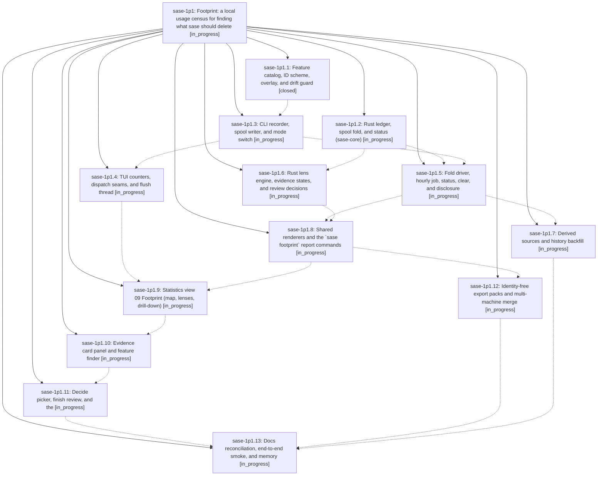

# Bead: sase-1p1 — Footprint: a local usage census for finding what sase should delete

[Bead Pages](../README.md) / sase-1p1

**Status:** ◐ in_progress · **Type:** ▸ plan · **Tier:** epic
**Owner:** `bryanbugyi34@gmail.com` · **Created by:** [bbugyi200.athena.14w](https://github.com/sase-org/sase--agents/blob/main/sessions/bbugyi200.athena.14w.md) · **Assignee:** `sase-1p1.land`
**Created:** 2026-10-27 15:21:48 EDT
**Plan:** [202610/footprint\_usage\_census.md](https://github.com/sase-org/sase--plans/blob/main/202610/footprint_usage_census.md)

<!-- sase:links:start -->

## Links

| Relation | Artifact | Why |
| --- | --- | --- |
| implemented-by | [plan:202610/footprint_usage_census.md][1] | derived from the plan's `bead_id:` frontmatter field |

[1]: https://github.com/sase-org/sase--plans/blob/main/202610/footprint_usage_census.md

<!-- sase:links:end -->

## Description

sase keeps an always-on, privacy-by-construction census of which of its surfaces (CLI commands and options, TUI actions and keys, views and modals, macros, skills, config leaves, automation) are used, by whom, and how. The census costs at most one appended line per CLI process and one in-memory counter bump per TUI action. A Statistics → Footprint view and a `sase footprint` command turn it into a review workflow that ends in keep reasons and deletion task beads. The local data contains only allowlisted IDs and enum values, so it can later be exported, and export packs carry no identity.

## Phases

| Bead | Title | Status | Size | Created | Agents | Commits |
|---|---|---|---|---|---:|---:|
| [sase-1p1.1](sase-1p1.1.md) | Feature catalog, ID scheme, overlay, and drift guard | ✓ closed | medium | 2026-10-27 | 1 | 1 |
| [sase-1p1.10](sase-1p1.10.md) | Evidence card panel and feature finder | ◐ in_progress | medium | 2026-10-27 | 1 | 0 |
| [sase-1p1.11](sase-1p1.11.md) | Decide picker, finish review, and the | ◐ in_progress | medium | 2026-10-27 | 1 | 0 |
| [sase-1p1.12](sase-1p1.12.md) | Identity-free export packs and multi-machine merge | ◐ in_progress | medium | 2026-10-27 | 1 | 0 |
| [sase-1p1.13](sase-1p1.13.md) | Docs reconciliation, end-to-end smoke, and memory | ◐ in_progress | small | 2026-10-27 | 1 | 0 |
| [sase-1p1.2](sase-1p1.2.md) | Rust ledger, spool fold, and status (sase-core) | ◐ in_progress | medium | 2026-10-27 | 1 | 0 |
| [sase-1p1.3](sase-1p1.3.md) | CLI recorder, spool writer, and mode switch | ◐ in_progress | medium | 2026-10-27 | 1 | 0 |
| [sase-1p1.4](sase-1p1.4.md) | TUI counters, dispatch seams, and flush thread | ◐ in_progress | medium | 2026-10-27 | 1 | 0 |
| [sase-1p1.5](sase-1p1.5.md) | Fold driver, hourly job, status, clear, and disclosure | ◐ in_progress | medium | 2026-10-27 | 1 | 0 |
| [sase-1p1.6](sase-1p1.6.md) | Rust lens engine, evidence states, and review decisions | ◐ in_progress | medium | 2026-10-27 | 1 | 0 |
| [sase-1p1.7](sase-1p1.7.md) | Derived sources and history backfill | ◐ in_progress | medium | 2026-10-27 | 1 | 0 |
| [sase-1p1.8](sase-1p1.8.md) | Shared renderers and the \`sase footprint\` report commands | ◐ in_progress | medium | 2026-10-27 | 1 | 0 |
| [sase-1p1.9](sase-1p1.9.md) | Statistics view 09 Footprint (map, lenses, drill-down) | ◐ in_progress | medium | 2026-10-27 | 1 | 0 |

## Lineage

## Agents

| Agent | Bead | Commits |
|---|---|---:|
| [bbugyi200.athena.sase-1p1.1](https://github.com/sase-org/sase--agents/blob/main/sessions/bbugyi200.athena.sase-1p1.1.md) | [sase-1p1.1](sase-1p1.1.md) | 1 |
| [bbugyi200.athena.sase-1p1.10](https://github.com/sase-org/sase--agents/blob/main/agents/bbugyi200.athena.sase-1p1.10/README.md) | [sase-1p1.10](sase-1p1.10.md) | 0 |
| [bbugyi200.athena.sase-1p1.11](https://github.com/sase-org/sase--agents/blob/main/agents/bbugyi200.athena.sase-1p1.11/README.md) | [sase-1p1.11](sase-1p1.11.md) | 0 |
| [bbugyi200.athena.sase-1p1.12](https://github.com/sase-org/sase--agents/blob/main/agents/bbugyi200.athena.sase-1p1.12/README.md) | [sase-1p1.12](sase-1p1.12.md) | 0 |
| [bbugyi200.athena.sase-1p1.13](https://github.com/sase-org/sase--agents/blob/main/agents/bbugyi200.athena.sase-1p1.13/README.md) | [sase-1p1.13](sase-1p1.13.md) | 0 |
| [bbugyi200.athena.sase-1p1.2](https://github.com/sase-org/sase--agents/blob/main/agents/bbugyi200.athena.sase-1p1.2/README.md) | [sase-1p1.2](sase-1p1.2.md) | 0 |
| [bbugyi200.athena.sase-1p1.3](https://github.com/sase-org/sase--agents/blob/main/agents/bbugyi200.athena.sase-1p1.3/README.md) | [sase-1p1.3](sase-1p1.3.md) | 0 |
| [bbugyi200.athena.sase-1p1.4](https://github.com/sase-org/sase--agents/blob/main/agents/bbugyi200.athena.sase-1p1.4/README.md) | [sase-1p1.4](sase-1p1.4.md) | 0 |
| [bbugyi200.athena.sase-1p1.5](https://github.com/sase-org/sase--agents/blob/main/agents/bbugyi200.athena.sase-1p1.5/README.md) | [sase-1p1.5](sase-1p1.5.md) | 0 |
| [bbugyi200.athena.sase-1p1.6](https://github.com/sase-org/sase--agents/blob/main/agents/bbugyi200.athena.sase-1p1.6/README.md) | [sase-1p1.6](sase-1p1.6.md) | 0 |
| [bbugyi200.athena.sase-1p1.7](https://github.com/sase-org/sase--agents/blob/main/agents/bbugyi200.athena.sase-1p1.7/README.md) | [sase-1p1.7](sase-1p1.7.md) | 0 |
| [bbugyi200.athena.sase-1p1.8](https://github.com/sase-org/sase--agents/blob/main/agents/bbugyi200.athena.sase-1p1.8/README.md) | [sase-1p1.8](sase-1p1.8.md) | 0 |
| [bbugyi200.athena.sase-1p1.9](https://github.com/sase-org/sase--agents/blob/main/agents/bbugyi200.athena.sase-1p1.9/README.md) | [sase-1p1.9](sase-1p1.9.md) | 0 |
| [bbugyi200.athena.sase-1p1.land](https://github.com/sase-org/sase--agents/blob/main/agents/bbugyi200.athena.sase-1p1.land/README.md) | [sase-1p1](README.md) | 0 |

## Commits

| Repo | Commit | Subject | Bead | Committed |
|---|---|---|---|---|
| sase | [`a520737`](https://github.com/sase-org/sase/commit/a5207375e7235f6ebfcbcbd920bfc679802dd2af) | feat(footprint): add feature catalog, overlay, drift guard and sase footprint catalog | [sase-1p1.1](sase-1p1.1.md) | 2026-10-27 16:54:42 EDT |
