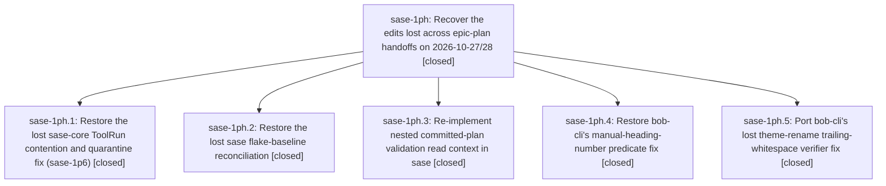

# Bead: sase-1ph — Recover the edits lost across epic-plan handoffs on 2026-10-27/28

[Bead Pages](../README.md) / sase-1ph

**Status:** ✓ closed · **Resolution:** done · **Type:** ▸ plan · **Tier:** epic
**Owner:** `bryanbugyi34@gmail.com` · **Created by:** [bbugyi200.athena.research.5f.final.f0](https://github.com/sase-org/sase--agents/blob/main/sessions/bbugyi200.athena.research.5f.final.f0.md) · **Assignee:** `sase-1ph.land`
**Created:** 2026-10-28 20:02:59 EDT · **Closed:** 2026-10-28 22:09:34 EDT
**Plan:** [202610/recover\_handoff\_lost\_edits.md](https://github.com/sase-org/sase--plans/blob/main/202610/recover_handoff_lost_edits.md)

<!-- sase:links:start -->

## Links

| Relation | Artifact | Why |
| --- | --- | --- |
| implemented-by | [plan:202610/recover_handoff_lost_edits.md][1] | derived from the plan's `bead_id:` frontmatter field |

_Plus 2 automatic references — see [Referenced By](#referenced-by)._

[1]: https://github.com/sase-org/sase--plans/blob/main/202610/recover_handoff_lost_edits.md

<!-- sase:links:end -->

## Description

Every source change that a land or closeout agent made and then lost by ending its turn with an epic `sase plan propose` is either on master in its repository or verified as no longer needed. Every bead and plan that cited the lost work as landed tells the truth again.

## Notes

[2026-10-29T02:09:34Z · sase-1ph.land] LANDED (sase-1ph.land, 2026-10-28). VERIFIED all 5 phases on origin and reviewed each diff against the plan and decisions. core-contention: sase-core df14e8f4 matches the replayed patch (attempt_owed / one post-quarantine recreate / WAL attempt before deadline, plus RELEASE_BUDGET and three regressions). core_stress=reuse was honored, with no stress rerun. sase-1p6 is re-closed with core check 7263dbbc. flake-baseline: sase df0070b0aa. Owners verified, and the phase note's 'sase-1m' is a typo for sase-19m, which is what the file has. Gate rechecked at master 60a4fe8a92: exit 1 with the same 20 exceedances, no drift. nested-plans-validation: sase 60a4fe8a92 adds nested_repo_open_{checkout_root,sdd_root,plans_root,plans_remedy}, all used in non-test code (no whitelist), checks the nested checkout before SASE_SDD_PLANS_DIR, fails closed with a remedy, and leaves non-nested behavior unchanged. Every required regression is present, focused suites pass 34/34, and live validate_committed_plans passes for 5598 plans. heading-predicate: bob-cli 4005c613; the Lua grammar was checked by hand against all plan cases. rename-verifier: bob-cli 687375eb; split fixed too; the replaced CLI test matches the reference patch. INTEGRATION: post-start commits sase 528d5fe576/35b00c9dad, sase-core 0fd85e4a/95dc0c10, and bob-cli 38f15d3e/cba7c47d don't conflict. 0fd85e4a rewrote connection.rs busy handling but kept the sase-1p6 semantics. The sase core pin is now 95dc0c10, which contains df14e8f4. LANDING RECORDS: notes on sase-1ou (core + baseline commits; not closed), bob-cli-dg, bob-cli-d7, bob-cli-dc, bob-cli-dd, and bob-cli-e0 (full loss inventory; left open). tale_status=mark: status: done on bob-cli plans 202610/{d7_heading_prefix_closeout,backlog_b3_rename_closeout,finish_backlog_b4,b5_validation_closeout}.md via the opened external repo gh:bobs-org/bob-cli--plans; only the status lines changed. FOLLOW-UPS: one proposal (sase-1ph.3 #1, reconcile the athena scoped-check baseline). Declined as a new task because every node is owned. +1 sase-1ll for the 16 TERM-dumb rendering nodes. +1 sase-1p5 for the artifact-directory audit. +1 sase-1pg for scrub_agent_identity and the previously unowned test_start_monitor_kills_a_supervisor_that_never_writes_the_ack_marker, which share its root cause, found with a Popen probe: the tests patch global subprocess.Popen and capture an unrelated git subprocess whose env has SASE_AGENT; product scrub is correct. sase-19b/sase-1lp nodes did not fail in these runs; no action. epic-symbols: none.

## Phases

| Bead | Title | Status | Size | Created | Agents | Commits |
|---|---|---|---|---|---:|---:|
| [sase-1ph.1](sase-1ph.1.md) | Restore the lost sase-core ToolRun contention and quarantine fix (sase-1p6) | ✓ closed | small | 2026-10-28 | 1 | 1 |
| [sase-1ph.2](sase-1ph.2.md) | Restore the lost sase flake-baseline reconciliation | ✓ closed | medium | 2026-10-28 | 1 | 1 |
| [sase-1ph.3](sase-1ph.3.md) | Re-implement nested committed-plan validation read context in sase | ✓ closed | medium | 2026-10-28 | 1 | 1 |
| [sase-1ph.4](sase-1ph.4.md) | Restore bob-cli's manual-heading-number predicate fix | ✓ closed | small | 2026-10-28 | 1 | 0 |
| [sase-1ph.5](sase-1ph.5.md) | Port bob-cli's lost theme-rename trailing-whitespace verifier fix | ✓ closed | medium | 2026-10-28 | 1 | 0 |

## Lineage

## Agents

| Agent | Bead | Commits |
|---|---|---:|
| [bbugyi200.athena.sase-1ph.1](https://github.com/sase-org/sase--agents/blob/main/agents/bbugyi200.athena.sase-1ph.1/README.md) | [sase-1ph.1](sase-1ph.1.md) | 1 |
| [bbugyi200.athena.sase-1ph.2](https://github.com/sase-org/sase--agents/blob/main/agents/bbugyi200.athena.sase-1ph.2/README.md) | [sase-1ph.2](sase-1ph.2.md) | 1 |
| [bbugyi200.athena.sase-1ph.3](https://github.com/sase-org/sase--agents/blob/main/agents/bbugyi200.athena.sase-1ph.3/README.md) | [sase-1ph.3](sase-1ph.3.md) | 1 |
| [bbugyi200.athena.sase-1ph.4](https://github.com/sase-org/sase--agents/blob/main/agents/bbugyi200.athena.sase-1ph.4/README.md) | [sase-1ph.4](sase-1ph.4.md) | 0 |
| [bbugyi200.athena.sase-1ph.5](https://github.com/sase-org/sase--agents/blob/main/agents/bbugyi200.athena.sase-1ph.5/README.md) | [sase-1ph.5](sase-1ph.5.md) | 0 |
| [bbugyi200.athena.sase-1ph.land](https://github.com/sase-org/sase--agents/blob/main/agents/bbugyi200.athena.sase-1ph.land/README.md) | [sase-1ph](README.md) | 0 |

## Commits

| Repo | Commit | Subject | Bead | Committed |
|---|---|---|---|---|
| sase | [`df0070b`](https://github.com/sase-org/sase/commit/df0070b0aab3fffbeaf585ffa6c6804876fa31fd) | test(flake-baseline): restore lost sase-1ou landing reconciliation | [sase-1ph.2](sase-1ph.2.md) | 2026-10-28 20:24:06 EDT |
| sase-core | [`sase-core@df14e8f`](https://github.com/sase-org/sase-core/commit/df14e8f4386bc64f6614ad48cf0de19026a8cd18) | fix(tool\_run): owe every call one store open and recreate after quarantine | [sase-1ph.1](sase-1ph.1.md) | 2026-10-28 20:32:43 EDT |
| sase | [`60a4fe8`](https://github.com/sase-org/sase/commit/60a4fe8a927234bec6b40210215f1ea9831c76bc) | fix(sdd): resolve nested checkout plan roots | [sase-1ph.3](sase-1ph.3.md) | 2026-10-28 21:44:44 EDT |

<!-- sase:referenced-by:start -->

## Referenced By

| Relation | Artifact | Why | Uses |
| --- | --- | --- | ---: |
| read-by | [agent:sase-1ph.1][1] | epic context | 1 |
| read-by | [agent:sase-1ph.2][2] | epic context | 1 |

[1]: https://github.com/sase-org/sase--agents/blob/main/agents/bbugyi200.athena.sase-1ph.1/README.md
[2]: https://github.com/sase-org/sase--agents/blob/main/agents/bbugyi200.athena.sase-1ph.2/README.md

<!-- sase:referenced-by:end -->
