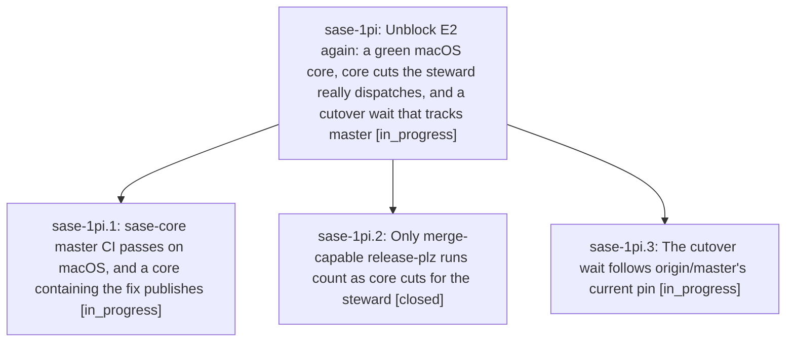

# Bead: sase-1pi — Unblock E2 again: a green macOS core, core cuts the steward really dispatches, and a cutover wait that tracks master

[Bead Pages](../README.md) / sase-1pi

**Status:** ◐ in_progress · **Type:** ▸ plan · **Tier:** epic
**Owner:** `bryanbugyi34@gmail.com` · **Created by:** [bbugyi200.athena.15m](https://github.com/sase-org/sase--agents/blob/main/sessions/bbugyi200.athena.15m.md) · **Assignee:** `sase-1pi.land`
**Created:** 2026-10-28 20:07:12 EDT
**Plan:** [202610/unblock\_e2\_core\_release\_flow.md](https://github.com/sase-org/sase--plans/blob/main/202610/unblock_e2_core_release_flow.md)

<!-- sase:links:start -->

## Links

| Relation | Artifact | Why |
| --- | --- | --- |
| implemented-by | [plan:202610/unblock_e2_core_release_flow.md][1] | derived from the plan's `bead_id:` frontmatter field |

[1]: https://github.com/sase-org/sase--plans/blob/main/202610/unblock_e2_core_release_flow.md

<!-- sase:links:end -->

## Description

sase-core master CI is green on macOS again, so the daily cut can merge and publish a core. The release steward counts only merge-capable release-plz runs as core cuts, so its CORE_LAG action proposes a real cut and a heal run never hides a failed cut. sase-1oe.4 waits on the core pin that origin/master names now, not on a frozen workspace pin, so it can rehearse and raise the E2 handover gate.

## Phases

| Bead | Title | Status | Size | Created | Agents | Commits |
|---|---|---|---|---|---:|---:|
| [sase-1pi.1](sase-1pi.1.md) | sase-core master CI passes on macOS, and a core containing the fix publishes | ◐ in_progress | medium | 2026-10-28 | 1 | 1 |
| [sase-1pi.2](sase-1pi.2.md) | Only merge-capable release-plz runs count as core cuts for the steward | ✓ closed | medium | 2026-10-28 | 1 | 1 |
| [sase-1pi.3](sase-1pi.3.md) | The cutover wait follows origin/master's current pin | ◐ in_progress | small | 2026-10-28 | 1 | 0 |

## Lineage

## Agents

| Agent | Bead | Commits |
|---|---|---:|
| [bbugyi200.athena.sase-1pi.1](https://github.com/sase-org/sase--agents/blob/main/agents/bbugyi200.athena.sase-1pi.1/README.md) | [sase-1pi.1](sase-1pi.1.md) | 1 |
| [bbugyi200.athena.sase-1pi.2](https://github.com/sase-org/sase--agents/blob/main/agents/bbugyi200.athena.sase-1pi.2/README.md) | [sase-1pi.2](sase-1pi.2.md) | 1 |
| [bbugyi200.athena.sase-1pi.3](https://github.com/sase-org/sase--agents/blob/main/agents/bbugyi200.athena.sase-1pi.3/README.md) | [sase-1pi.3](sase-1pi.3.md) | 0 |
| [bbugyi200.athena.sase-1pi.land](https://github.com/sase-org/sase--agents/blob/main/agents/bbugyi200.athena.sase-1pi.land/README.md) | [sase-1pi](README.md) | 0 |

## Commits

| Repo | Commit | Subject | Bead | Committed |
|---|---|---|---|---|
| sase-core | [`sase-core@0fd85e4`](https://github.com/sase-org/sase-core/commit/0fd85e4ab6e61ab0aec9be6b85cdb0026e71816c) | fix(tool-run): enforce SQLite wall-clock busy deadlines | [sase-1pi.1](sase-1pi.1.md) | 2026-10-28 20:58:20 EDT |
| sase-core | [`sase-core@95dc0c1`](https://github.com/sase-org/sase-core/commit/95dc0c10db564ad31bc7e63761dd4a6fab4f40e3) | feat(release-steward): bound core-cut dispatches to one per UTC day with merge authority | [sase-1pi.2](sase-1pi.2.md) | 2026-10-28 21:30:14 EDT |
