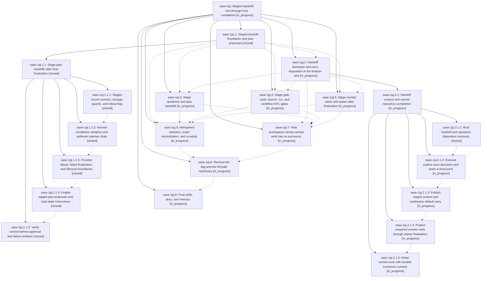

# Bead: sase-1pj — Staged handoffs end through host completion

[Bead Pages](../README.md) / sase-1pj

**Status:** ◐ in_progress · **Type:** ▸ plan · **Tier:** epic
**Owner:** `bryanbugyi34@gmail.com` · **Created by:** [bbugyi200.athena.research.5f.linker.w0](https://github.com/sase-org/sase--agents/blob/main/sessions/bbugyi200.athena.research.5f.linker.w0.md) · **Assignee:** `sase-1pj.land`
**Created:** 2026-10-28 20:28:57 EDT
**Plan:** [202610/staged\_handoffs.md](https://github.com/sase-org/sase--plans/blob/main/202610/staged_handoffs.md)

<!-- sase:links:start -->

## Links

| Relation | Artifact | Why |
| --- | --- | --- |
| implemented-by | [plan:202610/staged_handoffs.md][1] | derived from the plan's `bead_id:` frontmatter field |

_Plus 2 automatic references — see [Referenced By](#referenced-by)._

[1]: https://github.com/sase-org/sase--plans/blob/main/202610/staged_handoffs.md

<!-- sase:links:end -->

## Description

Turn-ending commands (plan propose, questions, pipe, gate create, sudo request, launch request, run, monitor start) stage their handoff instead of killing the agent runner. Every root turn ends normally through /sase_final, the host runs the selected finalizers to their fixed point, and only then does a fixed host-owned step adopt the staged handoff. Agents can commit file changes and propose a plan (or start a monitor) in the same turn, and no handoff ever silently drops uncommitted work.

## Phases

| Bead | Title | Status | Size | Created | Agents | Commits |
|---|---|---|---|---|---:|---:|
| [sase-1pj.1](sase-1pj.1.md) | Staged-handoff foundation and plan proposals | ✓ closed | large | 2026-10-28 | 1 | 0 |
| [sase-1pj.2](sase-1pj.2.md) | Handoff descriptor and carry disposition in the finalizer wire | ◐ in_progress | large | 2026-10-28 | 1 | 0 |
| [sase-1pj.3](sase-1pj.3.md) | Stage questions and pipe handoffs | ◐ in_progress | medium | 2026-10-28 | 1 | 0 |
| [sase-1pj.4](sase-1pj.4.md) | Stage gate, sudo, launch, run, and workflow HITL gates | ◐ in_progress | large | 2026-10-28 | 1 | 0 |
| [sase-1pj.5](sase-1pj.5.md) | Stage monitor starts and spawn after finalization | ◐ in_progress | large | 2026-10-28 | 1 | 0 |
| [sase-1pj.6](sase-1pj.6.md) | Idempotent adoption, crash reconciliation, and re-adopt | ◐ in_progress | large | 2026-10-28 | 1 | 0 |
| [sase-1pj.7](sase-1pj.7.md) | Hold workspaces whose carried work has no successor | ◐ in_progress | large | 2026-10-28 | 1 | 0 |
| [sase-1pj.8](sase-1pj.8.md) | Remove the flag and the kill-path machinery | ◐ in_progress | large | 2026-10-28 | 1 | 0 |
| [sase-1pj.9](sase-1pj.9.md) | Final skills, docs, and memory | ◐ in_progress | medium | 2026-10-28 | 1 | 0 |

## Lineage

## Agents

| Agent | Bead | Commits |
|---|---|---:|
| [bbugyi200.athena.sase-1pj.1](https://github.com/sase-org/sase--agents/blob/main/sessions/bbugyi200.athena.sase-1pj.1.md) | [sase-1pj.1](sase-1pj.1.md) | 0 |
| [bbugyi200.athena.sase-1pj.1.1.1](https://github.com/sase-org/sase--agents/blob/main/agents/bbugyi200.athena.sase-1pj.1.1.1/README.md) | [sase-1pj.1.1.1](sase-1pj.1.1.1.md) | 2 |
| [bbugyi200.athena.sase-1pj.1.1.2](https://github.com/sase-org/sase--agents/blob/main/agents/bbugyi200.athena.sase-1pj.1.1.2/README.md) | [sase-1pj.1.1.2](sase-1pj.1.1.2.md) | 1 |
| [bbugyi200.athena.sase-1pj.1.1.3](https://github.com/sase-org/sase--agents/blob/main/sessions/bbugyi200.athena.sase-1pj.1.1.3.md) | [sase-1pj.1.1.3](sase-1pj.1.1.3.md) | 2 |
| [bbugyi200.athena.sase-1pj.1.1.4](https://github.com/sase-org/sase--agents/blob/main/sessions/bbugyi200.athena.sase-1pj.1.1.4.md) | [sase-1pj.1.1.4](sase-1pj.1.1.4.md) | 1 |
| [bbugyi200.athena.sase-1pj.1.1.5](https://github.com/sase-org/sase--agents/blob/main/agents/bbugyi200.athena.sase-1pj.1.1.5/README.md) | [sase-1pj.1.1.5](sase-1pj.1.1.5.md) | 1 |
| [bbugyi200.athena.sase-1pj.1.1.land](https://github.com/sase-org/sase--agents/blob/main/sessions/bbugyi200.athena.sase-1pj.1.1.land.md) | [sase-1pj.1.1](sase-1pj.1.1.md) | 2 |
| [bbugyi200.athena.sase-1pj.2](https://github.com/sase-org/sase--agents/blob/main/sessions/bbugyi200.athena.sase-1pj.2.md) | [sase-1pj.2](sase-1pj.2.md) | 0 |
| [bbugyi200.athena.sase-1pj.2.1.1](https://github.com/sase-org/sase--agents/blob/main/sessions/bbugyi200.athena.sase-1pj.2.1.1.md) | [sase-1pj.2.1.1](sase-1pj.2.1.1.md) | 2 |
| [bbugyi200.athena.sase-1pj.2.1.2](https://github.com/sase-org/sase--agents/blob/main/agents/bbugyi200.athena.sase-1pj.2.1.2/README.md) | [sase-1pj.2.1.2](sase-1pj.2.1.2.md) | 0 |
| [bbugyi200.athena.sase-1pj.2.1.3](https://github.com/sase-org/sase--agents/blob/main/agents/bbugyi200.athena.sase-1pj.2.1.3/README.md) | [sase-1pj.2.1.3](sase-1pj.2.1.3.md) | 0 |
| [bbugyi200.athena.sase-1pj.2.1.4](https://github.com/sase-org/sase--agents/blob/main/agents/bbugyi200.athena.sase-1pj.2.1.4/README.md) | [sase-1pj.2.1.4](sase-1pj.2.1.4.md) | 0 |
| [bbugyi200.athena.sase-1pj.2.1.5](https://github.com/sase-org/sase--agents/blob/main/agents/bbugyi200.athena.sase-1pj.2.1.5/README.md) | [sase-1pj.2.1.5](sase-1pj.2.1.5.md) | 0 |
| [bbugyi200.athena.sase-1pj.2.1.land](https://github.com/sase-org/sase--agents/blob/main/agents/bbugyi200.athena.sase-1pj.2.1.land/README.md) | [sase-1pj.2.1](sase-1pj.2.1.md) | 0 |
| [bbugyi200.athena.sase-1pj.3](https://github.com/sase-org/sase--agents/blob/main/agents/bbugyi200.athena.sase-1pj.3/README.md) | [sase-1pj.3](sase-1pj.3.md) | 0 |
| [bbugyi200.athena.sase-1pj.4](https://github.com/sase-org/sase--agents/blob/main/agents/bbugyi200.athena.sase-1pj.4/README.md) | [sase-1pj.4](sase-1pj.4.md) | 0 |
| [bbugyi200.athena.sase-1pj.5](https://github.com/sase-org/sase--agents/blob/main/agents/bbugyi200.athena.sase-1pj.5/README.md) | [sase-1pj.5](sase-1pj.5.md) | 0 |
| [bbugyi200.athena.sase-1pj.6](https://github.com/sase-org/sase--agents/blob/main/agents/bbugyi200.athena.sase-1pj.6/README.md) | [sase-1pj.6](sase-1pj.6.md) | 0 |
| [bbugyi200.athena.sase-1pj.7](https://github.com/sase-org/sase--agents/blob/main/agents/bbugyi200.athena.sase-1pj.7/README.md) | [sase-1pj.7](sase-1pj.7.md) | 0 |
| [bbugyi200.athena.sase-1pj.8](https://github.com/sase-org/sase--agents/blob/main/agents/bbugyi200.athena.sase-1pj.8/README.md) | [sase-1pj.8](sase-1pj.8.md) | 0 |
| [bbugyi200.athena.sase-1pj.9](https://github.com/sase-org/sase--agents/blob/main/agents/bbugyi200.athena.sase-1pj.9/README.md) | [sase-1pj.9](sase-1pj.9.md) | 0 |
| [bbugyi200.athena.sase-1pj.land](https://github.com/sase-org/sase--agents/blob/main/agents/bbugyi200.athena.sase-1pj.land/README.md) | [sase-1pj](README.md) | 0 |

## Commits

| Repo | Commit | Subject | Bead | Committed |
|---|---|---|---|---|
| sase-core | [`sase-core@cd62c83`](https://github.com/sase-org/sase-core/commit/cd62c83df285e70a43fb5fa215a5a95367c8c32d) | feat(staged\_handoff): add staged-handoff wire contract and admission guards | [sase-1pj.1.1.1](sase-1pj.1.1.1.md) | 2026-10-28 22:35:43 EDT |
| sase | [`06cd630`](https://github.com/sase-org/sase/commit/06cd630543ab655702474cb75b8f394e6c39cafb) | feat(handoff): add staged-handoff storage, guards, and staged\_handoffs flag | [sase-1pj.1.1.1](sase-1pj.1.1.1.md) | 2026-10-28 23:37:51 EDT |
| sase | [`dd59c28`](https://github.com/sase-org/sase/commit/dd59c28f44c7e5fc83cc75188ca58b710d4f32f7) | feat(handoff): adopt staged plans after finalizer settlement | [sase-1pj.1.1.2](sase-1pj.1.1.2.md) | 2026-10-29 00:38:34 EDT |
| sase-core | [`sase-core@751bba5`](https://github.com/sase-org/sase-core/commit/751bba5ff80b21cfd41e28677fee63926bdfe615) | feat(stranded): own staged handoffs and held receipts as handoff | [sase-1pj.1.1.3](sase-1pj.1.1.3.md) | 2026-10-29 01:50:31 EDT |
| sase | [`0f73623`](https://github.com/sase-org/sase/commit/0f7362359115682e59f9f8b96e4c2ea67abe3198) | feat(handoff): finalize staged turns after provider failures without retrying ordinary work | [sase-1pj.1.1.3](sase-1pj.1.1.3.md) | 2026-10-29 01:58:19 EDT |
| sase | [`9f88875`](https://github.com/sase-org/sase/commit/9f88875b989530ff8ed8171bcab2c891cc4e1323) | feat(plan): stage proposals after host finalization | [sase-1pj.1.1.4](sase-1pj.1.1.4.md) | 2026-10-29 03:29:31 EDT |
| sase | [`cc32e69`](https://github.com/sase-org/sase/commit/cc32e69dbbf5ba106c585291f84fe96f2d389844) | test(plan): prove staged commit-before-approval acceptance matrix | [sase-1pj.1.1.5](sase-1pj.1.1.5.md) | 2026-10-29 04:31:20 EDT |
| sase | [`894317d`](https://github.com/sase-org/sase/commit/894317dccd7214c99e7440f6653789f4b97fa5e4) | feat(plan): land staged plan-handoff foundation (sase-1pj.1.1) | [sase-1pj.1.1](sase-1pj.1.1.md) | 2026-10-29 05:39:49 EDT |
| sase--plans | [`sase--plans@71cfd8e`](https://github.com/sase-org/sase--plans/commit/71cfd8e5c53269447ee862449716f8ac48106c47) | docs(plans): mark staged\_plan\_foundation.md done after sase-1pj.1.1 landing | [sase-1pj.1.1](sase-1pj.1.1.md) | 2026-10-29 05:41:51 EDT |
| sase-core | [`sase-core@24e160d`](https://github.com/sase-org/sase-core/commit/24e160d1b99b107475efd47e791ea3597376c1e8) | feat(core-policy): add handoff disposition and prepared-coverage predicates with bindings | [sase-1pj.2.1.1](sase-1pj.2.1.1.md) | 2026-10-29 07:24:12 EDT |
| sase | [`9c0a31f`](https://github.com/sase-org/sase/commit/9c0a31fba576ffa20feedbe93662d6bb871ed0a2) | feat(core-policy): add finalizer handoff wire, disposition checks and prepared-coverage mirrors | [sase-1pj.2.1.1](sase-1pj.2.1.1.md) | 2026-10-29 07:29:18 EDT |

<!-- sase:referenced-by:start -->

## Referenced By

| Relation | Artifact | Why | Uses |
| --- | --- | --- | ---: |
| read-by | [agent:research.5h.final][1] | Assess whether staged handoffs now wait on commit-stage latency | 1 |
| read-by | [agent:sase-1pj.1.1.2][2] | Need governing epic decisions for this assigned phase | 1 |

[1]: https://github.com/sase-org/sase--agents/blob/main/agents/bbugyi200.athena.research.5h.final/README.md
[2]: https://github.com/sase-org/sase--agents/blob/main/agents/bbugyi200.athena.sase-1pj.1.1.2/README.md

<!-- sase:referenced-by:end -->
