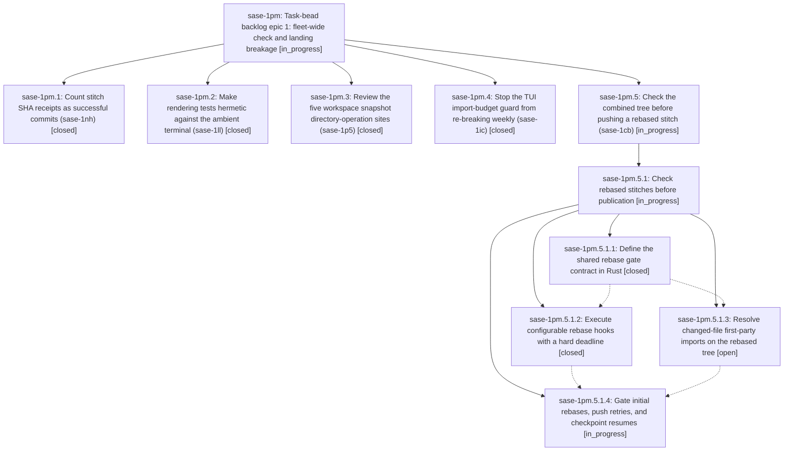

# Bead: sase-1pm — Task-bead backlog epic 1: fleet-wide check and landing breakage

[Bead Pages](../README.md) / sase-1pm

**Status:** ◐ in_progress · **Type:** ▸ plan · **Tier:** epic
**Owner:** `bryanbugyi34@gmail.com` · **Created by:** [bbugyi200.athena.15r](https://github.com/sase-org/sase--agents/blob/main/sessions/bbugyi200.athena.15r.md) · **Assignee:** `sase-1pm.land`
**Created:** 2026-10-29 01:44:35 EDT
**Plan:** [202610/task\_backlog\_epic\_1.md](https://github.com/sase-org/sase--plans/blob/main/202610/task_backlog_epic_1.md)

<!-- sase:links:start -->

## Links

| Relation | Artifact | Why |
| --- | --- | --- |
| implemented-by | [plan:202610/task_backlog_epic_1.md][1] | derived from the plan's `bead_id:` frontmatter field |

[1]: https://github.com/sase-org/sase--plans/blob/main/202610/task_backlog_epic_1.md

<!-- sase:links:end -->

## Description

The five costliest open task beads (sase-1nh, sase-1ll, sase-1p5, sase-1ic, sase-1cb) are fixed on master and closed. The land agent then proposes the next five-bead backlog epic under the same rules.

## Phases

| Bead | Title | Status | Size | Created | Agents | Commits |
|---|---|---|---|---|---:|---:|
| [sase-1pm.1](sase-1pm.1.md) | Count stitch SHA receipts as successful commits (sase-1nh) | ✓ closed | small | 2026-10-29 | 1 | 1 |
| [sase-1pm.2](sase-1pm.2.md) | Make rendering tests hermetic against the ambient terminal (sase-1ll) | ✓ closed | small | 2026-10-29 | 1 | 0 |
| [sase-1pm.3](sase-1pm.3.md) | Review the five workspace snapshot directory-operation sites (sase-1p5) | ✓ closed | small | 2026-10-29 | 1 | 1 |
| [sase-1pm.4](sase-1pm.4.md) | Stop the TUI import-budget guard from re-breaking weekly (sase-1ic) | ✓ closed | medium | 2026-10-29 | 1 | 1 |
| [sase-1pm.5](sase-1pm.5.md) | Check the combined tree before pushing a rebased stitch (sase-1cb) | ◐ in_progress | large | 2026-10-29 | 1 | 0 |

## Lineage

## Agents

| Agent | Bead | Commits |
|---|---|---:|
| [bbugyi200.athena.sase-1pm.1](https://github.com/sase-org/sase--agents/blob/main/agents/bbugyi200.athena.sase-1pm.1/README.md) | [sase-1pm.1](sase-1pm.1.md) | 1 |
| [bbugyi200.athena.sase-1pm.2](https://github.com/sase-org/sase--agents/blob/main/sessions/bbugyi200.athena.sase-1pm.2.md) | [sase-1pm.2](sase-1pm.2.md) | 0 |
| [bbugyi200.athena.sase-1pm.3](https://github.com/sase-org/sase--agents/blob/main/agents/bbugyi200.athena.sase-1pm.3/README.md) | [sase-1pm.3](sase-1pm.3.md) | 1 |
| [bbugyi200.athena.sase-1pm.4](https://github.com/sase-org/sase--agents/blob/main/sessions/bbugyi200.athena.sase-1pm.4.md) | [sase-1pm.4](sase-1pm.4.md) | 1 |
| [bbugyi200.athena.sase-1pm.5](https://github.com/sase-org/sase--agents/blob/main/sessions/bbugyi200.athena.sase-1pm.5.md) | [sase-1pm.5](sase-1pm.5.md) | 0 |
| [bbugyi200.athena.sase-1pm.5.1.1](https://github.com/sase-org/sase--agents/blob/main/agents/bbugyi200.athena.sase-1pm.5.1.1/README.md) | [sase-1pm.5.1.1](sase-1pm.5.1.1.md) | 2 |
| [bbugyi200.athena.sase-1pm.5.1.2](https://github.com/sase-org/sase--agents/blob/main/sessions/bbugyi200.athena.sase-1pm.5.1.2.md) | [sase-1pm.5.1.2](sase-1pm.5.1.2.md) | 1 |
| [bbugyi200.athena.sase-1pm.5.1.3](https://github.com/sase-org/sase--agents/blob/main/sessions/bbugyi200.athena.sase-1pm.5.1.3.md) | [sase-1pm.5.1.3](sase-1pm.5.1.3.md) | 0 |
| [bbugyi200.athena.sase-1pm.5.1.4](https://github.com/sase-org/sase--agents/blob/main/agents/bbugyi200.athena.sase-1pm.5.1.4/README.md) | [sase-1pm.5.1.4](sase-1pm.5.1.4.md) | 0 |
| [bbugyi200.athena.sase-1pm.5.1.land](https://github.com/sase-org/sase--agents/blob/main/agents/bbugyi200.athena.sase-1pm.5.1.land/README.md) | [sase-1pm.5.1](sase-1pm.5.1.md) | 0 |
| [bbugyi200.athena.sase-1pm.land](https://github.com/sase-org/sase--agents/blob/main/agents/bbugyi200.athena.sase-1pm.land/README.md) | [sase-1pm](README.md) | 0 |

## Commits

| Repo | Commit | Subject | Bead | Committed |
|---|---|---|---|---|
| sase | [`4d22cee`](https://github.com/sase-org/sase/commit/4d22ceefa597e5251336dd4c437c534a7bb0c313) | test: audit workspace snapshot directory operations | [sase-1pm.3](sase-1pm.3.md) | 2026-10-29 02:32:03 EDT |
| sase | [`2456160`](https://github.com/sase-org/sase/commit/24561602cc26a699f7994496006e7fefa4fbf176) | fix(tui): ratchet first-party TUI import budget instead of total modules | [sase-1pm.4](sase-1pm.4.md) | 2026-10-29 02:51:48 EDT |
| sase | [`45ded07`](https://github.com/sase-org/sase/commit/45ded07c148fd583e089f7b3f22f10ff0fe0272a) | fix(monitor): accept production SHA result markers as successful receipts | [sase-1pm.1](sase-1pm.1.md) | 2026-10-29 03:24:15 EDT |
| sase-core | [`sase-core@60fe51d`](https://github.com/sase-org/sase-core/commit/60fe51d627a6b5df57511d9d9f0388ec39ddc4b7) | feat(vcs): add rebase gate policy bindings | [sase-1pm.5.1.1](sase-1pm.5.1.1.md) | 2026-10-29 03:37:24 EDT |
| sase | [`c76fee2`](https://github.com/sase-org/sase/commit/c76fee2af11dfbad7cb57de9b670b02791b62bc0) | feat(core): add typed rebase gate facade | [sase-1pm.5.1.1](sase-1pm.5.1.1.md) | 2026-10-29 03:42:03 EDT |
| sase | [`bb5653c`](https://github.com/sase-org/sase/commit/bb5653cb7dcd7c75cab77ccaf9b6c3144db10ca2) | feat(commit): add configurable rebase gate runner with hard deadline | [sase-1pm.5.1.2](sase-1pm.5.1.2.md) | 2026-10-29 05:13:42 EDT |
