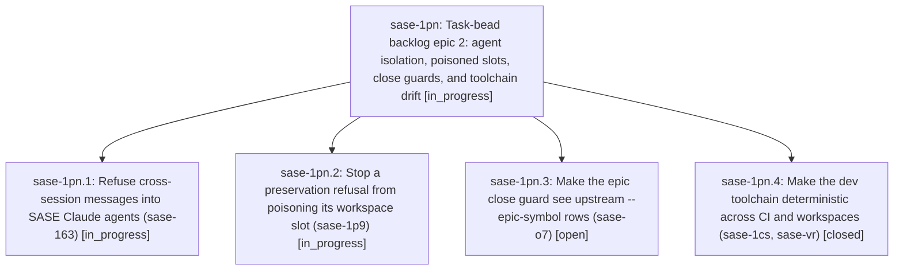

# Bead: sase-1pn — Task-bead backlog epic 2: agent isolation, poisoned slots, close guards, and toolchain drift

[Bead Pages](../README.md) / sase-1pn

**Status:** ◐ in_progress · **Type:** ▸ plan · **Tier:** epic
**Owner:** `bryanbugyi34@gmail.com` · **Created by:** [bbugyi200.athena.sase-1pm.land](https://github.com/sase-org/sase--agents/blob/main/sessions/bbugyi200.athena.sase-1pm.land.md) · **Assignee:** `sase-1pn.land`
**Created:** 2026-10-29 10:44:07 EDT
**Plan:** [202610/task\_backlog\_epic\_2.md](https://github.com/sase-org/sase--plans/blob/main/202610/task_backlog_epic_2.md)

<!-- sase:links:start -->

## Links

| Relation | Artifact | Why |
| --- | --- | --- |
| implemented-by | [plan:202610/task_backlog_epic_2.md][1] | derived from the plan's `bead_id:` frontmatter field |

[1]: https://github.com/sase-org/sase--plans/blob/main/202610/task_backlog_epic_2.md

<!-- sase:links:end -->

## Description

The five next-costliest open task beads (sase-163, sase-1p9, sase-o7, sase-1cs, sase-vr) are fixed on master and closed. The land agent then proposes the next five-bead backlog epic under the same rules.

## Phases

| Bead | Title | Status | Size | Created | Agents | Commits |
|---|---|---|---|---|---:|---:|
| [sase-1pn.1](sase-1pn.1.md) | Refuse cross-session messages into SASE Claude agents (sase-163) | ◐ in_progress | small | 2026-10-29 | 1 | 0 |
| [sase-1pn.2](sase-1pn.2.md) | Stop a preservation refusal from poisoning its workspace slot (sase-1p9) | ◐ in_progress | medium | 2026-10-29 | 1 | 0 |
| [sase-1pn.3](sase-1pn.3.md) | Make the epic close guard see upstream --epic-symbol rows (sase-o7) | ○ open | medium | 2026-10-29 | 1 | 0 |
| [sase-1pn.4](sase-1pn.4.md) | Make the dev toolchain deterministic across CI and workspaces (sase-1cs, sase-vr) | ✓ closed | medium | 2026-10-29 | 1 | 1 |

## Lineage

## Agents

| Agent | Bead | Commits |
|---|---|---:|
| [bbugyi200.athena.sase-1pn.1](https://github.com/sase-org/sase--agents/blob/main/agents/bbugyi200.athena.sase-1pn.1/README.md) | [sase-1pn.1](sase-1pn.1.md) | 0 |
| [bbugyi200.athena.sase-1pn.2](https://github.com/sase-org/sase--agents/blob/main/agents/bbugyi200.athena.sase-1pn.2/README.md) | [sase-1pn.2](sase-1pn.2.md) | 0 |
| [bbugyi200.athena.sase-1pn.3](https://github.com/sase-org/sase--agents/blob/main/agents/bbugyi200.athena.sase-1pn.3/README.md) | [sase-1pn.3](sase-1pn.3.md) | 0 |
| [bbugyi200.athena.sase-1pn.4](https://github.com/sase-org/sase--agents/blob/main/agents/bbugyi200.athena.sase-1pn.4/README.md) | [sase-1pn.4](sase-1pn.4.md) | 1 |
| [bbugyi200.athena.sase-1pn.land](https://github.com/sase-org/sase--agents/blob/main/agents/bbugyi200.athena.sase-1pn.land/README.md) | [sase-1pn](README.md) | 0 |

## Commits

| Repo | Commit | Subject | Bead | Committed |
|---|---|---|---|---|
| sase | [`995c451`](https://github.com/sase-org/sase/commit/995c451c38eca0befedc61f7e4918b49a6c3d4f4) | chore(deps): pin dev toolchain versions | [sase-1pn.4](sase-1pn.4.md) | 2026-10-29 11:33:31 EDT |
