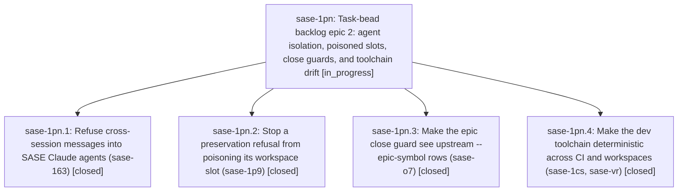

# Bead: sase-1pn — Task-bead backlog epic 2: agent isolation, poisoned slots, close guards, and toolchain drift

[Bead Pages](../README.md) / sase-1pn

**Status:** ◐ in_progress · **Type:** ▸ plan · **Tier:** epic
**Owner:** `bryanbugyi34@gmail.com` · **Created by:** [bbugyi200.athena.sase-1pm.land](https://github.com/sase-org/sase--agents/blob/main/sessions/bbugyi200.athena.sase-1pm.land.md) · **Assignee:** `sase-1pn.land`
**Created:** 2026-10-29 10:44:07 EDT
**Plan:** [202610/task\_backlog\_epic\_2.md](https://github.com/sase-org/sase--plans/blob/main/202610/task_backlog_epic_2.md)

<!-- sase:links:start -->

## Links

| Relation | Artifact | Why |
| --- | --- | --- |
| implemented-by | [plan:202610/task_backlog_epic_2.md][1] | derived from the plan's `bead_id:` frontmatter field |

_Plus 2 automatic references — see [Referenced By](#referenced-by)._

[1]: https://github.com/sase-org/sase--plans/blob/main/202610/task_backlog_epic_2.md

<!-- sase:links:end -->

## Description

The five next-costliest open task beads (sase-163, sase-1p9, sase-o7, sase-1cs, sase-vr) are fixed on master and closed. The land agent then proposes the next five-bead backlog epic under the same rules.

## Notes

[2026-10-29T18:23:14Z · sase-1pj.2.1.land] DISCOVERED ISSUE: tests/test_justfile_lint_lint.py::test_fix_routes_generated_docs_to_their_declared_venvs fails deterministically on master d8706bda92 (CalledProcessError: just fix exit 2). Bisected by swapping only the Justfile: passes with the Justfile at 89c40e30b0, fails at 995c451c38 (sase-1pn.4, 'pin dev toolchain versions') and every later commit. Cause: _setup-format-tools now reinstalls unless `ruff --version` prints 'ruff 0.17.3', but the test's fake .venv-format/bin/ruff stub prints nothing, so just fix runs a real 'uv pip install --project ... --group format-tools' inside the tmp dir and fails. Fix: have the test's ruff stub answer --version with the pinned format_tools_ruff_version (or read it from the Justfile). Triaged KNOWN (witness 083fa33bd3309a4e2f78626686a2ce92, no owner) in sase tool run check 7e23cc702c8815786967d2c06541e352. Found by sase-1pj.2.1.land.

## Phases

| Bead | Title | Status | Size | Created | Agents | Commits |
|---|---|---|---|---|---:|---:|
| [sase-1pn.1](sase-1pn.1.md) | Refuse cross-session messages into SASE Claude agents (sase-163) | ✓ closed | small | 2026-10-29 | 1 | 1 |
| [sase-1pn.2](sase-1pn.2.md) | Stop a preservation refusal from poisoning its workspace slot (sase-1p9) | ✓ closed | medium | 2026-10-29 | 1 | 2 |
| [sase-1pn.3](sase-1pn.3.md) | Make the epic close guard see upstream --epic-symbol rows (sase-o7) | ✓ closed | medium | 2026-10-29 | 1 | 1 |
| [sase-1pn.4](sase-1pn.4.md) | Make the dev toolchain deterministic across CI and workspaces (sase-1cs, sase-vr) | ✓ closed | medium | 2026-10-29 | 1 | 1 |

## Lineage

## Agents

| Agent | Bead | Commits |
|---|---|---:|
| [bbugyi200.athena.sase-1pn.1](https://github.com/sase-org/sase--agents/blob/main/agents/bbugyi200.athena.sase-1pn.1/README.md) | [sase-1pn.1](sase-1pn.1.md) | 1 |
| [bbugyi200.athena.sase-1pn.2](https://github.com/sase-org/sase--agents/blob/main/agents/bbugyi200.athena.sase-1pn.2/README.md) | [sase-1pn.2](sase-1pn.2.md) | 2 |
| [bbugyi200.athena.sase-1pn.3](https://github.com/sase-org/sase--agents/blob/main/sessions/bbugyi200.athena.sase-1pn.3.md) | [sase-1pn.3](sase-1pn.3.md) | 1 |
| [bbugyi200.athena.sase-1pn.4](https://github.com/sase-org/sase--agents/blob/main/agents/bbugyi200.athena.sase-1pn.4/README.md) | [sase-1pn.4](sase-1pn.4.md) | 1 |
| [bbugyi200.athena.sase-1pn.land](https://github.com/sase-org/sase--agents/blob/main/agents/bbugyi200.athena.sase-1pn.land/README.md) | [sase-1pn](README.md) | 0 |

## Commits

| Repo | Commit | Subject | Bead | Committed |
|---|---|---|---|---|
| sase | [`995c451`](https://github.com/sase-org/sase/commit/995c451c38eca0befedc61f7e4918b49a6c3d4f4) | chore(deps): pin dev toolchain versions | [sase-1pn.4](sase-1pn.4.md) | 2026-10-29 11:33:31 EDT |
| sase | [`464125c`](https://github.com/sase-org/sase/commit/464125cfa6491523c3297a4584d565490534baa7) | fix(claude): isolate SASE agent sessions | [sase-1pn.1](sase-1pn.1.md) | 2026-10-29 11:55:46 EDT |
| sase | [`8bea2e8`](https://github.com/sase-org/sase/commit/8bea2e84144a1a449b337c725a75b3c1c252cc8a) | feat(bead): include default-branch Justfile epic-symbol rows in close guard | [sase-1pn.3](sase-1pn.3.md) | 2026-10-29 12:26:49 EDT |
| sase-core | [`sase-core@1762b33`](https://github.com/sase-org/sase-core/commit/1762b33a12a9d91841162dde52db5d9e4d429916) | fix(workspace): skip quarantined slots in allocate\_and\_claim | [sase-1pn.2](sase-1pn.2.md) | 2026-10-29 13:20:57 EDT |
| sase | [`01dcc2e`](https://github.com/sase-org/sase/commit/01dcc2e5f5671d351ade5cbac5e5e4c5908c9d86) | fix(workspace): quarantine slots after nested-preservation refusal | [sase-1pn.2](sase-1pn.2.md) | 2026-10-29 15:58:27 EDT |

<!-- sase:referenced-by:start -->

## Referenced By

| Relation | Artifact | Why | Uses |
| --- | --- | --- | ---: |
| read-by | [agent:sase-1pj.2.1.land][1] | Check whether the epic that caused the Justfile fix-test regression is still active | 2 |
| read-by | [agent:sase-1pn.3--1][2] | check parent epic status | 1 |

[1]: https://github.com/sase-org/sase--agents/blob/main/agents/bbugyi200.athena.sase-1pj.2.1.land/README.md
[2]: https://github.com/sase-org/sase--agents/blob/main/sessions/bbugyi200.athena.sase-1pn.3.md

<!-- sase:referenced-by:end -->
