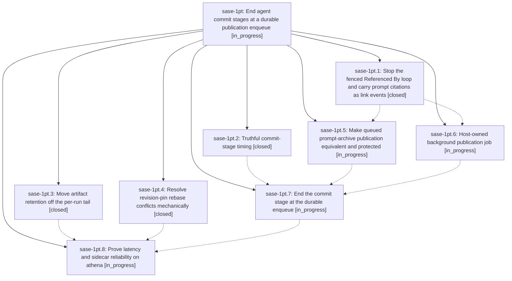

# Bead: sase-1pt — End agent commit stages at a durable publication enqueue

[Bead Pages](../README.md) / sase-1pt

**Status:** ◐ in_progress · **Type:** ▸ plan · **Tier:** epic
**Owner:** `bryanbugyi34@gmail.com` · **Created by:** [bbugyi200.athena.15z](https://github.com/sase-org/sase--agents/blob/main/sessions/bbugyi200.athena.15z.md) · **Assignee:** `sase-1pt.land`
**Created:** 2026-10-29 18:11:06 EDT
**Plan:** [202610/commit\_stage\_async\_publication.md](https://github.com/sase-org/sase--plans/blob/main/202610/commit_stage_async_publication.md)

<!-- sase:links:start -->

## Links

| Relation | Artifact | Why |
| --- | --- | --- |
| implemented-by | [plan:202610/commit_stage_async_publication.md][1] | derived from the plan's `bead_id:` frontmatter field |

_Plus 1 automatic references — see [Referenced By](#referenced-by)._

[1]: https://github.com/sase-org/sase--plans/blob/main/202610/commit_stage_async_publication.md

<!-- sase:links:end -->

## Description

A no-conflict sase agent commit stage (provider done to done.json) drops from a median of about four minutes to about one, and sase-core pin-only rebase conflicts stop costing an LLM repair turn, while every sidecar write the commit path owes today is still made. The agent's own declared commits stay synchronous and host-verified. Prompt-archive, agent-hood, Referenced By, and artifact-link publication is durably queued before the stage ends, then drained by a host-owned background publisher, with today's inline drain as an automatic fallback.

## Phases

| Bead | Title | Status | Size | Created | Agents | Commits |
|---|---|---|---|---|---:|---:|
| [sase-1pt.1](sase-1pt.1.md) | Stop the fenced Referenced By loop and carry prompt citations as link events | ✓ closed | medium | 2026-10-29 | 1 | 1 |
| [sase-1pt.2](sase-1pt.2.md) | Truthful commit-stage timing | ✓ closed | small | 2026-10-29 | 1 | 1 |
| [sase-1pt.3](sase-1pt.3.md) | Move artifact retention off the per-run tail | ✓ closed | small | 2026-10-29 | 1 | 1 |
| [sase-1pt.4](sase-1pt.4.md) | Resolve revision-pin rebase conflicts mechanically | ✓ closed | medium | 2026-10-29 | 1 | 1 |
| [sase-1pt.5](sase-1pt.5.md) | Make queued prompt-archive publication equivalent and protected | ◐ in_progress | medium | 2026-10-29 | 1 | 0 |
| [sase-1pt.6](sase-1pt.6.md) | Host-owned background publication job | ◐ in_progress | medium | 2026-10-29 | 1 | 0 |
| [sase-1pt.7](sase-1pt.7.md) | End the commit stage at the durable enqueue | ◐ in_progress | medium | 2026-10-29 | 1 | 0 |
| [sase-1pt.8](sase-1pt.8.md) | Prove latency and sidecar reliability on athena | ◐ in_progress | medium | 2026-10-29 | 1 | 0 |

## Lineage

## Agents

| Agent | Bead | Commits |
|---|---|---:|
| [bbugyi200.athena.sase-1pt.1](https://github.com/sase-org/sase--agents/blob/main/agents/bbugyi200.athena.sase-1pt.1/README.md) | [sase-1pt.1](sase-1pt.1.md) | 1 |
| [bbugyi200.athena.sase-1pt.2](https://github.com/sase-org/sase--agents/blob/main/sessions/bbugyi200.athena.sase-1pt.2.md) | [sase-1pt.2](sase-1pt.2.md) | 1 |
| [bbugyi200.athena.sase-1pt.3](https://github.com/sase-org/sase--agents/blob/main/agents/bbugyi200.athena.sase-1pt.3/README.md) | [sase-1pt.3](sase-1pt.3.md) | 1 |
| [bbugyi200.athena.sase-1pt.4](https://github.com/sase-org/sase--agents/blob/main/agents/bbugyi200.athena.sase-1pt.4/README.md) | [sase-1pt.4](sase-1pt.4.md) | 1 |
| [bbugyi200.athena.sase-1pt.5](https://github.com/sase-org/sase--agents/blob/main/agents/bbugyi200.athena.sase-1pt.5/README.md) | [sase-1pt.5](sase-1pt.5.md) | 0 |
| [bbugyi200.athena.sase-1pt.6](https://github.com/sase-org/sase--agents/blob/main/agents/bbugyi200.athena.sase-1pt.6/README.md) | [sase-1pt.6](sase-1pt.6.md) | 0 |
| [bbugyi200.athena.sase-1pt.7](https://github.com/sase-org/sase--agents/blob/main/agents/bbugyi200.athena.sase-1pt.7/README.md) | [sase-1pt.7](sase-1pt.7.md) | 0 |
| [bbugyi200.athena.sase-1pt.8](https://github.com/sase-org/sase--agents/blob/main/agents/bbugyi200.athena.sase-1pt.8/README.md) | [sase-1pt.8](sase-1pt.8.md) | 0 |
| [bbugyi200.athena.sase-1pt.land](https://github.com/sase-org/sase--agents/blob/main/agents/bbugyi200.athena.sase-1pt.land/README.md) | [sase-1pt](README.md) | 0 |

## Commits

| Repo | Commit | Subject | Bead | Committed |
|---|---|---|---|---|
| sase | [`e42c33f`](https://github.com/sase-org/sase/commit/e42c33fd68b030b1044dabdf999e3ce6011b2118) | feat(rebase): resolve revision-pin conflicts mechanically | [sase-1pt.4](sase-1pt.4.md) | 2026-10-29 18:43:13 EDT |
| sase | [`9664ed3`](https://github.com/sase-org/sase/commit/9664ed3c2055979e0cc93aba20783a3996d11082) | feat(artifacts): move indexed-file retention to hourly housekeeping | [sase-1pt.3](sase-1pt.3.md) | 2026-10-29 20:15:14 EDT |
| sase | [`4f1a5e0`](https://github.com/sase-org/sase/commit/4f1a5e0760aae7904372148fb4fbf3f041a1a30f) | feat(finalizers): report commit publication timings | [sase-1pt.2](sase-1pt.2.md) | 2026-10-29 20:22:44 EDT |
| sase | [`5f675c3`](https://github.com/sase-org/sase/commit/5f675c311f82fa66c82ff8659daa7f246da62f44) | feat(artifact-links): emit fenced prompt cites as link events | [sase-1pt.1](sase-1pt.1.md) | 2026-10-29 22:46:48 EDT |

<!-- sase:referenced-by:start -->

## Referenced By

| Relation | Artifact | Why | Uses |
| --- | --- | --- | ---: |
| read-by | [agent:sase-1pt.3][1] | Need parent epic scope and decisions | 1 |

[1]: https://github.com/sase-org/sase--agents/blob/main/agents/bbugyi200.athena.sase-1pt.3/README.md

<!-- sase:referenced-by:end -->
