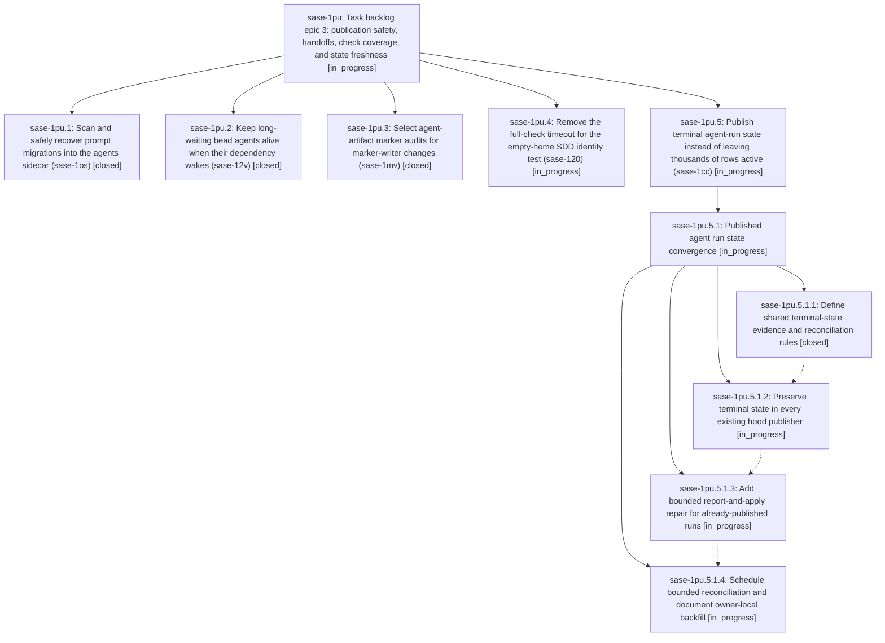

# Bead: sase-1pu — Task backlog epic 3: publication safety, handoffs, check coverage, and state freshness

[Bead Pages](../README.md) / sase-1pu

**Status:** ◐ in_progress · **Type:** ▸ plan · **Tier:** epic
**Owner:** `bryanbugyi34@gmail.com` · **Created by:** [bbugyi200.athena.sase-1pn.land](https://github.com/sase-org/sase--agents/blob/main/sessions/bbugyi200.athena.sase-1pn.land.md) · **Assignee:** `sase-1pu.land`
**Created:** 2026-10-29 19:19:00 EDT
**Plan:** [202610/task\_backlog\_epic\_3.md](https://github.com/sase-org/sase--plans/blob/main/202610/task_backlog_epic_3.md)

<!-- sase:links:start -->

## Links

| Relation | Artifact | Why |
| --- | --- | --- |
| implemented-by | [plan:202610/task_backlog_epic_3.md][1] | derived from the plan's `bead_id:` frontmatter field |

_Plus 2 automatic references — see [Referenced By](#referenced-by)._

[1]: https://github.com/sase-org/sase--plans/blob/main/202610/task_backlog_epic_3.md

<!-- sase:links:end -->

## Description

Fix and close the five selected fleet-costly task beads, then continue the backlog chain under the same ranking and closeout rules.

## Notes

[2026-10-30T00:37:53Z · sase-1pu.3--1] Full-lane verdict for sase-1pu.3 (marker-audit-selection, bead CLOSED): lint lane GREEN — all 16 lint/format/model-policy/SASE-validation stages passed in run 30fc9c7c53687497aeb55e6d6a19ef7e (fmt python/markdown/generated/sase-backed, keep-sorted, ruff, mypy, feature-flags, pyscripts, test-waits, changelog, patch/stitch, symvision, docs-contract, committed-plans). Test lane UNDETERMINED (infra) — test-scoped timed out after 2700s waiting for pytest worker-token grant (exit 4, UNKNOWN extractor_generic, contention with pids 2157973/2292927/2456902/3091634/2899852); no test assertion ran. Targeted evidence: tests/test_test_selection_marker_audits.py 4/4 PASS; tests/test_contract_manifest.py::test_contract_manifest_matches_marker_selection FAILS as expected pre-existing staleness (committed manifest still lists tests/test_core_finalizer_handoff.py which carries no contract marker; current selection omits it) — recorded as PROPOSED FOLLOW-UP on sase-1pu.3, reproduces on clean base. sase bead epic-symbols sase-1pu.3: clean, no leftovers. No new work needed for this phase.

## Phases

| Bead | Title | Status | Size | Created | Agents | Commits |
|---|---|---|---|---|---:|---:|
| [sase-1pu.1](sase-1pu.1.md) | Scan and safely recover prompt migrations into the agents sidecar (sase-1os) | ✓ closed | medium | 2026-10-29 | 1 | 0 |
| [sase-1pu.2](sase-1pu.2.md) | Keep long-waiting bead agents alive when their dependency wakes (sase-12v) | ✓ closed | large | 2026-10-29 | 1 | 0 |
| [sase-1pu.3](sase-1pu.3.md) | Select agent-artifact marker audits for marker-writer changes (sase-1mv) | ✓ closed | medium | 2026-10-29 | 1 | 1 |
| [sase-1pu.4](sase-1pu.4.md) | Remove the full-check timeout for the empty-home SDD identity test (sase-120) | ◐ in_progress | large | 2026-10-29 | 1 | 0 |
| [sase-1pu.5](sase-1pu.5.md) | Publish terminal agent-run state instead of leaving thousands of rows active (sase-1cc) | ◐ in_progress | large | 2026-10-29 | 1 | 0 |

## Lineage

## Agents

| Agent | Bead | Commits |
|---|---|---:|
| [bbugyi200.athena.sase-1pu.1](https://github.com/sase-org/sase--agents/blob/main/agents/bbugyi200.athena.sase-1pu.1/README.md) | [sase-1pu.1](sase-1pu.1.md) | 0 |
| [bbugyi200.athena.sase-1pu.2](https://github.com/sase-org/sase--agents/blob/main/sessions/bbugyi200.athena.sase-1pu.2.md) | [sase-1pu.2](sase-1pu.2.md) | 0 |
| [bbugyi200.athena.sase-1pu.3](https://github.com/sase-org/sase--agents/blob/main/sessions/bbugyi200.athena.sase-1pu.3.md) | [sase-1pu.3](sase-1pu.3.md) | 1 |
| [bbugyi200.athena.sase-1pu.4](https://github.com/sase-org/sase--agents/blob/main/sessions/bbugyi200.athena.sase-1pu.4.md) | [sase-1pu.4](sase-1pu.4.md) | 0 |
| [bbugyi200.athena.sase-1pu.5](https://github.com/sase-org/sase--agents/blob/main/sessions/bbugyi200.athena.sase-1pu.5.md) | [sase-1pu.5](sase-1pu.5.md) | 0 |
| [bbugyi200.athena.sase-1pu.5.1.1](https://github.com/sase-org/sase--agents/blob/main/sessions/bbugyi200.athena.sase-1pu.5.1.1.md) | [sase-1pu.5.1.1](sase-1pu.5.1.1.md) | 1 |
| [bbugyi200.athena.sase-1pu.5.1.2](https://github.com/sase-org/sase--agents/blob/main/agents/bbugyi200.athena.sase-1pu.5.1.2/README.md) | [sase-1pu.5.1.2](sase-1pu.5.1.2.md) | 0 |
| [bbugyi200.athena.sase-1pu.5.1.3](https://github.com/sase-org/sase--agents/blob/main/agents/bbugyi200.athena.sase-1pu.5.1.3/README.md) | [sase-1pu.5.1.3](sase-1pu.5.1.3.md) | 0 |
| [bbugyi200.athena.sase-1pu.5.1.4](https://github.com/sase-org/sase--agents/blob/main/agents/bbugyi200.athena.sase-1pu.5.1.4/README.md) | [sase-1pu.5.1.4](sase-1pu.5.1.4.md) | 0 |
| [bbugyi200.athena.sase-1pu.5.1.land](https://github.com/sase-org/sase--agents/blob/main/agents/bbugyi200.athena.sase-1pu.5.1.land/README.md) | [sase-1pu.5.1](sase-1pu.5.1.md) | 0 |
| [bbugyi200.athena.sase-1pu.land](https://github.com/sase-org/sase--agents/blob/main/agents/bbugyi200.athena.sase-1pu.land/README.md) | [sase-1pu](README.md) | 0 |

## Commits

| Repo | Commit | Subject | Bead | Committed |
|---|---|---|---|---|
| sase | [`fd8882c`](https://github.com/sase-org/sase/commit/fd8882c6af267424c4f3e1e131634264a2b59b74) | feat(scope): select marker audits for marker-writer changes | [sase-1pu.3](sase-1pu.3.md) | 2026-10-29 20:39:45 EDT |
| sase-core | [`sase-core@7de361c`](https://github.com/sase-org/sase-core/commit/7de361cca59157729d9f9c33d2895000eb37bc75) | feat(agent-run-state): add shared reconciliation policy and bindings | [sase-1pu.5.1.1](sase-1pu.5.1.1.md) | 2026-10-29 22:07:40 EDT |

<!-- sase:referenced-by:start -->

## Referenced By

| Relation | Artifact | Why | Uses |
| --- | --- | --- | ---: |
| read-by | [agent:sase-1pu.1][1] | Need parent epic DECISIONS and phase list | 1 |
| read-by | [agent:sase-1pu.3--1][2] | land agent verdict context | 1 |

[1]: https://github.com/sase-org/sase--agents/blob/main/agents/bbugyi200.athena.sase-1pu.1/README.md
[2]: https://github.com/sase-org/sase--agents/blob/main/sessions/bbugyi200.athena.sase-1pu.3.md

<!-- sase:referenced-by:end -->
