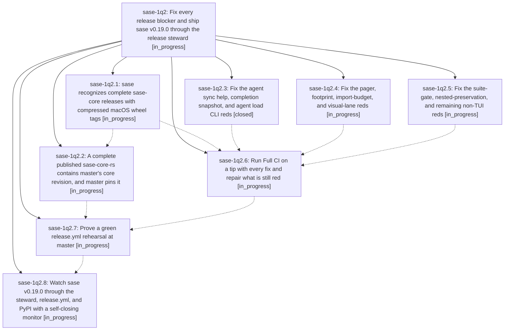

# Bead: sase-1q2 — Fix every release blocker and ship sase v0.19.0 through the release steward

[Bead Pages](../README.md) / sase-1q2

**Status:** ◐ in_progress · **Type:** ▸ plan · **Tier:** epic
**Owner:** `bryanbugyi34@gmail.com` · **Created by:** [bbugyi200.athena.16e](https://github.com/sase-org/sase--agents/blob/main/sessions/bbugyi200.athena.16e.md) · **Assignee:** `sase-1q2.land`
**Created:** 2026-10-30 12:37:05 EDT
**Plan:** [202610/v0\_19\_0\_release.md](https://github.com/sase-org/sase--plans/blob/main/202610/v0_19_0_release.md)

<!-- sase:links:start -->

## Links

| Relation | Artifact | Why |
| --- | --- | --- |
| implemented-by | [plan:202610/v0_19_0_release.md][1] | derived from the plan's `bead_id:` frontmatter field |

[1]: https://github.com/sase-org/sase--plans/blob/main/202610/v0_19_0_release.md

<!-- sase:links:end -->

## Description

Master Gate, Full CI, and a release.yml rehearsal are green on master; the release steward merges release-please PR #322; sase 0.19.0 is on PyPI; and the final lander records the release evidence as an artifact.

## Phases

| Bead | Title | Status | Size | Created | Agents | Commits |
|---|---|---|---|---|---:|---:|
| [sase-1q2.1](sase-1q2.1.md) | sase recognizes complete sase-core releases with compressed macOS wheel tags | ◐ in_progress | small | 2026-10-30 | 1 | 0 |
| [sase-1q2.2](sase-1q2.2.md) | A complete published sase-core-rs contains master's core revision, and master pins it | ◐ in_progress | medium | 2026-10-30 | 1 | 0 |
| [sase-1q2.3](sase-1q2.3.md) | Fix the agent sync help, completion snapshot, and agent load CLI reds | ✓ closed | small | 2026-10-30 | 1 | 1 |
| [sase-1q2.4](sase-1q2.4.md) | Fix the pager, footprint, import-budget, and visual-lane reds | ◐ in_progress | medium | 2026-10-30 | 1 | 0 |
| [sase-1q2.5](sase-1q2.5.md) | Fix the suite-gate, nested-preservation, and remaining non-TUI reds | ◐ in_progress | medium | 2026-10-30 | 1 | 0 |
| [sase-1q2.6](sase-1q2.6.md) | Run Full CI on a tip with every fix and repair what is still red | ◐ in_progress | medium | 2026-10-30 | 1 | 0 |
| [sase-1q2.7](sase-1q2.7.md) | Prove a green release.yml rehearsal at master | ◐ in_progress | small | 2026-10-30 | 1 | 0 |
| [sase-1q2.8](sase-1q2.8.md) | Watch sase v0.19.0 through the steward, release.yml, and PyPI with a self-closing monitor | ◐ in_progress | small | 2026-10-30 | 1 | 0 |

## Lineage

## Agents

| Agent | Bead | Commits |
|---|---|---:|
| [bbugyi200.athena.sase-1q2.1](https://github.com/sase-org/sase--agents/blob/main/agents/bbugyi200.athena.sase-1q2.1/README.md) | [sase-1q2.1](sase-1q2.1.md) | 0 |
| [bbugyi200.athena.sase-1q2.2](https://github.com/sase-org/sase--agents/blob/main/agents/bbugyi200.athena.sase-1q2.2/README.md) | [sase-1q2.2](sase-1q2.2.md) | 0 |
| [bbugyi200.athena.sase-1q2.3](https://github.com/sase-org/sase--agents/blob/main/agents/bbugyi200.athena.sase-1q2.3/README.md) | [sase-1q2.3](sase-1q2.3.md) | 1 |
| [bbugyi200.athena.sase-1q2.4](https://github.com/sase-org/sase--agents/blob/main/agents/bbugyi200.athena.sase-1q2.4/README.md) | [sase-1q2.4](sase-1q2.4.md) | 0 |
| [bbugyi200.athena.sase-1q2.5](https://github.com/sase-org/sase--agents/blob/main/agents/bbugyi200.athena.sase-1q2.5/README.md) | [sase-1q2.5](sase-1q2.5.md) | 0 |
| [bbugyi200.athena.sase-1q2.6](https://github.com/sase-org/sase--agents/blob/main/agents/bbugyi200.athena.sase-1q2.6/README.md) | [sase-1q2.6](sase-1q2.6.md) | 0 |
| [bbugyi200.athena.sase-1q2.7](https://github.com/sase-org/sase--agents/blob/main/agents/bbugyi200.athena.sase-1q2.7/README.md) | [sase-1q2.7](sase-1q2.7.md) | 0 |
| [bbugyi200.athena.sase-1q2.8](https://github.com/sase-org/sase--agents/blob/main/agents/bbugyi200.athena.sase-1q2.8/README.md) | [sase-1q2.8](sase-1q2.8.md) | 0 |
| [bbugyi200.athena.sase-1q2.land](https://github.com/sase-org/sase--agents/blob/main/agents/bbugyi200.athena.sase-1q2.land/README.md) | [sase-1q2](README.md) | 0 |

## Commits

| Repo | Commit | Subject | Bead | Committed |
|---|---|---|---|---|
| sase | [`3f9fe9c`](https://github.com/sase-org/sase/commit/3f9fe9c1079dd3862b2f176b2fff0b525b5ca337) | test(cli): stabilize agent sync and load assertions | [sase-1q2.3](sase-1q2.3.md) | 2026-10-30 13:34:58 EDT |
