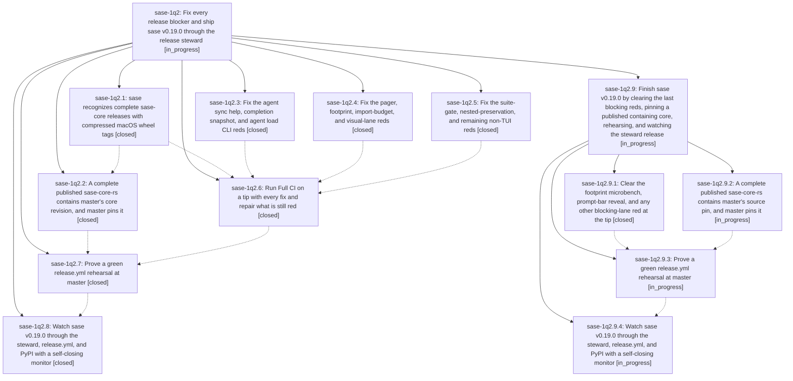

# Bead: sase-1q2 — Fix every release blocker and ship sase v0.19.0 through the release steward

[Bead Pages](../README.md) / sase-1q2

**Status:** ◐ in_progress · **Type:** ▸ plan · **Tier:** epic
**Owner:** `bryanbugyi34@gmail.com` · **Created by:** [bbugyi200.athena.16e](https://github.com/sase-org/sase--agents/blob/main/sessions/bbugyi200.athena.16e.md) · **Assignee:** `sase-1q2.land`
**Created:** 2026-10-30 12:37:05 EDT
**Plan:** [202610/v0\_19\_0\_release.md](https://github.com/sase-org/sase--plans/blob/main/202610/v0_19_0_release.md)

<!-- sase:links:start -->

## Links

| Relation | Artifact | Why |
| --- | --- | --- |
| implemented-by | [plan:202610/v0_19_0_release.md][1] | derived from the plan's `bead_id:` frontmatter field |

_Plus 3 automatic references — see [Referenced By](#referenced-by)._

[1]: https://github.com/sase-org/sase--plans/blob/main/202610/v0_19_0_release.md

<!-- sase:links:end -->

## Description

Master Gate, Full CI, and a release.yml rehearsal are green on master; the release steward merges release-please PR #322; sase 0.19.0 is on PyPI; and the final lander records the release evidence as an artifact.

## Notes

[2026-10-30T17:36:49Z · 16a--1] DISCOVERED ISSUE: During stopped-jump landing verification on 2026-10-30, sase tool run check ToolRun 3ca0ba01382eb58f81f4b5063766ebe1 stopped at lint (symvision) before pytest. It reports eight Justfile --epic-symbol entries for closed bead sase-1pj.5.1.4; the current TUI implementation diff does not touch that invocation. This is a deterministic remaining CI red for phase sase-1q2.6 to assess and remove as appropriate. Evidence: file:explicit:550fb2439c9eec33e4392004.

[2026-10-31T02:14:58Z · sase-1q4.2] DISCOVERED ISSUE: During wait_target rebase conflict repair in workspace sase_19, sase tool run check 1f6e27ebc5d389a1c2de42c4e230e2a9 (just check from this checkout) ERRORed at teardown of tests/pager/test_app_navigation.py::test_past_eof_line_clamps_with_information_toast and ::test_past_eof_end_line_clamps_silently with AttributeError: 'PagerScreen' object has no attribute 'notify' at tests/conftest.py:264. The test bodies completed; monkeypatch.setattr(screen, 'notify', ...) then failed on fixture teardown. Isolated rerun of the same two nodes on this tree reproduced both ERRORs (45 passed, 2 errors). This is the pager notify teardown class named in phase sase-1q2.4; the wait_target conflict repair does not touch pager. ToolRun 1f6e27ebc5d389a1c2de42c4e230e2a9.

[2026-10-31T09:16:23Z · sase-1q2.land] LAND TRIAGE (sase-1q2.land, 2026-10-31 ~09:30 UTC). sase 0.19.0 is NOT on PyPI (404). sase-1q2.7 (rehearse) closed canceled on CORE_LAG and sase-1q2.8 (watch) closed canceled, so the plan's Landing section, branch 2, applies: a nested epic covers the remaining blockers.

PROPOSED FOLLOW-UP outcomes:
(1) sase-1q2.1 #1, test_files_anchor_ownership::test_trailing_reserve_remeasures_when_flag_already_enabled timeout: new flake task sase-1qd (no duplicate; related link to sase-1a7).
(2) sase-1q2.4 #1, _lint-flags wait_target macro input-schema drift: DECLINED, already resolved on master. Both schema files now contain wait_target, and Master Gate lint is green at eec20f6ad5 (run 41185361724).
(3) sase-1q2.4 #2, parallel screenshot unstable recaptures: agents_stranded_resolve_modal is a duplicate (+1 on sase-1oa); agents_renamed_generic_session_root is new flake task sase-1qc (related to sase-1oa).
(4) sase-1q2.6, bump microbench variance: NOT a follow-up but a release blocker. It is deterministic on CI: the best-of-5 is 3.15-3.38 us in every Master Gate test (4) shard since 07:13 UTC (runs 41181251890, 41181712170, 41182683159, 41185361724) and 11.1 us under the 3.12 coverage leg (Full CI 41174188852), against a 2 us bound. Local cost is about 1.23 us. Folded into the nested epic.
(5) sase-1q2.6, test_reveal_matches_fresh_home[pairs1-] prompt-bar subtitle mismatch on Full CI 3.13 and 3.14: the revealed hot-spare subtitle lacks the key hints and shows 'Col …'. These are blocking qualification lanes, so this is folded into the nested epic as a release blocker.
(6) sase-1q2.6, visual-test stranded-modal timeout with pending_workers=[load_task]: duplicate (+1 on sase-1oa). final_rows_80x40 unstable: duplicate (+1 on sase-1nx). capacity_inspector_120x40 and capacity_inspector_busy_80x32 unstable: new flake task sase-1qb. The visual lane is advisory.
(7) sase-1q2.7 #1, re-rehearse once a core containing pin 80f5af40 publishes: folded into the nested epic.

Resolved tasks closed with evidence: sase-1ov, sase-1py (sase-1q2.3); sase-1px (sase-1q2.5); sase-1pz (sase-1q2.4); sase-1q7 (sase-1q2.6); sase-1q1 (toobig commit cf68c745f1).

Integration: since the epic started, sase-1q4 (wait_target) moved sase-core-revision.txt three times past the 0.43.2 ratchet: 271632e9d7 to d7b00dd7, cb230adb5e to 18ad5fd6, and eed4ef925b to 80f5af40. That is the CORE_LAG source. sase-core release PR #342 (v0.43.3) is open, contains 80f5af40, and is waiting for the daily 07:41 UTC cut. No later commit duplicates or conflicts with the core-match matcher (tools/_release_core.py and tools/release_candidate are untouched since deb8bb60b6).

## Phases

| Bead | Title | Status | Size | Created | Agents | Commits |
|---|---|---|---|---|---:|---:|
| [sase-1q2.1](sase-1q2.1.md) | sase recognizes complete sase-core releases with compressed macOS wheel tags | ✓ closed | small | 2026-10-30 | 1 | 1 |
| [sase-1q2.2](sase-1q2.2.md) | A complete published sase-core-rs contains master's core revision, and master pins it | ✓ closed | medium | 2026-10-30 | 1 | 1 |
| [sase-1q2.3](sase-1q2.3.md) | Fix the agent sync help, completion snapshot, and agent load CLI reds | ✓ closed | small | 2026-10-30 | 1 | 1 |
| [sase-1q2.4](sase-1q2.4.md) | Fix the pager, footprint, import-budget, and visual-lane reds | ✓ closed | medium | 2026-10-30 | 1 | 1 |
| [sase-1q2.5](sase-1q2.5.md) | Fix the suite-gate, nested-preservation, and remaining non-TUI reds | ✓ closed | medium | 2026-10-30 | 1 | 1 |
| [sase-1q2.6](sase-1q2.6.md) | Run Full CI on a tip with every fix and repair what is still red | ✓ closed | medium | 2026-10-30 | 1 | 1 |
| [sase-1q2.7](sase-1q2.7.md) | Prove a green release.yml rehearsal at master | ✓ closed | small | 2026-10-30 | 1 | 0 |
| [sase-1q2.8](sase-1q2.8.md) | Watch sase v0.19.0 through the steward, release.yml, and PyPI with a self-closing monitor | ✓ closed | small | 2026-10-30 | 1 | 0 |

## Lineage

## Agents

| Agent | Bead | Commits |
|---|---|---:|
| [bbugyi200.athena.sase-1q2.1](https://github.com/sase-org/sase--agents/blob/main/agents/bbugyi200.athena.sase-1q2.1/README.md) | [sase-1q2.1](sase-1q2.1.md) | 1 |
| [bbugyi200.athena.sase-1q2.2](https://github.com/sase-org/sase--agents/blob/main/sessions/bbugyi200.athena.sase-1q2.2.md) | [sase-1q2.2](sase-1q2.2.md) | 1 |
| [bbugyi200.athena.sase-1q2.3](https://github.com/sase-org/sase--agents/blob/main/agents/bbugyi200.athena.sase-1q2.3/README.md) | [sase-1q2.3](sase-1q2.3.md) | 1 |
| [bbugyi200.athena.sase-1q2.4](https://github.com/sase-org/sase--agents/blob/main/sessions/bbugyi200.athena.sase-1q2.4.md) | [sase-1q2.4](sase-1q2.4.md) | 1 |
| [bbugyi200.athena.sase-1q2.5](https://github.com/sase-org/sase--agents/blob/main/agents/bbugyi200.athena.sase-1q2.5/README.md) | [sase-1q2.5](sase-1q2.5.md) | 1 |
| [bbugyi200.athena.sase-1q2.6](https://github.com/sase-org/sase--agents/blob/main/sessions/bbugyi200.athena.sase-1q2.6.md) | [sase-1q2.6](sase-1q2.6.md) | 1 |
| [bbugyi200.athena.sase-1q2.7](https://github.com/sase-org/sase--agents/blob/main/agents/bbugyi200.athena.sase-1q2.7/README.md) | [sase-1q2.7](sase-1q2.7.md) | 0 |
| [bbugyi200.athena.sase-1q2.8](https://github.com/sase-org/sase--agents/blob/main/agents/bbugyi200.athena.sase-1q2.8/README.md) | [sase-1q2.8](sase-1q2.8.md) | 0 |
| [bbugyi200.athena.sase-1q2.9.1](https://github.com/sase-org/sase--agents/blob/main/sessions/bbugyi200.athena.sase-1q2.9.1.md) | [sase-1q2.9.1](sase-1q2.9.1.md) | 1 |
| [bbugyi200.athena.sase-1q2.9.2](https://github.com/sase-org/sase--agents/blob/main/sessions/bbugyi200.athena.sase-1q2.9.2.md) | [sase-1q2.9.2](sase-1q2.9.2.md) | 0 |
| [bbugyi200.athena.sase-1q2.9.3](https://github.com/sase-org/sase--agents/blob/main/agents/bbugyi200.athena.sase-1q2.9.3/README.md) | [sase-1q2.9.3](sase-1q2.9.3.md) | 0 |
| [bbugyi200.athena.sase-1q2.9.4](https://github.com/sase-org/sase--agents/blob/main/agents/bbugyi200.athena.sase-1q2.9.4/README.md) | [sase-1q2.9.4](sase-1q2.9.4.md) | 0 |
| [bbugyi200.athena.sase-1q2.9.land](https://github.com/sase-org/sase--agents/blob/main/agents/bbugyi200.athena.sase-1q2.9.land/README.md) | [sase-1q2.9](sase-1q2.9.md) | 0 |
| [bbugyi200.athena.sase-1q2.land](https://github.com/sase-org/sase--agents/blob/main/sessions/bbugyi200.athena.sase-1q2.land.md) | [sase-1q2](README.md) | 0 |

## Commits

| Repo | Commit | Subject | Bead | Committed |
|---|---|---|---|---|
| sase | [`3f9fe9c`](https://github.com/sase-org/sase/commit/3f9fe9c1079dd3862b2f176b2fff0b525b5ca337) | test(cli): stabilize agent sync and load assertions | [sase-1q2.3](sase-1q2.3.md) | 2026-10-30 13:34:58 EDT |
| sase | [`deb8bb6`](https://github.com/sase-org/sase/commit/deb8bb60b6aa1a159324fb3491f2ec69eedbf945) | fix(release): match compressed macOS tags for core completeness | [sase-1q2.1](sase-1q2.1.md) | 2026-10-30 13:48:02 EDT |
| sase | [`dab2d70`](https://github.com/sase-org/sase/commit/dab2d701fbac135ff3e828b2d0efd330c5a19b47) | fix(workspace): wrap nested-repo enumeration errors and copy the runner import closure | [sase-1q2.5](sase-1q2.5.md) | 2026-10-30 14:09:36 EDT |
| sase | [`1a41907`](https://github.com/sase-org/sase/commit/1a419071c20f3953562b4576d432700745d4cea6) | chore(core): ratchet sase-core-rs to 0.43.2 | [sase-1q2.2](sase-1q2.2.md) | 2026-10-30 15:04:39 EDT |
| sase | [`e28334c`](https://github.com/sase-org/sase/commit/e28334c45a72ec02d10b0564b06909f6d14751bf) | fix(tui): clear pager, footprint, import-budget, and visual-lane reds | [sase-1q2.4](sase-1q2.4.md) | 2026-10-31 01:43:45 EDT |
| sase | [`eec20f6`](https://github.com/sase-org/sase/commit/eec20f6ad54e295575f0f1e736527d656e84143c) | fix(tests): stabilize CI regression tests | [sase-1q2.6](sase-1q2.6.md) | 2026-10-31 04:37:21 EDT |
| sase | [`ddefc62`](https://github.com/sase-org/sase/commit/ddefc625e001ae255596f77a6461abb642f3929e) | perf(tui): keep footprint bump() under its 2us budget and fix hot-spare reveal subtitle race | [sase-1q2.9.1](sase-1q2.9.1.md) | 2026-10-31 09:00:25 EDT |

<!-- sase:referenced-by:start -->

## Referenced By

| Relation | Artifact | Why | Uses |
| --- | --- | --- | ---: |
| read-by | [agent:16a--1][1] | Check whether the active release-blocker epic owns the stale Symvision closed-epic whitelist failure | 1 |
| read-by | [agent:sase-1q2.1][2] | Need epic DECISIONS and remaining work for core-match phase | 1 |
| read-by | [agent:toobig-8x.agent_loader_artifacts.0][3] | Need to assess whether current check blockers are within the active release epic scope | 1 |

[1]: https://github.com/sase-org/sase--agents/blob/main/sessions/bbugyi200.athena.16a.md
[2]: https://github.com/sase-org/sase--agents/blob/main/agents/bbugyi200.athena.sase-1q2.1/README.md
[3]: https://github.com/sase-org/sase--agents/blob/main/agents/bbugyi200.athena.toobig-8x.agent_loader_artifacts.0/README.md

<!-- sase:referenced-by:end -->
