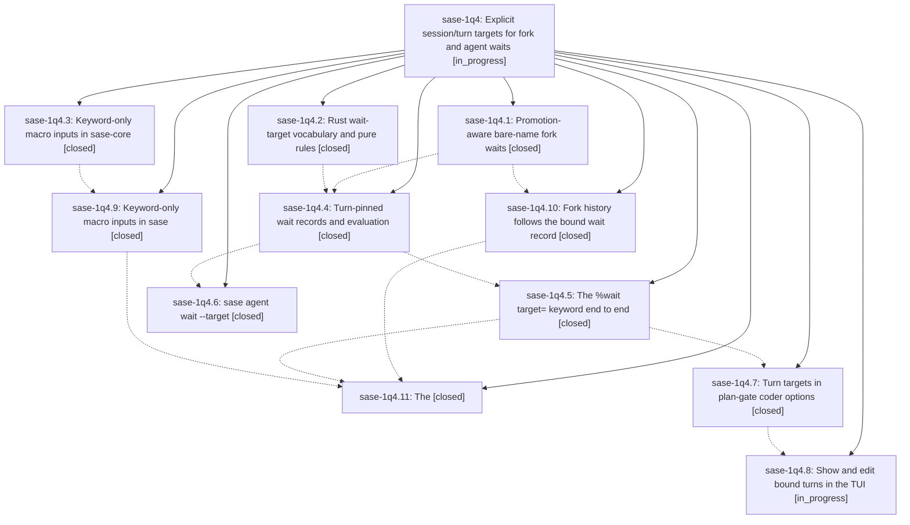

# Bead: sase-1q4 — Explicit session/turn targets for fork and agent waits

[Bead Pages](../README.md) / sase-1q4

**Status:** ◐ in_progress · **Type:** ▸ plan · **Tier:** epic
**Owner:** `bryanbugyi34@gmail.com` · **Created by:** [bbugyi200.athena.research.5j.linker.w0](https://github.com/sase-org/sase--agents/blob/main/sessions/bbugyi200.athena.research.5j.linker.w0.md) · **Assignee:** `sase-1q4.land`
**Created:** 2026-10-30 17:43:12 EDT
**Plan:** [202610/fork\_wait\_session\_turn\_target.md](https://github.com/sase-org/sase--plans/blob/main/202610/fork_wait_session_turn_target.md)

<!-- sase:links:start -->

## Links

| Relation | Artifact | Why |
| --- | --- | --- |
| implemented-by | [plan:202610/fork_wait_session_turn_target.md][1] | derived from the plan's `bead_id:` frontmatter field |

_Plus 2 automatic references — see [Referenced By](#referenced-by)._

[1]: https://github.com/sase-org/sase--plans/blob/main/202610/fork_wait_session_turn_target.md

<!-- sase:links:end -->

## Description

`#fork:<name>` reliably waits for the whole agent session, even when the parent is promoted into a session after the fork launched. Users can explicitly choose `session` or `turn` with `#fork(<name>, target=session|turn)`, `%wait(<name>, target=session|turn)`, `sase agent wait -T`, and the plan-gate coder options. Admission and injected fork history agree on the same bound target.

## Notes

[2026-10-31T07:12:00Z · toobig-8x.agent_loader_artifacts.0] DISCOVERED ISSUE: During artifact-loader split verification, sase tool run check ToolRun 8d8f3532b1b6f22323abb1bbd6d9da11 exited 1 after the scoped pytest lane. Seven NEW failures across tests/ace/tui/widgets/test_directive_arg_completion_wait.py, tests/ace/tui/widgets/test_directive_completion_candidates.py, tests/ace/tui/widgets/test_wait_directive_completion_interactions.py, tests/test_macro_directive_completion_parity.py, and tests/test_macro_directive_contract.py reflect assertions that omit the new %wait target= keyword: runtime completion candidates and argument hints now include target= while expected lists and contracts do not. This is directly tied to the %wait target implementation from phase sase-1q4.5; the artifact-loader diff does not touch these files. Evidence: ToolRun 8d8f3532b1b6f22323abb1bbd6d9da11.

## Phases

| Bead | Title | Status | Size | Created | Agents | Commits |
|---|---|---|---|---|---:|---:|
| [sase-1q4.1](sase-1q4.1.md) | Promotion-aware bare-name fork waits | ✓ closed | medium | 2026-10-30 | 1 | 1 |
| [sase-1q4.10](sase-1q4.10.md) | Fork history follows the bound wait record | ✓ closed | medium | 2026-10-30 | 1 | 1 |
| [sase-1q4.11](sase-1q4.11.md) | The | ✓ closed | medium | 2026-10-30 | 1 | 1 |
| [sase-1q4.2](sase-1q4.2.md) | Rust wait-target vocabulary and pure rules | ✓ closed | medium | 2026-10-30 | 1 | 2 |
| [sase-1q4.3](sase-1q4.3.md) | Keyword-only macro inputs in sase-core | ✓ closed | medium | 2026-10-30 | 1 | 2 |
| [sase-1q4.4](sase-1q4.4.md) | Turn-pinned wait records and evaluation | ✓ closed | medium | 2026-10-30 | 1 | 1 |
| [sase-1q4.5](sase-1q4.5.md) | The %wait target= keyword end to end | ✓ closed | medium | 2026-10-30 | 1 | 2 |
| [sase-1q4.6](sase-1q4.6.md) | sase agent wait --target | ✓ closed | small | 2026-10-30 | 1 | 1 |
| [sase-1q4.7](sase-1q4.7.md) | Turn targets in plan-gate coder options | ✓ closed | medium | 2026-10-30 | 1 | 1 |
| [sase-1q4.8](sase-1q4.8.md) | Show and edit bound turns in the TUI | ◐ in_progress | medium | 2026-10-30 | 1 | 0 |
| [sase-1q4.9](sase-1q4.9.md) | Keyword-only macro inputs in sase | ✓ closed | medium | 2026-10-30 | 1 | 1 |

## Lineage

## Agents

| Agent | Bead | Commits |
|---|---|---:|
| [bbugyi200.athena.sase-1q4.1](https://github.com/sase-org/sase--agents/blob/main/sessions/bbugyi200.athena.sase-1q4.1.md) | [sase-1q4.1](sase-1q4.1.md) | 1 |
| [bbugyi200.athena.sase-1q4.10](https://github.com/sase-org/sase--agents/blob/main/sessions/bbugyi200.athena.sase-1q4.10.md) | [sase-1q4.10](sase-1q4.10.md) | 1 |
| [bbugyi200.athena.sase-1q4.11](https://github.com/sase-org/sase--agents/blob/main/sessions/bbugyi200.athena.sase-1q4.11.md) | [sase-1q4.11](sase-1q4.11.md) | 1 |
| [bbugyi200.athena.sase-1q4.2](https://github.com/sase-org/sase--agents/blob/main/agents/bbugyi200.athena.sase-1q4.2/README.md) | [sase-1q4.2](sase-1q4.2.md) | 2 |
| [bbugyi200.athena.sase-1q4.3](https://github.com/sase-org/sase--agents/blob/main/sessions/bbugyi200.athena.sase-1q4.3.md) | [sase-1q4.3](sase-1q4.3.md) | 2 |
| [bbugyi200.athena.sase-1q4.4](https://github.com/sase-org/sase--agents/blob/main/agents/bbugyi200.athena.sase-1q4.4/README.md) | [sase-1q4.4](sase-1q4.4.md) | 1 |
| [bbugyi200.athena.sase-1q4.5](https://github.com/sase-org/sase--agents/blob/main/agents/bbugyi200.athena.sase-1q4.5/README.md) | [sase-1q4.5](sase-1q4.5.md) | 2 |
| [bbugyi200.athena.sase-1q4.6](https://github.com/sase-org/sase--agents/blob/main/agents/bbugyi200.athena.sase-1q4.6/README.md) | [sase-1q4.6](sase-1q4.6.md) | 1 |
| [bbugyi200.athena.sase-1q4.7](https://github.com/sase-org/sase--agents/blob/main/sessions/bbugyi200.athena.sase-1q4.7.md) | [sase-1q4.7](sase-1q4.7.md) | 1 |
| [bbugyi200.athena.sase-1q4.8](https://github.com/sase-org/sase--agents/blob/main/agents/bbugyi200.athena.sase-1q4.8/README.md) | [sase-1q4.8](sase-1q4.8.md) | 0 |
| [bbugyi200.athena.sase-1q4.9](https://github.com/sase-org/sase--agents/blob/main/agents/bbugyi200.athena.sase-1q4.9/README.md) | [sase-1q4.9](sase-1q4.9.md) | 1 |
| [bbugyi200.athena.sase-1q4.land](https://github.com/sase-org/sase--agents/blob/main/agents/bbugyi200.athena.sase-1q4.land/README.md) | [sase-1q4](README.md) | 0 |

## Commits

| Repo | Commit | Subject | Bead | Committed |
|---|---|---|---|---|
| sase | [`167af33`](https://github.com/sase-org/sase/commit/167af335307c8e83fd3994c9f9081c326fbbf6a5) | feat(agent): promotion-aware bare-name fork waits | [sase-1q4.1](sase-1q4.1.md) | 2026-10-30 18:18:33 EDT |
| sase | [`3fcb69f`](https://github.com/sase-org/sase/commit/3fcb69fb3ca7ff8caed60edf06fc9da47647e422) | fix(fork): honor bound wait records in injected history | [sase-1q4.10](sase-1q4.10.md) | 2026-10-30 20:50:58 EDT |
| sase-core | [`sase-core@d7b00dd`](https://github.com/sase-org/sase-core/commit/d7b00dd7e2088d64a4cf335385856c17d44a3bed) | feat(wait\_target): add parse, effective-target, and NamedEnum vocabulary | [sase-1q4.2](sase-1q4.2.md) | 2026-10-30 21:29:22 EDT |
| sase | [`271632e`](https://github.com/sase-org/sase/commit/271632e9d7381398fa1503730ed91f4a03d23e00) | feat(macros): add wait\_target NamedEnum facade and frontmatter wiring | [sase-1q4.2](sase-1q4.2.md) | 2026-10-30 22:18:35 EDT |
| sase-core | [`sase-core@18ad5fd`](https://github.com/sase-org/sase-core/commit/18ad5fd6f4592af4d61ef8e8187514b032bec03f) | feat(macro): add keyword-only input metadata and binding rules | [sase-1q4.3](sase-1q4.3.md) | 2026-10-30 23:32:07 EDT |
| sase | [`cb230ad`](https://github.com/sase-org/sase/commit/cb230adb5e50eed82039be6112716fbde0f23808) | docs(macros): document keyword-only inputs and wait targets | [sase-1q4.3](sase-1q4.3.md) | 2026-10-31 00:15:21 EDT |
| sase | [`5ade788`](https://github.com/sase-org/sase/commit/5ade7889b22e276ff20e8d304424b88d7f2777e0) | feat(wait): pin explicit session/turn wait identity records | [sase-1q4.4](sase-1q4.4.md) | 2026-10-31 00:27:05 EDT |
| sase | [`9e6e2b3`](https://github.com/sase-org/sase/commit/9e6e2b329fd94b3b3bd3840c43d787de5b8b9a04) | feat(macros): mirror keyword-only inputs across sase Python | [sase-1q4.9](sase-1q4.9.md) | 2026-10-31 01:11:51 EDT |
| sase | [`ef4bc2b`](https://github.com/sase-org/sase/commit/ef4bc2b34a6b844fea782d6d5ccd97f35471a316) | feat(agent): add -T/--target session\|turn to sase agent wait | [sase-1q4.6](sase-1q4.6.md) | 2026-10-31 01:43:29 EDT |
| sase-core | [`sase-core@80f5af4`](https://github.com/sase-org/sase-core/commit/80f5af40f4482f10187f207082249dd329cf329c) | feat(editor): parse and diagnose %wait target=session\|turn | [sase-1q4.5](sase-1q4.5.md) | 2026-10-31 02:37:20 EDT |
| sase | [`eed4ef9`](https://github.com/sase-org/sase/commit/eed4ef925b351e7aa9770dddbee969b79ec15589) | feat(macro): accept %wait(..., target=session\|turn) | [sase-1q4.5](sase-1q4.5.md) | 2026-10-31 02:38:38 EDT |
| sase | [`1b01062`](https://github.com/sase-org/sase/commit/1b01062d2e7bec72d3c312ee19a7772247164820) | feat(plan-gates): carry turn=\<agent\> waits through coder options | [sase-1q4.7](sase-1q4.7.md) | 2026-10-31 03:43:16 EDT |
| sase | [`dcee7f1`](https://github.com/sase-org/sase/commit/dcee7f11e9342935619dfbd85d670c7dfff1c98e) | feat(fork): bind explicit wait targets and structured refs | [sase-1q4.11](sase-1q4.11.md) | 2026-10-31 03:58:25 EDT |

<!-- sase:referenced-by:start -->

## Referenced By

| Relation | Artifact | Why | Uses |
| --- | --- | --- | ---: |
| read-by | [agent:sase-1q4.2][1] | Need parent epic DECISIONS and remaining phases | 2 |
| read-by | [agent:toobig-8x.agent_loader_artifacts.0][2] | Need to assess whether wait target completion failures belong to this active epic | 1 |

[1]: https://github.com/sase-org/sase--agents/blob/main/agents/bbugyi200.athena.sase-1q4.2/README.md
[2]: https://github.com/sase-org/sase--agents/blob/main/agents/bbugyi200.athena.toobig-8x.agent_loader_artifacts.0/README.md

<!-- sase:referenced-by:end -->
