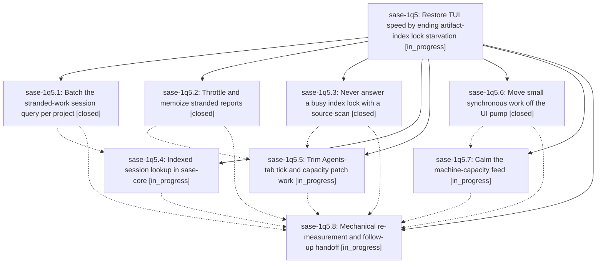

# Bead: sase-1q5 — Restore TUI speed by ending artifact-index lock starvation

[Bead Pages](../README.md) / sase-1q5

**Status:** ◐ in_progress · **Type:** ▸ plan · **Tier:** epic
**Owner:** `bryanbugyi34@gmail.com` · **Created by:** [bbugyi200.athena.research.5k.linker.w0](https://github.com/sase-org/sase--agents/blob/main/sessions/bbugyi200.athena.research.5k.linker.w0.md) · **Assignee:** `sase-1q5.land`
**Created:** 2026-10-30 18:38:09 EDT
**Plan:** [202610/tui\_index\_lock\_speedup.md](https://github.com/sase-org/sase--plans/blob/main/202610/tui_index_lock_speedup.md)

## Description

The TUI stops falling into 24–30 s O(archive) fallback scans. The stranded-work collector holds the artifact-index lock for seconds instead of minutes. A busy lock is answered from the last good snapshot, never a filesystem scan. The smaller UI-thread hitch sources the research found are trimmed. A restarted TUI can then be re-measured mechanically before any GC-policy change.

## Phases

| Bead | Title | Status | Size | Created | Agents | Commits |
|---|---|---|---|---|---:|---:|
| [sase-1q5.1](sase-1q5.1.md) | Batch the stranded-work session query per project | ✓ closed | small | 2026-10-30 | 1 | 1 |
| [sase-1q5.2](sase-1q5.2.md) | Throttle and memoize stranded reports | ✓ closed | medium | 2026-10-30 | 1 | 1 |
| [sase-1q5.3](sase-1q5.3.md) | Never answer a busy index lock with a source scan | ✓ closed | medium | 2026-10-30 | 1 | 1 |
| [sase-1q5.4](sase-1q5.4.md) | Indexed session lookup in sase-core | ◐ in_progress | medium | 2026-10-30 | 1 | 0 |
| [sase-1q5.5](sase-1q5.5.md) | Trim Agents-tab tick and capacity patch work | ◐ in_progress | medium | 2026-10-30 | 1 | 0 |
| [sase-1q5.6](sase-1q5.6.md) | Move small synchronous work off the UI pump | ✓ closed | small | 2026-10-30 | 1 | 1 |
| [sase-1q5.7](sase-1q5.7.md) | Calm the machine-capacity feed | ◐ in_progress | small | 2026-10-30 | 1 | 0 |
| [sase-1q5.8](sase-1q5.8.md) | Mechanical re-measurement and follow-up handoff | ◐ in_progress | small | 2026-10-30 | 1 | 0 |

## Lineage

## Agents

| Agent | Bead | Commits |
|---|---|---:|
| [bbugyi200.athena.sase-1q5.1](https://github.com/sase-org/sase--agents/blob/main/sessions/bbugyi200.athena.sase-1q5.1.md) | [sase-1q5.1](sase-1q5.1.md) | 1 |
| [bbugyi200.athena.sase-1q5.2](https://github.com/sase-org/sase--agents/blob/main/sessions/bbugyi200.athena.sase-1q5.2.md) | [sase-1q5.2](sase-1q5.2.md) | 1 |
| [bbugyi200.athena.sase-1q5.3](https://github.com/sase-org/sase--agents/blob/main/agents/bbugyi200.athena.sase-1q5.3/README.md) | [sase-1q5.3](sase-1q5.3.md) | 1 |
| [bbugyi200.athena.sase-1q5.4](https://github.com/sase-org/sase--agents/blob/main/agents/bbugyi200.athena.sase-1q5.4/README.md) | [sase-1q5.4](sase-1q5.4.md) | 0 |
| [bbugyi200.athena.sase-1q5.5](https://github.com/sase-org/sase--agents/blob/main/sessions/bbugyi200.athena.sase-1q5.5.md) | [sase-1q5.5](sase-1q5.5.md) | 0 |
| [bbugyi200.athena.sase-1q5.6](https://github.com/sase-org/sase--agents/blob/main/agents/bbugyi200.athena.sase-1q5.6/README.md) | [sase-1q5.6](sase-1q5.6.md) | 1 |
| [bbugyi200.athena.sase-1q5.7](https://github.com/sase-org/sase--agents/blob/main/agents/bbugyi200.athena.sase-1q5.7/README.md) | [sase-1q5.7](sase-1q5.7.md) | 0 |
| [bbugyi200.athena.sase-1q5.8](https://github.com/sase-org/sase--agents/blob/main/agents/bbugyi200.athena.sase-1q5.8/README.md) | [sase-1q5.8](sase-1q5.8.md) | 0 |
| [bbugyi200.athena.sase-1q5.land](https://github.com/sase-org/sase--agents/blob/main/agents/bbugyi200.athena.sase-1q5.land/README.md) | [sase-1q5](README.md) | 0 |

## Commits

| Repo | Commit | Subject | Bead | Committed |
|---|---|---|---|---|
| sase | [`b585d3b`](https://github.com/sase-org/sase/commit/b585d3b75bcd3fadbe0709d510d18b7cf6db4f7d) | fix(tui): answer a busy index lock from cache, never a source scan | [sase-1q5.3](sase-1q5.3.md) | 2026-10-30 20:06:14 EDT |
| sase | [`ad6e4d4`](https://github.com/sase-org/sase/commit/ad6e4d4c153316088c866b04e99652826ae00e1d) | perf(ace): throttle stranded report refreshes | [sase-1q5.2](sase-1q5.2.md) | 2026-10-30 20:12:35 EDT |
| sase | [`001351f`](https://github.com/sase-org/sase/commit/001351f5b921b165c52fb13fe2da8e0ea2d91a0a) | perf(tui): move small synchronous work off pump | [sase-1q5.6](sase-1q5.6.md) | 2026-10-30 20:13:22 EDT |
| sase | [`58ce6ee`](https://github.com/sase-org/sase/commit/58ce6ee62e468710a118a93b77d0084cad98b1a5) | feat(bead): batch stranded session query per project | [sase-1q5.1](sase-1q5.1.md) | 2026-10-30 20:29:00 EDT |

<!-- sase:referenced-by:start -->

## Referenced By

| Relation | Artifact | Why | Uses |
| --- | --- | --- | ---: |
| read-by | [agent:sase-1q5.6][1] | Need epic context and prior phase notes | 1 |

[1]: https://github.com/sase-org/sase--agents/blob/main/agents/bbugyi200.athena.sase-1q5.6/README.md

<!-- sase:referenced-by:end -->
