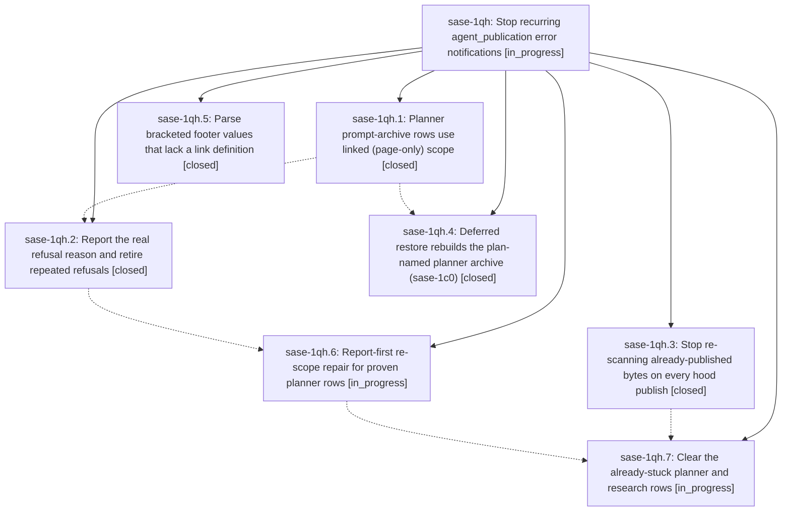

# Bead: sase-1qh — Stop recurring agent\_publication error notifications

[Bead Pages](../README.md) / sase-1qh

**Status:** ◐ in_progress · **Type:** ▸ plan · **Tier:** epic
**Owner:** `bryanbugyi34@gmail.com` · **Created by:** [bbugyi200.athena.research.5l.linker.w0](https://github.com/sase-org/sase--agents/blob/main/sessions/bbugyi200.athena.research.5l.linker.w0.md) · **Assignee:** `sase-1qh.land`
**Created:** 2026-10-31 12:01:49 EDT
**Plan:** [202610/agent\_publication\_notifications.md](https://github.com/sase-org/sase--plans/blob/main/202610/agent_publication_notifications.md)

<!-- sase:links:start -->

## Links

| Relation | Artifact | Why |
| --- | --- | --- |
| implemented-by | [plan:202610/agent_publication_notifications.md][1] | derived from the plan's `bead_id:` frontmatter field |

_Plus 2 automatic references — see [Referenced By](#referenced-by)._

[1]: https://github.com/sase-org/sase--plans/blob/main/202610/agent_publication_notifications.md

<!-- sase:links:end -->

## Description

Approving a plan and running research agents no longer produce `agent_publication` error notifications. Any refusal that remains states its real reason and retires instead of repeating. Rows already stuck by these bugs clear through verified acknowledgment, not by being dropped.

## Phases

| Bead | Title | Status | Size | Created | Agents | Commits |
|---|---|---|---|---|---:|---:|
| [sase-1qh.1](sase-1qh.1.md) | Planner prompt-archive rows use linked (page-only) scope | ✓ closed | medium | 2026-10-31 | 1 | 1 |
| [sase-1qh.2](sase-1qh.2.md) | Report the real refusal reason and retire repeated refusals | ✓ closed | medium | 2026-10-31 | 1 | 1 |
| [sase-1qh.3](sase-1qh.3.md) | Stop re-scanning already-published bytes on every hood publish | ✓ closed | medium | 2026-10-31 | 1 | 1 |
| [sase-1qh.4](sase-1qh.4.md) | Deferred restore rebuilds the plan-named planner archive (sase-1c0) | ✓ closed | medium | 2026-10-31 | 1 | 1 |
| [sase-1qh.5](sase-1qh.5.md) | Parse bracketed footer values that lack a link definition | ✓ closed | small | 2026-10-31 | 1 | 2 |
| [sase-1qh.6](sase-1qh.6.md) | Report-first re-scope repair for proven planner rows | ◐ in_progress | medium | 2026-10-31 | 1 | 0 |
| [sase-1qh.7](sase-1qh.7.md) | Clear the already-stuck planner and research rows | ◐ in_progress | small | 2026-10-31 | 1 | 0 |

## Lineage

## Agents

| Agent | Bead | Commits |
|---|---|---:|
| [bbugyi200.athena.sase-1qh.1](https://github.com/sase-org/sase--agents/blob/main/agents/bbugyi200.athena.sase-1qh.1/README.md) | [sase-1qh.1](sase-1qh.1.md) | 1 |
| [bbugyi200.athena.sase-1qh.2](https://github.com/sase-org/sase--agents/blob/main/sessions/bbugyi200.athena.sase-1qh.2.md) | [sase-1qh.2](sase-1qh.2.md) | 1 |
| [bbugyi200.athena.sase-1qh.3](https://github.com/sase-org/sase--agents/blob/main/sessions/bbugyi200.athena.sase-1qh.3.md) | [sase-1qh.3](sase-1qh.3.md) | 1 |
| [bbugyi200.athena.sase-1qh.4](https://github.com/sase-org/sase--agents/blob/main/agents/bbugyi200.athena.sase-1qh.4/README.md) | [sase-1qh.4](sase-1qh.4.md) | 1 |
| [bbugyi200.athena.sase-1qh.5](https://github.com/sase-org/sase--agents/blob/main/agents/bbugyi200.athena.sase-1qh.5/README.md) | [sase-1qh.5](sase-1qh.5.md) | 2 |
| [bbugyi200.athena.sase-1qh.6](https://github.com/sase-org/sase--agents/blob/main/agents/bbugyi200.athena.sase-1qh.6/README.md) | [sase-1qh.6](sase-1qh.6.md) | 0 |
| [bbugyi200.athena.sase-1qh.7](https://github.com/sase-org/sase--agents/blob/main/agents/bbugyi200.athena.sase-1qh.7/README.md) | [sase-1qh.7](sase-1qh.7.md) | 0 |
| [bbugyi200.athena.sase-1qh.land](https://github.com/sase-org/sase--agents/blob/main/agents/bbugyi200.athena.sase-1qh.land/README.md) | [sase-1qh](README.md) | 0 |

## Commits

| Repo | Commit | Subject | Bead | Committed |
|---|---|---|---|---|
| sase | [`30e012b`](https://github.com/sase-org/sase/commit/30e012baaad77f98f9c68f494a73cf48565970c4) | perf(agents-sync): reuse published protection scans | [sase-1qh.3](sase-1qh.3.md) | 2026-10-31 13:15:14 EDT |
| sase | [`9409312`](https://github.com/sase-org/sase/commit/9409312d1e2871c4433947213c9833d609b3540f) | feat(agents-sync): enqueue planner prompt archives with linked scope | [sase-1qh.1](sase-1qh.1.md) | 2026-10-31 13:18:21 EDT |
| sase-core | [`sase-core@764317b`](https://github.com/sase-org/sase-core/commit/764317b90c80784f2dc0f463a1631921d3f4379f) | fix(commit-footer): project bare label for undefined bracket links | [sase-1qh.5](sase-1qh.5.md) | 2026-10-31 13:36:21 EDT |
| sase | [`cb7ab28`](https://github.com/sase-org/sase/commit/cb7ab28e4ba9cdebe52acf4fad0dd58a31501f89) | fix(artifact-links): unwrap bracketed bead trailers with versioned stitch cache | [sase-1qh.5](sase-1qh.5.md) | 2026-10-31 13:37:37 EDT |
| sase | [`ae2c65d`](https://github.com/sase-org/sase/commit/ae2c65dd293f5f73513c1baccb08e313b1c53346) | feat(agents-sync): report real refusal reason and retire repeated refusals | [sase-1qh.2](sase-1qh.2.md) | 2026-10-31 14:20:21 EDT |
| sase | [`f1dcab6`](https://github.com/sase-org/sase/commit/f1dcab6dae643212b225462161dd313787d7e632) | feat(agents-sync): restore planner prompt archives under their plan name | [sase-1qh.4](sase-1qh.4.md) | 2026-10-31 14:32:35 EDT |

<!-- sase:referenced-by:start -->

## Referenced By

| Relation | Artifact | Why | Uses |
| --- | --- | --- | ---: |
| read-by | [agent:sase-1qh.1][1] | Need the parent epic scope, decisions, and phase list | 1 |
| read-by | [agent:sase-1qh.5][2] | epic context decisions | 2 |

[1]: https://github.com/sase-org/sase--agents/blob/main/agents/bbugyi200.athena.sase-1qh.1/README.md
[2]: https://github.com/sase-org/sase--agents/blob/main/agents/bbugyi200.athena.sase-1qh.5/README.md

<!-- sase:referenced-by:end -->
