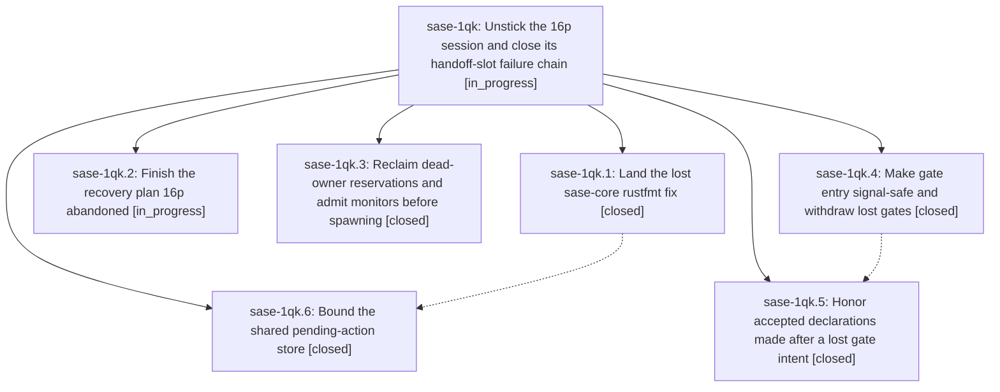

# Bead: sase-1qk — Unstick the 16p session and close its handoff-slot failure chain

[Bead Pages](../README.md) / sase-1qk

**Status:** ◐ in_progress · **Type:** ▸ plan · **Tier:** epic
**Owner:** `bryanbugyi34@gmail.com` · **Created by:** [bbugyi200.athena.16r](https://github.com/sase-org/sase--agents/blob/main/sessions/bbugyi200.athena.16r.md) · **Assignee:** `sase-1qk.land`
**Created:** 2026-11-01 12:02:54 EST
**Plan:** [202611/16p\_stall\_handoff\_recovery.md](https://github.com/sase-org/sase--plans/blob/main/202611/16p_stall_handoff_recovery.md)

<!-- sase:links:start -->

## Links

| Relation | Artifact | Why |
| --- | --- | --- |
| implemented-by | [plan:202611/16p_stall_handoff_recovery.md][1] | derived from the plan's `bead_id:` frontmatter field |

[1]: https://github.com/sase-org/sase--plans/blob/main/202611/16p_stall_handoff_recovery.md

<!-- sase:links:end -->

## Description

The 16p recovery work is finished (sase-core rustfmt fix landed, broken LaunchApproval withdrawn, remaining epics relaunched), and one interrupted gate command can no longer block later handoffs, orphan a monitor, leave an actionable lost gate, or discard an accepted final declaration.

## Phases

| Bead | Title | Status | Size | Created | Agents | Commits |
|---|---|---|---|---|---:|---:|
| [sase-1qk.1](sase-1qk.1.md) | Land the lost sase-core rustfmt fix | ✓ closed | small | 2026-11-01 | 1 | 1 |
| [sase-1qk.2](sase-1qk.2.md) | Finish the recovery plan 16p abandoned | ◐ in_progress | medium | 2026-11-01 | 1 | 0 |
| [sase-1qk.3](sase-1qk.3.md) | Reclaim dead-owner reservations and admit monitors before spawning | ✓ closed | medium | 2026-11-01 | 1 | 1 |
| [sase-1qk.4](sase-1qk.4.md) | Make gate entry signal-safe and withdraw lost gates | ✓ closed | medium | 2026-11-01 | 1 | 1 |
| [sase-1qk.5](sase-1qk.5.md) | Honor accepted declarations made after a lost gate intent | ✓ closed | medium | 2026-11-01 | 1 | 1 |
| [sase-1qk.6](sase-1qk.6.md) | Bound the shared pending-action store | ✓ closed | medium | 2026-11-01 | 1 | 2 |

## Lineage

## Agents

| Agent | Bead | Commits |
|---|---|---:|
| [bbugyi200.athena.sase-1qk.1](https://github.com/sase-org/sase--agents/blob/main/agents/bbugyi200.athena.sase-1qk.1/README.md) | [sase-1qk.1](sase-1qk.1.md) | 1 |
| [bbugyi200.athena.sase-1qk.2](https://github.com/sase-org/sase--agents/blob/main/sessions/bbugyi200.athena.sase-1qk.2.md) | [sase-1qk.2](sase-1qk.2.md) | 0 |
| [bbugyi200.athena.sase-1qk.3](https://github.com/sase-org/sase--agents/blob/main/sessions/bbugyi200.athena.sase-1qk.3.md) | [sase-1qk.3](sase-1qk.3.md) | 1 |
| [bbugyi200.athena.sase-1qk.4](https://github.com/sase-org/sase--agents/blob/main/sessions/bbugyi200.athena.sase-1qk.4.md) | [sase-1qk.4](sase-1qk.4.md) | 1 |
| [bbugyi200.athena.sase-1qk.5](https://github.com/sase-org/sase--agents/blob/main/sessions/bbugyi200.athena.sase-1qk.5.md) | [sase-1qk.5](sase-1qk.5.md) | 1 |
| [bbugyi200.athena.sase-1qk.6](https://github.com/sase-org/sase--agents/blob/main/sessions/bbugyi200.athena.sase-1qk.6.md) | [sase-1qk.6](sase-1qk.6.md) | 2 |
| [bbugyi200.athena.sase-1qk.land](https://github.com/sase-org/sase--agents/blob/main/agents/bbugyi200.athena.sase-1qk.land/README.md) | [sase-1qk](README.md) | 0 |

## Commits

| Repo | Commit | Subject | Bead | Committed |
|---|---|---|---|---|
| sase-core | [`sase-core@dc119c0`](https://github.com/sase-org/sase-core/commit/dc119c0bace0b7d6a740c6f769052fdecb5c6148) | style(staged\_handoff): rustfmt recovery and validate re-exports | [sase-1qk.1](sase-1qk.1.md) | 2026-11-01 12:34:58 EST |
| sase | [`17d8fe5`](https://github.com/sase-org/sase/commit/17d8fe593726e4691972f17b5c8aaeb8635a86d7) | feat(gate-turn): make gate entry signal-safe and withdraw lost gates | [sase-1qk.4](sase-1qk.4.md) | 2026-11-01 13:02:47 EST |
| sase | [`71827cf`](https://github.com/sase-org/sase/commit/71827cfecc3c8e0103738e83987bb01afa4394d4) | feat(gate-intent): honor accepted declarations made after a lost gate intent | [sase-1qk.5](sase-1qk.5.md) | 2026-11-01 14:04:27 EST |
| sase-core | [`sase-core@6d33166`](https://github.com/sase-org/sase-core/commit/6d3316690815b5a8281ff7081383dae411ec11f8) | feat(notifications): prune handled pending actions after one week | [sase-1qk.6](sase-1qk.6.md) | 2026-11-01 15:38:27 EST |
| sase | [`c5fdcd1`](https://github.com/sase-org/sase/commit/c5fdcd10cd8a6c678b8a806a1cdad4cefc3b3595) | test(pending-actions): use integral timestamps in transport round-trip | [sase-1qk.6](sase-1qk.6.md) | 2026-11-01 15:39:54 EST |
| sase | [`a792079`](https://github.com/sase-org/sase/commit/a79207993c4e619c235c3325e351e8610a2a0168) | fix(staged-handoff): reclaim dead-owner reservations before monitor spawn | [sase-1qk.3](sase-1qk.3.md) | 2026-11-01 18:15:37 EST |
