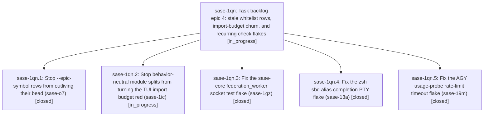

# Bead: sase-1qn — Task backlog epic 4: stale whitelist rows, import-budget churn, and recurring check flakes

[Bead Pages](../README.md) / sase-1qn

**Status:** ◐ in_progress · **Type:** ▸ plan · **Tier:** epic
**Owner:** `bryanbugyi34@gmail.com` · **Created by:** [bbugyi200.athena.sase-1pu.land](https://github.com/sase-org/sase--agents/blob/main/sessions/bbugyi200.athena.sase-1pu.land.md) · **Assignee:** `sase-1qn.land`
**Created:** 2026-11-01 14:34:47 EST
**Plan:** [202611/task\_backlog\_epic\_4.md](https://github.com/sase-org/sase--plans/blob/main/202611/task_backlog_epic_4.md)

<!-- sase:links:start -->

## Links

| Relation | Artifact | Why |
| --- | --- | --- |
| implemented-by | [plan:202611/task_backlog_epic_4.md][1] | derived from the plan's `bead_id:` frontmatter field |

[1]: https://github.com/sase-org/sase--plans/blob/main/202611/task_backlog_epic_4.md

<!-- sase:links:end -->

## Description

Fix and close the five next-costliest open task beads, then continue the backlog chain under the same ranking and closeout rules.

## Phases

| Bead | Title | Status | Size | Created | Agents | Commits |
|---|---|---|---|---|---:|---:|
| [sase-1qn.1](sase-1qn.1.md) | Stop --epic-symbol rows from outliving their bead (sase-o7) | ✓ closed | large | 2026-11-01 | 1 | 2 |
| [sase-1qn.2](sase-1qn.2.md) | Stop behavior-neutral module splits from turning the TUI import budget red (sase-1ic) | ◐ in_progress | large | 2026-11-01 | 1 | 0 |
| [sase-1qn.3](sase-1qn.3.md) | Fix the sase-core federation\_worker socket test flake (sase-1gz) | ✓ closed | large | 2026-11-01 | 1 | 1 |
| [sase-1qn.4](sase-1qn.4.md) | Fix the zsh sbd alias completion PTY flake (sase-13a) | ✓ closed | large | 2026-11-01 | 1 | 1 |
| [sase-1qn.5](sase-1qn.5.md) | Fix the AGY usage-probe rate-limit timeout flake (sase-19m) | ✓ closed | medium | 2026-11-01 | 1 | 1 |

## Lineage

## Agents

| Agent | Bead | Commits |
|---|---|---:|
| [bbugyi200.athena.sase-1qn.1](https://github.com/sase-org/sase--agents/blob/main/sessions/bbugyi200.athena.sase-1qn.1.md) | [sase-1qn.1](sase-1qn.1.md) | 2 |
| [bbugyi200.athena.sase-1qn.2](https://github.com/sase-org/sase--agents/blob/main/sessions/bbugyi200.athena.sase-1qn.2.md) | [sase-1qn.2](sase-1qn.2.md) | 0 |
| [bbugyi200.athena.sase-1qn.3](https://github.com/sase-org/sase--agents/blob/main/sessions/bbugyi200.athena.sase-1qn.3.md) | [sase-1qn.3](sase-1qn.3.md) | 1 |
| [bbugyi200.athena.sase-1qn.4](https://github.com/sase-org/sase--agents/blob/main/sessions/bbugyi200.athena.sase-1qn.4.md) | [sase-1qn.4](sase-1qn.4.md) | 1 |
| [bbugyi200.athena.sase-1qn.5](https://github.com/sase-org/sase--agents/blob/main/agents/bbugyi200.athena.sase-1qn.5/README.md) | [sase-1qn.5](sase-1qn.5.md) | 1 |
| [bbugyi200.athena.sase-1qn.land](https://github.com/sase-org/sase--agents/blob/main/agents/bbugyi200.athena.sase-1qn.land/README.md) | [sase-1qn](README.md) | 0 |

## Commits

| Repo | Commit | Subject | Bead | Committed |
|---|---|---|---|---|
| sase-core | [`sase-core@02eb696`](https://github.com/sase-org/sase-core/commit/02eb6961892c496db925234b8151daa5ab49098e) | fix(sase\_gateway): release federation listener lock on drop with duplicated descriptors | [sase-1qn.3](sase-1qn.3.md) | 2026-11-01 15:34:17 EST |
| sase | [`0760eb0`](https://github.com/sase-org/sase/commit/0760eb0100e6df72ca78c4cc317b48d824ceb309) | test(completion): isolate zsh PTY smoke tests from live sase | [sase-1qn.4](sase-1qn.4.md) | 2026-11-01 16:14:29 EST |
| sase | [`34a8638`](https://github.com/sase-org/sase/commit/34a8638ee07c7f98591cde669b04779ab2661605) | fix(llm-provider): drain AGY probe stderr so rate-limit wins over timeout | [sase-1qn.5](sase-1qn.5.md) | 2026-11-01 16:42:33 EST |
| sase-core | [`sase-core@e60f3e1`](https://github.com/sase-org/sase-core/commit/e60f3e1658d34f1345bc4bef8bf112a396749c87) | feat(bead): classify epic symbol freshness in Rust | [sase-1qn.1](sase-1qn.1.md) | 2026-11-01 16:44:55 EST |
| sase | [`5585fad`](https://github.com/sase-org/sase/commit/5585fadefdbe1d82bb806bb1fde77362f5c8ffb9) | fix(bead): preflight stale epic symbol rows | [sase-1qn.1](sase-1qn.1.md) | 2026-11-01 16:46:31 EST |
