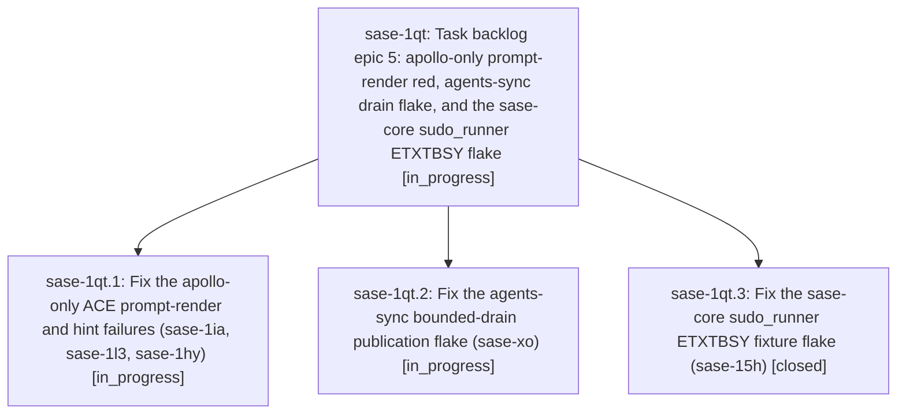

# Bead: sase-1qt — Task backlog epic 5: apollo-only prompt-render red, agents-sync drain flake, and the sase-core sudo\_runner ETXTBSY flake

[Bead Pages](../README.md) / sase-1qt

**Status:** ◐ in_progress · **Type:** ▸ plan · **Tier:** epic
**Owner:** `bryanbugyi34@gmail.com` · **Created by:** [bbugyi200.athena.sase-1qn.land](https://github.com/sase-org/sase--agents/blob/main/sessions/bbugyi200.athena.sase-1qn.land.md) · **Assignee:** `sase-1qt.land`
**Created:** 2026-11-01 18:08:19 EST
**Plan:** [202611/task\_backlog\_epic\_5.md](https://github.com/sase-org/sase--plans/blob/main/202611/task_backlog_epic_5.md)

## Description

Fix and close the five next-costliest open task beads, then continue the backlog chain under the same ranking and closeout rules.

## Phases

| Bead | Title | Status | Size | Created | Agents | Commits |
|---|---|---|---|---|---:|---:|
| [sase-1qt.1](sase-1qt.1.md) | Fix the apollo-only ACE prompt-render and hint failures (sase-1ia, sase-1l3, sase-1hy) | ◐ in_progress | large | 2026-11-01 | 1 | 0 |
| [sase-1qt.2](sase-1qt.2.md) | Fix the agents-sync bounded-drain publication flake (sase-xo) | ◐ in_progress | large | 2026-11-01 | 1 | 0 |
| [sase-1qt.3](sase-1qt.3.md) | Fix the sase-core sudo\_runner ETXTBSY fixture flake (sase-15h) | ✓ closed | medium | 2026-11-01 | 1 | 1 |

## Lineage

## Agents

| Agent | Bead | Commits |
|---|---|---:|
| [bbugyi200.athena.sase-1qt.1](https://github.com/sase-org/sase--agents/blob/main/sessions/bbugyi200.athena.sase-1qt.1.md) | [sase-1qt.1](sase-1qt.1.md) | 0 |
| [bbugyi200.athena.sase-1qt.2](https://github.com/sase-org/sase--agents/blob/main/sessions/bbugyi200.athena.sase-1qt.2.md) | [sase-1qt.2](sase-1qt.2.md) | 0 |
| [bbugyi200.athena.sase-1qt.3](https://github.com/sase-org/sase--agents/blob/main/agents/bbugyi200.athena.sase-1qt.3/README.md) | [sase-1qt.3](sase-1qt.3.md) | 1 |
| [bbugyi200.athena.sase-1qt.land](https://github.com/sase-org/sase--agents/blob/main/agents/bbugyi200.athena.sase-1qt.land/README.md) | [sase-1qt](README.md) | 0 |

## Commits

| Repo | Commit | Subject | Bead | Committed |
|---|---|---|---|---|
| sase-core | [`sase-core@b0a63dc`](https://github.com/sase-org/sase-core/commit/b0a63dc3a26741a9194d716ee4764b47a4ab6bae) | fix(sudo-runner): serialize fixture script publication against spawns with ETXTBSY retry backstop | [sase-1qt.3](sase-1qt.3.md) | 2026-11-01 18:38:44 EST |
