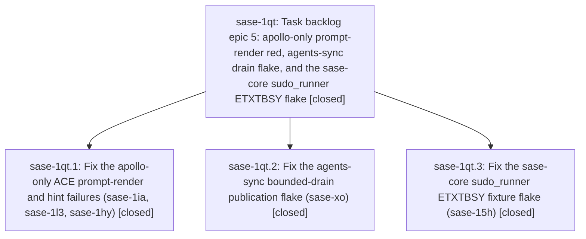

# Bead: sase-1qt — Task backlog epic 5: apollo-only prompt-render red, agents-sync drain flake, and the sase-core sudo\_runner ETXTBSY flake

[Bead Pages](../README.md) / sase-1qt

**Status:** ✓ closed · **Resolution:** done · **Type:** ▸ plan · **Tier:** epic · **↺ Reopened:** ↺1
**Owner:** `bryanbugyi34@gmail.com` · **Created by:** [bbugyi200.athena.sase-1qn.land](https://github.com/sase-org/sase--agents/blob/main/sessions/bbugyi200.athena.sase-1qn.land.md)
**Created:** 2026-11-01 18:08:19 EST · **Closed:** 2026-11-02 09:28:31 EST
**Plan:** [202611/task\_backlog\_epic\_5.md](https://github.com/sase-org/sase--plans/blob/main/202611/task_backlog_epic_5.md)

## Previously Closed

> ↺ Closed 2026-11-02T03:39:21Z · done
>
> (none)
>
> Reopened 2026-11-02T11:52:28Z by `sase bead open`

<!-- sase:links:start -->

## Links

| Relation | Artifact | Why |
| --- | --- | --- |
| implemented-by | [plan:202611/task_backlog_epic_5.md][1] | derived from the plan's `bead_id:` frontmatter field |
| related | file:explicit:10d848c95ce1680403f13082 | attached via sase artifact create --bead |
| related | file:explicit:7dd401778fab313e5a9fc3a1 | attached via sase artifact create --bead |

[1]: https://github.com/sase-org/sase--plans/blob/main/202611/task_backlog_epic_5.md

<!-- sase:links:end -->

## Description

Fix and close the five next-costliest open task beads, then continue the backlog chain under the same ranking and closeout rules.

## Notes

[2026-11-02T02:13:04Z · sase-1qt.land] FOLLOW-UP TRIAGE (completed before repair-tale proposal, /sase_new_task): (1) sase-1qt.1 note 4 wheel-cache proposal DECLINED. Cache key 86beb74a9a2d2d03ad7707e25660b915fd68d290bdf38141e327d120e4664d50 metadata identifies CLEAN core b0a63dc3 and wheel SHA256 9f33941aa12e..., which predates agent_prompt_select in 45c6a260; absence of that binding is expected. Cache refuses dirty source and revalidates identity after build; no evidence of an incorrect exact-identity hit. (2) sase-1qt.2 notes 2 and 3 are one distinct drain-accounting test-order issue, not nine independent defects. Independently reproduced 9 failed/3 passed cold, 12 passed with git_lock_facade preloaded. The scanner test patches every binding and the late-imported facade retains the fake after teardown. Routed DISCOVERED ISSUE to active sase-j7 (global-state leak prevention .2/.4); task search across types/statuses and last-week sweep found no exact duplicate, so no new task. (3) sase-1qt.2 note 3 import-budget proposal and notes 4/5 references DECLINED as unrelated follow-up: it is epic-owned integration work. Its check measured 12,164,194 source bytes >= 12,162,484; the KNOWN witness instead failed the OLD module-count assertion. Current closure diff from 9066546900 proves cleanup +3,036 eager bytes, intervening clan navigation +2,269, prompt adapter -93; current 12,166,370 exceeds the unchanged cap. Repair in the landing tale, do not weaken the guard. Phase .3 explicitly proposed no additional follow-up; adjacent 15e/15f remain separately owned. Evidence: file:explicit:10d848c95ce1680403f13082. Carry all these outcomes into the final close note.

[2026-11-02T02:13:33Z · sase-1qt.land] LAND AUDIT: Read epic and all 3 phase notes, 5 seed task notes/+1 evidence and related sase-1i9; reviewed actual source and sase commits d26baecb05/3e6c19ee37 plus core 45c6a260/f061f5f6/b0a63dc3. Prompt selection conforms to shared Rust policy; recorded athena/apollo evidence and tie regressions support completion. Preserve keep_five_seeds (no feature/memory expansion). Integration reviewed a79207993c staged-handoff reclaim, b8145cb51a clan navigation, 82cf081fc4 publication observation split; no unrelated core drift after e60f3e16 and current pin contains all phase commits. REMAINING EPIC WORK: cleanup optional-binding/Python-1.0 fallback violates required Rust boundary (missing-binding probe returns 1.0; explicit Python override ignores a smaller mocked Rust cap); core handoff.rs has two retry_on_etxtbsy(command.status) calls holding the cfg(test) fixture lock through child wait; ETXTBSY inheritance test retains the writer in the parent and retry test depends on sleep scheduling; startup footprint integration is over budget as recorded in FOLLOW-UP TRIAGE. Plan a single medium tale to repair these and perform full closeout, with no dependency on its own commit or CI. No epic-symbol entries; no parent_bead (predecessor plan link is not a parent). Five seed tasks and sase-1i9 intentionally remain open for the tale closeout. Initial .venv was missing its editable extension; installed historical b0a63dc3 only for independent follow-up/source-footprint probes, so the coder must refresh the current core before product checks. No implementation files changed, no check-full run. Detailed evidence: file:explicit:10d848c95ce1680403f13082.

[2026-11-02T03:37:42Z · sase-1qt.land] LANDING REPAIRS (tale 202611/finish_1qt_landing.md, same-turn closeout; host commits and the sase-core pin follow this note, so no SHA is cited for them). Audited tips unchanged at closeout: sase d26baecb05 == origin/master, sase-core 45c6a260 == origin/master; no drift to reconcile.

1. REQUIRED RUST CLEANUP POLICY. default_publication_cleanup_timeout now goes through require_rust_binding in the core adapter; the optional-binding path and both Python 1.0 mirrors are gone. A missing/stale/raising binding raises (adapter and PublicationCleanupBudget alike); non-numeric, non-positive or non-finite values raise RuntimeError. An override can only shorten the Rust-owned cap (min); a non-positive override raises ValueError. _commit_publication_locked builds the budget inside the protected cleanup boundary, so a lookup failure is attached as a note to the original exception (drain timeout stays primary, request stays queued with attempts==1, sidecar lock released) and no cleanup runs with an invented default. The shared one-second cap and the elapsed<5s assertions are untouched. sase-core: dropped the core_default_publication_cleanup_timeout alias from sase_core_py prelude.rs; vcs/mod.rs uses the module path. No binding contract change, so no pin move is owed. New tests/agents_sync/test_publication_cleanup_policy.py (17 tests: missing, raising, malformed values, override-cannot-exceed-cap, original-exception and timeout-attribution preservation, a 0.25s Rust cap bounding a stalled cleanup).

2. SUDO FIXTURE LOCK SCOPE (sase-core). retry_on_etxtbsy is now typed as a spawn (FnMut -> io::Result<Child>): the cfg(test) fixture spawn lock covers one Command::spawn attempt and is released before any wait or backoff; a spawn that returned Ok is never retried; only ETXTBSY is retried. New status_with_etxtbsy_retry spawns under the guard and waits outside it; handoff.rs sudo_status and spawn_internal_root_executor use it (the two sites that held the lock through the child wait). Test-only output_with_etxtbsy_retry replaces the .output() closures. DETERMINISTIC EVIDENCE: tests/spawn_lock.rs keeps a real sudo child alive on a handshake file and proves another fixture publication plus spawn completes meanwhile (bounded recv_timeout, self-expiring child, drop-guard release); mutation check holding the lock through the wait made both tests fail (and cascaded into internal_worker_timeout_completes_when_descendant_holds_pipe), then reverted. etxtbsy.rs: the exec_while_fork_child test now has a real child hold the inherited non-CLOEXEC writer, confirms it via a ready marker, closes the parent's copy, asserts ETXTBSY, releases and reaps the child, then proves exec succeeds; the retry test closes the writer inside the retry loop only after observing the first failed attempt (no sleeps or threads) and still asserts a retry happened. Bare result.is_ok() assertions in sudo_runner cli.rs/worker.rs now print the Err (9 sites). Every executable writer still goes through publish_executable/write_executable; manifest/argv/marker data stay data.

3. STARTUP FOOTPRINT. Edges deferred: sase.agents_sync package __init__ is now a PEP 562 lazy facade (via sase._lazy_exports), ACE agents_sync action imports sync_agents at its use site, artifact-link stitch rules import agents_sync.git.run_git at use, commit_finalizer_git_progress imports AGENTS_SYNC_AUTO_COMMIT_TYPE at use. The deferred-module guard gained agents_sync.git, git_sync, git_sync_transaction, publication, publication_cleanup; allowances, CPU bound and total-module guard unchanged. Normalized source footprint: base 9066546900 = 12,161,158 (2860 modules); d26baecb05 = 12,166,370; strict cap 12,162,484; now 11,893,483 bytes, 2796 sase.* modules (3506 total), i.e. -272,887 vs d26baecb05, -267,675 vs base, 269,001 under the cap. Attributed report (tools/tui_import_closure --diff d26baecb05): 🔒 closure\_final\_vs\_head.txt

4. VERIFICATION. sase: sase tool run check c3d751031ae96ebbfdca08ab1cfe32bc succeeded (38m). sase-core: sase tool run check 141fcdc410d4549d8645dce189f6a0ab succeeded (646s). sudo_runner module 58 passed, then 60/60 repeated runs (12 concurrent processes x 5 rounds, 24 busy loops). Bounded-drain + policy modules 26 passed, 12/12 concurrent loaded runs (16 busy loops; young-lock cleanup case 2.43-2.50s, stalled-cleanup case 2.06-2.08s vs the 5s bound). Prompt cache/render, git-lock, import-budget and closure files: 231 passed. Wider sweeps: agents_sync+artifact_links+core recovery 752 passed; every test file mentioning agents_sync plus llm_provider and sdd 2362 passed, 1 failed (see limits).

5. LIMITS. just check-full was not run. Prompt behavior did not change this turn, so the athena/apollo scratch-snapshot verification was not repeated; phase .1's 128 (athena) / 118 (apollo) passes and the sase-1i9 apollo pass stand. The drain-accounting test-order leak (cold 9 failed/3 passed; 12/12 with sase.core.git_lock_facade preloaded) is unchanged and stays with active epic sase-j7 (.2/.4). tests/ace/tui/test_log_panel_keymap.py::test_update_shortcut_dispatch_performs_no_disk_or_subprocess_work fails when run cold in isolation (it patches Path.read_text before the keymap defaults cache is warm); verified identical on the unmodified tree, so it is an existing order dependency, not caused here.

[2026-11-02T03:39:21Z · sase-1qt.land] sase-1qt LANDED. All three phases and the landing-repair tale are complete; five seed tasks (sase-1ia, sase-1l3, sase-1hy, sase-xo, sase-15h) and related sase-1i9 are closed normally, each with its fixing commits and before/after evidence (details in epic note #3).

VERIFICATION: sase check c3d751031ae96ebbfdca08ab1cfe32bc and sase-core check 141fcdc410d4549d8645dce189f6a0ab succeeded in the closeout turn (not check-full); sudo_runner 58 passed and 60/60 repeated loaded runs; bounded-drain + cleanup-policy 26 passed and 12/12 concurrent loaded runs; prompt/cache/git-lock/import-budget files 231 passed. Phase evidence stands: athena 128 / apollo 118 prompt-render passes (sase-1i9 included), 15.6448s -> about 2.4s bounded cleanup under injected index-lock contention.

DRIFT INTEGRATION: intervening commits since base 9066546900 were a79207993c (staged-handoff reclamation, no overlap), b8145cb51a (clan running-member jump, +2,269 startup bytes in the closure), 82cf081fc4 (publication observation split, footprint-neutral); no unrelated core drift after e60f3e16, and origin/master still equals the audited tips (sase d26baecb05, sase-core 45c6a260) at closeout. The audit's remaining defects are repaired in th

… and 9676 more characters

## Attachments

- 🔒 closure\_final\_vs\_head.txt · text/plain · 6.23242 KiB (private attachment)
- 🔒 test\_publication\_cleanup\_policy.py · text/x-python · 10.8564 KiB (private attachment)

## Phases

| Bead | Title | Status | Size | Created | Agents | Commits |
|---|---|---|---|---|---:|---:|
| [sase-1qt.1](sase-1qt.1.md) | Fix the apollo-only ACE prompt-render and hint failures (sase-1ia, sase-1l3, sase-1hy) | ✓ closed | large | 2026-11-01 | 1 | 2 |
| [sase-1qt.2](sase-1qt.2.md) | Fix the agents-sync bounded-drain publication flake (sase-xo) | ✓ closed | large | 2026-11-01 | 1 | 2 |
| [sase-1qt.3](sase-1qt.3.md) | Fix the sase-core sudo\_runner ETXTBSY fixture flake (sase-15h) | ✓ closed | medium | 2026-11-01 | 1 | 1 |

## Lineage

## Agents

| Agent | Bead | Commits |
|---|---|---:|
| [bbugyi200.athena.sase-1qt.1](https://github.com/sase-org/sase--agents/blob/main/sessions/bbugyi200.athena.sase-1qt.1.md) | [sase-1qt.1](sase-1qt.1.md) | 2 |
| [bbugyi200.athena.sase-1qt.2](https://github.com/sase-org/sase--agents/blob/main/sessions/bbugyi200.athena.sase-1qt.2.md) | [sase-1qt.2](sase-1qt.2.md) | 2 |
| [bbugyi200.athena.sase-1qt.3](https://github.com/sase-org/sase--agents/blob/main/agents/bbugyi200.athena.sase-1qt.3/README.md) | [sase-1qt.3](sase-1qt.3.md) | 1 |
| [bbugyi200.athena.sase-1qt.land](https://github.com/sase-org/sase--agents/blob/main/sessions/bbugyi200.athena.sase-1qt.land.md) | [sase-1qt](README.md) | 1 |

## Commits

| Repo | Commit | Subject | Bead | Committed |
|---|---|---|---|---|
| sase-core | [`sase-core@b0a63dc`](https://github.com/sase-org/sase-core/commit/b0a63dc3a26741a9194d716ee4764b47a4ab6bae) | fix(sudo-runner): serialize fixture script publication against spawns with ETXTBSY retry backstop | [sase-1qt.3](sase-1qt.3.md) | 2026-11-01 18:38:44 EST |
| sase-core | [`sase-core@f061f5f`](https://github.com/sase-org/sase-core/commit/f061f5f623c34381105fccf529bd56d9c77ef013) | fix(git-lock): enforce effective budget in backoff and aged-lock decisions | [sase-1qt.2](sase-1qt.2.md) | 2026-11-01 19:58:03 EST |
| sase | [`3e6c19e`](https://github.com/sase-org/sase/commit/3e6c19ee371b3b98184578f99897a2c9ab7953eb) | fix(agents-sync): bound publication drain cleanup under index-lock contention | [sase-1qt.2](sase-1qt.2.md) | 2026-11-01 19:59:26 EST |
| sase-core | [`sase-core@45c6a26`](https://github.com/sase-org/sase-core/commit/45c6a2601bb8fdaa48180ba97caa6339fe0a35c5) | feat(agent-prompts): add Rust-owned agent prompt selection policy | [sase-1qt.1](sase-1qt.1.md) | 2026-11-01 20:45:43 EST |
| sase | [`d26baec`](https://github.com/sase-org/sase/commit/d26baecb051927df38a8bfe4683b7d509371b1d1) | fix(agent-prompts): delegate prompt selection to Rust agent\_prompt\_select binding | [sase-1qt.1](sase-1qt.1.md) | 2026-11-01 20:46:50 EST |
| sase-core | [`sase-core@89a5bd8`](https://github.com/sase-org/sase-core/commit/89a5bd8b810ab20fee5c223bb4b1e40cb2c3ab68) | fix(sudo-runner): restrict fixture lock to process spawn | [sase-1qt](README.md) | 2026-11-02 09:36:57 EST |
