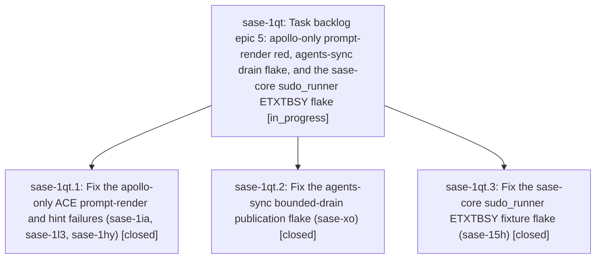

# Bead: sase-1qt — Task backlog epic 5: apollo-only prompt-render red, agents-sync drain flake, and the sase-core sudo\_runner ETXTBSY flake

[Bead Pages](../README.md) / sase-1qt

**Status:** ◐ in_progress · **Type:** ▸ plan · **Tier:** epic
**Owner:** `bryanbugyi34@gmail.com` · **Created by:** [bbugyi200.athena.sase-1qn.land](https://github.com/sase-org/sase--agents/blob/main/sessions/bbugyi200.athena.sase-1qn.land.md) · **Assignee:** `sase-1qt.land`
**Created:** 2026-11-01 18:08:19 EST
**Plan:** [202611/task\_backlog\_epic\_5.md](https://github.com/sase-org/sase--plans/blob/main/202611/task_backlog_epic_5.md)

## Description

Fix and close the five next-costliest open task beads, then continue the backlog chain under the same ranking and closeout rules.

## Phases

| Bead | Title | Status | Size | Created | Agents | Commits |
|---|---|---|---|---|---:|---:|
| [sase-1qt.1](sase-1qt.1.md) | Fix the apollo-only ACE prompt-render and hint failures (sase-1ia, sase-1l3, sase-1hy) | ✓ closed | large | 2026-11-01 | 1 | 2 |
| [sase-1qt.2](sase-1qt.2.md) | Fix the agents-sync bounded-drain publication flake (sase-xo) | ✓ closed | large | 2026-11-01 | 1 | 2 |
| [sase-1qt.3](sase-1qt.3.md) | Fix the sase-core sudo\_runner ETXTBSY fixture flake (sase-15h) | ✓ closed | medium | 2026-11-01 | 1 | 1 |

## Lineage

## Agents

| Agent | Bead | Commits |
|---|---|---:|
| [bbugyi200.athena.sase-1qt.1](https://github.com/sase-org/sase--agents/blob/main/sessions/bbugyi200.athena.sase-1qt.1.md) | [sase-1qt.1](sase-1qt.1.md) | 2 |
| [bbugyi200.athena.sase-1qt.2](https://github.com/sase-org/sase--agents/blob/main/sessions/bbugyi200.athena.sase-1qt.2.md) | [sase-1qt.2](sase-1qt.2.md) | 2 |
| [bbugyi200.athena.sase-1qt.3](https://github.com/sase-org/sase--agents/blob/main/agents/bbugyi200.athena.sase-1qt.3/README.md) | [sase-1qt.3](sase-1qt.3.md) | 1 |
| [bbugyi200.athena.sase-1qt.land](https://github.com/sase-org/sase--agents/blob/main/agents/bbugyi200.athena.sase-1qt.land/README.md) | [sase-1qt](README.md) | 0 |

## Commits

| Repo | Commit | Subject | Bead | Committed |
|---|---|---|---|---|
| sase-core | [`sase-core@b0a63dc`](https://github.com/sase-org/sase-core/commit/b0a63dc3a26741a9194d716ee4764b47a4ab6bae) | fix(sudo-runner): serialize fixture script publication against spawns with ETXTBSY retry backstop | [sase-1qt.3](sase-1qt.3.md) | 2026-11-01 18:38:44 EST |
| sase-core | [`sase-core@f061f5f`](https://github.com/sase-org/sase-core/commit/f061f5f623c34381105fccf529bd56d9c77ef013) | fix(git-lock): enforce effective budget in backoff and aged-lock decisions | [sase-1qt.2](sase-1qt.2.md) | 2026-11-01 19:58:03 EST |
| sase | [`3e6c19e`](https://github.com/sase-org/sase/commit/3e6c19ee371b3b98184578f99897a2c9ab7953eb) | fix(agents-sync): bound publication drain cleanup under index-lock contention | [sase-1qt.2](sase-1qt.2.md) | 2026-11-01 19:59:26 EST |
| sase-core | [`sase-core@45c6a26`](https://github.com/sase-org/sase-core/commit/45c6a2601bb8fdaa48180ba97caa6339fe0a35c5) | feat(agent-prompts): add Rust-owned agent prompt selection policy | [sase-1qt.1](sase-1qt.1.md) | 2026-11-01 20:45:43 EST |
| sase | [`d26baec`](https://github.com/sase-org/sase/commit/d26baecb051927df38a8bfe4683b7d509371b1d1) | fix(agent-prompts): delegate prompt selection to Rust agent\_prompt\_select binding | [sase-1qt.1](sase-1qt.1.md) | 2026-11-01 20:46:50 EST |
