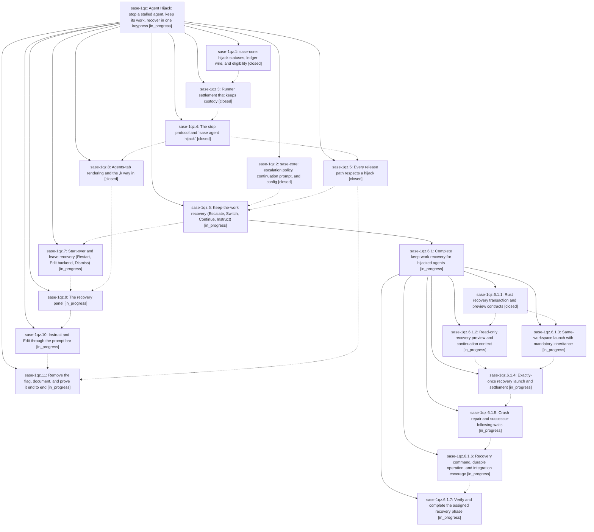

# Bead: sase-1qz — Agent Hijack: stop a stalled agent, keep its work, recover in one keypress

[Bead Pages](../README.md) / sase-1qz

**Status:** ◐ in_progress · **Type:** ▸ plan · **Tier:** epic
**Owner:** `bryanbugyi34@gmail.com` · **Created by:** [bbugyi200.apollo.research.33.linker.w0](https://github.com/sase-org/sase--agents/blob/main/sessions/bbugyi200.apollo.research.33.linker.w0.md) · **Assignee:** `sase-1qz.land`
**Created:** 2026-11-02 17:42:13 EST
**Plan:** [202611/agent\_hijack.md](https://github.com/sase-org/sase--plans/blob/main/202611/agent_hijack.md)

## Description

A user can hijack a stalled sase agent (,k, the kill dialog's h, or `sase agent hijack NAME`). Its process tree stops, but its workspace claim, Agents-tab node, and evidence stay. The node shows a ⏏ HIJACKED status, and <enter> opens a single-keypress recovery panel: escalate to a smarter model, continue, or instruct in the same workspace; restart or edit from a fresh workspace after a verified snapshot; view the diff, open a shell, or dismiss. Every path is durable, exactly-once, and fails closed so work is never silently lost.

## Phases

| Bead | Title | Status | Size | Created | Agents | Commits |
|---|---|---|---|---|---:|---:|
| [sase-1qz.1](sase-1qz.1.md) | sase-core: hijack statuses, ledger wire, and eligibility | ✓ closed | medium | 2026-11-02 | 1 | 2 |
| [sase-1qz.10](sase-1qz.10.md) | Instruct and Edit through the prompt bar | ◐ in_progress | medium | 2026-11-02 | 1 | 0 |
| [sase-1qz.11](sase-1qz.11.md) | Remove the flag, document, and prove it end to end | ◐ in_progress | medium | 2026-11-02 | 1 | 0 |
| [sase-1qz.2](sase-1qz.2.md) | sase-core: escalation policy, continuation prompt, and config | ✓ closed | medium | 2026-11-02 | 1 | 2 |
| [sase-1qz.3](sase-1qz.3.md) | Runner settlement that keeps custody | ✓ closed | medium | 2026-11-02 | 1 | 1 |
| [sase-1qz.4](sase-1qz.4.md) | The stop protocol and \`sase agent hijack\` | ✓ closed | medium | 2026-11-02 | 1 | 1 |
| [sase-1qz.5](sase-1qz.5.md) | Every release path respects a hijack | ✓ closed | medium | 2026-11-02 | 1 | 1 |
| [sase-1qz.6](sase-1qz.6.md) | Keep-the-work recovery (Escalate, Switch, Continue, Instruct) | ◐ in_progress | large | 2026-11-02 | 1 | 0 |
| [sase-1qz.7](sase-1qz.7.md) | Start-over and leave recovery (Restart, Edit backend, Dismiss) | ◐ in_progress | medium | 2026-11-02 | 1 | 0 |
| [sase-1qz.8](sase-1qz.8.md) | Agents-tab rendering and the ,k way in | ✓ closed | medium | 2026-11-02 | 1 | 1 |
| [sase-1qz.9](sase-1qz.9.md) | The recovery panel | ◐ in_progress | medium | 2026-11-02 | 1 | 0 |

## Lineage

## Agents

| Agent | Bead | Commits |
|---|---|---:|
| [bbugyi200.apollo.sase-1qz.1](https://github.com/sase-org/sase--agents/blob/main/agents/bbugyi200.apollo.sase-1qz.1/README.md) | [sase-1qz.1](sase-1qz.1.md) | 2 |
| [bbugyi200.apollo.sase-1qz.10](https://github.com/sase-org/sase--agents/blob/main/agents/bbugyi200.apollo.sase-1qz.10/README.md) | [sase-1qz.10](sase-1qz.10.md) | 0 |
| [bbugyi200.apollo.sase-1qz.11](https://github.com/sase-org/sase--agents/blob/main/agents/bbugyi200.apollo.sase-1qz.11/README.md) | [sase-1qz.11](sase-1qz.11.md) | 0 |
| [bbugyi200.apollo.sase-1qz.2](https://github.com/sase-org/sase--agents/blob/main/sessions/bbugyi200.apollo.sase-1qz.2.md) | [sase-1qz.2](sase-1qz.2.md) | 2 |
| [bbugyi200.apollo.sase-1qz.3](https://github.com/sase-org/sase--agents/blob/main/sessions/bbugyi200.apollo.sase-1qz.3.md) | [sase-1qz.3](sase-1qz.3.md) | 1 |
| [bbugyi200.apollo.sase-1qz.4](https://github.com/sase-org/sase--agents/blob/main/sessions/bbugyi200.apollo.sase-1qz.4.md) | [sase-1qz.4](sase-1qz.4.md) | 1 |
| [bbugyi200.apollo.sase-1qz.5](https://github.com/sase-org/sase--agents/blob/main/agents/bbugyi200.apollo.sase-1qz.5/README.md) | [sase-1qz.5](sase-1qz.5.md) | 1 |
| [bbugyi200.apollo.sase-1qz.6](https://github.com/sase-org/sase--agents/blob/main/sessions/bbugyi200.apollo.sase-1qz.6.md) | [sase-1qz.6](sase-1qz.6.md) | 0 |
| [bbugyi200.apollo.sase-1qz.6.1.1](https://github.com/sase-org/sase--agents/blob/main/agents/bbugyi200.apollo.sase-1qz.6.1.1/README.md) | [sase-1qz.6.1.1](sase-1qz.6.1.1.md) | 2 |
| [bbugyi200.apollo.sase-1qz.6.1.2](https://github.com/sase-org/sase--agents/blob/main/agents/bbugyi200.apollo.sase-1qz.6.1.2/README.md) | [sase-1qz.6.1.2](sase-1qz.6.1.2.md) | 0 |
| [bbugyi200.apollo.sase-1qz.6.1.3](https://github.com/sase-org/sase--agents/blob/main/agents/bbugyi200.apollo.sase-1qz.6.1.3/README.md) | [sase-1qz.6.1.3](sase-1qz.6.1.3.md) | 0 |
| [bbugyi200.apollo.sase-1qz.6.1.4](https://github.com/sase-org/sase--agents/blob/main/agents/bbugyi200.apollo.sase-1qz.6.1.4/README.md) | [sase-1qz.6.1.4](sase-1qz.6.1.4.md) | 0 |
| [bbugyi200.apollo.sase-1qz.6.1.5](https://github.com/sase-org/sase--agents/blob/main/agents/bbugyi200.apollo.sase-1qz.6.1.5/README.md) | [sase-1qz.6.1.5](sase-1qz.6.1.5.md) | 0 |
| [bbugyi200.apollo.sase-1qz.6.1.6](https://github.com/sase-org/sase--agents/blob/main/agents/bbugyi200.apollo.sase-1qz.6.1.6/README.md) | [sase-1qz.6.1.6](sase-1qz.6.1.6.md) | 0 |
| [bbugyi200.apollo.sase-1qz.6.1.7](https://github.com/sase-org/sase--agents/blob/main/agents/bbugyi200.apollo.sase-1qz.6.1.7/README.md) | [sase-1qz.6.1.7](sase-1qz.6.1.7.md) | 0 |
| [bbugyi200.apollo.sase-1qz.6.1.land](https://github.com/sase-org/sase--agents/blob/main/agents/bbugyi200.apollo.sase-1qz.6.1.land/README.md) | [sase-1qz.6.1](sase-1qz.6.1.md) | 0 |
| [bbugyi200.apollo.sase-1qz.7](https://github.com/sase-org/sase--agents/blob/main/agents/bbugyi200.apollo.sase-1qz.7/README.md) | [sase-1qz.7](sase-1qz.7.md) | 0 |
| [bbugyi200.apollo.sase-1qz.8](https://github.com/sase-org/sase--agents/blob/main/sessions/bbugyi200.apollo.sase-1qz.8.md) | [sase-1qz.8](sase-1qz.8.md) | 1 |
| [bbugyi200.apollo.sase-1qz.9](https://github.com/sase-org/sase--agents/blob/main/agents/bbugyi200.apollo.sase-1qz.9/README.md) | [sase-1qz.9](sase-1qz.9.md) | 0 |
| [bbugyi200.apollo.sase-1qz.land](https://github.com/sase-org/sase--agents/blob/main/agents/bbugyi200.apollo.sase-1qz.land/README.md) | [sase-1qz](README.md) | 0 |

## Commits

| Repo | Commit | Subject | Bead | Committed |
|---|---|---|---|---|
| sase-core | [`sase-core@65925ca`](https://github.com/sase-org/sase-core/commit/65925ca8b6427fc0037c9ddbb5ebba8e6927fabe) | feat(agent-hijack): add core ledger and eligibility | [sase-1qz.1](sase-1qz.1.md) | 2026-11-02 20:45:42 EST |
| sase | [`85c8d46`](https://github.com/sase-org/sase/commit/85c8d4613a3a8ef06ec2e67de6c398d59b92b412) | feat(agent-hijack): add Python hijack workflow wrappers | [sase-1qz.1](sase-1qz.1.md) | 2026-11-02 20:48:03 EST |
| sase-core | [`sase-core@f1bbb4f`](https://github.com/sase-org/sase-core/commit/f1bbb4f3b81383c06df422c9df9fa13f0ec244f7) | feat(agent-hijack): add escalation policy and continuation-prompt core with bindings | [sase-1qz.2](sase-1qz.2.md) | 2026-11-02 23:27:54 EST |
| sase | [`38c3a3c`](https://github.com/sase-org/sase/commit/38c3a3c5fc92f6c3cb0d9887c7458a9e4666a178) | feat(agent-hijack): add Python escalation policy and continuation-prompt support | [sase-1qz.2](sase-1qz.2.md) | 2026-11-03 02:29:57 EST |
| sase | [`01a2828`](https://github.com/sase-org/sase/commit/01a28287c8f7d2ce5c7ae71e769e74a377892ea7) | feat(agent-hijack): settle hijacked runner outcome while holding custody | [sase-1qz.3](sase-1qz.3.md) | 2026-11-03 03:22:28 EST |
| sase | [`f163ba7`](https://github.com/sase-org/sase/commit/f163ba74c0dc2a237133e5af68b5ad8fd72ce789) | feat(agent-hijack): add ordered stop orchestrator with hijack ingress | [sase-1qz.4](sase-1qz.4.md) | 2026-11-03 06:35:53 EST |
| sase | [`8ac56e2`](https://github.com/sase-org/sase/commit/8ac56e2a09ed23f18d972041e814a384bb8d4d78) | feat(agent-hijack): retain claims across every release path | [sase-1qz.5](sase-1qz.5.md) | 2026-11-03 07:54:03 EST |
| sase | [`81808e9`](https://github.com/sase-org/sase/commit/81808e9ba0ad955a6a3562cd4a21b53b24bf542a) | feat(ace): add Agent Hijack controls to Agents tab | [sase-1qz.8](sase-1qz.8.md) | 2026-11-03 11:07:38 EST |
| sase-core | [`sase-core@bbef1df`](https://github.com/sase-org/sase-core/commit/bbef1df25612c79839e4ae96d9d5648ce041b4a8) | feat(agent-hijack): add recovery identity, preview, and reconcile wires | [sase-1qz.6.1.1](sase-1qz.6.1.1.md) | 2026-11-03 13:06:17 EST |
| sase | [`83cd8de`](https://github.com/sase-org/sase/commit/83cd8deffe4eff5362b773089c601b280d904462) | feat(agent-hijack): wrap recovery preview and reconcile bindings | [sase-1qz.6.1.1](sase-1qz.6.1.1.md) | 2026-11-03 13:08:21 EST |

<!-- sase:referenced-by:start -->

## Referenced By

| Relation | Artifact | Why | Uses |
| --- | --- | --- | ---: |
| read-by | [agent:sase-1qz.2--3][1] | Need epic DECISIONS and plan | 1 |

[1]: https://github.com/sase-org/sase--agents/blob/main/sessions/bbugyi200.apollo.sase-1qz.2.md

<!-- sase:referenced-by:end -->
