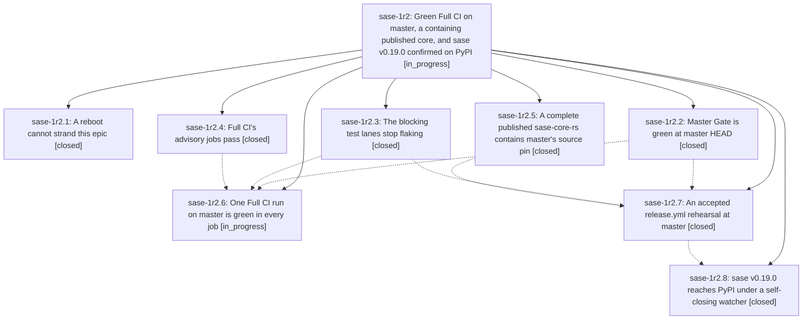

# Bead: sase-1r2 — Green Full CI on master, a containing published core, and sase v0.19.0 confirmed on PyPI

[Bead Pages](../README.md) / sase-1r2

**Status:** ◐ in_progress · **Type:** ▸ plan · **Tier:** epic
**Owner:** `bryanbugyi34@gmail.com` · **Created by:** [bbugyi200.athena.178.w0](https://github.com/sase-org/sase--agents/blob/main/sessions/bbugyi200.athena.178.w0.md) · **Assignee:** `sase-1r2.land`
**Created:** 2026-11-03 11:09:30 EST
**Plan:** [202611/v0\_19\_0\_green\_full\_ci\_release.md](https://github.com/sase-org/sase--plans/blob/main/202611/v0_19_0_green_full_ci_release.md)

<!-- sase:links:start -->

## Links

| Relation | Artifact | Why |
| --- | --- | --- |
| implemented-by | [plan:202611/v0_19_0_green_full_ci_release.md][1] | derived from the plan's `bead_id:` frontmatter field |

_Plus 6 automatic references — see [Referenced By](#referenced-by)._

[1]: https://github.com/sase-org/sase--plans/blob/main/202611/v0_19_0_green_full_ci_release.md

<!-- sase:links:end -->

## Description

Full CI is green in every job on master. sase-core's master CI is green, and a complete published sase-core-rs contains master's source pin. A release.yml rehearsal at master is accepted. Release-please PR #322 merges, and sase 0.19.0 is confirmed on PyPI. The lander that observes the release records the evidence as an artifact.

## Notes

[2026-11-03T16:22:16Z · sase-1r2.1] WATCHDOG installed for sase-1r2.
Cron line: 23 * * * * sh /home/bryan/.local/state/sase-epic-watchdog/sase-1r2/watchdog.sh >> /home/bryan/.local/state/sase-epic-watchdog/sase-1r2/watchdog.log 2>&1 # sase-epic-watchdog:sase-1r2
Paths: D=/home/bryan/.local/state/sase-epic-watchdog/sase-1r2 (watchdog.sh, boot_id, installed_at, watchdog.log, crontab.before). Primary checkout baked into the script: /home/bryan/projects/github/sase-org/sase (workspace 0).
Removal: sh /home/bryan/.local/state/sase-epic-watchdog/sase-1r2/watchdog.sh remove
Proof: sh -n ok; WATCHDOG_DRY=1 with boot_id=test found live agent sase-1r2.land and took no action; real run exited 0 with "same boot; no action"; crontab gained exactly that one line.

[2026-11-04T22:42:14Z · ce] DISCOVERED ISSUE: Independent recurrence during approved Codex parser implementation on HEAD 34b09fa219b5e4fd07f5d1e45166c4d40431b426, ToolRun da5474658f5a1ca37b10d0d7f368379d; 59979 passed, 9 failed, 32 skipped. test_sudo_answer_waits_for_concurrent_reclaimer_without_failure recurred as FLAKY after phase .3 reported the lock-release handshake fix. Corroborated sase-1oy; the full assertion evidence is preserved at file:explicit:3727ef9b3441f725f36d89a4. This report changes only Codex stream normalization and tests/docs.

## Phases

| Bead | Title | Status | Size | Created | Agents | Commits |
|---|---|---|---|---|---:|---:|
| [sase-1r2.1](sase-1r2.1.md) | A reboot cannot strand this epic | ✓ closed | small | 2026-11-03 | 1 | 0 |
| [sase-1r2.2](sase-1r2.2.md) | Master Gate is green at master HEAD | ✓ closed | small | 2026-11-03 | 1 | 0 |
| [sase-1r2.3](sase-1r2.3.md) | The blocking test lanes stop flaking | ✓ closed | medium | 2026-11-03 | 1 | 1 |
| [sase-1r2.4](sase-1r2.4.md) | Full CI's advisory jobs pass | ✓ closed | medium | 2026-11-03 | 1 | 1 |
| [sase-1r2.5](sase-1r2.5.md) | A complete published sase-core-rs contains master's source pin | ✓ closed | medium | 2026-11-03 | 1 | 0 |
| [sase-1r2.6](sase-1r2.6.md) | One Full CI run on master is green in every job | ◐ in_progress | medium | 2026-11-03 | 1 | 2 |
| [sase-1r2.7](sase-1r2.7.md) | An accepted release.yml rehearsal at master | ✓ closed | small | 2026-11-03 | 1 | 0 |
| [sase-1r2.8](sase-1r2.8.md) | sase v0.19.0 reaches PyPI under a self-closing watcher | ✓ closed | small | 2026-11-03 | 1 | 0 |

## Lineage

## Dependencies

- **Blocks:** [sase-1ra.11.1.1](../sase-1ra/sase-1ra.11.1.1.md) ◐ · ⧖ 2026-11-04

## Agents

| Agent | Bead | Commits |
|---|---|---:|
| [bbugyi200.athena.sase-1r2.1](https://github.com/sase-org/sase--agents/blob/main/agents/bbugyi200.athena.sase-1r2.1/README.md) | [sase-1r2.1](sase-1r2.1.md) | 0 |
| [bbugyi200.athena.sase-1r2.2](https://github.com/sase-org/sase--agents/blob/main/agents/bbugyi200.athena.sase-1r2.2/README.md) | [sase-1r2.2](sase-1r2.2.md) | 0 |
| [bbugyi200.athena.sase-1r2.3](https://github.com/sase-org/sase--agents/blob/main/sessions/bbugyi200.athena.sase-1r2.3.md) | [sase-1r2.3](sase-1r2.3.md) | 1 |
| [bbugyi200.athena.sase-1r2.4](https://github.com/sase-org/sase--agents/blob/main/agents/bbugyi200.athena.sase-1r2.4/README.md) | [sase-1r2.4](sase-1r2.4.md) | 1 |
| [bbugyi200.athena.sase-1r2.5](https://github.com/sase-org/sase--agents/blob/main/sessions/bbugyi200.athena.sase-1r2.5.md) | [sase-1r2.5](sase-1r2.5.md) | 0 |
| [bbugyi200.athena.sase-1r2.6](https://github.com/sase-org/sase--agents/blob/main/sessions/bbugyi200.athena.sase-1r2.6.md) | [sase-1r2.6](sase-1r2.6.md) | 2 |
| [bbugyi200.athena.sase-1r2.7](https://github.com/sase-org/sase--agents/blob/main/sessions/bbugyi200.athena.sase-1r2.7.md) | [sase-1r2.7](sase-1r2.7.md) | 0 |
| [bbugyi200.athena.sase-1r2.8](https://github.com/sase-org/sase--agents/blob/main/agents/bbugyi200.athena.sase-1r2.8/README.md) | [sase-1r2.8](sase-1r2.8.md) | 0 |
| [bbugyi200.athena.sase-1r2.land](https://github.com/sase-org/sase--agents/blob/main/agents/bbugyi200.athena.sase-1r2.land/README.md) | [sase-1r2](README.md) | 0 |

## Commits

| Repo | Commit | Subject | Bead | Committed |
|---|---|---|---|---|
| sase | [`d3b0480`](https://github.com/sase-org/sase/commit/d3b0480636cdfbc7eb979144ea2a71702b18fae0) | fix(ci): make Full CI advisory lanes pass locally | [sase-1r2.4](sase-1r2.4.md) | 2026-11-03 13:55:35 EST |
| sase | [`26b50ca`](https://github.com/sase-org/sase/commit/26b50ca5251945db4d9ca3efe804cd843f36bed9) | fix(flakes): de-flake blocking Master Gate and Full CI test lanes | [sase-1r2.3](sase-1r2.3.md) | 2026-11-03 15:18:23 EST |
| sase | [`d2aa3ef`](https://github.com/sase-org/sase/commit/d2aa3ef832f8c8b620dbb9856eb016d0d79e0e09) | fix(ci): repair Full CI first-attempt reds at master tip | [sase-1r2.6](sase-1r2.6.md) | 2026-11-07 07:01:02 EST |
| sase | [`48d0c3e`](https://github.com/sase-org/sase/commit/48d0c3ea2d3f193b1538505d565afd681e21c45b) | fix(ci): repair Full CI visual-test drift and pin capacity hostname seam | [sase-1r2.6](sase-1r2.6.md) | 2026-11-07 10:38:01 EST |

<!-- sase:referenced-by:start -->

## Referenced By

| Relation | Artifact | Why | Uses |
| --- | --- | --- | ---: |
| read-by | [agent:ce][1] | Confirm existing follow-up scopes before attaching independent verification evidence | 1 |
| read-by | [agent:research.3a.cdx][2] | Check dependencies, active epic coverage, and alternatives to the leading task candidates | 1 |
| read-by | [agent:research.3a.cld][3] | Check scope of active athena epic to avoid conflicts when ranking task beads | 1 |
| read-by | [agent:research.3a.final][4] | Check active epic phase scopes for conflict screening of task bead recommendations | 1 |
| read-by | [agent:research.3a.gem][5] | Inspect scope and conflicts for research recommendation | 2 |
| read-by | [agent:research.3a.grk][6] | Need phase children of prior top-ten epic, live CI-green epic, and flake-class epic to exclude overlapping task beads | 2 |

[1]: https://github.com/sase-org/sase--agents/blob/main/sessions/bbugyi200.athena.ce.md
[2]: https://github.com/sase-org/sase--agents/blob/main/agents/bbugyi200.athena.research.3a.cdx/README.md
[3]: https://github.com/sase-org/sase--agents/blob/main/agents/bbugyi200.athena.research.3a.cld/README.md
[4]: https://github.com/sase-org/sase--agents/blob/main/agents/bbugyi200.athena.research.3a.final/README.md
[5]: https://github.com/sase-org/sase--agents/blob/main/agents/bbugyi200.athena.research.3a.gem/README.md
[6]: https://github.com/sase-org/sase--agents/blob/main/agents/bbugyi200.athena.research.3a.grk/README.md

<!-- sase:referenced-by:end -->
