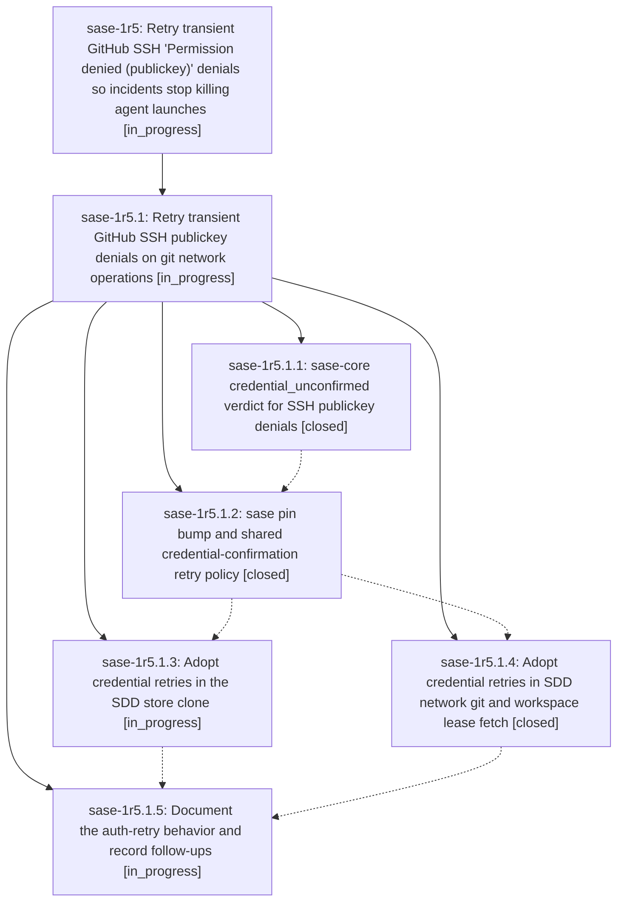

# Bead: sase-1r5 — Retry transient GitHub SSH 'Permission denied (publickey)' denials so incidents stop killing agent launches

[Bead Pages](../README.md) / sase-1r5

**Status:** ◐ in_progress · **Type:** ◆ task · **Task type:** ✦ feature
**Owner:** `bryanbugyi34@gmail.com` · **Created by:** [bbugyi200.athena.claude-code-interactive](https://github.com/sase-org/sase--agents/blob/main/agents/bbugyi200.athena.claude-code-interactive/README.md) · **Assignee:** `sase-1r5` · **Size:** xlarge
**Created:** 2026-11-04 06:18:07 EST

## Description

\## What happened (2026-11-04)

From about 09:37 UTC, GitHub intermittently rejected valid, registered SSH keys with
`Permission denied (publickey)`. GitHub opened "Incident with Pull Requests, Git
Operations and Issues" at 09:49:55 UTC (impact: major; still investigating at 10:38 UTC).
SASE agent launches on athena and apollo died in workspace preparation, for example
`bob-cli-go.10.1.4` on apollo:

\```
sase.sdd._store_types.SddMaterializationError: failed to clone SDD store
git@github.com:bobs-org/bob-cli--plans.git into .../bob-cli_23/sase/repos/plans:
Cloning into '.../sase/repos/.sase-sdd-clone-staging/plans-<id>/clone'...
git@github.com: Permission denied (publickey).
fatal: Could not read from remote repository.
\```

Call path: `run_agent_runner_launch._prepare_workspace_and_repos` ->
`run_agent_runner_setup_workspace.prepare_workspace_if_needed` ->
`runner_workspace_protection.prepare_launch_workspace_repos` ->
`sdd.store.ensure_workspace_sdd_clone` -> `sdd._store_workspace.ensure_sdd_kind_clone` ->
`sdd._store_link.ensure_sidecar_sdd_clone` -> `sdd._store_clone_ops.clone_sdd_store` ->
`sdd._store_clone_remote.clone_sdd_store_to_path` ->
`sdd._store_clone_common.handle_failed_sdd_clone`.

\## Evidence the denials were transient, not a credential problem

- The same key flipped between success and denial within minutes. athena's
  `id_sase_service` (registered and verified on the GitHub account) went 0/7 then 7/8
  about ten minutes later against `ssh.github.com:443`, and about 8/13 against
  `github.com:22`.
- apollo, with a different key (its own `id_rsa`) and a different route
  (`github.com:22`), failed the same way: 3/6 on :22 and 2/6 on :443.
- athena's `external_issue_mirror[bob-cli]` runs succeeded every 15 minutes through
  04:35 EST and failed with publickey denials from 04:50 EST. The first denials on both
  hosts were at 04:37 EST (09:37 UTC). 54 of athena's last 100 AXE errors were these
  denials (`agent_publication`, `external_issue_mirror[*]`).
- Nothing changed locally: athena's `~/.ssh/config` was unchanged since 2026-09-22 and
  apollo's since 2026-09-06, both keys were still registered, and `gh` token auth worked.
- Prior occurrence: a sase-1oe.4 note (2026-10-30) records a `git fetch` that died on
  `Permission denied (publickey)` and passed on retry.

\## Why one denial aborts the launch

`clone_sdd_store_to_path` (`src/sase/sdd/_store_clone_remote.py`) already retries
transient failures (4 attempts with 0.25s/1s/2s backoff), but
`is_retryable_git_clone_failure` delegates to sase-core's
`classify_failure_retryability`, which returns
`verdict='permanent', reason='authentication: authentication or authorization failed'`
for this stderr (for both the `git_clone` and `git` operation kinds). The first rejection
therefore raises a non-transient `SddMaterializationError`. A connection timeout on the
same remote is classified retryable.

\## Constraints for the planner

- The classifier lives in sase-core (Rust Core Backend Boundary); sase picks it up through
  the binding plus a `sase-core-revision.txt` pin bump (`docs/rust_backend.md`). Python
  keeps call-site policy: sleeps, deadlines, and retry budgets.
- Design question: add a distinct verdict or hint (for example "authentication, possibly
  transient" with a retry-after) versus changing `permanent`. Consumers that rely on auth
  failures being terminal must keep reporting real credential problems promptly,
  including service-host ssh-agent checks (`src/sase/service/ssh_agent.py`) and bead sync
  log classification (`src/sase/bead/_sync_logs.py`).
- Deploy-key refusals (`ERROR: Permission to <repo> denied to deploy key`) must stay
  permanent; sase-167 wants exactly those classified as credential failures in the same
  matchers.
- The existing ~3.25s total backoff is too short for incident-style clustering (athena saw
  seven consecutive denials on one endpoint). The auth-retry budget should be bounded and
  deadline-aware, and the final error must keep the original stderr.
- Inventory the other git/gh network call sites that consult the classifier (workspace
  prep fetch, host finalizer push, sidecar and bead sync, AXE mirror and publication jobs)
  and decide which adopt the new verdict.
- Tests: a fake remote or ssh shim that denies N times and then succeeds; sase-core
  classifier table tests; a persistent denial that still fails within its budget with the
  original stderr.

---

\## Feature proposal

Treat SSH `Permission denied (publickey)` from GitHub as possibly transient on git network operations: retry it with a bounded, deadline-aware backoff that is longer than today's ~3.25s transient schedule before declaring a permanent authentication failure. Start with the launch-blocking SDD store clone, then extend the new verdict to the other git/gh network call sites that consult sase-core's shared retryability classifier. Genuine credential failures must stay fast and clearly reported: deploy-key refusals, a missing key or ssh-agent on a service host, and a denial that persists past the retry budget all still surface as permanent authentication errors with the original stderr.


Filed from an interactive diagnosis of the 2026-11-04 agent failures, whose root cause was GitHub's incident; nothing local needed fixing. The hardening changes shared retry policy across two repos (sase-core's classifier, sase's call sites, and the sase-core-revision.txt pin), so the owner chose to plan it as its own task rather than patch it during the incident.

## Notes

[2026-11-04T11:21:23Z · claude-code-interactive] Failure screenshot (apollo, 2026-11-04 05:43 EST): the ACE TUI showing bob-cli-go.10.1.4 failing at launch with the SDD store clone traceback quoted in the description. 🔒 20261104\_054308.png

## Attachments

- 🔒 20261104\_054308.png · image/png · 2854×1686 · 892.32 KiB (private attachment)

## Lineage



## Agents

| Agent | Bead | Commits |
|---|---|---:|
| [bbugyi200.athena.sase-1r5](https://github.com/sase-org/sase--agents/blob/main/sessions/bbugyi200.athena.sase-1r5.md) | [sase-1r5](README.md) | 0 |
| [bbugyi200.athena.sase-1r5.1.1](https://github.com/sase-org/sase--agents/blob/main/agents/bbugyi200.athena.sase-1r5.1.1/README.md) | [sase-1r5.1.1](sase-1r5.1.1.md) | 1 |
| [bbugyi200.athena.sase-1r5.1.2](https://github.com/sase-org/sase--agents/blob/main/sessions/bbugyi200.athena.sase-1r5.1.2.md) | [sase-1r5.1.2](sase-1r5.1.2.md) | 1 |
| [bbugyi200.athena.sase-1r5.1.3](https://github.com/sase-org/sase--agents/blob/main/sessions/bbugyi200.athena.sase-1r5.1.3.md) | [sase-1r5.1.3](sase-1r5.1.3.md) | 1 |
| [bbugyi200.athena.sase-1r5.1.4](https://github.com/sase-org/sase--agents/blob/main/agents/bbugyi200.athena.sase-1r5.1.4/README.md) | [sase-1r5.1.4](sase-1r5.1.4.md) | 1 |
| [bbugyi200.athena.sase-1r5.1.5](https://github.com/sase-org/sase--agents/blob/main/agents/bbugyi200.athena.sase-1r5.1.5/README.md) | [sase-1r5.1.5](sase-1r5.1.5.md) | 0 |
| [bbugyi200.athena.sase-1r5.1.land](https://github.com/sase-org/sase--agents/blob/main/agents/bbugyi200.athena.sase-1r5.1.land/README.md) | [sase-1r5.1](sase-1r5.1.md) | 0 |

## Commits

| Repo | Commit | Subject | Bead | Committed |
|---|---|---|---|---|
| sase-core | [`sase-core@55532e2`](https://github.com/sase-org/sase-core/commit/55532e2d878dfc5415bdd695a1978cc5c5fb5a3c) | feat(retryability): credential\_unconfirmed verdict for SSH publickey denials | [sase-1r5.1.1](sase-1r5.1.1.md) | 2026-11-04 07:15:59 EST |
| sase | [`d008039`](https://github.com/sase-org/sase/commit/d0080395118c2c239433c3bef1c0b0e26a4a5c51) | feat(retryability): add credential confirmation retry policy | [sase-1r5.1.2](sase-1r5.1.2.md) | 2026-11-04 08:32:04 EST |
| sase | [`31174e2`](https://github.com/sase-org/sase/commit/31174e283c68ae969d3572268bf45fd3a146f63d) | feat(retryability): adopt credential retries in network git and leases | [sase-1r5.1.4](sase-1r5.1.4.md) | 2026-11-04 09:20:51 EST |
| sase | [`8274208`](https://github.com/sase-org/sase/commit/82742081f9bdb02a282ebd209b4c2bfa1bd58d0a) | feat(retryability): adopt credential retries in the SDD store clone | [sase-1r5.1.3](sase-1r5.1.3.md) | 2026-11-04 09:26:41 EST |
