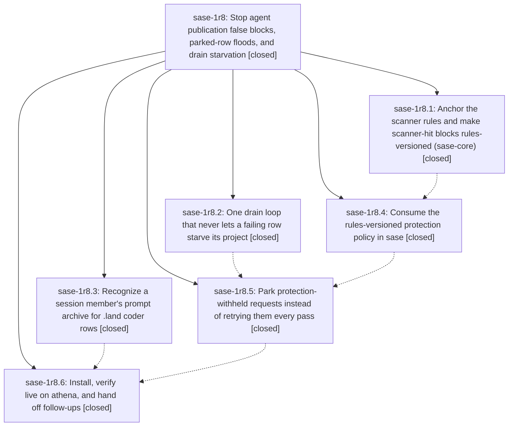

# Bead: sase-1r8 — Stop agent publication false blocks, parked-row floods, and drain starvation

[Bead Pages](../README.md) / sase-1r8

**Status:** ✓ closed · **Resolution:** done · **Type:** ▸ plan · **Tier:** epic
**Owner:** `bryanbugyi34@gmail.com` · **Created by:** [bbugyi200.athena.184](https://github.com/sase-org/sase--agents/blob/main/sessions/bbugyi200.athena.184.md) · **Assignee:** `sase-1r8.land`
**Created:** 2026-11-04 13:54:36 EST · **Closed:** 2026-11-04 19:43:49 EST
**Plan:** [202611/agent\_publication\_errors.md](https://github.com/sase-org/sase--plans/blob/main/202611/agent_publication_errors.md)

<!-- sase:links:start -->

## Links

| Relation | Artifact | Why |
| --- | --- | --- |
| implemented-by | [plan:202611/agent_publication_errors.md][1] | derived from the plan's `bead_id:` frontmatter field |
| related | [bead:sase-1rb][2] | Epic that introduced rules-versioned stale blocks and chose revalidation=automatic; its plan and decisions bound the remedy |

_Plus 7 automatic references — see [Referenced By](#referenced-by)._

[1]: https://github.com/sase-org/sase--plans/blob/main/202611/agent_publication_errors.md
[2]: https://github.com/sase-org/sase--beads/blob/main/pages/sase-1rb/README.md

<!-- sase:links:end -->

## Description

The background agent_publication job stops reporting scanner false positives every pass. bob-cli's stuck and starved rows publish. A request withheld by publication protection can no longer starve its project or flood the error digest. A future scanner-rule correction releases its own stale false blocks with provenance, and .land coder rows stop quarantining over a prompt archive that already exists.

## Notes

[2026-11-04T21:01:35Z · 18b--code] DISCOVERED ISSUE (workspace-retention serialization implementation check, 2026-11-04):  ToolRun f07f3fe8c21a8203bed7ecbdbdafc7b1 failed its diff-scoped lane with two NEW failures: tests/agents_sync/test_prompt_archive_protection.py::test_blocked_raw_prompt_is_not_published and tests/agents_sync/test_transcript_publication_protection.py::test_blocked_prompt_withheld_but_clean_sibling_publishes. Both assert that publication_content_retry_allowed remains false for a digest just blocked by the synthetic scanner, but the function returned true. Re-running both nodes together in isolation reproduced both failures (2 failed in 6.48s). This is in the active protection-policy path owned by phase sase-1r8.4 (enforced lookups and stale-block resolution); the unrelated diff here touches only Agent bundle serialization and tests. Please include these failing nodes in the phase's diagnosis.

[2026-11-04T21:01:48Z · 18b--code] DISCOVERED ISSUE (workspace-retention serialization check, 2026-11-04): ToolRun f07f3fe8c21a8203bed7ecbdbdafc7b1 failed its scoped lane with two NEW failures: tests/agents_sync/test_prompt_archive_protection.py::test_blocked_raw_prompt_is_not_published and tests/agents_sync/test_transcript_publication_protection.py::test_blocked_prompt_withheld_but_clean_sibling_publishes. Both assert publication_content_retry_allowed remains false for a digest just blocked by the synthetic scanner, but the function returned true. Re-running both nodes together in isolation reproduced both failures (2 failed in 6.48s). This is in the active protection-policy path owned by phase sase-1r8.4 (enforced lookups and stale-block resolution); the unrelated diff here touches only Agent bundle serialization and tests. Please include these failing nodes in the phase diagnosis.

[2026-11-04T22:42:05Z · ce] DISCOVERED ISSUE: Independent recurrence during approved Codex parser implementation on HEAD 34b09fa219b5e4fd07f5d1e45166c4d40431b426, ToolRun da5474658f5a1ca37b10d0d7f368379d; 59979 passed, 9 failed, 32 skipped. test_blocked_raw_prompt_is_not_published and test_blocked_prompt_withheld_but_clean_sibling_publishes both returned true from publication_content_retry_allowed when their synthetic scanner blocks expected false. Both were classified KNOWN with independent witnesses. This is additional evidence for the rules-versioned policy path owned by phase .4, matching the existing epic notes. Evidence: file:explicit:3727ef9b3441f725f36d89a4

[2026-11-05T00:43:49Z · sase-1r8.land] LANDED sase-1r8 (sase-1r8.land, 2026-11-04).

VERIFIED (step 1). All 6 phases are closed. Commits: sase-core 542448a0 (.1), sase 59723ae0cd (.3), 34b09fa219 (.2), cdfbb82d2b (.4), 1b62dfb9bd (.5). The sase-core-revision.txt pin is 542448a0. Source review against the decisions:
- rule_scope=all_prefix: every prefix credential rule requires a left token boundary. openai-key and anthropic-key also require a digit or uppercase letter in the key body. Overlapping windows skip offset-0 matches. Rules version is 2.
- revalidation=automatic: lookup_publication_content_record goes through publication_protection_lookup_enforced. retry_allowed is true for stale blocks. A clean rescan passes clean_rules_version and timestamp, which moves the stale block to `superseded` with provenance. Doctor separates enforced, stale, and superseded.
- The parked-recheck predicate lives in Rust.
- Unified drain loop: a hinted-then-oldest candidate set, attempted keys excluded, stops only on repository scope, lock-busy, or deadline. Hint claims are compacted.
- land_prompt: session-normalized archive labels, indexed once per restore call.
- park_notice=once: outbox schema 8 parked fields, one error per newly parked key, parks never charged.
- historic_quarantines=leave and planner_hints=no were honored. No revival happened and no planner hint was added.

Epic notes #1-#3 reported test_blocked_raw_prompt_is_not_published and test_blocked_prompt_withheld_but_clean_sibling_publishes failing. Both pass at HEAD 45bcf6fe39: the failing runs paired a v2 core with fixtures pinned to v1, which cdfbb82d2b bumped.

Live state on athena, re-checked about 19:10 EST:
- 0 active rows in every project. bob-cli's 5 formerly stuck keys are gone from the outbox, so they were acknowledged.
- Protection doctor: 0 enforced, 15 superseded, 53 stale.
- No unresolved-prompt quarantines since the fix. The newest bob-cli quarantine predates the 14:30 commit.
- The error digest has no agent_publication entries after the 17:58 reinstall. The only post-install entry is an unrelated artifact_link_backfill timeout.

INTEGRATED (step 2). Non-epic commits since base d563b9da4d: c6282f75b2, 8462195314, 39611cc83f, 99932634cd, 0cc9fad474, 394ff93ff5, 522b07a009, 45bcf6fe39.
- The 0cc9fad474 publication-job test split keeps the drain tests collected via re-exports.
- Landing edits:
  - Three synthetic-scanner fixtures (test_transcript_publication_protection, test_prompt_archive_migration, test_prompt_archive_protection) hardcoded rules_version 2. They now read the live attachment_scanner_rules_version, so the next scanner-rules bump cannot reintroduce the stale-fixture failures from notes #1-#3.
  - The macro-terminology allowlist named the pre-split tests/agents_sync/test_deferred_prompt_archive.py, so 39611cc83f left test_macro_string_literals_avoid_xprompt_terms red. It now points at the split test_acknowledgment.py and test_full_sync.py.
- test_publication_protection.py keeps its "2" pins because its fake core is self-consistent.
- `sase tool run check` 0f5b2af2ef22f483b4ac52c320168ec2 succeeded.
- epic-symbols: none.

FOLLOW-UPS:
- sase-1r8.5 #1 (test_scanner_timeout_unwinds_drain_and_leaves_request_queued fails cold): a pre-existing test-order leak that also reproduces at d563b9da4d. It was already routed to active epic sase-j7 (note #91, same root mechanism). Corroborating note added to sase-j7. No task created.
- sase-1r8.6 #1 (sase-1ot rescan under v2): handoff note added to sase-1ot.
- sase-1r8.6 #2 (sase-1r7 fifth retry site): handoff note added to sase-1r7, with the agents_sync pull and push sites and the never-sleep-under-the-lock constraint.
- sase-1r8.6 #3 (pre-reinstall residuals): superseded by the post-reinstall verification (#5) and the lander's re-check. bob-cli is drained, the job has errors=0, and the ledger was rescanned.
- sase-1r8.6 #4:
  - (a) 53 stale blocks are never revisited. Filed as new task sase-1rb (bug, medium), linked to this epic.
  - (b) 3842 historic quarantines: DECLINED. The bob-cli unresolved-prompt rows fall under the reviewer's historic_quarantines=leave decision. The sase rows (2914 hood-timeout, 439 lock-busy) predate this epic, the newest is about 100 hours old, and doctor already prescribes `sase agent sync --retry-quarantined`.
  - (c) No fresh .land live-ack observed: DECLINED. It is an observation gap, not work. sase-1r8.3's regression tests cover the path, and no unresolved-prompt quarantine has appeared since the fix.
- Lander-discovered: bob-cli-h4.2 was retired after 2 attempts because its page lacks the run's own post-commit revision. The row predates the reinstall, so this epic did not cause it, and sase-1nj's pre-commit cause does not apply. Filed as new task sase-1rc (bug, large), linked to sase-1nj.

## Phases

| Bead | Title | Status | Size | Created | Agents | Commits |
|---|---|---|---|---|---:|---:|
| [sase-1r8.1](sase-1r8.1.md) | Anchor the scanner rules and make scanner-hit blocks rules-versioned (sase-core) | ✓ closed | medium | 2026-11-04 | 1 | 1 |
| [sase-1r8.2](sase-1r8.2.md) | One drain loop that never lets a failing row starve its project | ✓ closed | medium | 2026-11-04 | 1 | 1 |
| [sase-1r8.3](sase-1r8.3.md) | Recognize a session member's prompt archive for .land coder rows | ✓ closed | small | 2026-11-04 | 1 | 1 |
| [sase-1r8.4](sase-1r8.4.md) | Consume the rules-versioned protection policy in sase | ✓ closed | medium | 2026-11-04 | 1 | 1 |
| [sase-1r8.5](sase-1r8.5.md) | Park protection-withheld requests instead of retrying them every pass | ✓ closed | medium | 2026-11-04 | 1 | 1 |
| [sase-1r8.6](sase-1r8.6.md) | Install, verify live on athena, and hand off follow-ups | ✓ closed | small | 2026-11-04 | 1 | 0 |

## Lineage

## Agents

| Agent | Bead | Commits |
|---|---|---:|
| [bbugyi200.athena.sase-1r8.1](https://github.com/sase-org/sase--agents/blob/main/sessions/bbugyi200.athena.sase-1r8.1.md) | [sase-1r8.1](sase-1r8.1.md) | 1 |
| [bbugyi200.athena.sase-1r8.2](https://github.com/sase-org/sase--agents/blob/main/agents/bbugyi200.athena.sase-1r8.2/README.md) | [sase-1r8.2](sase-1r8.2.md) | 1 |
| [bbugyi200.athena.sase-1r8.3](https://github.com/sase-org/sase--agents/blob/main/sessions/bbugyi200.athena.sase-1r8.3.md) | [sase-1r8.3](sase-1r8.3.md) | 1 |
| [bbugyi200.athena.sase-1r8.4](https://github.com/sase-org/sase--agents/blob/main/sessions/bbugyi200.athena.sase-1r8.4.md) | [sase-1r8.4](sase-1r8.4.md) | 1 |
| [bbugyi200.athena.sase-1r8.5](https://github.com/sase-org/sase--agents/blob/main/agents/bbugyi200.athena.sase-1r8.5/README.md) | [sase-1r8.5](sase-1r8.5.md) | 1 |
| [bbugyi200.athena.sase-1r8.6](https://github.com/sase-org/sase--agents/blob/main/sessions/bbugyi200.athena.sase-1r8.6.md) | [sase-1r8.6](sase-1r8.6.md) | 0 |
| [bbugyi200.athena.sase-1r8.land](https://github.com/sase-org/sase--agents/blob/main/agents/bbugyi200.athena.sase-1r8.land/README.md) | [sase-1r8](README.md) | 2 |

## Commits

| Repo | Commit | Subject | Bead | Committed |
|---|---|---|---|---|
| sase | [`59723ae`](https://github.com/sase-org/sase/commit/59723ae0cd6fc12104e16e6e6c4fc63ad147f57e) | fix(agents-sync): match deferred archives by session | [sase-1r8.3](sase-1r8.3.md) | 2026-11-04 14:30:23 EST |
| sase-core | [`sase-core@542448a`](https://github.com/sase-org/sase-core/commit/542448a01b2f8f8246ae376dfbe5d84b996261b7) | feat(sase-core): anchor scanner rules, version blocks, add parked recheck | [sase-1r8.1](sase-1r8.1.md) | 2026-11-04 14:48:49 EST |
| sase | [`34b09fa`](https://github.com/sase-org/sase/commit/34b09fa219b5e4fd07f5d1e45166c4d40431b426) | fix(agents-sync): prevent publication drain starvation | [sase-1r8.2](sase-1r8.2.md) | 2026-11-04 15:04:00 EST |
| sase | [`cdfbb82`](https://github.com/sase-org/sase/commit/cdfbb82d2bad28c1f1b6d7a7e23b3e72f455fbf3) | feat(agent-publication-protection): enforce scanner rule versions | [sase-1r8.4](sase-1r8.4.md) | 2026-11-04 16:18:35 EST |
| sase | [`1b62dfb`](https://github.com/sase-org/sase/commit/1b62dfb9bdb52b9a81a7755f8f6184c5d1cc2ec2) | feat(agent-publication): park protection-withheld requests | [sase-1r8.5](sase-1r8.5.md) | 2026-11-04 17:21:54 EST |
| sase | [`1bd2816`](https://github.com/sase-org/sase/commit/1bd2816d13f910421d2ba07ba8528c2015ff4a9b) | test(agents-sync): pin synthetic scanner fixtures to live rules version | [sase-1r8](README.md) | 2026-11-04 19:46:19 EST |
| sase--plans | [`sase--plans@c89274f`](https://github.com/sase-org/sase--plans/commit/c89274f3d0017e2b737a18603b7362ba17900a60) | chore(plans): mark agent\_publication\_errors plan done | [sase-1r8](README.md) | 2026-11-04 19:47:07 EST |

<!-- sase:referenced-by:start -->

## Referenced By

| Relation | Artifact | Why | Uses |
| --- | --- | --- | ---: |
| read-by | [agent:18b--code][1] | Check whether the active publication-protection epic owns stale blocked-content retry failures | 1 |
| read-by | [agent:ce][2] | Confirm existing follow-up scopes before attaching independent verification evidence | 1 |
| read-by | [agent:research.3a.cdx][3] | Check dependencies, active epic coverage, and alternatives to the leading task candidates | 1 |
| read-by | [agent:research.3a.cld][4] | Check scope of active athena epic to avoid conflicts when ranking task beads | 1 |
| read-by | [agent:research.3a.final][5] | Check active epic phase scopes for conflict screening of task bead recommendations | 1 |
| read-by | [agent:research.3a.gem][6] | Inspect scope and conflicts for research recommendation | 2 |
| read-by | [agent:research.3a.grk][7] | Need live epic scopes and high-impact candidate task details to rank work without colliding with in-flight epics | 1 |

[1]: https://github.com/sase-org/sase--agents/blob/main/sessions/bbugyi200.athena.18b.md
[2]: https://github.com/sase-org/sase--agents/blob/main/sessions/bbugyi200.athena.ce.md
[3]: https://github.com/sase-org/sase--agents/blob/main/agents/bbugyi200.athena.research.3a.cdx/README.md
[4]: https://github.com/sase-org/sase--agents/blob/main/agents/bbugyi200.athena.research.3a.cld/README.md
[5]: https://github.com/sase-org/sase--agents/blob/main/agents/bbugyi200.athena.research.3a.final/README.md
[6]: https://github.com/sase-org/sase--agents/blob/main/agents/bbugyi200.athena.research.3a.gem/README.md
[7]: https://github.com/sase-org/sase--agents/blob/main/agents/bbugyi200.athena.research.3a.grk/README.md

<!-- sase:referenced-by:end -->
