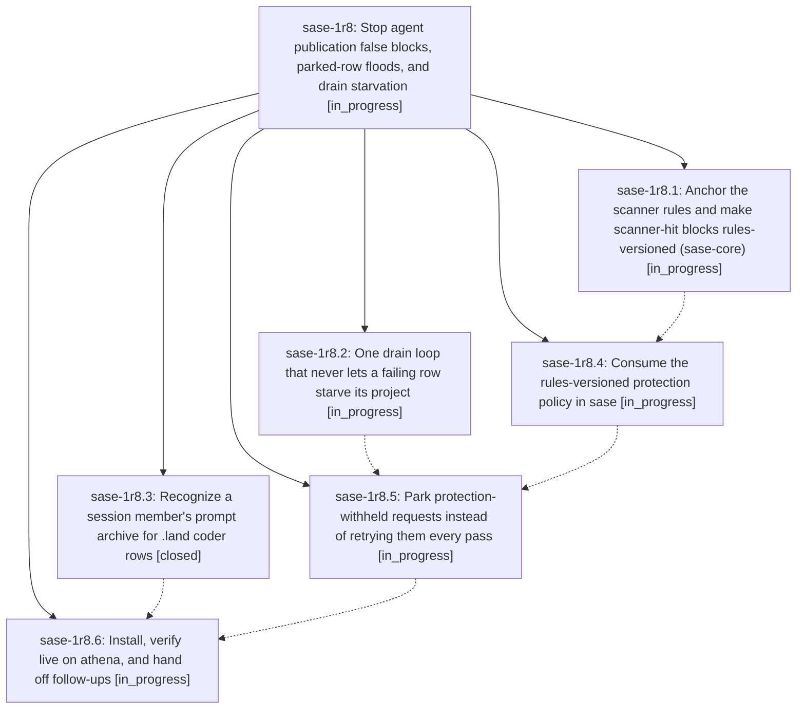

# Bead: sase-1r8 — Stop agent publication false blocks, parked-row floods, and drain starvation

[Bead Pages](../README.md) / sase-1r8

**Status:** ◐ in_progress · **Type:** ▸ plan · **Tier:** epic
**Owner:** `bryanbugyi34@gmail.com` · **Created by:** [bbugyi200.athena.184](https://github.com/sase-org/sase--agents/blob/main/sessions/bbugyi200.athena.184.md) · **Assignee:** `sase-1r8.land`
**Created:** 2026-11-04 13:54:36 EST
**Plan:** [202611/agent\_publication\_errors.md](https://github.com/sase-org/sase--plans/blob/main/202611/agent_publication_errors.md)

<!-- sase:links:start -->

## Links

| Relation | Artifact | Why |
| --- | --- | --- |
| implemented-by | [plan:202611/agent_publication_errors.md][1] | derived from the plan's `bead_id:` frontmatter field |

[1]: https://github.com/sase-org/sase--plans/blob/main/202611/agent_publication_errors.md

<!-- sase:links:end -->

## Description

The background agent_publication job stops reporting scanner false positives every pass. bob-cli's stuck and starved rows publish. A request withheld by publication protection can no longer starve its project or flood the error digest. A future scanner-rule correction releases its own stale false blocks with provenance, and .land coder rows stop quarantining over a prompt archive that already exists.

## Phases

| Bead | Title | Status | Size | Created | Agents | Commits |
|---|---|---|---|---|---:|---:|
| [sase-1r8.1](sase-1r8.1.md) | Anchor the scanner rules and make scanner-hit blocks rules-versioned (sase-core) | ◐ in_progress | medium | 2026-11-04 | 1 | 0 |
| [sase-1r8.2](sase-1r8.2.md) | One drain loop that never lets a failing row starve its project | ◐ in_progress | medium | 2026-11-04 | 1 | 0 |
| [sase-1r8.3](sase-1r8.3.md) | Recognize a session member's prompt archive for .land coder rows | ✓ closed | small | 2026-11-04 | 1 | 1 |
| [sase-1r8.4](sase-1r8.4.md) | Consume the rules-versioned protection policy in sase | ◐ in_progress | medium | 2026-11-04 | 1 | 0 |
| [sase-1r8.5](sase-1r8.5.md) | Park protection-withheld requests instead of retrying them every pass | ◐ in_progress | medium | 2026-11-04 | 1 | 0 |
| [sase-1r8.6](sase-1r8.6.md) | Install, verify live on athena, and hand off follow-ups | ◐ in_progress | small | 2026-11-04 | 1 | 0 |

## Lineage

## Agents

| Agent | Bead | Commits |
|---|---|---:|
| [bbugyi200.athena.sase-1r8.1](https://github.com/sase-org/sase--agents/blob/main/agents/bbugyi200.athena.sase-1r8.1/README.md) | [sase-1r8.1](sase-1r8.1.md) | 0 |
| [bbugyi200.athena.sase-1r8.2](https://github.com/sase-org/sase--agents/blob/main/agents/bbugyi200.athena.sase-1r8.2/README.md) | [sase-1r8.2](sase-1r8.2.md) | 0 |
| [bbugyi200.athena.sase-1r8.3](https://github.com/sase-org/sase--agents/blob/main/sessions/bbugyi200.athena.sase-1r8.3.md) | [sase-1r8.3](sase-1r8.3.md) | 1 |
| [bbugyi200.athena.sase-1r8.4](https://github.com/sase-org/sase--agents/blob/main/agents/bbugyi200.athena.sase-1r8.4/README.md) | [sase-1r8.4](sase-1r8.4.md) | 0 |
| [bbugyi200.athena.sase-1r8.5](https://github.com/sase-org/sase--agents/blob/main/agents/bbugyi200.athena.sase-1r8.5/README.md) | [sase-1r8.5](sase-1r8.5.md) | 0 |
| [bbugyi200.athena.sase-1r8.6](https://github.com/sase-org/sase--agents/blob/main/agents/bbugyi200.athena.sase-1r8.6/README.md) | [sase-1r8.6](sase-1r8.6.md) | 0 |
| [bbugyi200.athena.sase-1r8.land](https://github.com/sase-org/sase--agents/blob/main/agents/bbugyi200.athena.sase-1r8.land/README.md) | [sase-1r8](README.md) | 0 |

## Commits

| Repo | Commit | Subject | Bead | Committed |
|---|---|---|---|---|
| sase | [`59723ae`](https://github.com/sase-org/sase/commit/59723ae0cd6fc12104e16e6e6c4fc63ad147f57e) | fix(agents-sync): match deferred archives by session | [sase-1r8.3](sase-1r8.3.md) | 2026-11-04 14:30:23 EST |
