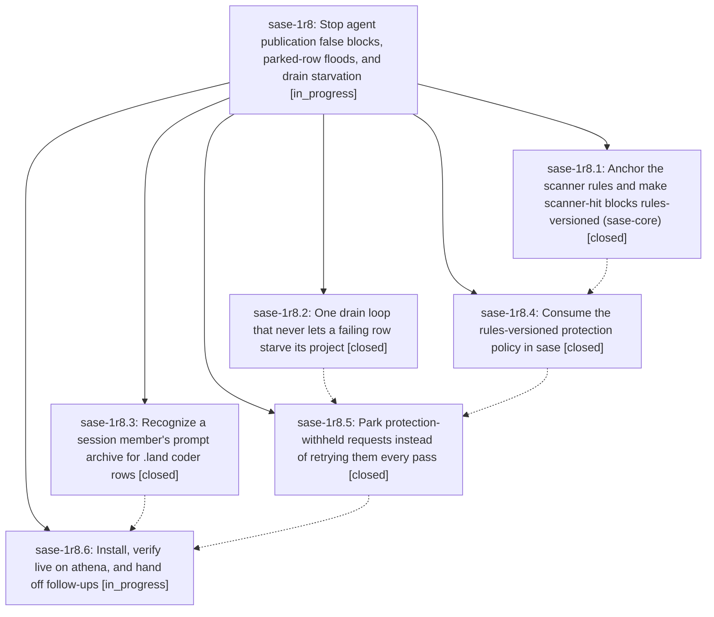

# Bead: sase-1r8 — Stop agent publication false blocks, parked-row floods, and drain starvation

[Bead Pages](../README.md) / sase-1r8

**Status:** ◐ in_progress · **Type:** ▸ plan · **Tier:** epic
**Owner:** `bryanbugyi34@gmail.com` · **Created by:** [bbugyi200.athena.184](https://github.com/sase-org/sase--agents/blob/main/sessions/bbugyi200.athena.184.md) · **Assignee:** `sase-1r8.land`
**Created:** 2026-11-04 13:54:36 EST
**Plan:** [202611/agent\_publication\_errors.md](https://github.com/sase-org/sase--plans/blob/main/202611/agent_publication_errors.md)

<!-- sase:links:start -->

## Links

| Relation | Artifact | Why |
| --- | --- | --- |
| implemented-by | [plan:202611/agent_publication_errors.md][1] | derived from the plan's `bead_id:` frontmatter field |

_Plus 6 automatic references — see [Referenced By](#referenced-by)._

[1]: https://github.com/sase-org/sase--plans/blob/main/202611/agent_publication_errors.md

<!-- sase:links:end -->

## Description

The background agent_publication job stops reporting scanner false positives every pass. bob-cli's stuck and starved rows publish. A request withheld by publication protection can no longer starve its project or flood the error digest. A future scanner-rule correction releases its own stale false blocks with provenance, and .land coder rows stop quarantining over a prompt archive that already exists.

## Notes

[2026-11-04T21:01:35Z · 18b--code] DISCOVERED ISSUE (workspace-retention serialization implementation check, 2026-11-04):  ToolRun f07f3fe8c21a8203bed7ecbdbdafc7b1 failed its diff-scoped lane with two NEW failures: tests/agents_sync/test_prompt_archive_protection.py::test_blocked_raw_prompt_is_not_published and tests/agents_sync/test_transcript_publication_protection.py::test_blocked_prompt_withheld_but_clean_sibling_publishes. Both assert that publication_content_retry_allowed remains false for a digest just blocked by the synthetic scanner, but the function returned true. Re-running both nodes together in isolation reproduced both failures (2 failed in 6.48s). This is in the active protection-policy path owned by phase sase-1r8.4 (enforced lookups and stale-block resolution); the unrelated diff here touches only Agent bundle serialization and tests. Please include these failing nodes in the phase's diagnosis.

[2026-11-04T21:01:48Z · 18b--code] DISCOVERED ISSUE (workspace-retention serialization check, 2026-11-04): ToolRun f07f3fe8c21a8203bed7ecbdbdafc7b1 failed its scoped lane with two NEW failures: tests/agents_sync/test_prompt_archive_protection.py::test_blocked_raw_prompt_is_not_published and tests/agents_sync/test_transcript_publication_protection.py::test_blocked_prompt_withheld_but_clean_sibling_publishes. Both assert publication_content_retry_allowed remains false for a digest just blocked by the synthetic scanner, but the function returned true. Re-running both nodes together in isolation reproduced both failures (2 failed in 6.48s). This is in the active protection-policy path owned by phase sase-1r8.4 (enforced lookups and stale-block resolution); the unrelated diff here touches only Agent bundle serialization and tests. Please include these failing nodes in the phase diagnosis.

## Phases

| Bead | Title | Status | Size | Created | Agents | Commits |
|---|---|---|---|---|---:|---:|
| [sase-1r8.1](sase-1r8.1.md) | Anchor the scanner rules and make scanner-hit blocks rules-versioned (sase-core) | ✓ closed | medium | 2026-11-04 | 1 | 1 |
| [sase-1r8.2](sase-1r8.2.md) | One drain loop that never lets a failing row starve its project | ✓ closed | medium | 2026-11-04 | 1 | 1 |
| [sase-1r8.3](sase-1r8.3.md) | Recognize a session member's prompt archive for .land coder rows | ✓ closed | small | 2026-11-04 | 1 | 1 |
| [sase-1r8.4](sase-1r8.4.md) | Consume the rules-versioned protection policy in sase | ✓ closed | medium | 2026-11-04 | 1 | 1 |
| [sase-1r8.5](sase-1r8.5.md) | Park protection-withheld requests instead of retrying them every pass | ✓ closed | medium | 2026-11-04 | 1 | 1 |
| [sase-1r8.6](sase-1r8.6.md) | Install, verify live on athena, and hand off follow-ups | ◐ in_progress | small | 2026-11-04 | 1 | 0 |

## Lineage

## Agents

| Agent | Bead | Commits |
|---|---|---:|
| [bbugyi200.athena.sase-1r8.1](https://github.com/sase-org/sase--agents/blob/main/sessions/bbugyi200.athena.sase-1r8.1.md) | [sase-1r8.1](sase-1r8.1.md) | 1 |
| [bbugyi200.athena.sase-1r8.2](https://github.com/sase-org/sase--agents/blob/main/agents/bbugyi200.athena.sase-1r8.2/README.md) | [sase-1r8.2](sase-1r8.2.md) | 1 |
| [bbugyi200.athena.sase-1r8.3](https://github.com/sase-org/sase--agents/blob/main/sessions/bbugyi200.athena.sase-1r8.3.md) | [sase-1r8.3](sase-1r8.3.md) | 1 |
| [bbugyi200.athena.sase-1r8.4](https://github.com/sase-org/sase--agents/blob/main/sessions/bbugyi200.athena.sase-1r8.4.md) | [sase-1r8.4](sase-1r8.4.md) | 1 |
| [bbugyi200.athena.sase-1r8.5](https://github.com/sase-org/sase--agents/blob/main/agents/bbugyi200.athena.sase-1r8.5/README.md) | [sase-1r8.5](sase-1r8.5.md) | 1 |
| [bbugyi200.athena.sase-1r8.6](https://github.com/sase-org/sase--agents/blob/main/agents/bbugyi200.athena.sase-1r8.6/README.md) | [sase-1r8.6](sase-1r8.6.md) | 0 |
| [bbugyi200.athena.sase-1r8.land](https://github.com/sase-org/sase--agents/blob/main/agents/bbugyi200.athena.sase-1r8.land/README.md) | [sase-1r8](README.md) | 0 |

## Commits

| Repo | Commit | Subject | Bead | Committed |
|---|---|---|---|---|
| sase | [`59723ae`](https://github.com/sase-org/sase/commit/59723ae0cd6fc12104e16e6e6c4fc63ad147f57e) | fix(agents-sync): match deferred archives by session | [sase-1r8.3](sase-1r8.3.md) | 2026-11-04 14:30:23 EST |
| sase-core | [`sase-core@542448a`](https://github.com/sase-org/sase-core/commit/542448a01b2f8f8246ae376dfbe5d84b996261b7) | feat(sase-core): anchor scanner rules, version blocks, add parked recheck | [sase-1r8.1](sase-1r8.1.md) | 2026-11-04 14:48:49 EST |
| sase | [`34b09fa`](https://github.com/sase-org/sase/commit/34b09fa219b5e4fd07f5d1e45166c4d40431b426) | fix(agents-sync): prevent publication drain starvation | [sase-1r8.2](sase-1r8.2.md) | 2026-11-04 15:04:00 EST |
| sase | [`cdfbb82`](https://github.com/sase-org/sase/commit/cdfbb82d2bad28c1f1b6d7a7e23b3e72f455fbf3) | feat(agent-publication-protection): enforce scanner rule versions | [sase-1r8.4](sase-1r8.4.md) | 2026-11-04 16:18:35 EST |
| sase | [`1b62dfb`](https://github.com/sase-org/sase/commit/1b62dfb9bdb52b9a81a7755f8f6184c5d1cc2ec2) | feat(agent-publication): park protection-withheld requests | [sase-1r8.5](sase-1r8.5.md) | 2026-11-04 17:21:54 EST |

<!-- sase:referenced-by:start -->

## Referenced By

| Relation | Artifact | Why | Uses |
| --- | --- | --- | ---: |
| read-by | [agent:18b--code][1] | Check whether the active publication-protection epic owns stale blocked-content retry failures | 1 |
| read-by | [agent:research.3a.cdx][2] | Check dependencies, active epic coverage, and alternatives to the leading task candidates | 1 |
| read-by | [agent:research.3a.cld][3] | Check scope of active athena epic to avoid conflicts when ranking task beads | 1 |
| read-by | [agent:research.3a.final][4] | Check active epic phase scopes for conflict screening of task bead recommendations | 1 |
| read-by | [agent:research.3a.gem][5] | Inspect scope and conflicts for research recommendation | 2 |
| read-by | [agent:research.3a.grk][6] | Need live epic scopes and high-impact candidate task details to rank work without colliding with in-flight epics | 1 |

[1]: https://github.com/sase-org/sase--agents/blob/main/sessions/bbugyi200.athena.18b.md
[2]: https://github.com/sase-org/sase--agents/blob/main/agents/bbugyi200.athena.research.3a.cdx/README.md
[3]: https://github.com/sase-org/sase--agents/blob/main/agents/bbugyi200.athena.research.3a.cld/README.md
[4]: https://github.com/sase-org/sase--agents/blob/main/agents/bbugyi200.athena.research.3a.final/README.md
[5]: https://github.com/sase-org/sase--agents/blob/main/agents/bbugyi200.athena.research.3a.gem/README.md
[6]: https://github.com/sase-org/sase--agents/blob/main/agents/bbugyi200.athena.research.3a.grk/README.md

<!-- sase:referenced-by:end -->
