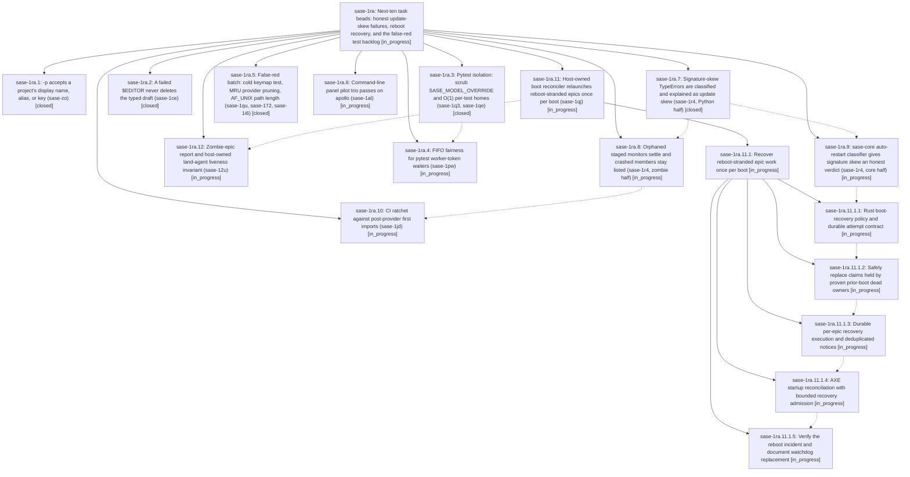

# Bead: sase-1ra — Next-ten task beads: honest update-skew failures, reboot recovery, and the false-red test backlog

[Bead Pages](../README.md) / sase-1ra

**Status:** ◐ in_progress · **Type:** ▸ plan · **Tier:** epic
**Owner:** `bryanbugyi34@gmail.com` · **Created by:** [bbugyi200.athena.18d](https://github.com/sase-org/sase--agents/blob/main/sessions/bbugyi200.athena.18d.md) · **Assignee:** `sase-1ra.land`
**Created:** 2026-11-04 17:59:12 EST
**Plan:** [202611/next\_ten\_task\_beads.md](https://github.com/sase-org/sase--plans/blob/main/202611/next_ten_task_beads.md)

## Description

The ten task beads ranked by the 2026-11-04 next-ten research report are fixed, verified, and closed, together with the three beads the report attached to them (sase-1i6, sase-1jd, sase-12u). None of this work collides with the live Agent Hijack (sase-1qz), publication (sase-1r8), or v0.19.0 release (sase-1r2) epics.

## Phases

| Bead | Title | Status | Size | Created | Agents | Commits |
|---|---|---|---|---|---:|---:|
| [sase-1ra.1](sase-1ra.1.md) | -p accepts a project's display name, alias, or key (sase-zo) | ✓ closed | small | 2026-11-04 | 1 | 0 |
| [sase-1ra.10](sase-1ra.10.md) | CI ratchet against post-provider first imports (sase-1jd) | ◐ in_progress | large | 2026-11-04 | 1 | 0 |
| [sase-1ra.11](sase-1ra.11.md) | Host-owned boot reconciler relaunches reboot-stranded epics once per boot (sase-1qj) | ◐ in_progress | large | 2026-11-04 | 1 | 0 |
| [sase-1ra.12](sase-1ra.12.md) | Zombie-epic report and host-owned land-agent liveness invariant (sase-12u) | ◐ in_progress | large | 2026-11-04 | 1 | 0 |
| [sase-1ra.2](sase-1ra.2.md) | A failed $EDITOR never deletes the typed draft (sase-1ce) | ✓ closed | small | 2026-11-04 | 1 | 1 |
| [sase-1ra.3](sase-1ra.3.md) | Pytest isolation: scrub SASE\_MODEL\_OVERRIDE and O(1) per-test homes (sase-1q3, sase-1qe) | ✓ closed | small | 2026-11-04 | 1 | 1 |
| [sase-1ra.4](sase-1ra.4.md) | FIFO fairness for pytest worker-token waiters (sase-1pw) | ◐ in_progress | medium | 2026-11-04 | 1 | 0 |
| [sase-1ra.5](sase-1ra.5.md) | False-red batch: cold keymap test, MRU provider pruning, AF\_UNIX path length (sase-1qu, sase-172, sase-1i6) | ✓ closed | medium | 2026-11-04 | 1 | 1 |
| [sase-1ra.6](sase-1ra.6.md) | Command-line panel pilot trio passes on apollo (sase-1al) | ◐ in_progress | medium | 2026-11-04 | 1 | 1 |
| [sase-1ra.7](sase-1ra.7.md) | Signature-skew TypeErrors are classified and explained as update skew (sase-1r4, Python half) | ✓ closed | medium | 2026-11-04 | 1 | 0 |
| [sase-1ra.8](sase-1ra.8.md) | Orphaned staged monitors settle and crashed members stay listed (sase-1r4, zombie half) | ◐ in_progress | medium | 2026-11-04 | 1 | 0 |
| [sase-1ra.9](sase-1ra.9.md) | sase-core auto-restart classifier gives signature skew an honest verdict (sase-1r4, core half) | ◐ in_progress | medium | 2026-11-04 | 1 | 0 |

## Lineage

## Agents

| Agent | Bead | Commits |
|---|---|---:|
| [bbugyi200.athena.sase-1ra.1](https://github.com/sase-org/sase--agents/blob/main/sessions/bbugyi200.athena.sase-1ra.1.md) | [sase-1ra.1](sase-1ra.1.md) | 0 |
| [bbugyi200.athena.sase-1ra.10](https://github.com/sase-org/sase--agents/blob/main/agents/bbugyi200.athena.sase-1ra.10/README.md) | [sase-1ra.10](sase-1ra.10.md) | 0 |
| [bbugyi200.athena.sase-1ra.11](https://github.com/sase-org/sase--agents/blob/main/sessions/bbugyi200.athena.sase-1ra.11.md) | [sase-1ra.11](sase-1ra.11.md) | 0 |
| [bbugyi200.athena.sase-1ra.11.1.1](https://github.com/sase-org/sase--agents/blob/main/sessions/bbugyi200.athena.sase-1ra.11.1.1.md) | [sase-1ra.11.1.1](sase-1ra.11.1.1.md) | 0 |
| [bbugyi200.athena.sase-1ra.11.1.2](https://github.com/sase-org/sase--agents/blob/main/agents/bbugyi200.athena.sase-1ra.11.1.2/README.md) | [sase-1ra.11.1.2](sase-1ra.11.1.2.md) | 0 |
| [bbugyi200.athena.sase-1ra.11.1.3](https://github.com/sase-org/sase--agents/blob/main/agents/bbugyi200.athena.sase-1ra.11.1.3/README.md) | [sase-1ra.11.1.3](sase-1ra.11.1.3.md) | 0 |
| [bbugyi200.athena.sase-1ra.11.1.4](https://github.com/sase-org/sase--agents/blob/main/agents/bbugyi200.athena.sase-1ra.11.1.4/README.md) | [sase-1ra.11.1.4](sase-1ra.11.1.4.md) | 0 |
| [bbugyi200.athena.sase-1ra.11.1.5](https://github.com/sase-org/sase--agents/blob/main/agents/bbugyi200.athena.sase-1ra.11.1.5/README.md) | [sase-1ra.11.1.5](sase-1ra.11.1.5.md) | 0 |
| [bbugyi200.athena.sase-1ra.11.1.land](https://github.com/sase-org/sase--agents/blob/main/agents/bbugyi200.athena.sase-1ra.11.1.land/README.md) | [sase-1ra.11.1](sase-1ra.11.1.md) | 0 |
| [bbugyi200.athena.sase-1ra.12](https://github.com/sase-org/sase--agents/blob/main/agents/bbugyi200.athena.sase-1ra.12/README.md) | [sase-1ra.12](sase-1ra.12.md) | 0 |
| [bbugyi200.athena.sase-1ra.2](https://github.com/sase-org/sase--agents/blob/main/agents/bbugyi200.athena.sase-1ra.2/README.md) | [sase-1ra.2](sase-1ra.2.md) | 1 |
| [bbugyi200.athena.sase-1ra.3](https://github.com/sase-org/sase--agents/blob/main/agents/bbugyi200.athena.sase-1ra.3/README.md) | [sase-1ra.3](sase-1ra.3.md) | 1 |
| [bbugyi200.athena.sase-1ra.4](https://github.com/sase-org/sase--agents/blob/main/sessions/bbugyi200.athena.sase-1ra.4.md) | [sase-1ra.4](sase-1ra.4.md) | 0 |
| [bbugyi200.athena.sase-1ra.5](https://github.com/sase-org/sase--agents/blob/main/agents/bbugyi200.athena.sase-1ra.5/README.md) | [sase-1ra.5](sase-1ra.5.md) | 1 |
| [bbugyi200.athena.sase-1ra.6](https://github.com/sase-org/sase--agents/blob/main/sessions/bbugyi200.athena.sase-1ra.6.md) | [sase-1ra.6](sase-1ra.6.md) | 1 |
| [bbugyi200.athena.sase-1ra.7](https://github.com/sase-org/sase--agents/blob/main/sessions/bbugyi200.athena.sase-1ra.7.md) | [sase-1ra.7](sase-1ra.7.md) | 0 |
| [bbugyi200.athena.sase-1ra.8](https://github.com/sase-org/sase--agents/blob/main/agents/bbugyi200.athena.sase-1ra.8/README.md) | [sase-1ra.8](sase-1ra.8.md) | 0 |
| [bbugyi200.athena.sase-1ra.9](https://github.com/sase-org/sase--agents/blob/main/agents/bbugyi200.athena.sase-1ra.9/README.md) | [sase-1ra.9](sase-1ra.9.md) | 0 |
| [bbugyi200.athena.sase-1ra.land](https://github.com/sase-org/sase--agents/blob/main/agents/bbugyi200.athena.sase-1ra.land/README.md) | [sase-1ra](README.md) | 0 |

## Commits

| Repo | Commit | Subject | Bead | Committed |
|---|---|---|---|---|
| sase | [`394ff93`](https://github.com/sase-org/sase/commit/394ff93ff5f35944596e349dee3e274d5290c083) | test(pytest): isolate per-test SASE homes | [sase-1ra.3](sase-1ra.3.md) | 2026-11-04 18:31:45 EST |
| sase | [`522b07a`](https://github.com/sase-org/sase/commit/522b07a009895c6f20b4a9db16b9f8103e3c2dfe) | fix(ace): preserve failed editor drafts | [sase-1ra.2](sase-1ra.2.md) | 2026-11-04 18:52:47 EST |
| sase | [`45bcf6f`](https://github.com/sase-org/sase/commit/45bcf6fe398e1a29e4d6985d820f1ccc9d9903d0) | test(false-red): fix keymap warmup, vcs mru mock, ipc socket path | [sase-1ra.5](sase-1ra.5.md) | 2026-11-04 18:58:37 EST |
| sase | [`02e93fd`](https://github.com/sase-org/sase/commit/02e93fd261505a8ff00342f48a1f4f8501786470) | test(ace): prebuild command-line grammar for panel pilot tests | [sase-1ra.6](sase-1ra.6.md) | 2026-11-04 19:18:03 EST |

<!-- sase:referenced-by:start -->

## Referenced By

| Relation | Artifact | Why | Uses |
| --- | --- | --- | ---: |
| read-by | [agent:sase-1ra.2][1] | Need parent epic notes and phase coordination constraints | 1 |
| read-by | [agent:sase-1ra.3][2] | Need the epic design decisions for its assigned phase | 1 |
| read-by | [agent:sase-1ra.5][3] | parent epic plan and design | 1 |

[1]: https://github.com/sase-org/sase--agents/blob/main/agents/bbugyi200.athena.sase-1ra.2/README.md
[2]: https://github.com/sase-org/sase--agents/blob/main/agents/bbugyi200.athena.sase-1ra.3/README.md
[3]: https://github.com/sase-org/sase--agents/blob/main/agents/bbugyi200.athena.sase-1ra.5/README.md

<!-- sase:referenced-by:end -->
