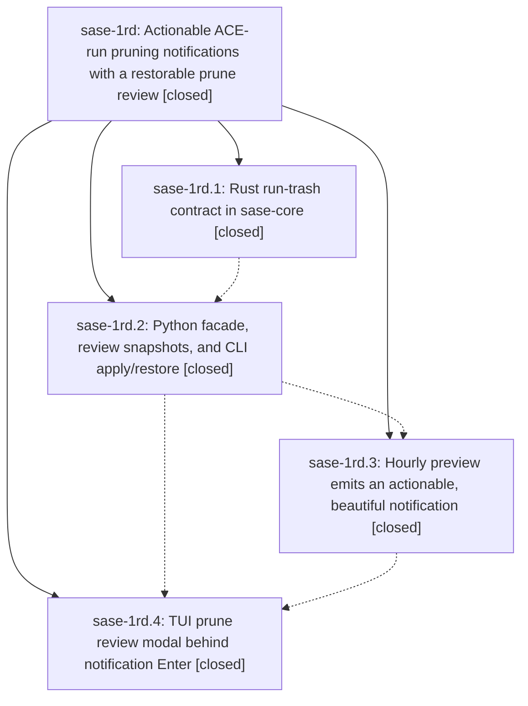

# Bead: sase-1rd — Actionable ACE-run pruning notifications with a restorable prune review

[Bead Pages](../README.md) / sase-1rd

**Status:** ✓ closed · **Resolution:** done · **Type:** ▸ plan · **Tier:** epic
**Owner:** `bryanbugyi34@gmail.com` · **Created by:** [bbugyi200.athena.18e](https://github.com/sase-org/sase--agents/blob/main/sessions/bbugyi200.athena.18e.md) · **Assignee:** `sase-1rd.land`
**Created:** 2026-11-05 06:20:13 EST · **Closed:** 2026-11-06 16:05:59 EST
**Plan:** [202611/actionable\_run\_prune\_notifications.md](https://github.com/sase-org/sase--plans/blob/main/202611/actionable_run_prune_notifications.md)

<!-- sase:links:start -->

## Links

| Relation | Artifact | Why |
| --- | --- | --- |
| implemented-by | [plan:202611/actionable_run_prune_notifications.md][1] | derived from the plan's `bead_id:` frontmatter field |

_Plus 3 automatic references — see [Referenced By](#referenced-by)._

[1]: https://github.com/sase-org/sase--plans/blob/main/202611/actionable_run_prune_notifications.md

<!-- sase:links:end -->

## Description

Pressing Enter on an ACE-run pruning notification opens a polished review that, once confirmed, moves exactly the reviewed and still-eligible runs into a restorable trash in the background. Protections are re-verified before every move and again before any permanent purge.

## Notes

[2026-11-06T17:52:40Z · sase-1rd.land] FOLLOW-UP TRIAGE (landing at d44032ad79): reviewed every note on phases .1-.4. (1) .1 note #2 isolation items, .2 note #1, .3 note #2, and .4 note #1 consolidate on active sase-1ra, whose .5 introduced monkeypatch.undo(); added DISCOVERED ISSUE with fresh clean-tree reproduction (2 failed/4 passed focused batch). No duplicate task. (2) .1 note #2 and .2 note #2 marker-path proposals are resolved on current HEAD; the exact audit passes, recovery-site reviews landed in ef11650ad4 and later refactors preserve them. Added resolution evidence to sase-1by; declined a new task or failure +1. (3) .2 note #2 screenshot prepare-error flake is now ready task sase-1rh, size large because root cause is unknown; related to sase-1pd, which covers a different screenshot node without a proven common cause. This exact node passes focused now (2.66s); no fresh failure is claimed. (4) .3 note #1 symbol/phase-close proposal was already fulfilled by .3 note #3 and its normal close; no follow-up task needed. Current epic-symbols finds only sase-1rd(snapshot_dir), which remains landing work and will be privatized or otherwise resolved before close.

[2026-11-06T17:54:16Z · sase-1rd.land] LANDING AUDIT: epic remains open. Reviewed all four child scopes and every note, original approved plan, core commit 39744416 and sase commits 37a4c8ed8d/950c8aec15/e94a52e0ae/d44032ad79, actual Rust owner/PyO3 and Python/CLI/chop/TUI code. Core pin 28159925 contains 39744416; auto_purge=yes implemented; no memory edits in epic commits. All 61 focused feature tests pass, including preview-dispatch-quarantine-index-notification-restore E2E. Disposable fixture reproductions expose remaining epic defects: (A) fresh protected_agent_names or non_closed_bead_ids_by_project alone are discarded by purge_ace_run_trash, yielding purged=1/restored=0 and losing both original/trash paths; continuation closure is likewise absent from purge. (B) replacing batch/runs with a symlink to a disposable sibling makes explicit restore move that external run (restored=1). (C) a protected item with an original-path conflict reports kept=1 but cleanup deletes its empty payload subdirectory. (D) blocked busy notify invokes preview dismissal despite TUI saying Preview kept. Also found fixed 14-day copy despite configurable grace and missing index-error details in typed completion. No real host lifecycle mutation was performed. Reviewed non-epic history through d44032ad79 plus 71fd5b6c2a since creation: recovery/inheritance and monitor ancestry are the relevant integration boundary for complete purge protection; publication, scheduler splitting, slow-tool ordering, bead opener attribution and unread navigation do not duplicate pruning. Planning bounded repairs as a medium tale whose final step closes this epic; no parent link exists. The snapshot_dir helper has only internal production callers, so this turn privatizes it and removes its final epic-symbol row before the tale starts; check ToolRun dee7bd4a2b6bb98b8cc573f669a0e722 is running.

[2026-11-06T18:15:39Z · sase-1rd.land] LANDING VERIFICATION: Required sase tool run check settled exit 1 (ToolRun dee7bd4a2b6bb98b8cc573f669a0e722; argv just check; 21m53s). All lint stages passed, including Symvision. Test stage: 60,314 passed, 17 skipped, 2 failed: tests/test_pytest_isolation_guards.py::test_no_undo_on_shared_monkeypatch_fixture and ::test_session_sandbox_seal_is_not_first_test. Both independently reproduced on clean d44032ad79 before my edits (2 failed, 4 passed baseline batch); existing causal owner sase-1ra already has the corroboration. Automated triage extracted a nested relative-path spelling of the first failure as NEW; it is not a third failed test. The command remains failed; no check-full was run. The existing 61 focused feature tests passed, and git diff --check passes. This turn only privatizes snapshot_dir and removes its epic whitelist entry (three main-repo files); the confirmed preservation/reporting defects remain for the validated medium tale sase_plan_finish_run_prune_landing.md, whose final step must close this epic and mark its original plan done. Epic intentionally stays open.

[2026-11-06T21:05:59Z · sase-1rd.land] Landing repairs for plan:202611/finish_run_prune_landing.md complete. Purge now requires schema v2 observations (protected_agent_names, non_closed_bead_ids_by_project, continuation_runs) and evaluates the full classify_run_candidate protection set plus continuation retention; missing observations refuse the whole op. Trash effects stay contained: symlink components under the trusted root are skipped, restore checks the trash item, empty-batch cleanup only removes empty structural dirs, journal/cleanup failures count as errors after effects, and list preserves orphan original_path. Completion reporting upserts the result before dismissing previews, includes index_errors, uses configured trash_grace_days, shared human_size, and "Project unavailable". Dry-run default and unattended apply refusal unchanged. No real host run mutations; disposable fixtures only.

Verification: sase-core sase tool run check ToolRun 7928a8efee2e11a8d231f2a5a2cfe990 succeeded. sase sase tool run check ToolRun 7b21fa28d2927857723c95c81e5135ee verdict no_new_failures (1 KNOWN, 2 FLAKY): tests/test_pytest_isolation_guards.py::test_no_undo_on_shared_monkeypatch_fixture and ::test_session_sandbox_seal_is_not_first_test belong to sase-1ra. Focused core trash tests 13/13; focused Python prune/schema/hijack tests green. just rust-install installed schema-2 wheel. just check-full was not run.

Follow-ups carried from lander: sase-1ra isolation (still reproducing); sase-1by marker-audit already resolved; sase-1rh screenshot flake remains a ready task. snapshot_dir epic-symbol already gone. epic-symbols sase-1rd: none. Original plan plan:202611/actionable_run_prune_notifications.md and tale plan:202611/finish_run_prune_landing.md set status: done.

## Phases

| Bead | Title | Status | Size | Created | Agents | Commits |
|---|---|---|---|---|---:|---:|
| [sase-1rd.1](sase-1rd.1.md) | Rust run-trash contract in sase-core | ✓ closed | medium | 2026-11-05 | 1 | 1 |
| [sase-1rd.2](sase-1rd.2.md) | Python facade, review snapshots, and CLI apply/restore | ✓ closed | medium | 2026-11-05 | 1 | 1 |
| [sase-1rd.3](sase-1rd.3.md) | Hourly preview emits an actionable, beautiful notification | ✓ closed | small | 2026-11-05 | 1 | 2 |
| [sase-1rd.4](sase-1rd.4.md) | TUI prune review modal behind notification Enter | ✓ closed | medium | 2026-11-05 | 1 | 1 |

## Lineage

## Agents

| Agent | Bead | Commits |
|---|---|---:|
| [bbugyi200.athena.sase-1rd.1](https://github.com/sase-org/sase--agents/blob/main/agents/bbugyi200.athena.sase-1rd.1/README.md) | [sase-1rd.1](sase-1rd.1.md) | 1 |
| [bbugyi200.athena.sase-1rd.2](https://github.com/sase-org/sase--agents/blob/main/sessions/bbugyi200.athena.sase-1rd.2.md) | [sase-1rd.2](sase-1rd.2.md) | 1 |
| [bbugyi200.athena.sase-1rd.3](https://github.com/sase-org/sase--agents/blob/main/agents/bbugyi200.athena.sase-1rd.3/README.md) | [sase-1rd.3](sase-1rd.3.md) | 2 |
| [bbugyi200.athena.sase-1rd.4](https://github.com/sase-org/sase--agents/blob/main/agents/bbugyi200.athena.sase-1rd.4/README.md) | [sase-1rd.4](sase-1rd.4.md) | 1 |
| [bbugyi200.athena.sase-1rd.land](https://github.com/sase-org/sase--agents/blob/main/sessions/bbugyi200.athena.sase-1rd.land.md) | [sase-1rd](README.md) | 2 |

## Commits

| Repo | Commit | Subject | Bead | Committed |
|---|---|---|---|---|
| sase-core | [`sase-core@3974441`](https://github.com/sase-org/sase-core/commit/39744416635e319fb8f65f90e4f89dfd0b4fc395) | feat(agent-artifact-run-trash): add journaled run quarantine | [sase-1rd.1](sase-1rd.1.md) | 2026-11-05 08:00:29 EST |
| sase | [`37a4c8e`](https://github.com/sase-org/sase/commit/37a4c8ed8d2b30942697494d1624532a63434460) | feat(artifact): quarantine ACE runs to restorable trash with review snapshots | [sase-1rd.2](sase-1rd.2.md) | 2026-11-05 10:14:11 EST |
| sase | [`950c8ae`](https://github.com/sase-org/sase/commit/950c8aec15f1e20c93b4a67d7564d09f47d8c137) | feat(artifact-retention): make run prune previews actionable | [sase-1rd.3](sase-1rd.3.md) | 2026-11-05 11:18:57 EST |
| sase | [`e94a52e`](https://github.com/sase-org/sase/commit/e94a52e0ae7e1a88e56f6e774efc22a3983536b6) | fix(artifact-retention): report busy prune previews and verify supersession | [sase-1rd.3](sase-1rd.3.md) | 2026-11-06 10:02:26 EST |
| sase | [`d44032a`](https://github.com/sase-org/sase/commit/d44032ad797e7684e4fa1699708c2cca1b278866) | feat(ace): add actionable run prune review modal | [sase-1rd.4](sase-1rd.4.md) | 2026-11-06 12:30:19 EST |
| sase | [`d8381f2`](https://github.com/sase-org/sase/commit/d8381f230fff8bcfb0cbf26420f1bbc4af0d100d) | refactor(run-prune): privatize snapshot directory helper | [sase-1rd](README.md) | 2026-11-06 13:17:09 EST |
| sase-core | [`sase-core@c8adc87`](https://github.com/sase-org/sase-core/commit/c8adc878aedfda494731eb1c0a4ecbc359be1c0e) | feat!: require complete protection observations for ACE-run trash purge | [sase-1rd](README.md) | 2026-11-06 16:07:23 EST |

<!-- sase:referenced-by:start -->

## Referenced By

| Relation | Artifact | Why | Uses |
| --- | --- | --- | ---: |
| read-by | [agent:sase-1qz.6.1.4.1.3][1] | Confirm the unrelated symvision symbol bead status for clean-base comparison | 2 |
| read-by | [agent:sase-1rd.1][2] | Need the epic plan and phase history before implementing core quarantine | 1 |
| read-by | [agent:sase-1rd.land][3] | Need the epic scope, children, and linked plan file | 2 |

[1]: https://github.com/sase-org/sase--agents/blob/main/agents/bbugyi200.athena.sase-1qz.6.1.4.1.3/README.md
[2]: https://github.com/sase-org/sase--agents/blob/main/agents/bbugyi200.athena.sase-1rd.1/README.md
[3]: https://github.com/sase-org/sase--agents/blob/main/sessions/bbugyi200.athena.sase-1rd.land.md

<!-- sase:referenced-by:end -->
