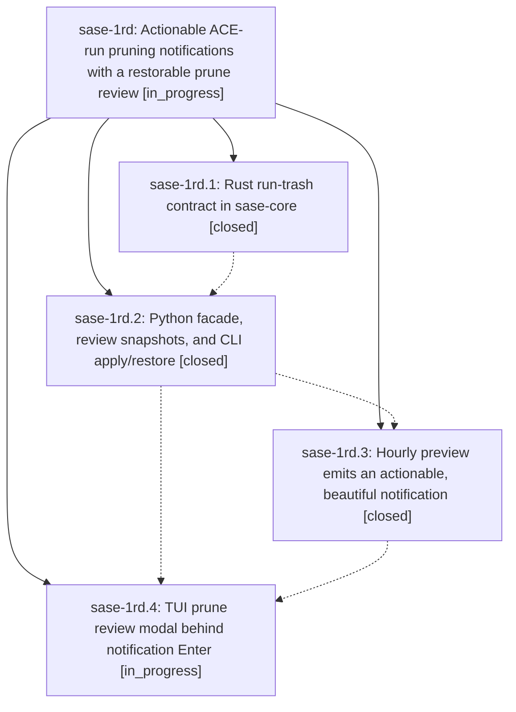

# Bead: sase-1rd — Actionable ACE-run pruning notifications with a restorable prune review

[Bead Pages](../README.md) / sase-1rd

**Status:** ◐ in_progress · **Type:** ▸ plan · **Tier:** epic
**Owner:** `bryanbugyi34@gmail.com` · **Created by:** [bbugyi200.athena.18e](https://github.com/sase-org/sase--agents/blob/main/sessions/bbugyi200.athena.18e.md) · **Assignee:** `sase-1rd.land`
**Created:** 2026-11-05 06:20:13 EST
**Plan:** [202611/actionable\_run\_prune\_notifications.md](https://github.com/sase-org/sase--plans/blob/main/202611/actionable_run_prune_notifications.md)

<!-- sase:links:start -->

## Links

| Relation | Artifact | Why |
| --- | --- | --- |
| implemented-by | [plan:202611/actionable_run_prune_notifications.md][1] | derived from the plan's `bead_id:` frontmatter field |

_Plus 2 automatic references — see [Referenced By](#referenced-by)._

[1]: https://github.com/sase-org/sase--plans/blob/main/202611/actionable_run_prune_notifications.md

<!-- sase:links:end -->

## Description

Pressing Enter on an ACE-run pruning notification opens a polished review that, once confirmed, moves exactly the reviewed and still-eligible runs into a restorable trash in the background. Protections are re-verified before every move and again before any permanent purge.

## Phases

| Bead | Title | Status | Size | Created | Agents | Commits |
|---|---|---|---|---|---:|---:|
| [sase-1rd.1](sase-1rd.1.md) | Rust run-trash contract in sase-core | ✓ closed | medium | 2026-11-05 | 1 | 1 |
| [sase-1rd.2](sase-1rd.2.md) | Python facade, review snapshots, and CLI apply/restore | ✓ closed | medium | 2026-11-05 | 1 | 1 |
| [sase-1rd.3](sase-1rd.3.md) | Hourly preview emits an actionable, beautiful notification | ✓ closed | small | 2026-11-05 | 1 | 2 |
| [sase-1rd.4](sase-1rd.4.md) | TUI prune review modal behind notification Enter | ◐ in_progress | medium | 2026-11-05 | 1 | 0 |

## Lineage

## Agents

| Agent | Bead | Commits |
|---|---|---:|
| [bbugyi200.athena.sase-1rd.1](https://github.com/sase-org/sase--agents/blob/main/agents/bbugyi200.athena.sase-1rd.1/README.md) | [sase-1rd.1](sase-1rd.1.md) | 1 |
| [bbugyi200.athena.sase-1rd.2](https://github.com/sase-org/sase--agents/blob/main/sessions/bbugyi200.athena.sase-1rd.2.md) | [sase-1rd.2](sase-1rd.2.md) | 1 |
| [bbugyi200.athena.sase-1rd.3](https://github.com/sase-org/sase--agents/blob/main/agents/bbugyi200.athena.sase-1rd.3/README.md) | [sase-1rd.3](sase-1rd.3.md) | 2 |
| [bbugyi200.athena.sase-1rd.4](https://github.com/sase-org/sase--agents/blob/main/agents/bbugyi200.athena.sase-1rd.4/README.md) | [sase-1rd.4](sase-1rd.4.md) | 0 |
| [bbugyi200.athena.sase-1rd.land](https://github.com/sase-org/sase--agents/blob/main/agents/bbugyi200.athena.sase-1rd.land/README.md) | [sase-1rd](README.md) | 0 |

## Commits

| Repo | Commit | Subject | Bead | Committed |
|---|---|---|---|---|
| sase-core | [`sase-core@3974441`](https://github.com/sase-org/sase-core/commit/39744416635e319fb8f65f90e4f89dfd0b4fc395) | feat(agent-artifact-run-trash): add journaled run quarantine | [sase-1rd.1](sase-1rd.1.md) | 2026-11-05 08:00:29 EST |
| sase | [`37a4c8e`](https://github.com/sase-org/sase/commit/37a4c8ed8d2b30942697494d1624532a63434460) | feat(artifact): quarantine ACE runs to restorable trash with review snapshots | [sase-1rd.2](sase-1rd.2.md) | 2026-11-05 10:14:11 EST |
| sase | [`950c8ae`](https://github.com/sase-org/sase/commit/950c8aec15f1e20c93b4a67d7564d09f47d8c137) | feat(artifact-retention): make run prune previews actionable | [sase-1rd.3](sase-1rd.3.md) | 2026-11-05 11:18:57 EST |
| sase | [`e94a52e`](https://github.com/sase-org/sase/commit/e94a52e0ae7e1a88e56f6e774efc22a3983536b6) | fix(artifact-retention): report busy prune previews and verify supersession | [sase-1rd.3](sase-1rd.3.md) | 2026-11-06 10:02:26 EST |

<!-- sase:referenced-by:start -->

## Referenced By

| Relation | Artifact | Why | Uses |
| --- | --- | --- | ---: |
| read-by | [agent:sase-1qz.6.1.4.1.3][1] | Confirm the unrelated symvision symbol bead status for clean-base comparison | 2 |
| read-by | [agent:sase-1rd.1][2] | Need the epic plan and phase history before implementing core quarantine | 1 |

[1]: https://github.com/sase-org/sase--agents/blob/main/agents/bbugyi200.athena.sase-1qz.6.1.4.1.3/README.md
[2]: https://github.com/sase-org/sase--agents/blob/main/agents/bbugyi200.athena.sase-1rd.1/README.md

<!-- sase:referenced-by:end -->
