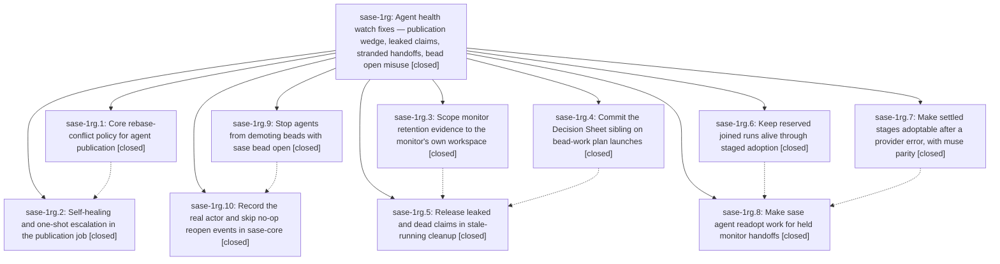

# Bead: sase-1rg — Agent health watch fixes — publication wedge, leaked claims, stranded handoffs, bead open misuse

[Bead Pages](../README.md) / sase-1rg

**Status:** ✓ closed · **Resolution:** done · **Type:** ▸ plan · **Tier:** epic
**Owner:** `bryanbugyi34@gmail.com` · **Created by:** `bbugyi200.apollo.cp--5` · **Assignee:** `sase-1rg.land`
**Created:** 2026-11-06 05:46:48 EST · **Closed:** 2026-11-06 15:46:22 EST
**Plan:** [202611/agent\_health\_watch\_fixes.md](https://github.com/sase-org/sase--plans/blob/main/202611/agent_health_watch_fixes.md)

<!-- sase:links:start -->

## Links

| Relation | Artifact | Why |
| --- | --- | --- |
| implemented-by | [plan:202611/agent_health_watch_fixes.md][1] | derived from the plan's `bead_id:` frontmatter field |

_Plus 7 automatic references — see [Referenced By](#referenced-by)._

[1]: https://github.com/sase-org/sase--plans/blob/main/202611/agent_health_watch_fixes.md

<!-- sase:links:end -->

## Description

Agent publication heals itself from conflicts on regenerable index pages and escalates once otherwise; finished monitors and failed staged handoffs stop leaking workspace claims and can be re-adopted; agents can no longer demote their own beads by running `sase bead open` to view them.

## Notes

[2026-11-06T20:46:22Z · sase-1rg.land] LAND (sase-1rg.land, 2026-11-06). VERIFIED: all 10 phases are closed, and every phase note was reviewed against source and commits.
- pub-policy: 2072bd6d2e plus sase-core e9c0a99f.
- pub-heal: b313400ebd. Recovery-ref-pinned upstream-side healing, diverged_replay parking with a 1h cooldown marker, doorbell suppression, a dedup notification with plus_one_note, own-commit drop with files/objects preserved, and a doctor WARN.
- retain-scope: 520962bcba. Starter evidence is same-workspace only, foreign records outside the checkout are dropped, baselines merge, is_primary is limited to the own checkout, snapshots are path-hash keyed, and the plus_one notice works. The plan's sibling-target bullet is met through foreign scoping. Monitors capture no run-start baseline and never call configured_sibling_targets, so inherited-env sibling paths reached settlement only through the foreign starter baseline, which is now dropped. A test covers sibling:plans.
- decisions-commit: 85082c7da8.
- stale-claims: 4f9c892c58. It survived the later d185aea3bc split into stale_running_leak/sweep, and both repair paths are still wired.
- staged-join: c65055eff6.
- staged-response: b22f63d3f4.
- staged-readopt: 956310b7ad.
- open-guard: 6be3266cfc.
- open-actor: a6fe55c1be plus sase-core 28159925.
The sase-core pin cd02e319 contains both sase-core commits, which resolves the PIN PENDING notes on .1 and .10. The epic's decisions were honored: core policy and actor live in sase-core, and orchestration stays in Python. Focused rerun on HEAD 15c1743fdf: 31 epic test files, 292 passed. No epic-symbol entries remain.

INTEGRATION: I reviewed all 15 non-epic commits since 85082c7da8. Test splits (b5ea62a0a2, 203be2742a, 2e8c6e8726, 39ca7f2b0e) kept the epic's tests. Hijack-recovery (a7d68a2e71, 71011e1e10, f4ca45edf8) covers deliberately hijacked agents and does not duplicate or conflict with the held-staged-handoff readopt/salvage notices. No code changes were needed. sase-1ra.8 (in progress, same cleanup module) got a coordination note on keeping the staged-owner index for held stages.

FOLLOW-UPS:
(1) The isolation-guard failure from tests/ace/tui/test_log_panel_keymap.py:331 monkeypatch.undo() was proposed by sase-1rg.2 #1, sase-1rg.9 #1, and sase-1rg.10 #2. Phase sase-1ra.5 (commit 45bcf6fe39) of active epic sase-1ra introduced it. It still reproduces on HEAD, so I added a corroborating DISCOVERED ISSUE note on sase-1ra and created no task.
(2) Threading the actor through update, claims, and remove was proposed by sase-1rg.10 #1. It is distinct from sase-15a and sase-159, so I created task sase-1ri (bug, medium, ready) with related links.

NOT VERIFIED: apollo post-deploy acceptance. The two stuck agents-clone commits should heal and active_remaining should fall. This needs a human-run deploy to apollo, which is outside this agent's scope.

## Phases

| Bead | Title | Status | Size | Created | Agents | Commits |
|---|---|---|---|---|---:|---:|
| [sase-1rg.1](sase-1rg.1.md) | Core rebase-conflict policy for agent publication | ✓ closed | small | 2026-11-06 | 1 | 2 |
| [sase-1rg.10](sase-1rg.10.md) | Record the real actor and skip no-op reopen events in sase-core | ✓ closed | medium | 2026-11-06 | 1 | 2 |
| [sase-1rg.2](sase-1rg.2.md) | Self-healing and one-shot escalation in the publication job | ✓ closed | medium | 2026-11-06 | 1 | 1 |
| [sase-1rg.3](sase-1rg.3.md) | Scope monitor retention evidence to the monitor's own workspace | ✓ closed | medium | 2026-11-06 | 1 | 1 |
| [sase-1rg.4](sase-1rg.4.md) | Commit the Decision Sheet sibling on bead-work plan launches | ✓ closed | small | 2026-11-06 | 1 | 1 |
| [sase-1rg.5](sase-1rg.5.md) | Release leaked and dead claims in stale-running cleanup | ✓ closed | medium | 2026-11-06 | 1 | 1 |
| [sase-1rg.6](sase-1rg.6.md) | Keep reserved joined runs alive through staged adoption | ✓ closed | medium | 2026-11-06 | 1 | 1 |
| [sase-1rg.7](sase-1rg.7.md) | Make settled stages adoptable after a provider error, with muse parity | ✓ closed | medium | 2026-11-06 | 1 | 1 |
| [sase-1rg.8](sase-1rg.8.md) | Make sase agent readopt work for held monitor handoffs | ✓ closed | medium | 2026-11-06 | 1 | 1 |
| [sase-1rg.9](sase-1rg.9.md) | Stop agents from demoting beads with sase bead open | ✓ closed | small | 2026-11-06 | 1 | 1 |

## Lineage

## Agents

| Agent | Bead | Commits |
|---|---|---:|
| [bbugyi200.athena.sase-1rg.1](https://github.com/sase-org/sase--agents/blob/main/agents/bbugyi200.athena.sase-1rg.1/README.md) | [sase-1rg.1](sase-1rg.1.md) | 2 |
| [bbugyi200.athena.sase-1rg.10](https://github.com/sase-org/sase--agents/blob/main/sessions/bbugyi200.athena.sase-1rg.10.md) | [sase-1rg.10](sase-1rg.10.md) | 2 |
| [bbugyi200.athena.sase-1rg.2](https://github.com/sase-org/sase--agents/blob/main/sessions/bbugyi200.athena.sase-1rg.2.md) | [sase-1rg.2](sase-1rg.2.md) | 1 |
| [bbugyi200.athena.sase-1rg.3](https://github.com/sase-org/sase--agents/blob/main/agents/bbugyi200.athena.sase-1rg.3/README.md) | [sase-1rg.3](sase-1rg.3.md) | 1 |
| [bbugyi200.athena.sase-1rg.4](https://github.com/sase-org/sase--agents/blob/main/agents/bbugyi200.athena.sase-1rg.4/README.md) | [sase-1rg.4](sase-1rg.4.md) | 1 |
| [bbugyi200.athena.sase-1rg.5](https://github.com/sase-org/sase--agents/blob/main/agents/bbugyi200.athena.sase-1rg.5/README.md) | [sase-1rg.5](sase-1rg.5.md) | 1 |
| [bbugyi200.athena.sase-1rg.6](https://github.com/sase-org/sase--agents/blob/main/agents/bbugyi200.athena.sase-1rg.6/README.md) | [sase-1rg.6](sase-1rg.6.md) | 1 |
| [bbugyi200.athena.sase-1rg.7](https://github.com/sase-org/sase--agents/blob/main/sessions/bbugyi200.athena.sase-1rg.7.md) | [sase-1rg.7](sase-1rg.7.md) | 1 |
| [bbugyi200.athena.sase-1rg.8](https://github.com/sase-org/sase--agents/blob/main/agents/bbugyi200.athena.sase-1rg.8/README.md) | [sase-1rg.8](sase-1rg.8.md) | 1 |
| [bbugyi200.athena.sase-1rg.9](https://github.com/sase-org/sase--agents/blob/main/sessions/bbugyi200.athena.sase-1rg.9.md) | [sase-1rg.9](sase-1rg.9.md) | 1 |
| [bbugyi200.athena.sase-1rg.land](https://github.com/sase-org/sase--agents/blob/main/agents/bbugyi200.athena.sase-1rg.land/README.md) | [sase-1rg](README.md) | 1 |

## Commits

| Repo | Commit | Subject | Bead | Committed |
|---|---|---|---|---|
| sase | [`85082c7`](https://github.com/sase-org/sase/commit/85082c7da865d555c24ae1ce8c5d4f7e86c940c2) | fix(bead): commit decision sheets on plan launches | [sase-1rg.4](sase-1rg.4.md) | 2026-11-06 07:11:37 EST |
| sase | [`520962b`](https://github.com/sase-org/sase/commit/520962bcba1912af4e8079d1909a6e0d0066f18e) | fix(monitor): scope retention settlement to owning workspace | [sase-1rg.3](sase-1rg.3.md) | 2026-11-06 07:29:09 EST |
| sase | [`c65055e`](https://github.com/sase-org/sase/commit/c65055eff66b1cc47d95a2855df7db264a2c862f) | fix(monitor): preserve staged joined tool runs | [sase-1rg.6](sase-1rg.6.md) | 2026-11-06 07:31:10 EST |
| sase | [`6be3266`](https://github.com/sase-org/sase/commit/6be3266cfce06dcfb69268e067a3f7a8431a6437) | feat(bead): add open agent guard with CLI lifecycle split and tests | [sase-1rg.9](sase-1rg.9.md) | 2026-11-06 07:45:29 EST |
| sase | [`b22f63d`](https://github.com/sase-org/sase/commit/b22f63d3f41e6d078f99c140ad71f7c02ac30285) | feat(staged-response): verify stale red check is fixed, keep closed phase sase-1rg.7 | [sase-1rg.7](sase-1rg.7.md) | 2026-11-06 07:46:05 EST |
| sase | [`4f9c892`](https://github.com/sase-org/sase/commit/4f9c892c58e7405bdae7a3be31614972c08ebc72) | fix(monitor): release leaked and dead claims in stale-running cleanup | [sase-1rg.5](sase-1rg.5.md) | 2026-11-06 08:16:37 EST |
| sase-core | [`sase-core@e9c0a99`](https://github.com/sase-org/sase-core/commit/e9c0a99f6be21da7adeef77b14f52e83c59ef7c0) | feat(publication): add core rebase-conflict policy for agent publication | [sase-1rg.1](sase-1rg.1.md) | 2026-11-06 08:20:24 EST |
| sase | [`2072bd6`](https://github.com/sase-org/sase/commit/2072bd6d2ef993f1dfaf02be70b97eade7a7a1ca) | feat(publication): add core rebase-conflict policy for agent publication | [sase-1rg.1](sase-1rg.1.md) | 2026-11-06 08:21:46 EST |
| sase | [`956310b`](https://github.com/sase-org/sase/commit/956310b7ad7be73908467bb4d1d147f8e76c627a) | fix(monitor): restore readopt for held staged handoffs | [sase-1rg.8](sase-1rg.8.md) | 2026-11-06 08:26:22 EST |
| sase-core | [`sase-core@2815992`](https://github.com/sase-org/sase-core/commit/28159925724bc9ff46c3fccd9047f159f428c861) | feat(bead): thread opener actor through core open mutation | [sase-1rg.10](sase-1rg.10.md) | 2026-11-06 09:28:09 EST |
| sase | [`a6fe55c`](https://github.com/sase-org/sase/commit/a6fe55c1bee573b0f6b9ee23442c9fc242aeb670) | feat(bead): record acting opener and skip no-op reopen | [sase-1rg.10](sase-1rg.10.md) | 2026-11-06 09:29:37 EST |
| sase | [`b313400`](https://github.com/sase-org/sase/commit/b313400ebda21c209ee086264778825ae0ca4816) | fix(agents-sync): recover publication rebase conflicts and clean pass commits | [sase-1rg.2](sase-1rg.2.md) | 2026-11-06 11:14:59 EST |
| sase--plans | [`sase--plans@131ca20`](https://github.com/sase-org/sase--plans/commit/131ca208dbb503645fbf78ac6b0958731f395dbd) | chore(plans): mark agent\_health\_watch\_fixes plan done after sase-1rg landing | [sase-1rg](README.md) | 2026-11-06 15:48:12 EST |

<!-- sase:referenced-by:start -->

## Referenced By

| Relation | Artifact | Why | Uses |
| --- | --- | --- | ---: |
| read-by | [agent:sase-1rg.1][1] | epic decisions | 1 |
| read-by | [agent:sase-1rg.2--1][2] | Need the epic decisions that govern this assigned phase | 1 |
| read-by | [agent:sase-1rg.3][3] | Need epic DECISIONS and plan for phase context | 2 |
| read-by | [agent:sase-1rg.4][4] | Need epic decisions that govern the phase | 1 |
| read-by | [agent:sase-1rg.5][5] | Need epic DECISIONS and design | 2 |
| read-by | [agent:sase-1rg.7--1][6] | Need epic DECISIONS for phase compliance | 2 |
| read-by | [agent:sase-1rg.8][7] | Need epic decisions before implementing phase | 1 |

[1]: https://github.com/sase-org/sase--agents/blob/main/agents/bbugyi200.athena.sase-1rg.1/README.md
[2]: https://github.com/sase-org/sase--agents/blob/main/sessions/bbugyi200.athena.sase-1rg.2.md
[3]: https://github.com/sase-org/sase--agents/blob/main/agents/bbugyi200.athena.sase-1rg.3/README.md
[4]: https://github.com/sase-org/sase--agents/blob/main/agents/bbugyi200.athena.sase-1rg.4/README.md
[5]: https://github.com/sase-org/sase--agents/blob/main/agents/bbugyi200.athena.sase-1rg.5/README.md
[6]: https://github.com/sase-org/sase--agents/blob/main/sessions/bbugyi200.athena.sase-1rg.7.md
[7]: https://github.com/sase-org/sase--agents/blob/main/agents/bbugyi200.athena.sase-1rg.8/README.md

<!-- sase:referenced-by:end -->
