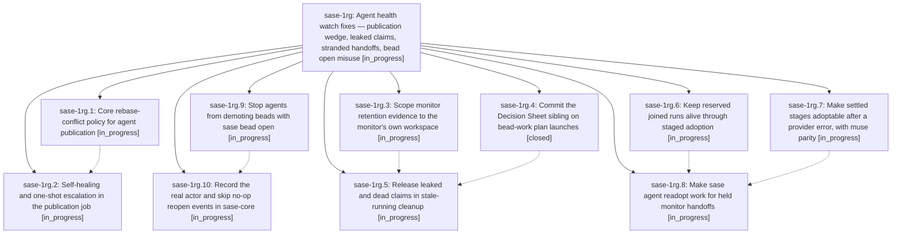

# Bead: sase-1rg — Agent health watch fixes — publication wedge, leaked claims, stranded handoffs, bead open misuse

[Bead Pages](../README.md) / sase-1rg

**Status:** ◐ in_progress · **Type:** ▸ plan · **Tier:** epic
**Owner:** `bryanbugyi34@gmail.com` · **Created by:** `bbugyi200.apollo.cp--5` · **Assignee:** `sase-1rg.land`
**Created:** 2026-11-06 05:46:48 EST
**Plan:** [202611/agent\_health\_watch\_fixes.md](https://github.com/sase-org/sase--plans/blob/main/202611/agent_health_watch_fixes.md)

## Description

Agent publication heals itself from conflicts on regenerable index pages and escalates once otherwise; finished monitors and failed staged handoffs stop leaking workspace claims and can be re-adopted; agents can no longer demote their own beads by running `sase bead open` to view them.

## Phases

| Bead | Title | Status | Size | Created | Agents | Commits |
|---|---|---|---|---|---:|---:|
| [sase-1rg.1](sase-1rg.1.md) | Core rebase-conflict policy for agent publication | ◐ in_progress | small | 2026-11-06 | 1 | 0 |
| [sase-1rg.10](sase-1rg.10.md) | Record the real actor and skip no-op reopen events in sase-core | ◐ in_progress | medium | 2026-11-06 | 1 | 0 |
| [sase-1rg.2](sase-1rg.2.md) | Self-healing and one-shot escalation in the publication job | ◐ in_progress | medium | 2026-11-06 | 1 | 0 |
| [sase-1rg.3](sase-1rg.3.md) | Scope monitor retention evidence to the monitor's own workspace | ◐ in_progress | medium | 2026-11-06 | 1 | 0 |
| [sase-1rg.4](sase-1rg.4.md) | Commit the Decision Sheet sibling on bead-work plan launches | ✓ closed | small | 2026-11-06 | 1 | 1 |
| [sase-1rg.5](sase-1rg.5.md) | Release leaked and dead claims in stale-running cleanup | ◐ in_progress | medium | 2026-11-06 | 1 | 0 |
| [sase-1rg.6](sase-1rg.6.md) | Keep reserved joined runs alive through staged adoption | ◐ in_progress | medium | 2026-11-06 | 1 | 0 |
| [sase-1rg.7](sase-1rg.7.md) | Make settled stages adoptable after a provider error, with muse parity | ◐ in_progress | medium | 2026-11-06 | 1 | 0 |
| [sase-1rg.8](sase-1rg.8.md) | Make sase agent readopt work for held monitor handoffs | ◐ in_progress | medium | 2026-11-06 | 1 | 0 |
| [sase-1rg.9](sase-1rg.9.md) | Stop agents from demoting beads with sase bead open | ◐ in_progress | small | 2026-11-06 | 1 | 0 |

## Lineage

## Agents

| Agent | Bead | Commits |
|---|---|---:|
| [bbugyi200.athena.sase-1rg.1](https://github.com/sase-org/sase--agents/blob/main/agents/bbugyi200.athena.sase-1rg.1/README.md) | [sase-1rg.1](sase-1rg.1.md) | 0 |
| [bbugyi200.athena.sase-1rg.10](https://github.com/sase-org/sase--agents/blob/main/agents/bbugyi200.athena.sase-1rg.10/README.md) | [sase-1rg.10](sase-1rg.10.md) | 0 |
| [bbugyi200.athena.sase-1rg.2](https://github.com/sase-org/sase--agents/blob/main/agents/bbugyi200.athena.sase-1rg.2/README.md) | [sase-1rg.2](sase-1rg.2.md) | 0 |
| [bbugyi200.athena.sase-1rg.3](https://github.com/sase-org/sase--agents/blob/main/agents/bbugyi200.athena.sase-1rg.3/README.md) | [sase-1rg.3](sase-1rg.3.md) | 0 |
| [bbugyi200.athena.sase-1rg.4](https://github.com/sase-org/sase--agents/blob/main/agents/bbugyi200.athena.sase-1rg.4/README.md) | [sase-1rg.4](sase-1rg.4.md) | 1 |
| [bbugyi200.athena.sase-1rg.5](https://github.com/sase-org/sase--agents/blob/main/agents/bbugyi200.athena.sase-1rg.5/README.md) | [sase-1rg.5](sase-1rg.5.md) | 0 |
| [bbugyi200.athena.sase-1rg.6](https://github.com/sase-org/sase--agents/blob/main/agents/bbugyi200.athena.sase-1rg.6/README.md) | [sase-1rg.6](sase-1rg.6.md) | 0 |
| [bbugyi200.athena.sase-1rg.7](https://github.com/sase-org/sase--agents/blob/main/sessions/bbugyi200.athena.sase-1rg.7.md) | [sase-1rg.7](sase-1rg.7.md) | 0 |
| [bbugyi200.athena.sase-1rg.8](https://github.com/sase-org/sase--agents/blob/main/agents/bbugyi200.athena.sase-1rg.8/README.md) | [sase-1rg.8](sase-1rg.8.md) | 0 |
| [bbugyi200.athena.sase-1rg.9](https://github.com/sase-org/sase--agents/blob/main/agents/bbugyi200.athena.sase-1rg.9/README.md) | [sase-1rg.9](sase-1rg.9.md) | 0 |
| [bbugyi200.athena.sase-1rg.land](https://github.com/sase-org/sase--agents/blob/main/agents/bbugyi200.athena.sase-1rg.land/README.md) | [sase-1rg](README.md) | 0 |

## Commits

| Repo | Commit | Subject | Bead | Committed |
|---|---|---|---|---|
| sase | [`85082c7`](https://github.com/sase-org/sase/commit/85082c7da865d555c24ae1ce8c5d4f7e86c940c2) | fix(bead): commit decision sheets on plan launches | [sase-1rg.4](sase-1rg.4.md) | 2026-11-06 07:11:37 EST |
