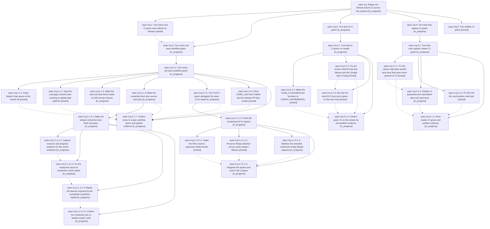

# Bead: sase-1rq — Repair red GitHub Actions CI across five projects

[Bead Pages](../README.md) / sase-1rq

**Status:** ◐ in_progress · **Type:** ▸ plan · **Tier:** epic
**Owner:** `bryanbugyi34@gmail.com` · **Created by:** [bbugyi200.athena.19h](https://github.com/sase-org/sase--agents/blob/main/sessions/bbugyi200.athena.19h.md) · **Assignee:** `sase-1rq.land`
**Created:** 2026-11-07 07:46:42 EST
**Plan:** [202611/red\_ci\_repair.md](https://github.com/sase-org/sase--plans/blob/main/202611/red_ci_repair.md)

<!-- sase:links:start -->

## Links

| Relation | Artifact | Why |
| --- | --- | --- |
| implemented-by | [plan:202611/red_ci_repair.md][1] | derived from the plan's `bead_id:` frontmatter field |

[1]: https://github.com/sase-org/sase--plans/blob/main/202611/red_ci_repair.md

<!-- sase:links:end -->

## Description

Every project whose GitHub Actions CI went red in the ~12 hours before 2026-11-07 07:30 EST (sase-core, sase, bob-cli, bob-mac-capture, dotfiles) is green at its default-branch tip, with machine-readable green evidence attached to the phase's final turn, or, after a very large and well-documented effort, carries a research-sidecar report that tells Bryan exactly what is still needed to finish.

## Phases

| Bead | Title | Status | Size | Created | Agents | Commits |
|---|---|---|---|---|---:|---:|
| [sase-1rq.1](sase-1rq.1.md) | Turn sase-core CI green and unblock its release | ✓ closed | xlarge | 2026-11-07 | 1 | 1 |
| [sase-1rq.2](sase-1rq.2.md) | Turn every red sase workflow green | ◐ in_progress | xlarge | 2026-11-07 | 1 | 0 |
| [sase-1rq.3](sase-1rq.3.md) | Turn bob-cli CI green | ◐ in_progress | xlarge | 2026-11-07 | 1 | 0 |
| [sase-1rq.4](sase-1rq.4.md) | Turn bob-mac-capture CI green | ◐ in_progress | xlarge | 2026-11-07 | 1 | 0 |
| [sase-1rq.5](sase-1rq.5.md) | Turn dotfiles CI green | ✓ closed | xlarge | 2026-11-07 | 1 | 0 |

## Lineage

## Agents

| Agent | Bead | Commits |
|---|---|---:|
| [bbugyi200.athena.sase-1rq.1](https://github.com/sase-org/sase--agents/blob/main/sessions/bbugyi200.athena.sase-1rq.1.md) | [sase-1rq.1](sase-1rq.1.md) | 1 |
| [bbugyi200.athena.sase-1rq.2](https://github.com/sase-org/sase--agents/blob/main/sessions/bbugyi200.athena.sase-1rq.2.md) | [sase-1rq.2](sase-1rq.2.md) | 0 |
| [bbugyi200.athena.sase-1rq.2.1.1](https://github.com/sase-org/sase--agents/blob/main/sessions/bbugyi200.athena.sase-1rq.2.1.1.md) | [sase-1rq.2.1.1](sase-1rq.2.1.1.md) | 1 |
| [bbugyi200.athena.sase-1rq.2.1.2](https://github.com/sase-org/sase--agents/blob/main/sessions/bbugyi200.athena.sase-1rq.2.1.2.md) | [sase-1rq.2.1.2](sase-1rq.2.1.2.md) | 1 |
| [bbugyi200.athena.sase-1rq.2.1.3](https://github.com/sase-org/sase--agents/blob/main/sessions/bbugyi200.athena.sase-1rq.2.1.3.md) | [sase-1rq.2.1.3](sase-1rq.2.1.3.md) | 0 |
| [bbugyi200.athena.sase-1rq.2.1.4](https://github.com/sase-org/sase--agents/blob/main/sessions/bbugyi200.athena.sase-1rq.2.1.4.md) | [sase-1rq.2.1.4](sase-1rq.2.1.4.md) | 0 |
| [bbugyi200.athena.sase-1rq.2.1.4.1.1](https://github.com/sase-org/sase--agents/blob/main/sessions/bbugyi200.athena.sase-1rq.2.1.4.1.1.md) | [sase-1rq.2.1.4.1.1](sase-1rq.2.1.4.1.1.md) | 1 |
| [bbugyi200.athena.sase-1rq.2.1.4.1.2](https://github.com/sase-org/sase--agents/blob/main/agents/bbugyi200.athena.sase-1rq.2.1.4.1.2/README.md) | [sase-1rq.2.1.4.1.2](sase-1rq.2.1.4.1.2.md) | 0 |
| [bbugyi200.athena.sase-1rq.2.1.4.1.3](https://github.com/sase-org/sase--agents/blob/main/agents/bbugyi200.athena.sase-1rq.2.1.4.1.3/README.md) | [sase-1rq.2.1.4.1.3](sase-1rq.2.1.4.1.3.md) | 0 |
| [bbugyi200.athena.sase-1rq.2.1.4.1.4](https://github.com/sase-org/sase--agents/blob/main/agents/bbugyi200.athena.sase-1rq.2.1.4.1.4/README.md) | [sase-1rq.2.1.4.1.4](sase-1rq.2.1.4.1.4.md) | 0 |
| [bbugyi200.athena.sase-1rq.2.1.4.1.land](https://github.com/sase-org/sase--agents/blob/main/agents/bbugyi200.athena.sase-1rq.2.1.4.1.land/README.md) | [sase-1rq.2.1.4.1](sase-1rq.2.1.4.1.md) | 0 |
| [bbugyi200.athena.sase-1rq.2.1.5](https://github.com/sase-org/sase--agents/blob/main/sessions/bbugyi200.athena.sase-1rq.2.1.5.md) | [sase-1rq.2.1.5](sase-1rq.2.1.5.md) | 0 |
| [bbugyi200.athena.sase-1rq.2.1.5.1.1](https://github.com/sase-org/sase--agents/blob/main/agents/bbugyi200.athena.sase-1rq.2.1.5.1.1/README.md) | [sase-1rq.2.1.5.1.1](sase-1rq.2.1.5.1.1.md) | 1 |
| [bbugyi200.athena.sase-1rq.2.1.5.1.2](https://github.com/sase-org/sase--agents/blob/main/agents/bbugyi200.athena.sase-1rq.2.1.5.1.2/README.md) | [sase-1rq.2.1.5.1.2](sase-1rq.2.1.5.1.2.md) | 1 |
| [bbugyi200.athena.sase-1rq.2.1.5.1.3](https://github.com/sase-org/sase--agents/blob/main/agents/bbugyi200.athena.sase-1rq.2.1.5.1.3/README.md) | [sase-1rq.2.1.5.1.3](sase-1rq.2.1.5.1.3.md) | 0 |
| [bbugyi200.athena.sase-1rq.2.1.5.1.4](https://github.com/sase-org/sase--agents/blob/main/agents/bbugyi200.athena.sase-1rq.2.1.5.1.4/README.md) | [sase-1rq.2.1.5.1.4](sase-1rq.2.1.5.1.4.md) | 0 |
| [bbugyi200.athena.sase-1rq.2.1.5.1.land](https://github.com/sase-org/sase--agents/blob/main/agents/bbugyi200.athena.sase-1rq.2.1.5.1.land/README.md) | [sase-1rq.2.1.5.1](sase-1rq.2.1.5.1.md) | 0 |
| [bbugyi200.athena.sase-1rq.2.1.6](https://github.com/sase-org/sase--agents/blob/main/agents/bbugyi200.athena.sase-1rq.2.1.6/README.md) | [sase-1rq.2.1.6](sase-1rq.2.1.6.md) | 0 |
| [bbugyi200.athena.sase-1rq.2.1.7](https://github.com/sase-org/sase--agents/blob/main/agents/bbugyi200.athena.sase-1rq.2.1.7/README.md) | [sase-1rq.2.1.7](sase-1rq.2.1.7.md) | 0 |
| [bbugyi200.athena.sase-1rq.2.1.land](https://github.com/sase-org/sase--agents/blob/main/agents/bbugyi200.athena.sase-1rq.2.1.land/README.md) | [sase-1rq.2.1](sase-1rq.2.1.md) | 0 |
| [bbugyi200.athena.sase-1rq.3](https://github.com/sase-org/sase--agents/blob/main/sessions/bbugyi200.athena.sase-1rq.3.md) | [sase-1rq.3](sase-1rq.3.md) | 0 |
| [bbugyi200.athena.sase-1rq.3.1.1](https://github.com/sase-org/sase--agents/blob/main/agents/bbugyi200.athena.sase-1rq.3.1.1/README.md) | [sase-1rq.3.1.1](sase-1rq.3.1.1.md) | 0 |
| [bbugyi200.athena.sase-1rq.3.1.2](https://github.com/sase-org/sase--agents/blob/main/agents/bbugyi200.athena.sase-1rq.3.1.2/README.md) | [sase-1rq.3.1.2](sase-1rq.3.1.2.md) | 0 |
| [bbugyi200.athena.sase-1rq.3.1.3](https://github.com/sase-org/sase--agents/blob/main/sessions/bbugyi200.athena.sase-1rq.3.1.3.md) | [sase-1rq.3.1.3](sase-1rq.3.1.3.md) | 0 |
| [bbugyi200.athena.sase-1rq.3.1.4](https://github.com/sase-org/sase--agents/blob/main/sessions/bbugyi200.athena.sase-1rq.3.1.4.md) | [sase-1rq.3.1.4](sase-1rq.3.1.4.md) | 0 |
| [bbugyi200.athena.sase-1rq.3.1.land](https://github.com/sase-org/sase--agents/blob/main/agents/bbugyi200.athena.sase-1rq.3.1.land/README.md) | [sase-1rq.3.1](sase-1rq.3.1.md) | 0 |
| [bbugyi200.athena.sase-1rq.4](https://github.com/sase-org/sase--agents/blob/main/sessions/bbugyi200.athena.sase-1rq.4.md) | [sase-1rq.4](sase-1rq.4.md) | 0 |
| [bbugyi200.athena.sase-1rq.4.1.1](https://github.com/sase-org/sase--agents/blob/main/sessions/bbugyi200.athena.sase-1rq.4.1.1.md) | [sase-1rq.4.1.1](sase-1rq.4.1.1.md) | 0 |
| [bbugyi200.athena.sase-1rq.4.1.2](https://github.com/sase-org/sase--agents/blob/main/sessions/bbugyi200.athena.sase-1rq.4.1.2.md) | [sase-1rq.4.1.2](sase-1rq.4.1.2.md) | 0 |
| [bbugyi200.athena.sase-1rq.4.1.3](https://github.com/sase-org/sase--agents/blob/main/agents/bbugyi200.athena.sase-1rq.4.1.3/README.md) | [sase-1rq.4.1.3](sase-1rq.4.1.3.md) | 0 |
| [bbugyi200.athena.sase-1rq.4.1.4](https://github.com/sase-org/sase--agents/blob/main/agents/bbugyi200.athena.sase-1rq.4.1.4/README.md) | [sase-1rq.4.1.4](sase-1rq.4.1.4.md) | 0 |
| [bbugyi200.athena.sase-1rq.4.1.land](https://github.com/sase-org/sase--agents/blob/main/agents/bbugyi200.athena.sase-1rq.4.1.land/README.md) | [sase-1rq.4.1](sase-1rq.4.1.md) | 0 |
| [bbugyi200.athena.sase-1rq.5](https://github.com/sase-org/sase--agents/blob/main/sessions/bbugyi200.athena.sase-1rq.5.md) | [sase-1rq.5](sase-1rq.5.md) | 0 |
| [bbugyi200.athena.sase-1rq.land](https://github.com/sase-org/sase--agents/blob/main/agents/bbugyi200.athena.sase-1rq.land/README.md) | [sase-1rq](README.md) | 0 |

## Commits

| Repo | Commit | Subject | Bead | Committed |
|---|---|---|---|---|
| sase-core | [`sase-core@dec432c`](https://github.com/sase-org/sase-core/commit/dec432cadda83cb44f4f7a0ae8d12b233c5a2764) | test(agent-artifact-run-trash): compare journal path against the canonical trash root | [sase-1rq.1](sase-1rq.1.md) | 2026-11-07 08:22:45 EST |
| sase | [`c732c6e`](https://github.com/sase-org/sase/commit/c732c6e38e7b5cc3c270a9c60acb7a800186b593) | fix(tui): keep a visible agent-list highlight on screen across resizes | [sase-1rq.2.1.1](sase-1rq.2.1.1.md) | 2026-11-07 11:45:47 EST |
| sase | [`ab6b14f`](https://github.com/sase-org/sase/commit/ab6b14fb8b7722b647725868fbd5ec1252c56424) | fix(tests): scope no-disk guards so coverage's tracer never trips them | [sase-1rq.2.1.2](sase-1rq.2.1.2.md) | 2026-11-07 11:52:26 EST |
| sase | [`f97019e`](https://github.com/sase-org/sase/commit/f97019e7e8a4f600d273462f1ebe83de41f30837) | feat(test-contention): sample soak resources and signal senders | [sase-1rq.2.1.4.1.1](sase-1rq.2.1.4.1.1.md) | 2026-11-07 12:22:13 EST |
| sase | [`da15614`](https://github.com/sase-org/sase/commit/da1561407ab03db299959ec3ab8e2a5fadafb1e3) | fix(tui): keep Files spread reserve remeasure from being swallowed | [sase-1rq.2.1.5.1.1](sase-1rq.2.1.5.1.1.md) | 2026-11-07 13:05:20 EST |
| sase | [`92fc89d`](https://github.com/sase-org/sase/commit/92fc89d83f062259857b6d8870996231ddd4315e) | fix(ace): keep a parked Main Reply through same-subject re-delivery | [sase-1rq.2.1.5.1.2](sase-1rq.2.1.5.1.2.md) | 2026-11-07 13:26:40 EST |
