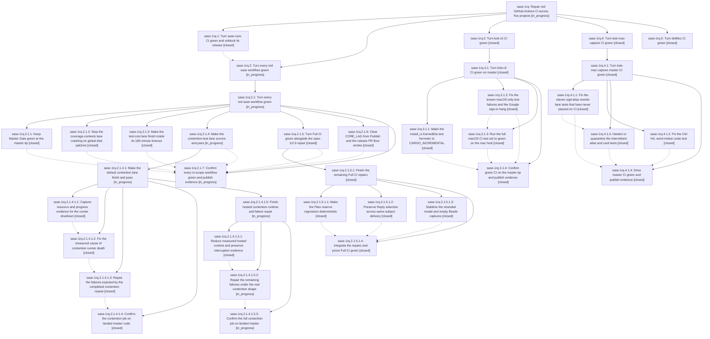

# Bead: sase-1rq — Repair red GitHub Actions CI across five projects

[Bead Pages](../README.md) / sase-1rq

**Status:** ◐ in_progress · **Type:** ▸ plan · **Tier:** epic
**Owner:** `bryanbugyi34@gmail.com` · **Created by:** [bbugyi200.athena.19h](https://github.com/sase-org/sase--agents/blob/main/sessions/bbugyi200.athena.19h.md) · **Assignee:** `sase-1rq.land`
**Created:** 2026-11-07 07:46:42 EST
**Plan:** [202611/red\_ci\_repair.md](https://github.com/sase-org/sase--plans/blob/main/202611/red_ci_repair.md)

<!-- sase:links:start -->

## Links

| Relation | Artifact | Why |
| --- | --- | --- |
| implemented-by | [plan:202611/red_ci_repair.md][1] | derived from the plan's `bead_id:` frontmatter field |

_Plus 1 automatic references — see [Referenced By](#referenced-by)._

[1]: https://github.com/sase-org/sase--plans/blob/main/202611/red_ci_repair.md

<!-- sase:links:end -->

## Description

Every project whose GitHub Actions CI went red in the ~12 hours before 2026-11-07 07:30 EST (sase-core, sase, bob-cli, bob-mac-capture, dotfiles) is green at its default-branch tip, with machine-readable green evidence attached to the phase's final turn, or, after a very large and well-documented effort, carries a research-sidecar report that tells Bryan exactly what is still needed to finish.

## Phases

| Bead | Title | Status | Size | Created | Agents | Commits |
|---|---|---|---|---|---:|---:|
| [sase-1rq.1](sase-1rq.1.md) | Turn sase-core CI green and unblock its release | ✓ closed | xlarge | 2026-11-07 | 1 | 1 |
| [sase-1rq.2](sase-1rq.2.md) | Turn every red sase workflow green | ◐ in_progress | xlarge | 2026-11-07 | 1 | 0 |
| [sase-1rq.3](sase-1rq.3.md) | Turn bob-cli CI green | ✓ closed | xlarge | 2026-11-07 | 1 | 0 |
| [sase-1rq.4](sase-1rq.4.md) | Turn bob-mac-capture CI green | ✓ closed | xlarge | 2026-11-07 | 1 | 0 |
| [sase-1rq.5](sase-1rq.5.md) | Turn dotfiles CI green | ✓ closed | xlarge | 2026-11-07 | 1 | 0 |

## Lineage

## Agents

| Agent | Bead | Commits |
|---|---|---:|
| [bbugyi200.athena.sase-1rq.1](https://github.com/sase-org/sase--agents/blob/main/sessions/bbugyi200.athena.sase-1rq.1.md) | [sase-1rq.1](sase-1rq.1.md) | 1 |
| [bbugyi200.athena.sase-1rq.2](https://github.com/sase-org/sase--agents/blob/main/sessions/bbugyi200.athena.sase-1rq.2.md) | [sase-1rq.2](sase-1rq.2.md) | 0 |
| [bbugyi200.athena.sase-1rq.2.1.1](https://github.com/sase-org/sase--agents/blob/main/sessions/bbugyi200.athena.sase-1rq.2.1.1.md) | [sase-1rq.2.1.1](sase-1rq.2.1.1.md) | 1 |
| [bbugyi200.athena.sase-1rq.2.1.2](https://github.com/sase-org/sase--agents/blob/main/sessions/bbugyi200.athena.sase-1rq.2.1.2.md) | [sase-1rq.2.1.2](sase-1rq.2.1.2.md) | 1 |
| [bbugyi200.athena.sase-1rq.2.1.3](https://github.com/sase-org/sase--agents/blob/main/sessions/bbugyi200.athena.sase-1rq.2.1.3.md) | [sase-1rq.2.1.3](sase-1rq.2.1.3.md) | 2 |
| [bbugyi200.athena.sase-1rq.2.1.4](https://github.com/sase-org/sase--agents/blob/main/sessions/bbugyi200.athena.sase-1rq.2.1.4.md) | [sase-1rq.2.1.4](sase-1rq.2.1.4.md) | 0 |
| [bbugyi200.athena.sase-1rq.2.1.4.1.1](https://github.com/sase-org/sase--agents/blob/main/sessions/bbugyi200.athena.sase-1rq.2.1.4.1.1.md) | [sase-1rq.2.1.4.1.1](sase-1rq.2.1.4.1.1.md) | 1 |
| [bbugyi200.athena.sase-1rq.2.1.4.1.2](https://github.com/sase-org/sase--agents/blob/main/sessions/bbugyi200.athena.sase-1rq.2.1.4.1.2.md) | [sase-1rq.2.1.4.1.2](sase-1rq.2.1.4.1.2.md) | 2 |
| [bbugyi200.athena.sase-1rq.2.1.4.1.3](https://github.com/sase-org/sase--agents/blob/main/sessions/bbugyi200.athena.sase-1rq.2.1.4.1.3.md) | [sase-1rq.2.1.4.1.3](sase-1rq.2.1.4.1.3.md) | 2 |
| [bbugyi200.athena.sase-1rq.2.1.4.1.4](https://github.com/sase-org/sase--agents/blob/main/sessions/bbugyi200.athena.sase-1rq.2.1.4.1.4.md) | [sase-1rq.2.1.4.1.4](sase-1rq.2.1.4.1.4.md) | 0 |
| [bbugyi200.athena.sase-1rq.2.1.4.1.5.1](https://github.com/sase-org/sase--agents/blob/main/sessions/bbugyi200.athena.sase-1rq.2.1.4.1.5.1.md) | [sase-1rq.2.1.4.1.5.1](sase-1rq.2.1.4.1.5.1.md) | 1 |
| [bbugyi200.athena.sase-1rq.2.1.4.1.5.2](https://github.com/sase-org/sase--agents/blob/main/sessions/bbugyi200.athena.sase-1rq.2.1.4.1.5.2.md) | [sase-1rq.2.1.4.1.5.2](sase-1rq.2.1.4.1.5.2.md) | 10 |
| [bbugyi200.athena.sase-1rq.2.1.4.1.5.3](https://github.com/sase-org/sase--agents/blob/main/agents/bbugyi200.athena.sase-1rq.2.1.4.1.5.3/README.md) | [sase-1rq.2.1.4.1.5.3](sase-1rq.2.1.4.1.5.3.md) | 0 |
| [bbugyi200.athena.sase-1rq.2.1.4.1.5.land](https://github.com/sase-org/sase--agents/blob/main/agents/bbugyi200.athena.sase-1rq.2.1.4.1.5.land/README.md) | [sase-1rq.2.1.4.1.5](sase-1rq.2.1.4.1.5.md) | 0 |
| [bbugyi200.athena.sase-1rq.2.1.4.1.land](https://github.com/sase-org/sase--agents/blob/main/sessions/bbugyi200.athena.sase-1rq.2.1.4.1.land.md) | [sase-1rq.2.1.4.1](sase-1rq.2.1.4.1.md) | 0 |
| [bbugyi200.athena.sase-1rq.2.1.5](https://github.com/sase-org/sase--agents/blob/main/sessions/bbugyi200.athena.sase-1rq.2.1.5.md) | [sase-1rq.2.1.5](sase-1rq.2.1.5.md) | 0 |
| [bbugyi200.athena.sase-1rq.2.1.5.1.1](https://github.com/sase-org/sase--agents/blob/main/agents/bbugyi200.athena.sase-1rq.2.1.5.1.1/README.md) | [sase-1rq.2.1.5.1.1](sase-1rq.2.1.5.1.1.md) | 1 |
| [bbugyi200.athena.sase-1rq.2.1.5.1.2](https://github.com/sase-org/sase--agents/blob/main/agents/bbugyi200.athena.sase-1rq.2.1.5.1.2/README.md) | [sase-1rq.2.1.5.1.2](sase-1rq.2.1.5.1.2.md) | 1 |
| [bbugyi200.athena.sase-1rq.2.1.5.1.3](https://github.com/sase-org/sase--agents/blob/main/agents/bbugyi200.athena.sase-1rq.2.1.5.1.3/README.md) | [sase-1rq.2.1.5.1.3](sase-1rq.2.1.5.1.3.md) | 1 |
| [bbugyi200.athena.sase-1rq.2.1.5.1.4](https://github.com/sase-org/sase--agents/blob/main/sessions/bbugyi200.athena.sase-1rq.2.1.5.1.4.md) | [sase-1rq.2.1.5.1.4](sase-1rq.2.1.5.1.4.md) | 1 |
| [bbugyi200.athena.sase-1rq.2.1.5.1.land](https://github.com/sase-org/sase--agents/blob/main/agents/bbugyi200.athena.sase-1rq.2.1.5.1.land/README.md) | [sase-1rq.2.1.5.1](sase-1rq.2.1.5.1.md) | 1 |
| [bbugyi200.athena.sase-1rq.2.1.6](https://github.com/sase-org/sase--agents/blob/main/agents/bbugyi200.athena.sase-1rq.2.1.6/README.md) | [sase-1rq.2.1.6](sase-1rq.2.1.6.md) | 0 |
| [bbugyi200.athena.sase-1rq.2.1.7](https://github.com/sase-org/sase--agents/blob/main/agents/bbugyi200.athena.sase-1rq.2.1.7/README.md) | [sase-1rq.2.1.7](sase-1rq.2.1.7.md) | 0 |
| [bbugyi200.athena.sase-1rq.2.1.land](https://github.com/sase-org/sase--agents/blob/main/agents/bbugyi200.athena.sase-1rq.2.1.land/README.md) | [sase-1rq.2.1](sase-1rq.2.1.md) | 0 |
| [bbugyi200.athena.sase-1rq.3](https://github.com/sase-org/sase--agents/blob/main/sessions/bbugyi200.athena.sase-1rq.3.md) | [sase-1rq.3](sase-1rq.3.md) | 0 |
| [bbugyi200.athena.sase-1rq.3.1.1](https://github.com/sase-org/sase--agents/blob/main/agents/bbugyi200.athena.sase-1rq.3.1.1/README.md) | [sase-1rq.3.1.1](sase-1rq.3.1.1.md) | 0 |
| [bbugyi200.athena.sase-1rq.3.1.2](https://github.com/sase-org/sase--agents/blob/main/agents/bbugyi200.athena.sase-1rq.3.1.2/README.md) | [sase-1rq.3.1.2](sase-1rq.3.1.2.md) | 0 |
| [bbugyi200.athena.sase-1rq.3.1.3](https://github.com/sase-org/sase--agents/blob/main/sessions/bbugyi200.athena.sase-1rq.3.1.3.md) | [sase-1rq.3.1.3](sase-1rq.3.1.3.md) | 0 |
| [bbugyi200.athena.sase-1rq.3.1.4](https://github.com/sase-org/sase--agents/blob/main/sessions/bbugyi200.athena.sase-1rq.3.1.4.md) | [sase-1rq.3.1.4](sase-1rq.3.1.4.md) | 0 |
| [bbugyi200.athena.sase-1rq.3.1.land](https://github.com/sase-org/sase--agents/blob/main/agents/bbugyi200.athena.sase-1rq.3.1.land/README.md) | [sase-1rq.3.1](sase-1rq.3.1.md) | 1 |
| [bbugyi200.athena.sase-1rq.4](https://github.com/sase-org/sase--agents/blob/main/sessions/bbugyi200.athena.sase-1rq.4.md) | [sase-1rq.4](sase-1rq.4.md) | 0 |
| [bbugyi200.athena.sase-1rq.4.1.1](https://github.com/sase-org/sase--agents/blob/main/sessions/bbugyi200.athena.sase-1rq.4.1.1.md) | [sase-1rq.4.1.1](sase-1rq.4.1.1.md) | 0 |
| [bbugyi200.athena.sase-1rq.4.1.2](https://github.com/sase-org/sase--agents/blob/main/sessions/bbugyi200.athena.sase-1rq.4.1.2.md) | [sase-1rq.4.1.2](sase-1rq.4.1.2.md) | 0 |
| [bbugyi200.athena.sase-1rq.4.1.3](https://github.com/sase-org/sase--agents/blob/main/sessions/bbugyi200.athena.sase-1rq.4.1.3.md) | [sase-1rq.4.1.3](sase-1rq.4.1.3.md) | 0 |
| [bbugyi200.athena.sase-1rq.4.1.4](https://github.com/sase-org/sase--agents/blob/main/agents/bbugyi200.athena.sase-1rq.4.1.4/README.md) | [sase-1rq.4.1.4](sase-1rq.4.1.4.md) | 0 |
| [bbugyi200.athena.sase-1rq.4.1.land](https://github.com/sase-org/sase--agents/blob/main/agents/bbugyi200.athena.sase-1rq.4.1.land/README.md) | [sase-1rq.4.1](sase-1rq.4.1.md) | 1 |
| [bbugyi200.athena.sase-1rq.5](https://github.com/sase-org/sase--agents/blob/main/sessions/bbugyi200.athena.sase-1rq.5.md) | [sase-1rq.5](sase-1rq.5.md) | 0 |
| [bbugyi200.athena.sase-1rq.land](https://github.com/sase-org/sase--agents/blob/main/agents/bbugyi200.athena.sase-1rq.land/README.md) | [sase-1rq](README.md) | 0 |

## Commits

| Repo | Commit | Subject | Bead | Committed |
|---|---|---|---|---|
| sase-core | [`sase-core@dec432c`](https://github.com/sase-org/sase-core/commit/dec432cadda83cb44f4f7a0ae8d12b233c5a2764) | test(agent-artifact-run-trash): compare journal path against the canonical trash root | [sase-1rq.1](sase-1rq.1.md) | 2026-11-07 08:22:45 EST |
| sase | [`c732c6e`](https://github.com/sase-org/sase/commit/c732c6e38e7b5cc3c270a9c60acb7a800186b593) | fix(tui): keep a visible agent-list highlight on screen across resizes | [sase-1rq.2.1.1](sase-1rq.2.1.1.md) | 2026-11-07 11:45:47 EST |
| sase | [`ab6b14f`](https://github.com/sase-org/sase/commit/ab6b14fb8b7722b647725868fbd5ec1252c56424) | fix(tests): scope no-disk guards so coverage's tracer never trips them | [sase-1rq.2.1.2](sase-1rq.2.1.2.md) | 2026-11-07 11:52:26 EST |
| sase | [`f97019e`](https://github.com/sase-org/sase/commit/f97019e7e8a4f600d273462f1ebe83de41f30837) | feat(test-contention): sample soak resources and signal senders | [sase-1rq.2.1.4.1.1](sase-1rq.2.1.4.1.1.md) | 2026-11-07 12:22:13 EST |
| sase | [`da15614`](https://github.com/sase-org/sase/commit/da1561407ab03db299959ec3ab8e2a5fadafb1e3) | fix(tui): keep Files spread reserve remeasure from being swallowed | [sase-1rq.2.1.5.1.1](sase-1rq.2.1.5.1.1.md) | 2026-11-07 13:05:20 EST |
| sase | [`92fc89d`](https://github.com/sase-org/sase/commit/92fc89d83f062259857b6d8870996231ddd4315e) | fix(ace): keep a parked Main Reply through same-subject re-delivery | [sase-1rq.2.1.5.1.2](sase-1rq.2.1.5.1.2.md) | 2026-11-07 13:26:40 EST |
| sase | [`578a317`](https://github.com/sase-org/sase/commit/578a317bcf98a383fbd6adf2d96a1f1e4bae2648) | perf(tests): cut test-cost leak-detector overhead about 3x without weakening the gate | [sase-1rq.2.1.3](sase-1rq.2.1.3.md) | 2026-11-07 13:54:35 EST |
| sase--plans | [`sase--plans@297269c`](https://github.com/sase-org/sase--plans/commit/297269cccdd62f5c6570bcdd8a468b293cffc435) | docs(plans): mark bob-cli CI repair epic complete | [sase-1rq.3.1](sase-1rq.3.1.md) | 2026-11-07 14:09:08 EST |
| sase | [`960646e`](https://github.com/sase-org/sase/commit/960646e8cea50f80a19a08199be044fbfe55bf03) | fix(tui): stabilize the stranded modal and empty Beads PNG captures | [sase-1rq.2.1.5.1.3](sase-1rq.2.1.5.1.3.md) | 2026-11-07 14:43:39 EST |
| sase--plans | [`sase--plans@4c2dfdb`](https://github.com/sase-org/sase--plans/commit/4c2dfdb5c1f1af380f1751b514470c823e6ba285) | docs(plan): complete bob-mac-capture CI epic sase-1rq.4.1 | [sase-1rq.4.1](sase-1rq.4.1.md) | 2026-11-07 15:12:12 EST |
| sase | [`618dbb5`](https://github.com/sase-org/sase/commit/618dbb5fcfe3a37c336056c4c44af877f97edd70) | fix(test-contention): shard whole-suite collection so 26 workers survive a 16 GB runner | [sase-1rq.2.1.4.1.2](sase-1rq.2.1.4.1.2.md) | 2026-11-07 15:16:52 EST |
| sase | [`dd5567e`](https://github.com/sase-org/sase/commit/dd5567e5801095c709f7145dd7d6cdfe2a7d8673) | fix(ci): land the AGENT PROMPT golden repair and capacity hostname pin | [sase-1rq.2.1.5.1.4](sase-1rq.2.1.5.1.4.md) | 2026-11-07 16:07:57 EST |
| sase | [`8668755`](https://github.com/sase-org/sase/commit/8668755b3534f6d0065b1ccb3bc8461d96be26b2) | fix(tests): stop cross-test global leaks the full test-cost gate found | [sase-1rq.2.1.3](sase-1rq.2.1.3.md) | 2026-11-07 16:58:12 EST |
| sase | [`291265f`](https://github.com/sase-org/sase/commit/291265f08a56fd3db5f224d1823568e0c8d0adde) | perf(flags): stream the feature-flag checker's AST parse so the contention soak keeps its memory headroom | [sase-1rq.2.1.4.1.2](sase-1rq.2.1.4.1.2.md) | 2026-11-07 17:13:01 EST |
| sase--plans | [`sase--plans@82c7e7b`](https://github.com/sase-org/sase--plans/commit/82c7e7b704786152a6e815e3b58651e1346f2823) | chore(plans): mark Full CI repair epic complete | [sase-1rq.2.1.5.1](sase-1rq.2.1.5.1.md) | 2026-11-07 18:40:51 EST |
| sase | [`4a7ce0f`](https://github.com/sase-org/sase/commit/4a7ce0f3302c558a595c5c907c1e9c0a01864d74) | fix(tests): repair the 94 failures the completed contention repeat exposed | [sase-1rq.2.1.4.1.3](sase-1rq.2.1.4.1.3.md) | 2026-11-07 19:01:16 EST |
| sase | [`539afb2`](https://github.com/sase-org/sase/commit/539afb211e381bd3b1d708baa19eefc649132aa7) | fix(tests): repair the 8 failures the full contention repeat left | [sase-1rq.2.1.4.1.3](sase-1rq.2.1.4.1.3.md) | 2026-11-07 21:09:01 EST |
| sase | [`ea5c1f0`](https://github.com/sase-org/sase/commit/ea5c1f0561791105710dca52dbb375a1c547b9f9) | perf(contention): single-scan markdown guards and interruption-evidence diagnostics | [sase-1rq.2.1.4.1.5.1](sase-1rq.2.1.4.1.5.1.md) | 2026-11-08 02:25:28 EST |
| sase | [`dde1ada`](https://github.com/sase-org/sase/commit/dde1ada139e5698b8723b2166fab97d65d3d0f7c) | fix(test): isolate contention hang guards and nested soak records | [sase-1rq.2.1.4.1.5.2](sase-1rq.2.1.4.1.5.2.md) | 2026-11-08 04:31:55 EST |
| sase | [`2400e61`](https://github.com/sase-org/sase/commit/2400e61e938c0535ca3de61e83f63f698c8b25c2) | fix(test): keep contended TUI waits off the event loop | [sase-1rq.2.1.4.1.5.2](sase-1rq.2.1.4.1.5.2.md) | 2026-11-08 06:12:38 EST |
| sase | [`229f85a`](https://github.com/sase-org/sase/commit/229f85a998cb8fade8a4331f3ac4877b5104adf9) | fix(test): keep contended subprocess waits load-tolerant | [sase-1rq.2.1.4.1.5.2](sase-1rq.2.1.4.1.5.2.md) | 2026-11-08 08:33:25 EST |
| sase | [`6a6cc2b`](https://github.com/sase-org/sase/commit/6a6cc2b4268eb6c14f70d20f58d1a5e3cbc43580) | fix(test): keep contended nested and TUI waits load-tolerant | [sase-1rq.2.1.4.1.5.2](sase-1rq.2.1.4.1.5.2.md) | 2026-11-08 10:36:05 EST |
| sase | [`11de7c8`](https://github.com/sase-org/sase/commit/11de7c8591e506af66ae7029480e0e64a86011a0) | fix(test): bound TUI settle and zsh PTY waits under contention | [sase-1rq.2.1.4.1.5.2](sase-1rq.2.1.4.1.5.2.md) | 2026-11-08 12:40:57 EST |
| sase | [`8f82a88`](https://github.com/sase-org/sase/commit/8f82a88607750ed1c87156b0656220b30a96b19d) | fix(test): pin post-update toast timeout under contention | [sase-1rq.2.1.4.1.5.2](sase-1rq.2.1.4.1.5.2.md) | 2026-11-08 14:20:39 EST |
| sase | [`7190490`](https://github.com/sase-org/sase/commit/719049003053750ddf089d7eab53af5eee6a294c) | fix(tui): keep stitches first-paint coverage exact under contention | [sase-1rq.2.1.4.1.5.2](sase-1rq.2.1.4.1.5.2.md) | 2026-11-08 16:08:03 EST |
| sase | [`9c4cebe`](https://github.com/sase-org/sase/commit/9c4cebea9820b5917f9027f70aa2a0409edb6ba9) | fix: stabilize bump microbench and provider timer under contention | [sase-1rq.2.1.4.1.5.2](sase-1rq.2.1.4.1.5.2.md) | 2026-11-08 18:06:48 EST |
| sase | [`d1c6a2c`](https://github.com/sase-org/sase/commit/d1c6a2c10b3473020df6831b71d2d21096156a9f) | fix: skip same-key highlight echo and wait for group-kill reaping under contention | [sase-1rq.2.1.4.1.5.2](sase-1rq.2.1.4.1.5.2.md) | 2026-11-08 21:09:04 EST |
| sase | [`7a7ecd6`](https://github.com/sase-org/sase/commit/7a7ecd6885b32ea969d462881673e96d776a37d1) | fix(tui): return archive pulse Enter to inbox and drop paused stalls | [sase-1rq.2.1.4.1.5.2](sase-1rq.2.1.4.1.5.2.md) | 2026-11-09 00:09:40 EST |

<!-- sase:referenced-by:start -->

## Referenced By

| Relation | Artifact | Why | Uses |
| --- | --- | --- | ---: |
| read-by | [agent:sase-1rq.4.1.land][1] | Need containing epic decisions and causal scope for the two follow-ups | 1 |

[1]: https://github.com/sase-org/sase--agents/blob/main/agents/bbugyi200.athena.sase-1rq.4.1.land/README.md

<!-- sase:referenced-by:end -->
